::part[Learn the Concept]{n="1"}

## 🎯 What you'll learn

- Deployment options: **Vercel**, other platforms, **Docker** on a VPS/AWS, static export — and what each supports
- Environments (development, preview, staging, production) and their variables
- Build-time vs runtime variables (`NEXT_PUBLIC_` is baked in at build)
- **Validating configuration** at startup without leaking secrets
- `output: "standalone"` and a **multi-stage, non-root Dockerfile**
- **Health checks**, logs, and graceful operation behind a load balancer
- CI/CD: checks → build → deploy, **preview deployments**, **rollbacks**
- Connecting the frontend to the Flask API securely (CORS, cookies, domains)

## 🧠 The big idea

Deploying is like **opening a restaurant branch**. Your recipes (code) are the same everywhere, but each branch has its own supplier contacts and keys (environment variables). You don't open the doors until the kitchen passes an inspection (health check), and if the new menu makes people sick you switch back to the old one immediately (rollback).

A **Docker image** is the branch **kit**: the same sealed box runs in staging and production — only the configuration differs.

## ❓ Why does this exist?

`npm run dev` on your laptop isn't a product. Production needs: an optimized build, HTTPS, the right API URL and secrets per environment, automatic restarts, logs, zero-downtime updates, and a way to undo a bad release in minutes.

## 💥 What happens if we DON'T?

- `NEXT_PUBLIC_API_URL` set only at runtime → the browser bundle still contains `undefined` (it was inlined at build).
- A missing `SESSION_SECRET` in production → every login throws 500s at 2 a.m.; or the error message prints the secret into logs.
- A 1.5 GB image running as root with dev dependencies and `.env` files copied in.
- No health check → the load balancer sends traffic to a container that's still starting.
- Deploys straight from a laptop, no record of what's running, no rollback.

## 📖 How it works, step by step

### 1. Where to deploy

| Option | Good for | Notes |
|---|---|---|
| **Vercel** | fastest start, previews per PR, edge/CDN built in | made by the Next.js team; free hobby tier; costs grow with usage |
| Netlify, Cloudflare, Render, Railway, Fly.io | similar managed experience | check support for newer Next.js features on each platform |
| **Docker** (VPS, AWS ECS/App Runner, Google Cloud Run, Kubernetes) | control, same infra as your Flask API, predictable costs | you manage scaling, CDN, TLS (Module 5) |
| Static export (`output: "export"`) | marketing sites, no server features | no Server Actions, cookies, proxy, dynamic rendering |

Next.js supports self-hosting with `next start` or Docker, including caching features; a CDN in front for static assets is still recommended.

### 2. Environments and variables

| Variable | Where it's read | When it's fixed | Secret? |
|---|---|---|---|
| `API_URL=http://api:5091` | server only | runtime | no (internal) |
| `SESSION_SECRET` | server only | runtime | **yes** |
| `NEXT_PUBLIC_APP_URL` | server **and** browser | **build time** (inlined) | never |

- Keep secrets in the platform's secret store (Vercel env vars, AWS Secrets Manager/SSM, GitHub Actions secrets) — never in the image or Git.
- One Docker image promoted from staging to production only works if **public** values don't differ, or are provided at runtime through a server-rendered config instead of `NEXT_PUBLIC_`.

### 3. Validate config at startup

```ts
// lib/env.ts
import { z } from "zod";

const serverEnvSchema = z.object({
  API_URL: z.url(),
  SESSION_SECRET: z.string().min(32),
  NEXT_PUBLIC_APP_URL: z.url(),
});

export function parseServerEnv(source = process.env) {
  const result = serverEnvSchema.safeParse(source);
  if (!result.success) {
    const names = [...new Set(result.error.issues.map((i) => String(i.path[0])))].sort();
    throw new Error(`Invalid environment variables: ${names.join(", ")}`);   // names, never values
  }
  return result.data;
}

export const env = parseServerEnv();
```

Call it from `instrumentation.ts` (runs once when the server starts) or import `env` in server modules so a misconfigured deploy **fails immediately** instead of on the first user request.

### 4. Standalone output

```ts
// next.config.ts
const nextConfig: NextConfig = { output: "standalone" };
```

`next build` creates `.next/standalone` with `server.js` and only the traced dependencies. Copy `public` and `.next/static` next to it (or serve them from a CDN).

### 5. A production Dockerfile

```dockerfile
# syntax=docker/dockerfile:1
FROM node:24-alpine AS deps
WORKDIR /app
COPY package.json package-lock.json ./
RUN npm ci

FROM node:24-alpine AS builder
WORKDIR /app
COPY --from=deps /app/node_modules ./node_modules
COPY . .
ENV NEXT_TELEMETRY_DISABLED=1
RUN npm run build

FROM node:24-alpine AS runner
WORKDIR /app
ENV NODE_ENV=production NEXT_TELEMETRY_DISABLED=1 PORT=3091 HOSTNAME=0.0.0.0
COPY --from=builder --chown=node:node /app/.next/standalone ./
COPY --from=builder --chown=node:node /app/.next/static ./.next/static
COPY --from=builder --chown=node:node /app/public ./public
USER node
EXPOSE 3091
HEALTHCHECK --interval=30s --timeout=3s --start-period=10s --retries=3 \
  CMD node -e "fetch('http://127.0.0.1:3091/api/health').then(r => process.exit(r.ok ? 0 : 1)).catch(() => process.exit(1))"
CMD ["node", "server.js"]
```

| Choice | Why |
|---|---|
| Three stages | build tools and full `node_modules` never reach the runtime image |
| Copy `package*.json` before code | `npm ci` layer is cached until dependencies change |
| `node:24-alpine` pinned (optionally by digest) | reproducible, small; Node 24 is an LTS line |
| `USER node` | not root inside the container |
| `HOSTNAME=0.0.0.0` | listen on all interfaces so the container port is reachable |
| exec-form `CMD` | Node receives `SIGTERM` directly for graceful shutdown |
| `.dockerignore` with `node_modules`, `.next`, `.git`, `.env*` | faster builds; secrets never copied |

The same pattern as your Flask image in Module 2 W6 — now both services can run side by side in `docker compose` (Postgres 5491, Flask 5091, Next.js 3091).

### 6. Health checks

```ts
// app/api/health/route.ts
export async function GET() {
  return Response.json({ status: "ok", version: process.env.APP_VERSION ?? "dev" }, { headers: { "Cache-Control": "no-store" } });
}
```

- **Liveness** ("is the process alive?") — cheap, no dependencies.
- **Readiness** ("can it serve traffic?") — may check that the Flask API responds; don't make liveness depend on other services or one API hiccup restarts every frontend container.
- Never include secrets or detailed internals in health responses.

### 7. CI/CD

```mermaid
flowchart LR
    PR[Pull request] --> Q[quality: lint, typecheck, unit/component tests]
    Q --> E[e2e: build + Playwright]
    E --> P[preview deploy per PR]
    P --> Review[code review + QA on preview URL]
    Review --> Main[merge to main]
    Main --> B[build image tagged with git SHA]
    B --> S[deploy staging + smoke E2E]
    S --> Prod[deploy production]
    Prod --> Mon[monitor errors + Web Vitals]
    Mon -->|bad| RB[rollback to previous image/deployment]
```



- Tag images with the **commit SHA** (`careerpilot-web:3f2c1ab`), not only `latest` — rollback = redeploy the previous tag.
- Vercel and similar platforms create **preview deployments** for every PR and allow **instant rollback** to a previous deployment.
- Run database migrations for the API **before** deploying frontend code that needs them, and keep changes backward compatible (expand → migrate → contract).

### 8. Frontend ↔ API in production

- Same site (e.g. `app.careerpilot.id` and `api.careerpilot.id`) keeps `sameSite: "lax"` cookies simple.
- With the BFF pattern (W5 L5) the browser only talks to the Next.js origin; the Next.js server calls Flask over a private network → **no CORS** needed for the browser.
- If the browser calls Flask directly, configure CORS on Flask with an explicit origin allow-list — never `*` with credentials.
- Security headers (`Content-Security-Policy`, `Strict-Transport-Security`, `X-Content-Type-Options`) via `headers()` in `next.config.ts` or the proxy/CDN.

## ⚖️ Trade-offs

| | ✅ | ❌ |
|---|---|---|
| Vercel | zero-config, previews, CDN, rollbacks | vendor lock-in for some features, usage-based costs, less infra control |
| Docker self-hosting | portable, same pipeline as backend, cost control | you operate scaling, TLS, CDN, logs, zero-downtime deploys |
| Build per environment | `NEXT_PUBLIC_` values can differ | more builds; "tested image ≠ deployed image" |
| One image promoted | exactly what you tested ships | public config must be runtime-provided |

## ✅ When to use it / 🚫 When NOT to use it

- ✅ Vercel (or similar) for portfolios, prototypes and teams without platform engineers.
- ✅ Docker when the company runs its own infrastructure (AWS, Kubernetes) or you need the frontend next to private APIs.
- 🚫 Don't use static export for an app with auth, Server Actions or per-user pages.
- 🚫 Don't deploy from a laptop to production.

## 🏆 Best practices

- [ ] Validate environment variables at startup; error messages name variables, never values.
- [ ] Secrets only in the platform's secret store; nothing secret in `NEXT_PUBLIC_*`, `ARG` or `ENV` in the Dockerfile.
- [ ] Multi-stage, non-root, pinned-base images with a `.dockerignore`.
- [ ] Liveness/readiness endpoints with `Cache-Control: no-store`.
- [ ] CI gates: lint, typecheck, tests, E2E, build — before any deploy.
- [ ] Preview deployments per PR; staging smoke tests; immutable image tags; one-command rollback.
- [ ] Pin GitHub Actions to commit SHAs; least-privilege `permissions`.
- [ ] Structured logs to stdout; error tracking (e.g. Sentry) with source maps uploaded privately.
- [ ] Security headers and HTTPS everywhere.

## 🏭 How it's used in industry

- Startups commonly deploy Next.js on Vercel; larger companies often run it in containers on AWS/GCP next to their other services, fronted by a CDN.
- Preview environments per pull request are standard practice for product review and E2E runs.
- Blue-green and canary deployments (Module 5) reduce risk further by shifting traffic gradually and rolling back automatically on error spikes.

## ⚠️ Common mistakes

- Expecting `NEXT_PUBLIC_*` changes to apply without rebuilding.
- Forgetting to copy `.next/static` and `public` into the standalone image → unstyled pages, 404 assets.
- Running `next start` without `HOSTNAME=0.0.0.0` in a container → unreachable.
- Health checks that call the database every 5 seconds from every container.
- `COPY . .` without `.dockerignore` → `.env.local` inside the image.

::part[Explain & Design]{n="2"}

## 🗣️ Explain it

Using the restaurant branch analogy, explain the difference between build-time and runtime configuration, and why `NEXT_PUBLIC_API_URL` can't be changed by editing the production server's environment.

## 📐 Design it

Design CareerPilot's production setup for the **Next.js frontend + Flask API + Postgres** on a budget: where each runs, domains, how the frontend reaches the API, where secrets live, the CI/CD pipeline, how a release is rolled back, and what's monitored.

:::quiz
Show a possible design

**Option A (simplest):** Next.js on Vercel (`app.careerpilot.id`), Flask API as a Docker container on Render/Fly.io/AWS App Runner (`api.careerpilot.id`), managed Postgres (Neon/Supabase/RDS). Next.js server calls the API over HTTPS with a service-to-user token from the session; browser only talks to `app.` (BFF) → no browser CORS.

**Option B (one cloud):** AWS — both containers on ECS Fargate behind an Application Load Balancer (path/host routing), RDS Postgres in private subnets, CloudFront in front for static assets, secrets in SSM Parameter Store/Secrets Manager injected as env vars, images in ECR tagged by git SHA.

**CI/CD (GitHub Actions, SHA-pinned):** PR → lint/typecheck/tests → Playwright against `docker compose` (Postgres 5491, API 5091, web 3091) → preview (Vercel preview or ephemeral env). Merge → build + push images → run API migrations (backward compatible) → deploy staging → smoke E2E → manual approval → production.

**Rollback:** redeploy previous image tag / Vercel "instant rollback"; database changes follow expand-migrate-contract so the previous version still works.

**Monitoring:** `/api/health` for liveness; readiness checks API reachability; structured logs → CloudWatch/Better Stack; Sentry for frontend + API errors; Web Vitals field data (lesson 07); uptime check running the login journey every 5 minutes; alerts on 5xx rate and LCP p75.
:::

### 📝 Self-review checklist

- [ ] Secrets never in images, Git or public variables
- [ ] Rollback takes minutes and works with the database
- [ ] Health and monitoring defined

::ai-review{task="design"}

::part[Toy Exercise]{n="3"}

:::exercise{path="exercises/web/m4/w6/05-deployment" ai="ai-allowed" title="Standalone build, Docker, health check and CI"}
Enable standalone output, validate environment variables without leaking values, add a health route, write a three-stage non-root Dockerfile and `.dockerignore`, and a SHA-pinned GitHub Actions workflow with quality and E2E jobs. The tests parse your Dockerfile and workflow.
:::

:::hints
- Order in the runner stage matters: `USER node` must come before `CMD`.
- `.env*` excludes `.env.example` too — add `!.env.example` **after** it.
- If you use AI, ask it why each Dockerfile line exists, and delete anything you can't explain.
:::

## ✅ Quick check

:::quiz
Your container starts but the site has no CSS and all `/_next/static` files return 404. What did you forget?

Copying `.next/static` (and `public`) into the standalone output — the standalone server doesn't include them by default.
:::

:::quiz
Why must the production image not run `npm ci` in the final stage?

It would add the full dependency tree (and npm itself) to the runtime image: bigger, slower to deploy, more vulnerabilities. The standalone output already contains only the needed modules.
:::

## 📖 Kamus (glossary)

| Term | Bahasa Indonesia |
|---|---|
| Deployment | Penerapan aplikasi ke server |
| Environment variable | Variabel lingkungan (konfigurasi) |
| Preview deployment | Deploy pratinjau per pull request |
| Health check | Pemeriksaan kesehatan layanan |
| Rollback | Kembali ke versi sebelumnya |
| Multi-stage build | Build Docker bertahap |

## 📚 Keep learning

- Next.js docs (bundled): Deploying; Self-Hosting guide; `output` config; Environment Variables guide; Production Checklist
- [Vercel docs: Deployments and rollbacks](https://vercel.com/docs/deployments)
- [Docker: Build best practices](https://docs.docker.com/build/building/best-practices/)
