::part[Learn the Concept]{n="1"}

## 🎯 What you'll learn

- Deployment options: **Vercel**, other platforms, **Docker** on a server/AWS, static export — and what each supports
- Environments (development, preview, staging, production) and their variables
- Build-time vs runtime variables (`NEXT_PUBLIC_` is baked in at build)
- **Checking configuration** at startup without leaking secrets
- `output: "standalone"` and a **multi-stage, non-root Dockerfile**
- **Health checks**, logs, and running behind a load balancer
- CI/CD: checks → build → deploy, **preview deployments**, **rollbacks**
- Connecting the frontend to the Flask API safely (CORS, cookies, domains)

## 🔤 Key words

| Word | In simple words | Bahasa Indonesia |
|---|---|---|
| **Deploy** | Put a version of your app on servers so real users can use it | Menerapkan ke server |
| **Environment** | A separate copy of the app: preview, staging (rehearsal), production (real users) | Lingkungan |
| **Environment variable** | A setting given to the app from outside the code (API URL, secret) | Variabel lingkungan |
| **Build time / runtime** | While `next build` runs / while the server is running | Saat build / saat berjalan |
| **Docker image** | A sealed package with your app and everything it needs to run | Paket aplikasi |
| **Health check** | A small URL that answers "I'm OK" so the platform knows the app works | Cek kesehatan |
| **Preview deployment** | A temporary copy of the app for one pull request | Deploy pratinjau |
| **Rollback** | Going back to the previous working version | Kembali ke versi lama |

## 🧠 The big idea

Deploying is like **opening a restaurant branch**. The recipes (code) are the same everywhere, but each branch has its own supplier contacts and keys (environment variables). You don't open the doors until the kitchen passes inspection (health check). If the new menu makes people sick, you switch back to the old menu right away (rollback).

A **Docker image** is the **branch kit**: the same sealed box runs in staging and production — only the settings differ.

## ❓ Why it matters

`npm run dev` on your laptop isn't a product. Production needs: an optimized build, HTTPS, the right API URL and secrets per environment, automatic restarts, logs, updates without downtime, and a way to undo a bad release in minutes.

What goes wrong without it:

- `NEXT_PUBLIC_API_URL` set only at runtime → the browser code still contains `undefined` (it was baked in during the build).
- `SESSION_SECRET` missing in production → every login fails with 500 at 2 a.m.; or the error message prints the secret into the logs.
- A 1.5 GB image running as root, with dev tools and `.env` files copied inside.
- No health check → the load balancer sends users to a container that's still starting.
- Deploying straight from a laptop: no record of what's running, no rollback.

## 📖 Step by step

### 1. Where to deploy

| Option | Good for | Notes |
|---|---|---|
| **Vercel** | fastest start, previews per PR, CDN built in | made by the Next.js team; free hobby tier; costs grow with usage |
| Netlify, Cloudflare, Render, Railway, Fly.io | similar managed experience | check support for newer Next.js features on each platform |
| **Docker** (VPS, AWS ECS/App Runner, Google Cloud Run, Kubernetes) | control, same setup as your Flask API, predictable costs | you manage scaling, CDN, TLS (Module 5) |
| Static export (`output: "export"`) | marketing sites, no server features | no Server Actions, cookies, proxy, dynamic rendering |

Vercel is like a **food court**: rent a stall, and electricity, cleaning and security are handled for you. Docker on your own server is like **renting a shophouse (ruko)**: more control and often cheaper at scale, but you handle everything.

Next.js can also be self-hosted with `next start` or Docker, including its caching features; a CDN in front for static files is still recommended.

### 2. Environments and variables

| Variable | Where it's read | When it's fixed | Secret? |
|---|---|---|---|
| `API_URL=http://api:5091` | server only | runtime | no (internal) |
| `SESSION_SECRET` | server only | runtime | **yes** |
| `NEXT_PUBLIC_APP_URL` | server **and** browser | **build time** (inlined) | never |

`NEXT_PUBLIC_` values are **printed into the menu** during the build: the browser gets a copy, so changing the server's settings later doesn't change menus already printed. And anyone can read the menu — so never put secrets there.

- Keep secrets in the platform's secret store (Vercel env vars, AWS Secrets Manager/SSM, GitHub Actions secrets) — never in the image or Git.
- Using one Docker image for both staging and production only works if **public** values are the same, or come at runtime from a server-rendered config instead of `NEXT_PUBLIC_`.

### 3. Check config at startup

```ts
// lib/env.ts
import { z } from "zod";

const serverEnvSchema = z.object({
  API_URL: z.url(),
  SESSION_SECRET: z.string().min(32),
  NEXT_PUBLIC_APP_URL: z.url(),
});

export function parseServerEnv(source = process.env) {
  const result = serverEnvSchema.safeParse(source);
  if (!result.success) {
    const names = [...new Set(result.error.issues.map((i) => String(i.path[0])))].sort();
    throw new Error(`Invalid environment variables: ${names.join(", ")}`);   // names, never values
  }
  return result.data;
}

export const env = parseServerEnv();
```

Like a pilot's pre-flight checklist: check everything **before** take-off, not in the air.

- Call it from `instrumentation.ts` (runs once when the server starts) or import `env` in server files, so a wrong setup **fails right away** instead of on the first user's request.
- The error lists variable **names**, never their values — logs are read by many people.

### 4. Standalone output

```ts
// next.config.ts
const nextConfig: NextConfig = { output: "standalone" };
```

`next build` creates `.next/standalone` with `server.js` and only the dependencies the app really uses. Copy `public` and `.next/static` next to it (or serve them from a CDN).

### 5. A production Dockerfile

```dockerfile
# syntax=docker/dockerfile:1
FROM node:24-alpine AS deps
WORKDIR /app
COPY package.json package-lock.json ./
RUN npm ci

FROM node:24-alpine AS builder
WORKDIR /app
COPY --from=deps /app/node_modules ./node_modules
COPY . .
ENV NEXT_TELEMETRY_DISABLED=1
RUN npm run build

FROM node:24-alpine AS runner
WORKDIR /app
ENV NODE_ENV=production NEXT_TELEMETRY_DISABLED=1 PORT=3091 HOSTNAME=0.0.0.0
COPY --from=builder --chown=node:node /app/.next/standalone ./
COPY --from=builder --chown=node:node /app/.next/static ./.next/static
COPY --from=builder --chown=node:node /app/public ./public
USER node
EXPOSE 3091
HEALTHCHECK --interval=30s --timeout=3s --start-period=10s --retries=3 \
  CMD node -e "fetch('http://127.0.0.1:3091/api/health').then(r => process.exit(r.ok ? 0 : 1)).catch(() => process.exit(1))"
CMD ["node", "server.js"]
```

A multi-stage build is like a **kitchen and a dining room**: you cook in the kitchen with all the tools (build stage), then only the finished plate goes to the table (runner stage). Knives and dirty pans stay behind.

| Choice | Why |
|---|---|
| Three stages | build tools and the full `node_modules` never reach the final image |
| Copy `package*.json` before the code | the `npm ci` step is reused from cache until dependencies change |
| `node:24-alpine` pinned (optionally by digest) | repeatable and small; Node 24 is a long-term support version |
| `USER node` | not root inside the container |
| `HOSTNAME=0.0.0.0` | listen on all network interfaces so the container port can be reached |
| exec-form `CMD` | Node receives the `SIGTERM` stop signal directly and can shut down cleanly |
| `.dockerignore` with `node_modules`, `.next`, `.git`, `.env*` | faster builds; secrets never copied |

Same pattern as your Flask image in Module 2 W6 — now both services can run side by side in `docker compose` (Postgres 5491, Flask 5091, Next.js 3091).

### 6. Health checks

```ts
// app/api/health/route.ts
export async function GET() {
  return Response.json({ status: "ok", version: process.env.APP_VERSION ?? "dev" }, { headers: { "Cache-Control": "no-store" } });
}
```

- **Liveness** ("is the process alive?") — cheap, checks nothing else. Like checking a person has a pulse.
- **Readiness** ("can it serve users now?") — may check that the Flask API responds. Like checking a staff member is at their station.
- Don't make liveness depend on other services, or one API hiccup restarts every frontend container.
- Never put secrets or internal details in health responses.

### 7. CI/CD

```mermaid
flowchart LR
    PR[Pull request] --> Q[quality: lint, typecheck, unit/component tests]
    Q --> E[e2e: build + Playwright]
    E --> P[preview deploy per PR]
    P --> Review[code review + QA on preview URL]
    Review --> Main[merge to main]
    Main --> B[build image tagged with git SHA]
    B --> S[deploy staging + smoke E2E]
    S --> Prod[deploy production]
    Prod --> Mon[monitor errors + Web Vitals]
    Mon -->|bad| RB[rollback to previous image/deployment]
```



- Tag images with the **commit SHA** (`careerpilot-web:3f2c1ab`), not only `latest`. Then rollback = deploy the previous tag again — like a numbered menu version you can reprint.
- Vercel and similar platforms create **preview deployments** for every PR and offer **instant rollback**.
- Run the API's database migrations **before** deploying frontend code that needs them, and keep changes backward compatible (expand → migrate → contract), so the old version still works if you roll back.

### 8. Frontend ↔ API in production

- Same site (e.g. `app.careerpilot.id` and `api.careerpilot.id`) keeps `sameSite: "lax"` cookies simple.
- With the BFF pattern (W5 L5), the browser only talks to the Next.js site; the Next.js server calls Flask over a private network → **no CORS** needed for the browser.
- If the browser calls Flask directly, set up CORS on Flask with an explicit list of allowed origins — never `*` with credentials.
- Add security headers (`Content-Security-Policy`, `Strict-Transport-Security`, `X-Content-Type-Options`) through `headers()` in `next.config.ts` or at the proxy/CDN.

### When to choose what

- ✅ Vercel (or similar) for portfolios, prototypes and teams without platform engineers.
- ✅ Docker when the company runs its own infrastructure (AWS, Kubernetes) or the frontend must sit next to private APIs.
- 🚫 Don't use static export for an app with login, Server Actions or per-user pages.
- 🚫 Don't deploy to production from a laptop.

## ⚠️ Common mistakes

- Expecting `NEXT_PUBLIC_*` changes to apply without rebuilding.
- Forgetting to copy `.next/static` and `public` into the standalone image → pages without CSS, 404 files.
- Running `next start` in a container without `HOSTNAME=0.0.0.0` → can't be reached.
- Health checks that hit the database every 5 seconds from every container.
- `COPY . .` without `.dockerignore` → `.env.local` ends up inside the image.

## 🏆 Best practices

- [ ] Check environment variables at startup; error messages name variables, never values.
- [ ] Secrets only in the platform's secret store; nothing secret in `NEXT_PUBLIC_*`, `ARG` or `ENV` in the Dockerfile.
- [ ] Multi-stage, non-root images with a pinned base and a `.dockerignore`.
- [ ] Liveness/readiness endpoints with `Cache-Control: no-store`.
- [ ] CI gates: lint, typecheck, tests, E2E, build — before any deploy.
- [ ] Preview deployments per PR; staging smoke tests; image tags that never change; one-command rollback.
- [ ] Pin GitHub Actions to commit SHAs; give workflows only the `permissions` they need.
- [ ] Structured logs to stdout; error tracking (e.g. Sentry) with source maps uploaded privately.
- [ ] Security headers and HTTPS everywhere.

::part[Explain & Design]{n="2"}

## 🗣️ Explain it

Using the restaurant branch analogy, explain the difference between build-time and runtime configuration, and why `NEXT_PUBLIC_API_URL` can't be changed by editing the production server's environment.

## 📐 Design it

Design CareerPilot's production setup for the **Next.js frontend + Flask API + Postgres** on a budget: where each runs, domains, how the frontend reaches the API, where secrets live, the CI/CD pipeline, how a release is rolled back, and what's monitored.

:::quiz
Show a possible design

**Option A (simplest):** Next.js on Vercel (`app.careerpilot.id`), the Flask API as a Docker container on Render/Fly.io/AWS App Runner (`api.careerpilot.id`), managed Postgres (Neon/Supabase/RDS). The Next.js server calls the API over HTTPS with the user's token from the session; the browser only talks to `app.` (BFF) → no browser CORS.

**Option B (one cloud):** AWS — both containers on ECS Fargate behind an Application Load Balancer (routing by path/host), RDS Postgres in private subnets, CloudFront in front for static files, secrets in SSM Parameter Store/Secrets Manager given to the containers as env vars, images in ECR tagged by git SHA.

**CI/CD (GitHub Actions, SHA-pinned):** PR → lint/typecheck/tests → Playwright against `docker compose` (Postgres 5491, API 5091, web 3091) → preview (Vercel preview or a temporary environment). Merge → build + push images → run API migrations (backward compatible) → deploy staging → smoke E2E → manual approval → production.

**Rollback:** deploy the previous image tag again / Vercel "instant rollback"; database changes follow expand-migrate-contract so the previous version still works.

**Monitoring:** `/api/health` for liveness; readiness checks that the API responds; structured logs → CloudWatch/Better Stack; Sentry for frontend + API errors; real-user Web Vitals (lesson 07); an uptime check running the login journey every 5 minutes; alerts on the 5xx rate and LCP p75.
:::

### 📝 Self-review checklist

- [ ] Secrets never in images, Git or public variables
- [ ] Rollback takes minutes and works with the database
- [ ] Health checks and monitoring defined

::ai-review{task="design"}

::part[Toy Exercise]{n="3"}

:::exercise{path="exercises/web/m4/w6/05-deployment" ai="ai-allowed" title="Standalone build, Docker, health check and CI"}
Enable standalone output, validate environment variables without leaking values, add a health route, write a three-stage non-root Dockerfile and `.dockerignore`, and a SHA-pinned GitHub Actions workflow with quality and E2E jobs. The tests parse your Dockerfile and workflow.
:::

:::hints
- Order in the runner stage matters: `USER node` must come before `CMD`.
- `.env*` excludes `.env.example` too — add `!.env.example` **after** it.
- If you use AI, ask it why each Dockerfile line exists, and delete anything you can't explain.
:::

## ✅ Quick check

:::quiz
Your container starts but the site has no CSS and all `/_next/static` files return 404. What did you forget?

Copying `.next/static` (and `public`) into the standalone output — the standalone server doesn't include them by default.
:::

:::quiz
Why must the production image not run `npm ci` in the final stage?

It would add the full dependency tree (and npm itself) to the final image: bigger, slower to deploy, more security holes. The standalone output already contains only the modules it needs.
:::

## 📚 Keep learning

- Next.js docs (bundled): Deploying; Self-Hosting guide; `output` config; Environment Variables guide; Production Checklist
- [Vercel docs: Deployments and rollbacks](https://vercel.com/docs/deployments)
- [Docker: Build best practices](https://docs.docker.com/build/building/best-practices/)
