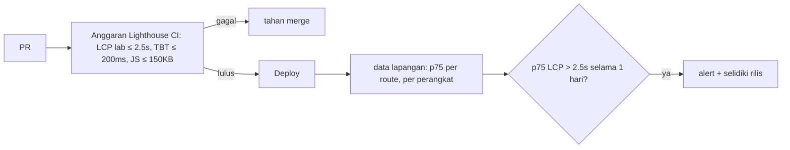

::part[Pelajari Konsepnya]{n="1"}

## 🎯 Yang akan kamu pelajari

- Tiga **Core Web Vitals**: **LCP** (loading), **INP** (responsivitas), **CLS** (stabilitas visual) — plus FCP dan TTFB
- Batas "bagus" dan kenapa Google memakai **persentil ke-75**
- **Data lab** (Lighthouse, DevTools) vs **data lapangan** (pengguna nyata, CrUX)
- Mencari penyebab tiap metrik dan perbaikan yang biasa dilakukan di aplikasi Next.js
- Melaporkan metrik pengguna nyata dengan `useReportWebVitals` dan endpoint pengumpul
- Anggaran performa dan alert

## 🔤 Istilah penting

| Istilah | Artinya (sederhana) |
|---|---|
| **Core Web Vitals** | Tiga angka utama dari Google tentang bagaimana halaman terasa bagi pengguna |
| **LCP** | Berapa lama sampai elemen terbesar di layar muncul |
| **INP** | Berapa lama halaman bereaksi setelah klik, tap, atau tekan tombol |
| **CLS** | Seberapa banyak elemen melompat-lompat di halaman |
| **Lab data** | Diukur lewat uji coba di satu perangkat simulasi |
| **Field data** | Diukur dari pengguna nyata di perangkat mereka sendiri |
| **p75 (persentil ke-75)** | Nilai di mana 3 dari 4 kunjungan sama atau lebih baik |
| **RUM** | Real User Monitoring: mengumpulkan metrik dari kunjungan nyata |

## 🧠 Ide besarnya

Bayangkan menilai **layanan pesan antar** (seperti pesan makanan online):

- **LCP** — berapa lama sampai paket utama tiba (elemen terbesar di layar)
- **INP** — saat kamu memencet bel, berapa lama sampai ada yang menjawab (setiap interaksi; yang lambat ikut dihitung)
- **CLS** — apakah kurirnya terus memindahkan paket saat kamu mau mengambilnya (layout melompat)

Dan kamu tidak menilai dari satu pengiriman di hari cerah (laptopmu di Lighthouse). Kamu melihat **sebagian besar pengiriman** ke pelanggan nyata — 3 dari 4 harus bagus (p75).

## ❓ Kenapa ini penting

"Situsnya terasa lambat" bukan sesuatu yang bisa langsung dikerjakan. Core Web Vitals memberi angka standar berdasarkan apa yang dirasakan pengguna. Angka ini berkaitan dengan keterlibatan dan penjualan, dan Google memakainya untuk peringkat pencarian. Data lapangan menunjukkan masalah yang tidak pernah terlihat di laptop cepatmu: HP Android murah, 4G lambat di luar kota besar, halaman yang sangat besar setelah di-scroll.

Kalau diabaikan:

- Lighthouse bilang 98 di MacBook-mu; pengguna nyata dengan HP kelas menengah menunggu 5 detik untuk halaman lowongan.
- Banner cookie atau iklan yang telat muncul mendorong tombol "Apply" ke bawah tepat saat pengguna mengetuk → salah klik (CLS).
- Dropdown filter butuh 600 ms untuk merespons karena setiap ketikan merender ulang 500 kartu (INP) — tidak ada yang sadar sampai muncul review negatif.

## 📖 Langkah demi langkah

### 1. Metriknya

| Metrik | Mengukur | Bagus | Perlu perbaikan | Buruk |
|---|---|---|---|---|
| **LCP** Largest Contentful Paint | waktu sampai gambar/blok teks terbesar dirender | ≤ 2,5 dtk | ≤ 4,0 dtk | > 4,0 dtk |
| **INP** Interaction to Next Paint | jeda interaksi (klik, tap, tombol) selama kunjungan | ≤ 200 ms | ≤ 500 ms | > 500 ms |
| **CLS** Cumulative Layout Shift | pergerakan layout yang tidak terduga (lonjakan terbesar) | ≤ 0,1 | ≤ 0,25 | > 0,25 |
| FCP First Contentful Paint | teks/gambar pertama | ≤ 1,8 dtk | ≤ 3,0 dtk | > 3,0 dtk |
| TTFB Time to First Byte | waktu respons server/jaringan | ≤ 0,8 dtk | ≤ 1,8 dtk | > 1,8 dtk |

INP menggantikan First Input Delay (FID) sebagai Core Web Vital pada 2024. Halaman dianggap "lulus" kalau **persentil ke-75** dari pemuatan halaman bagus untuk ketiganya.

### 2. Lab vs lapangan

| | Lab (Lighthouse, DevTools Performance, WebPageTest) | Lapangan (RUM, Chrome UX Report, PageSpeed Insights "real users") |
|---|---|---|
| Siapa | perangkat/jaringan simulasi | pengguna nyata |
| Cocok untuk | debugging, sebelum rilis, anggaran di CI | kondisi sebenarnya, tren, masalah setelah rilis |
| INP | tidak diukur langsung (Total Blocking Time sebagai pengganti) | diukur |
| Variasi | rendah | tinggi (perangkat, jaringan) |

Lab itu **test drive** di jalan kosong; lapangan itu **lalu lintas asli** saat jam sibuk. Pakai data lab untuk **menemukan dan memperbaiki**, data lapangan untuk **memutuskan dan memastikan**.

### 3. p75

```ts
export function p75(values: number[]) {
  if (values.length === 0) return null;
  const sorted = values.toSorted((a, b) => a - b);
  return sorted[Math.ceil(0.75 * sorted.length) - 1]!;
}
```

Urutkan semua nilai dari yang tercepat sampai terlambat, lalu ambil yang berada di posisi 75%. Rata-rata menyembunyikan masalah: sembilan pemuatan 1 detik dan satu pemuatan 20 detik rata-ratanya 2,9 detik, tapi p75-nya 1 detik — dan p95 memperlihatkan pencilan 20 detik itu. Pakai p75 untuk lulus/gagal, dan p95 untuk memahami pengalaman terburuk.

### 4. Mencari penyebab dan memperbaikinya

**LCP** — pecah menjadi bagian: respons server (TTFB) → menunggu mulai memuat → waktu memuat → menggambar di layar.

- TTFB lambat: cache halaman publik, alirkan dengan `<Suspense>`, hindari fetch berurutan satu per satu di Server Components (`Promise.all`), host aplikasi dekat pengguna (CDN/region — Jakarta/Singapura untuk pengguna Indonesia, region AS untuk pengguna AS).
- Gambar LCP: `next/image` dengan `preload`/`fetchPriority="high"`, `sizes` yang benar, AVIF/WebP; jangan pernah lazy-load.
- Font/CSS yang menahan halaman: `next/font`; hindari CSS raksasa; tidak ada script pihak ketiga yang memblokir.

**INP** — main thread browser itu seperti **satu kasir**: kalau kasirnya sibuk dengan pekerjaan panjang, klikmu harus antre.

- Pekerjaan panjang: kirim JS klien lebih sedikit (Server Components, lazy load), pecah pekerjaan berat.
- Render ulang yang mahal: memoize (atau pakai React Compiler), berlangganan secara sempit (selector Zustand), virtualisasi daftar panjang (TanStack Virtual).
- Tetap responsif: `useTransition`/`useDeferredValue` untuk memfilter daftar besar, debounce pekerjaan mahal, langsung tampilkan feedback.

**CLS**

- Selalu siapkan ruang: `width`/`height` pada gambar (`next/image` sudah melakukannya), `aspect-ratio` untuk embed, skeleton dengan tinggi tetap untuk komponen lazy. Seperti menandai kursi dengan tas — tidak ada yang perlu pindah nanti.
- Font: ukuran fallback dari `next/font`.
- Jangan sisipkan banner atau iklan di atas konten yang sudah ada; animasikan dengan transform, bukan mengubah properti layout.

DevTools → panel **Performance** menunjukkan elemen LCP, kumpulan layout shift, dan interaksi yang lambat; tampilan Web Vitals langsungnya ter-update saat kamu memakai halaman.

### 5. Melaporkan metrik pengguna nyata di Next.js

```tsx
// app/_components/web-vitals.tsx
"use client";
import { useReportWebVitals } from "next/web-vitals";

function reportWebVital(metric: { name: string; value: number; rating: string; id: string; navigationType: string }) {
  const body = JSON.stringify({ name: metric.name, value: metric.value, rating: metric.rating, id: metric.id, navigationType: metric.navigationType, path: window.location.pathname });
  if (navigator.sendBeacon) navigator.sendBeacon("/api/vitals", body);
  else fetch("/api/vitals", { method: "POST", body, keepalive: true, headers: { "Content-Type": "application/json" } });
}

export function WebVitals() {
  useReportWebVitals(reportWebVital);        // stable, module-level function → no duplicate reports
  return null;
}
```

```tsx
// app/layout.tsx — keeps the client boundary tiny
<body><WebVitals />{children}</body>
```

```ts
// app/api/vitals/route.ts — public endpoint: small, strict, cheap
export async function POST(request: Request) {
  if (Number(request.headers.get("content-length") ?? 0) > 2048) return new Response(null, { status: 413 });
  const parsed = vitalSchema.safeParse(await request.json().catch(() => null));
  if (!parsed.success) return new Response(null, { status: 400 });
  console.info(JSON.stringify({ event: "web_vital", ...parsed.data }));   // → log pipeline → dashboard
  return new Response(null, { status: 204 });
}
```

- `sendBeacon` itu seperti memasukkan kartu pos ke kotak surat sambil pergi: tetap terkirim walaupun pengguna menutup tab.
- Reporter didefinisikan **di luar** komponen, jadi hook menerima fungsi yang sama di setiap render (tidak ada laporan ganda).
- Endpoint-nya publik, jadi siapa pun bisa mengirim sampah: batasi ukuran, validasi dengan schema.
- Kirim **pola route** (`/jobs/[id]`) alih-alih path lengkap kalau bisa, supaya data dikelompokkan per jenis halaman dan tidak mengumpulkan ID. Ambil sampel kalau traffic-nya besar.
- Produk seperti Vercel Speed Insights, Sentry, Datadog RUM, dan Grafana Faro melakukan semua ini untukmu.

### 6. Anggaran dan alert



### Kapan fokus ke sini

- ✅ Halaman publik yang butuh traffic dari pencarian (daftar lowongan) dan alur utama setelah login di mobile.
- ✅ Pemantauan lapangan setelah setiap rilis.
- 🚫 Jangan mengejar skor Lighthouse 100 dengan mengorbankan fitur; perbaiki apa yang dirasakan pengguna.
- 🚫 Jangan mengumpulkan data pribadi (URL lengkap dengan ID, email) bersama vitals.

## ⚠️ Kesalahan umum

- Mengoptimasi Lighthouse di desktop padahal penggunanya di mobile.
- Lazy-load gambar hero.
- Skeleton dengan tinggi berbeda dari konten aslinya (lompatannya hanya pindah ke belakang).
- Memberi fungsi inline baru ke `useReportWebVitals` → laporan ganda.
- Melihat rata-rata, bukan persentil.

## 🏆 Praktik terbaik

- [ ] Kenali elemen LCP di setiap halaman dan buat cepat (preload, sizes, tanpa lazy-load).
- [ ] Siapkan ruang untuk semua yang dimuat belakangan → CLS ≤ 0,1.
- [ ] Kirim dan pecah JS klien lebih sedikit; virtualisasi daftar panjang; tunda update yang tidak mendesak → INP ≤ 200 ms.
- [ ] Uji dengan profil HP kelas menengah dan jaringan lambat, bukan hanya laptopmu.
- [ ] Kumpulkan data lapangan (p75, per route dan perangkat) dan bandingkan antar rilis.
- [ ] Anggaran di CI untuk metrik lab dan ukuran bundle; alert untuk masalah di lapangan.
- [ ] Jaga endpoint vitals tetap ketat, kecil, dan bebas data pribadi.

::part[Jelaskan & Rancang]{n="2"}

## 🗣️ Jelaskan

Jelaskan LCP, INP, dan CLS ke product manager dengan analogi layanan pesan antar, dan kenapa "3 dari 4 pengiriman harus bagus" adalah target yang lebih baik daripada "rata-rata pengiriman".

## 📐 Rancang

Data lapangan CareerPilot untuk `/jobs/[id]` di mobile: LCP p75 3,9 detik (elemen LCP: banner perusahaan), INP p75 340 ms (chip filter "Similar jobs"), CLS p75 0,21 (kartu "Salary insights" yang muncul setelah halaman dimuat). Tulis rencana penyelidikan dan perbaikan untuk setiap metrik, dan cara kamu memastikan perbaikannya berhasil.

:::quiz
Lihat contoh rencana

**LCP 3,9 detik (banner):** cek TTFB di data lapangan per route; kalau tinggi → cache halaman lowongan publik (`"use cache"` + `cacheLife("hours")`, `updateTag` saat diedit) dan alirkan bagian yang personal. Banner: `next/image` dengan `preload`, `sizes="100vw"`, AVIF, disajikan dari CDN dekat pengguna; pastikan tidak lazy atau tersembunyi di balik JS klien. Hapus font/script yang menahan render. **Pastikan:** LCP lab Lighthouse mobile ≤ 2,5 detik, lalu p75 lapangan selama 7 hari.

**INP 340 ms (chip filter):** rekam interaksinya di DevTools Performance → pekerjaan panjang dari merender ulang 300 kartu lowongan + memfilter di main thread. Perbaikan: filter di server atau memoize proses filternya; `useTransition` supaya chip langsung ter-update dan daftarnya ter-update sebagai hal yang tidak mendesak; virtualisasi daftar; kurangi render ulang (kartu yang di-memoize / React Compiler). **Pastikan:** interaksi di bawah 100 ms di lab dengan CPU diperlambat 4×; INP p75 lapangan ≤ 200 ms.

**CLS 0,21 (kartu gaji):** siapkan tingginya dengan skeleton berukuran sama (`min-h-[180px]`), atau render di server; pastikan gambar/embed punya dimensi dan font memakai `next/font`. **Pastikan:** tidak ada area layout shift di DevTools; CLS p75 lapangan ≤ 0,1.

**Penjaga:** tambahkan anggaran per route ke Lighthouse CI dan alert saat p75 mana pun melewati "perlu perbaikan" selama 24 jam.
:::

### 📝 Checklist review mandiri

- [ ] Setiap perbaikan menyasar penyebab yang ditemukan
- [ ] Lab untuk debugging, lapangan untuk memastikan
- [ ] Ada penjaga agar masalah tidak kembali

::ai-review{task="design"}

::part[Latihan Kecil]{n="3"}

:::exercise{path="exercises/web/m4/w6/07-web-vitals" ai="ai-allowed" title="Kumpulkan dan ringkas Web Vitals"}
Implementasikan penilaian berdasarkan batas, ringkasan p75, reporter `useReportWebVitals` yang stabil memakai `sendBeacon` dengan cadangan `fetch`, dan Route Handler pengumpul yang ketat yang mencatat satu baris log terstruktur per metrik.
:::

:::hints
- p75 nearest-rank: indeks `Math.ceil(0.75 * n) - 1` di array yang sudah diurutkan.
- Definisikan reporter di luar komponen supaya hook menerima fungsi yang sama di setiap render.
- Validasi semua yang diterima endpoint publik — termasuk ukurannya.
:::

## ✅ Cek cepat

:::quiz
Kenapa Lighthouse tidak bisa melaporkan INP?

INP butuh interaksi nyata selama kunjungan. Lighthouse memuat halaman tanpa ada yang mengklik; ia melaporkan Total Blocking Time sebagai pengganti di lab untuk responsivitas.
:::

:::quiz
CLS-mu 0,02 di Lighthouse tapi 0,19 di data lapangan. Apa kemungkinan penyebabnya?

Pergeseran yang terjadi setelah halaman dimuat atau saat scroll/interaksi (banner yang telat, konten lazy tanpa ruang yang disiapkan, iklan), ukuran layar/perangkat yang berbeda, atau konten yang dipersonalisasi — satu kali pemuatan halaman di lab tidak menangkap semua itu.
:::

## 🔗 CareerPilot Phase 4

Minggu ini menyelesaikan **CareerPilot Phase 4**: frontend Next.js untuk Flask API-mu, dites dengan Vitest dan Playwright, dan siap di-deploy dengan Docker. Selesaikan checkpoint C6–C8 di [brief Phase 4](/projects/careerpilot/04-phase-4-web-app).

## 📚 Lanjut belajar

- [web.dev: Web Vitals](https://web.dev/articles/vitals) · [Optimize INP](https://web.dev/articles/optimize-inp) · [Optimize CLS](https://web.dev/articles/optimize-cls)
- Dokumentasi Next.js (tersedia di dalam proyek): `useReportWebVitals`; panduan Analytics
- [PageSpeed Insights](https://pagespeed.web.dev/)

## 📣 Akhir Minggu 6 — bagikan progresmu

:::linkedin{type="weekly"}
🚀 Minggu 6: menguji dan merilis frontend Next.js.

- Tes E2E Playwright untuk login, form, dan navigasi — dinilai dengan menanam bug lalu mengecek apakah tesku menangkapnya
- Tes komponen dengan Vitest + Testing Library yang menguji perilaku, bukan detail implementasi
- Halaman lowongan yang lebih cepat: Server Components, next/image, next/font, dan chart yang di-lazy-load
- Docker image 3 stage non-root, health check, dan pipeline CI yang dikunci ke SHA
- Mengukur Core Web Vitals dari pengguna nyata (p75 LCP, INP, CLS)

Yang mengejutkanku: [jawabanmu].

Module 4 selesai — berikutnya: cloud & DevOps. ☁️

#NextJS #Playwright #WebPerformance #LearningInPublic
:::
