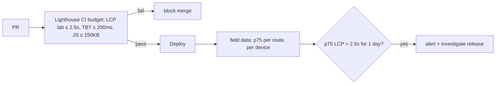

::part[Learn the Concept]{n="1"}

## 🎯 What you'll learn

- The three **Core Web Vitals**: **LCP** (loading), **INP** (responsiveness), **CLS** (visual stability) — plus FCP and TTFB
- "Good" thresholds and why Google uses the **75th percentile**
- **Lab data** (Lighthouse, DevTools) vs **field data** (real users, CrUX)
- Diagnosing each metric and the usual fixes in a Next.js app
- Reporting real-user metrics with `useReportWebVitals` and a collector endpoint
- Performance budgets and alerts

## 🧠 The big idea

Imagine rating a **delivery service**:

- **LCP** — how long until the main package arrives (the biggest thing on screen)
- **INP** — when you ring the bell, how long until someone answers (every interaction, worst ones count)
- **CLS** — whether the driver keeps moving the package while you reach for it (layout jumps)

And you don't judge by one delivery on a sunny day (your laptop in Lighthouse). You look at **most deliveries** to real customers — 3 out of 4 must be good (p75).

## ❓ Why does this exist?

"The site feels slow" isn't actionable. Core Web Vitals give standard, user-centered numbers that correlate with engagement and conversion, and Google uses them in search ranking. Field data reveals problems your fast laptop never shows: cheap Android phones, slow 4G in smaller cities, big DOMs after scrolling.

## 💥 What happens if we DON'T?

- Lighthouse says 98 on your MacBook; real users on mid-range phones wait 5 s for the job page.
- A cookie banner or a late-loading ad pushes the "Apply" button down as users tap → wrong clicks (CLS).
- A filter dropdown takes 600 ms to respond because every keystroke re-renders 500 cards (INP) — nobody notices until reviews complain.

## 📖 How it works, step by step

### 1. The metrics

| Metric | Measures | Good | Needs improvement | Poor |
|---|---|---|---|---|
| **LCP** Largest Contentful Paint | time until the largest image/text block renders | ≤ 2.5 s | ≤ 4.0 s | > 4.0 s |
| **INP** Interaction to Next Paint | latency of interactions (clicks, taps, keys) across the visit | ≤ 200 ms | ≤ 500 ms | > 500 ms |
| **CLS** Cumulative Layout Shift | unexpected layout movement (largest burst) | ≤ 0.1 | ≤ 0.25 | > 0.25 |
| FCP First Contentful Paint | first text/image | ≤ 1.8 s | ≤ 3.0 s | > 3.0 s |
| TTFB Time to First Byte | server/network response time | ≤ 0.8 s | ≤ 1.8 s | > 1.8 s |

INP replaced First Input Delay (FID) as a Core Web Vital in 2024. A page "passes" when the **75th percentile** of page loads is good for all three.

### 2. Lab vs field

| | Lab (Lighthouse, DevTools Performance, WebPageTest) | Field (RUM, Chrome UX Report, PageSpeed Insights "real users") |
|---|---|---|
| Who | simulated device/network | real users |
| Good for | debugging, before release, CI budgets | truth, trends, regressions after release |
| INP | not measured directly (Total Blocking Time is a proxy) | measured |
| Variance | low | high (devices, networks) |

Use lab data to **find and fix**, field data to **decide and verify**.

### 3. p75

```ts
export function p75(values: number[]) {
  if (values.length === 0) return null;
  const sorted = values.toSorted((a, b) => a - b);
  return sorted[Math.ceil(0.75 * sorted.length) - 1]!;
}
```

Averages hide pain: nine 1-second loads and one 20-second load average 2.9 s but the p75 is 1 s — while p95 shows the 20 s outlier. Track p75 for pass/fail and p95 to understand the worst experiences.

### 4. Diagnosing and fixing

**LCP** (break it into: TTFB → resource load delay → load time → render delay)
- Slow TTFB: cache public pages, stream with `<Suspense>`, avoid waterfalls in Server Components (`Promise.all`), put the app near users (CDN/region — Jakarta/Singapore for Indonesian users).
- LCP image: `next/image` with `preload`/`fetchPriority="high"`, correct `sizes`, AVIF/WebP; never lazy-load it.
- Render-blocking fonts/CSS: `next/font`; avoid huge CSS; no blocking third-party scripts.

**INP**
- Long tasks on the main thread: reduce client JS (Server Components, lazy load), split heavy work.
- Expensive re-renders: memoize (or the React Compiler), narrow state (Zustand selectors), virtualize long lists (TanStack Virtual).
- Keep interactions responsive: `useTransition`/`useDeferredValue` for filtering big lists, debounce expensive work, show immediate feedback.

**CLS**
- Always reserve space: `width`/`height` on images (`next/image` does it), `aspect-ratio` for embeds, skeletons with fixed height for lazy components.
- Fonts: `next/font` fallback metrics.
- Don't insert banners/ads above existing content; use transforms for animations instead of changing layout properties.

DevTools → **Performance** panel shows LCP element, layout shift clusters and long interactions; the **Web Vitals** overlay in the Performance panel shows live values while you use the page.

### 5. Reporting real-user metrics in Next.js

```tsx
// app/_components/web-vitals.tsx
"use client";
import { useReportWebVitals } from "next/web-vitals";

function reportWebVital(metric: { name: string; value: number; rating: string; id: string; navigationType: string }) {
  const body = JSON.stringify({ name: metric.name, value: metric.value, rating: metric.rating, id: metric.id, navigationType: metric.navigationType, path: window.location.pathname });
  if (navigator.sendBeacon) navigator.sendBeacon("/api/vitals", body);
  else fetch("/api/vitals", { method: "POST", body, keepalive: true, headers: { "Content-Type": "application/json" } });
}

export function WebVitals() {
  useReportWebVitals(reportWebVital);        // stable, module-level function → no duplicate reports
  return null;
}
```

```tsx
// app/layout.tsx — keeps the client boundary tiny
<body><WebVitals />{children}</body>
```

```ts
// app/api/vitals/route.ts — public endpoint: small, strict, cheap
export async function POST(request: Request) {
  if (Number(request.headers.get("content-length") ?? 0) > 2048) return new Response(null, { status: 413 });
  const parsed = vitalSchema.safeParse(await request.json().catch(() => null));
  if (!parsed.success) return new Response(null, { status: 400 });
  console.info(JSON.stringify({ event: "web_vital", ...parsed.data }));   // → log pipeline → dashboard
  return new Response(null, { status: 204 });
}
```

Send the **route pattern** (`/jobs/[id]`) rather than full paths when possible, so data groups by page type and doesn't collect IDs. Sample if traffic is large. Vercel Speed Insights, Sentry, Datadog RUM and Grafana Faro do this as products.

### 6. Budgets and alerts



## ⚖️ Trade-offs

| | ✅ | ❌ |
|---|---|---|
| Lighthouse / lab | reproducible, runs in CI | not real users; no true INP |
| CrUX / PageSpeed Insights | free field data from Chrome users | needs enough traffic; 28-day window; Chrome only |
| Own RUM endpoint | full control, per-route, cheap | you build dashboards, sampling, privacy handling |
| RUM products | dashboards, attribution, alerts | cost; another third-party script |

## ✅ When to use it / 🚫 When NOT to use it

- ✅ Public, SEO-relevant pages (job listings) and core logged-in flows on mobile.
- ✅ Field monitoring after every release.
- 🚫 Don't chase a Lighthouse score of 100 at the cost of features; fix what users feel.
- 🚫 Don't collect personal data (full URLs with IDs, emails) with vitals.

## 🏆 Best practices

- [ ] Know each page's LCP element and make it fast (preload, sizes, no lazy-loading).
- [ ] Reserve space for everything that loads late → CLS ≤ 0.1.
- [ ] Reduce and split client JS; virtualize long lists; defer non-urgent updates → INP ≤ 200 ms.
- [ ] Measure on a mid-range phone profile and slow network, not only your laptop.
- [ ] Collect field data (p75, by route and device) and compare releases.
- [ ] Budgets in CI for lab metrics and bundle size; alerts for field regressions.
- [ ] Keep the vitals endpoint strict, small and free of personal data.

## 🏭 How it's used in industry

- Google Search uses Core Web Vitals as part of its page experience signals; SEO-driven businesses (job boards, marketplaces, media) track them closely.
- Case studies from large sites have linked LCP and CLS improvements to better conversion and lower bounce rates.
- RUM tooling (Vercel Speed Insights, Sentry, Datadog, New Relic) makes Web Vitals a standard dashboard next to error rates.

## ⚠️ Common mistakes

- Optimizing for Lighthouse on desktop while users are on mobile.
- Lazy-loading the hero image.
- Skeletons with a different height than the real content (CLS moves to later).
- Passing a new inline function to `useReportWebVitals` → duplicate reports.
- Measuring averages instead of percentiles.

::part[Explain & Design]{n="2"}

## 🗣️ Explain it

Explain LCP, INP and CLS to a product manager using the delivery service analogy, and why "3 out of 4 deliveries must be good" is a better goal than "the average delivery".

## 📐 Design it

CareerPilot's field data for `/jobs/[id]` on mobile: LCP p75 3.9 s (LCP element: company banner), INP p75 340 ms (the "Similar jobs" filter chips), CLS p75 0.21 (a "Salary insights" card that appears after load). Write an investigation and fix plan for each metric, and how you'll confirm the fix.

:::quiz
Show a possible plan

**LCP 3.9 s (banner):** check TTFB in field data by route; if high → cache the public job page (`"use cache"` + `cacheLife("hours")`, `updateTag` on edit) and stream personalized parts. Banner: `next/image` with `preload`, `sizes="100vw"`, AVIF, served from a CDN near Indonesia; make sure it isn't lazy or hidden behind client JS. Remove render-blocking fonts/scripts. **Confirm:** Lighthouse mobile lab LCP ≤ 2.5 s, then field p75 over 7 days.

**INP 340 ms (filter chips):** record the interaction in DevTools Performance → long task from re-rendering 300 job cards + filtering on the main thread. Fixes: filter on the server or memoize filtering; `useTransition` so chips update instantly and the list updates as non-urgent; virtualize the list; narrow re-renders (memoized cards / React Compiler). **Confirm:** interaction under 100 ms in lab with 4× CPU throttling; field INP p75 ≤ 200 ms.

**CLS 0.21 (salary card):** reserve its height with a skeleton of the same size (`min-h-[180px]`), or render it on the server; ensure images/embeds have dimensions and fonts use `next/font`. **Confirm:** DevTools layout shift regions empty; field CLS p75 ≤ 0.1.

**Guard:** add route-level budgets to Lighthouse CI and an alert when any p75 crosses "needs improvement" for 24 h.
:::

### 📝 Self-review checklist

- [ ] Each fix targets the diagnosed cause
- [ ] Lab used for debugging, field for confirmation
- [ ] Regression guard defined

::ai-review{task="design"}

::part[Toy Exercise]{n="3"}

:::exercise{path="exercises/web/m4/w6/07-web-vitals" ai="ai-allowed" title="Collect and summarize Web Vitals"}
Implement threshold ratings, p75 summaries, a stable `useReportWebVitals` reporter using `sendBeacon` with a `fetch` fallback, and a strict collector Route Handler that logs one structured line per metric.
:::

:::hints
- Nearest-rank p75: index `Math.ceil(0.75 * n) - 1` in the sorted array.
- Define the reporter outside the component so the hook receives the same function every render.
- Validate everything a public endpoint receives — including size.
:::

## ✅ Quick check

:::quiz
Why can't Lighthouse report INP?

INP needs real interactions across a visit. Lighthouse loads a page without user input; it reports Total Blocking Time as a lab proxy for responsiveness.
:::

:::quiz
Your CLS is 0.02 in Lighthouse but 0.19 in field data. What could explain it?

Shifts that happen after load or during scrolling/interaction (late banners, lazy content without reserved space, ads), different viewports/devices, or personalized content — none of which a single lab page load captures.
:::

## 🔗 CareerPilot Phase 4

This week finishes **CareerPilot Phase 4**: the Next.js frontend for your Flask API, tested with Vitest and Playwright and deployable with Docker. The project brief, starter and acceptance tests are in the CareerPilot project section.

:::linkedin{type="weekly"}
🚀 Week 6: testing and shipping the Next.js frontend.

- Playwright E2E tests for login, forms and navigation — graded by planting bugs and checking my tests caught them
- Component tests with Vitest + Testing Library that test behavior, not implementation
- A faster job page: Server Components, next/image, next/font and a lazy-loaded chart
- A 3-stage non-root Docker image, a health check and a SHA-pinned CI pipeline
- Measuring Core Web Vitals from real users (p75 LCP, INP, CLS)

What surprised me: [your answer].

Module 4 done — next up: cloud & DevOps. ☁️

#NextJS #Playwright #WebPerformance #LearningInPublic
:::

## 📖 Kamus (glossary)

| Term | Bahasa Indonesia |
|---|---|
| Core Web Vitals | Metrik inti pengalaman pengguna web |
| Field data | Data dari pengguna nyata |
| Lab data | Data dari pengujian simulasi |
| Percentile (p75) | Persentil ke-75 |
| Layout shift | Pergeseran tata letak |
| Real User Monitoring | Pemantauan pengguna nyata |

## 📚 Keep learning

- [web.dev: Web Vitals](https://web.dev/articles/vitals) · [Optimize INP](https://web.dev/articles/optimize-inp) · [Optimize CLS](https://web.dev/articles/optimize-cls)
- Next.js docs (bundled): `useReportWebVitals`; Analytics guide
- [PageSpeed Insights](https://pagespeed.web.dev/)
