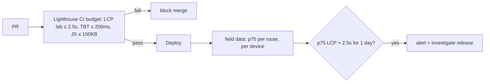

::part[Learn the Concept]{n="1"}

## 🎯 What you'll learn

- The three **Core Web Vitals**: **LCP** (loading), **INP** (responsiveness), **CLS** (visual stability) — plus FCP and TTFB
- "Good" limits and why Google uses the **75th percentile**
- **Lab data** (Lighthouse, DevTools) vs **field data** (real users, CrUX)
- Finding the cause of each metric and the usual fixes in a Next.js app
- Reporting real-user metrics with `useReportWebVitals` and a collector endpoint
- Performance budgets and alerts

## 🔤 Key words

| Word | In simple words | Bahasa Indonesia |
|---|---|---|
| **Core Web Vitals** | Google's three main numbers for how a page feels to users | Metrik inti pengalaman web |
| **LCP** | How long until the biggest thing on screen appears | Waktu konten utama tampil |
| **INP** | How long the page takes to react after a click, tap or key press | Kecepatan respons interaksi |
| **CLS** | How much things jump around on the page | Pergeseran tata letak |
| **Lab data** | Measured in a test run on one simulated device | Data uji simulasi |
| **Field data** | Measured from real users on their real devices | Data pengguna nyata |
| **p75 (75th percentile)** | The value that 3 out of 4 visits are at or better than | Persentil ke-75 |
| **RUM** | Real User Monitoring: collecting metrics from real visits | Pemantauan pengguna nyata |

## 🧠 The big idea

Imagine rating a **delivery service** (like an online food order):

- **LCP** — how long until the main package arrives (the biggest thing on screen)
- **INP** — when you ring the bell, how long until someone answers (every interaction; the slow ones count)
- **CLS** — whether the driver keeps moving the package while you reach for it (layout jumps)

And you don't judge by one delivery on a sunny day (your laptop in Lighthouse). You look at **most deliveries** to real customers — 3 out of 4 must be good (p75).

## ❓ Why it matters

"The site feels slow" isn't something you can act on. Core Web Vitals give standard numbers based on what users feel. They're linked to engagement and sales, and Google uses them in search ranking. Field data shows problems your fast laptop never shows: cheap Android phones, slow 4G outside big cities, huge pages after scrolling.

What happens if you ignore them:

- Lighthouse says 98 on your MacBook; real users on mid-range phones wait 5 s for the job page.
- A cookie banner or a late ad pushes the "Apply" button down just as users tap → wrong clicks (CLS).
- A filter dropdown takes 600 ms to respond because every keystroke re-renders 500 cards (INP) — nobody notices until reviews complain.

## 📖 Step by step

### 1. The metrics

| Metric | Measures | Good | Needs improvement | Poor |
|---|---|---|---|---|
| **LCP** Largest Contentful Paint | time until the largest image/text block renders | ≤ 2.5 s | ≤ 4.0 s | > 4.0 s |
| **INP** Interaction to Next Paint | latency of interactions (clicks, taps, keys) across the visit | ≤ 200 ms | ≤ 500 ms | > 500 ms |
| **CLS** Cumulative Layout Shift | unexpected layout movement (largest burst) | ≤ 0.1 | ≤ 0.25 | > 0.25 |
| FCP First Contentful Paint | first text/image | ≤ 1.8 s | ≤ 3.0 s | > 3.0 s |
| TTFB Time to First Byte | server/network response time | ≤ 0.8 s | ≤ 1.8 s | > 1.8 s |

INP replaced First Input Delay (FID) as a Core Web Vital in 2024. A page "passes" when the **75th percentile** of page loads is good for all three.

### 2. Lab vs field

| | Lab (Lighthouse, DevTools Performance, WebPageTest) | Field (RUM, Chrome UX Report, PageSpeed Insights "real users") |
|---|---|---|
| Who | simulated device/network | real users |
| Good for | debugging, before release, CI budgets | the truth, trends, problems after release |
| INP | not measured directly (Total Blocking Time is a stand-in) | measured |
| Variation | low | high (devices, networks) |

Lab is a **test drive** on an empty road; field is **real traffic** in rush hour. Use lab data to **find and fix**, field data to **decide and confirm**.

### 3. p75

```ts
export function p75(values: number[]) {
  if (values.length === 0) return null;
  const sorted = values.toSorted((a, b) => a - b);
  return sorted[Math.ceil(0.75 * sorted.length) - 1]!;
}
```

Sort all the values from fastest to slowest and take the one 75% of the way along. Averages hide pain: nine 1-second loads and one 20-second load average 2.9 s, but the p75 is 1 s — and p95 shows the 20 s outlier. Use p75 for pass/fail, and p95 to understand the worst experiences.

### 4. Finding the cause and fixing it

**LCP** — split it into parts: server response (TTFB) → waiting to start loading → loading time → drawing it on screen.

- Slow TTFB: cache public pages, stream with `<Suspense>`, avoid one-after-another fetches in Server Components (`Promise.all`), host the app near users (CDN/region — Jakarta/Singapore for Indonesian users, US regions for US users).
- LCP image: `next/image` with `preload`/`fetchPriority="high"`, correct `sizes`, AVIF/WebP; never lazy-load it.
- Fonts/CSS blocking the page: `next/font`; avoid huge CSS; no blocking third-party scripts.

**INP** — the browser's main thread is like a **single cashier**: if they're busy with a long task, your click waits in line.

- Long tasks: send less client JS (Server Components, lazy load), split heavy work.
- Expensive re-renders: memoize (or use the React Compiler), subscribe narrowly (Zustand selectors), virtualize long lists (TanStack Virtual).
- Stay responsive: `useTransition`/`useDeferredValue` for filtering big lists, debounce expensive work, show feedback right away.

**CLS**

- Always reserve space: `width`/`height` on images (`next/image` does it), `aspect-ratio` for embeds, fixed-height skeletons for lazy components. Like saving a seat with your bag — nobody has to move later.
- Fonts: `next/font` fallback sizes.
- Don't insert banners or ads above existing content; animate with transforms instead of changing layout properties.

DevTools → **Performance** panel shows the LCP element, layout shift clusters and slow interactions; its live Web Vitals view updates while you use the page.

### 5. Reporting real-user metrics in Next.js

```tsx
// app/_components/web-vitals.tsx
"use client";
import { useReportWebVitals } from "next/web-vitals";

function reportWebVital(metric: { name: string; value: number; rating: string; id: string; navigationType: string }) {
  const body = JSON.stringify({ name: metric.name, value: metric.value, rating: metric.rating, id: metric.id, navigationType: metric.navigationType, path: window.location.pathname });
  if (navigator.sendBeacon) navigator.sendBeacon("/api/vitals", body);
  else fetch("/api/vitals", { method: "POST", body, keepalive: true, headers: { "Content-Type": "application/json" } });
}

export function WebVitals() {
  useReportWebVitals(reportWebVital);        // stable, module-level function → no duplicate reports
  return null;
}
```

```tsx
// app/layout.tsx — keeps the client boundary tiny
<body><WebVitals />{children}</body>
```

```ts
// app/api/vitals/route.ts — public endpoint: small, strict, cheap
export async function POST(request: Request) {
  if (Number(request.headers.get("content-length") ?? 0) > 2048) return new Response(null, { status: 413 });
  const parsed = vitalSchema.safeParse(await request.json().catch(() => null));
  if (!parsed.success) return new Response(null, { status: 400 });
  console.info(JSON.stringify({ event: "web_vital", ...parsed.data }));   // → log pipeline → dashboard
  return new Response(null, { status: 204 });
}
```

- `sendBeacon` is like dropping a postcard in a mailbox as you leave: it still gets sent even if the user closes the tab.
- The reporter is defined **outside** the component, so the hook gets the same function every render (no duplicate reports).
- The endpoint is public, so anyone can send junk: limit size, validate with a schema.
- Send the **route pattern** (`/jobs/[id]`) instead of full paths when possible, so data groups by page type and doesn't collect IDs. Sample if traffic is large.
- Products like Vercel Speed Insights, Sentry, Datadog RUM and Grafana Faro do all this for you.

### 6. Budgets and alerts



### When to focus on it

- ✅ Public pages that need search traffic (job listings) and the main logged-in flows on mobile.
- ✅ Field monitoring after every release.
- 🚫 Don't chase a Lighthouse score of 100 at the cost of features; fix what users feel.
- 🚫 Don't collect personal data (full URLs with IDs, emails) with vitals.

## ⚠️ Common mistakes

- Optimizing Lighthouse on desktop while users are on mobile.
- Lazy-loading the hero image.
- Skeletons with a different height than the real content (the jump just happens later).
- Passing a new inline function to `useReportWebVitals` → duplicate reports.
- Looking at averages instead of percentiles.

## 🏆 Best practices

- [ ] Know each page's LCP element and make it fast (preload, sizes, no lazy-loading).
- [ ] Reserve space for everything that loads late → CLS ≤ 0.1.
- [ ] Send and split less client JS; virtualize long lists; delay non-urgent updates → INP ≤ 200 ms.
- [ ] Test on a mid-range phone profile and slow network, not only your laptop.
- [ ] Collect field data (p75, by route and device) and compare releases.
- [ ] Budgets in CI for lab metrics and bundle size; alerts for field problems.
- [ ] Keep the vitals endpoint strict, small and free of personal data.

::part[Explain & Design]{n="2"}

## 🗣️ Explain it

Explain LCP, INP and CLS to a product manager using the delivery service analogy, and why "3 out of 4 deliveries must be good" is a better goal than "the average delivery".

## 📐 Design it

CareerPilot's field data for `/jobs/[id]` on mobile: LCP p75 3.9 s (LCP element: company banner), INP p75 340 ms (the "Similar jobs" filter chips), CLS p75 0.21 (a "Salary insights" card that appears after load). Write an investigation and fix plan for each metric, and how you'll confirm the fix.

:::quiz
Show a possible plan

**LCP 3.9 s (banner):** check TTFB in field data by route; if high → cache the public job page (`"use cache"` + `cacheLife("hours")`, `updateTag` on edit) and stream the personalized parts. Banner: `next/image` with `preload`, `sizes="100vw"`, AVIF, served from a CDN near the users; make sure it isn't lazy or hidden behind client JS. Remove render-blocking fonts/scripts. **Confirm:** Lighthouse mobile lab LCP ≤ 2.5 s, then field p75 over 7 days.

**INP 340 ms (filter chips):** record the interaction in DevTools Performance → a long task from re-rendering 300 job cards + filtering on the main thread. Fixes: filter on the server or memoize the filtering; `useTransition` so chips update instantly and the list updates as non-urgent; virtualize the list; fewer re-renders (memoized cards / React Compiler). **Confirm:** interaction under 100 ms in lab with 4× CPU slowdown; field INP p75 ≤ 200 ms.

**CLS 0.21 (salary card):** reserve its height with a same-size skeleton (`min-h-[180px]`), or render it on the server; make sure images/embeds have dimensions and fonts use `next/font`. **Confirm:** no layout shift regions in DevTools; field CLS p75 ≤ 0.1.

**Guard:** add per-route budgets to Lighthouse CI and an alert when any p75 crosses "needs improvement" for 24 h.
:::

### 📝 Self-review checklist

- [ ] Each fix targets the cause you found
- [ ] Lab used for debugging, field for confirmation
- [ ] A guard against future regressions

::ai-review{task="design"}

::part[Toy Exercise]{n="3"}

:::exercise{path="exercises/web/m4/w6/07-web-vitals" ai="ai-allowed" title="Collect and summarize Web Vitals"}
Implement threshold ratings, p75 summaries, a stable `useReportWebVitals` reporter using `sendBeacon` with a `fetch` fallback, and a strict collector Route Handler that logs one structured line per metric.
:::

:::hints
- Nearest-rank p75: index `Math.ceil(0.75 * n) - 1` in the sorted array.
- Define the reporter outside the component so the hook receives the same function every render.
- Validate everything a public endpoint receives — including size.
:::

## ✅ Quick check

:::quiz
Why can't Lighthouse report INP?

INP needs real interactions during a visit. Lighthouse loads a page without anyone clicking; it reports Total Blocking Time as a lab stand-in for responsiveness.
:::

:::quiz
Your CLS is 0.02 in Lighthouse but 0.19 in field data. What could explain it?

Shifts that happen after load or while scrolling/interacting (late banners, lazy content without reserved space, ads), different screen sizes/devices, or personalized content — a single lab page load captures none of these.
:::

## 🔗 CareerPilot Phase 4

This week finishes **CareerPilot Phase 4**: the Next.js frontend for your Flask API, tested with Vitest and Playwright and deployable with Docker. Finish checkpoints C6–C8 in the [Phase 4 brief](/projects/careerpilot/04-phase-4-web-app).

## 📚 Keep learning

- [web.dev: Web Vitals](https://web.dev/articles/vitals) · [Optimize INP](https://web.dev/articles/optimize-inp) · [Optimize CLS](https://web.dev/articles/optimize-cls)
- Next.js docs (bundled): `useReportWebVitals`; Analytics guide
- [PageSpeed Insights](https://pagespeed.web.dev/)

## 📣 End of Week 6 — share your progress

:::linkedin{type="weekly"}
🚀 Week 6: testing and shipping the Next.js frontend.

- Playwright E2E tests for login, forms and navigation — graded by planting bugs and checking my tests caught them
- Component tests with Vitest + Testing Library that test behavior, not implementation
- A faster job page: Server Components, next/image, next/font and a lazy-loaded chart
- A 3-stage non-root Docker image, a health check and a SHA-pinned CI pipeline
- Measuring Core Web Vitals from real users (p75 LCP, INP, CLS)

What surprised me: [your answer].

Module 4 done — next up: cloud & DevOps. ☁️

#NextJS #Playwright #WebPerformance #LearningInPublic
:::
