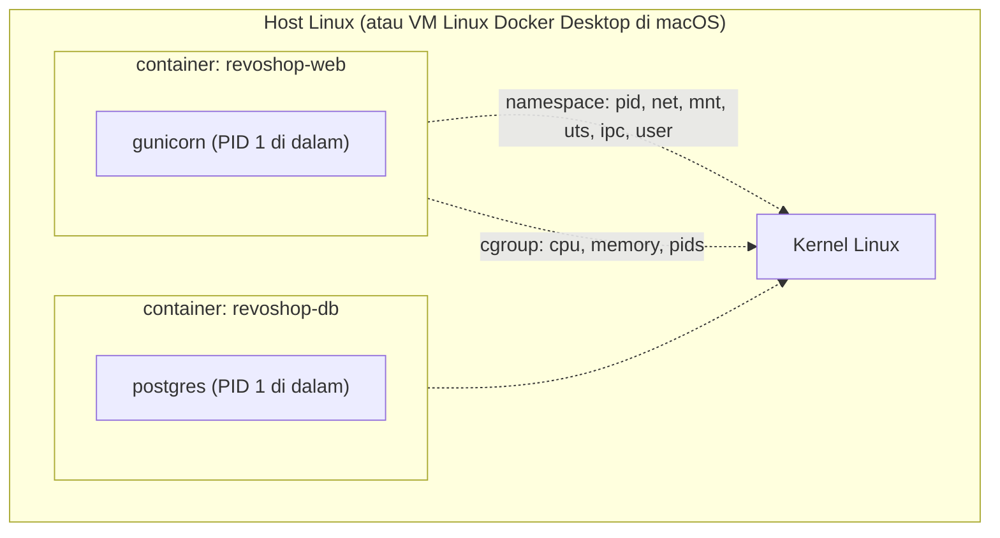

::part[Pelajari Konsepnya]{n="1"}

## 🎯 Yang akan kamu pelajari

- Apa itu container di balik layar: **namespace**, **cgroup**, **filesystem berlapis**
- Image, **manifest**, **digest**, tag, dan registry
- **Arsitektur CPU** (Mac `arm64` vs server `amd64`) dan image multi-platform
- **Jaringan** container: bridge network, DNS, port yang dipublikasikan
- **Penyimpanan**: layer vs volume vs bind mount vs tmpfs
- **Batas sumber daya**, OOM killer, dan **exit code** (137, 143, 1)
- **Alat debugging**: `logs`, `exec`, `inspect`, `stats`, `events`, `top`
- **Hardening**: non-root, filesystem read-only, lebih sedikit hak root, `no-new-privileges`

## 🔤 Istilah penting

| Istilah | Artinya (sederhana) |
|---|---|
| **Container** | Program biasa yang berjalan dengan batasan tentang apa yang bisa ia lihat dan pakai |
| **Image** | Paket read-only yang menjadi titik awal container |
| **Namespace** | Fitur Linux yang menyembunyikan semua yang ada di luar container darinya |
| **cgroup** | Fitur Linux yang membatasi CPU, memori, dan jumlah proses |
| **Layer** | Satu langkah yang disimpan dalam image; image adalah tumpukan layer |
| **Digest** | Sidik jari (`sha256:…`) yang selalu menunjuk ke image yang persis sama |
| **Volume** | Penyimpanan di luar container, sehingga data tetap ada saat container diganti |
| **OOM killer** | Bagian Linux yang mematikan proses saat memori habis |
| **Signal (SIGTERM / SIGKILL)** | Pesan ke proses: "tolong berhenti" / "berhenti sekarang, tanpa pilihan" |
| **Hardening** | Mencabut hak yang tidak dibutuhkan aplikasi, untuk membatasi kerusakan kalau dibobol |

## 🧠 Ide besarnya

Container **bukan virtual machine kecil**. Container adalah proses Linux biasa yang memakai:

- **kacamata kuda** (namespace) — ia hanya bisa melihat file, proses, dan jaringannya sendiri,
- **program diet** (cgroup) — ia hanya boleh memakai CPU dan memori sebanyak jatahnya,
- berdiri di atas **tumpukan lembar transparan** (layer image), dengan satu lembar paling atas yang bisa ia tulisi.

VM itu seperti rumah terpisah dengan fondasinya sendiri. Container seperti **kamar kos**: punya pintu dan kunci sendiri, tapi gedung, air, dan listriknya sama (kernel Linux).

Kalau sudah melihatnya seperti ini, kebanyakan misteri Docker — "kenapa mati?", "kenapa tidak bisa menjangkau database?", "data saya ke mana?" — berubah menjadi pertanyaan Linux dengan jawaban Linux.

## ❓ Kenapa ini penting

Di Module 2 kamu sudah membuat image Flask yang bagus. Di production kamu juga harus bisa menjawab: kenapa container restart jam 3 pagi? Kenapa image jalan di Mac tapi tidak di server? Kenapa database hilang setelah redeploy? Kenapa aplikasi mengabaikan `docker stop` selama 10 detik? Platform cloud (ECS, Kubernetes) dibangun persis dari bagian-bagian ini.

Tanpa pemahaman ini:

- Container RevoShop-mu menampilkan **`Exited (137)`** dan kamu "memperbaikinya" dengan restart, lagi dan lagi.
- Kamu menyimpan file upload di dalam container dan kehilangannya saat deploy berikutnya.
- Image yang dibuat di Mac seri M crash di server x86 dengan `exec format error`.
- Kamu men-debug jaringan dengan mempublikasikan semua port ke host "biar aman" — termasuk PostgreSQL.

## 📖 Langkah demi langkah

### 1. Apa itu container



| Mekanisme | Memberi container |
|---|---|
| **PID namespace** | daftar prosesnya sendiri (aplikasimu menjadi PID 1) |
| **Network namespace** | network interface, IP, dan port-nya sendiri |
| **Mount namespace** | tampilan filesystem-nya sendiri |
| **cgroup** | batas dan penghitung untuk CPU, memori, dan jumlah proses |
| **OverlayFS** | layer image read-only + layer tipis yang bisa ditulisi di atasnya |
| **Capabilities / seccomp** | hak root yang lebih sedikit dan system call yang diizinkan saja |

Di macOS dan Windows, Docker Desktop menjalankan container di dalam **VM Linux** kecil. Karena itu total memori untuk semua container dibatasi oleh pengaturan VM tersebut (cek dengan `docker info`).

### 2. Image, tag, dan digest

```bash
docker pull python:3.13-slim
docker image inspect python:3.13-slim --format '{{index .RepoDigests 0}}'
# python@sha256:9d2e55…   ← content address: this exact image forever
```

- **Image** = pengaturan + **layer** yang berurutan, dijelaskan oleh **manifest** (daftar isi paket).
- **Tag** (`3.13-slim`) itu seperti **label nama** yang bisa dipindah ke image lain. **Digest** (`@sha256:…`) itu **sidik jari** — tidak pernah bisa menunjuk ke yang lain.
- **Image multi-platform** punya *daftar* manifest: satu daftar isi per platform (`linux/amd64`, `linux/arm64`).
- Registry (gudang image): Docker Hub, **GitHub Container Registry (GHCR)**, **Amazon ECR**, Google Artifact Registry.

### 3. Arsitektur CPU: jebakan Apple Silicon

```bash
uname -m                                  # arm64 on M-series Macs
docker image inspect myapp --format '{{.Architecture}}'
docker buildx build --platform linux/amd64 -t myapp:amd64 .           # for x86 servers
docker buildx build --platform linux/amd64,linux/arm64 -t ghcr.io/you/myapp:1.0.0 --push .   # both
```

Program dikompilasi untuk satu jenis CPU, seperti **colokan untuk satu jenis stopkontak**. Image `arm64` tidak bisa jalan di server `amd64` (Intel/AMD) → `exec format error`.

AWS menyediakan server x86 dan **Graviton (arm64)** — arm64 sering lebih murah untuk kecepatan yang sama, dan Mac-mu membuatnya secara native. Pilih target dengan sengaja; CI (Week 2) biasanya build di mesin `amd64`.

### 4. Jaringan

```bash
docker network create shop
docker run -d --name db --network shop -e POSTGRES_PASSWORD=pw postgres:17-alpine
docker run -d --name api --network shop -p 127.0.0.1:8000:5000 myapp   # host → container
docker exec api getent hosts db          # Docker's embedded DNS resolves service names
```

| Konsep | Artinya |
|---|---|
| user-defined bridge network | container saling menjangkau **lewat nama** (`db:5432`) |
| `-p 8000:5000` | membuat port 5000 container bisa dijangkau di port 8000 pada **semua** network interface host |
| `-p 127.0.0.1:8000:5000` | hanya bisa dijangkau dari host itu sendiri |
| `EXPOSE` | hanya dokumentasi — tidak mempublikasikan apa pun |
| `localhost` di dalam container | **container itu sendiri**, bukan laptopmu dan bukan database |

Network Docker itu seperti **telepon internal kantor**: orang di dalam saling menelepon lewat nama ("db"). Mempublikasikan port seperti memberi telepon itu nomor publik. Hanya resepsionis (reverse proxy) yang butuh nomor publik; database tetap internal.

### 5. Penyimpanan

| Jenis | Bertahan | Dipakai untuk |
|---|---|---|
| layer container yang bisa ditulisi | sampai container **dihapus** | tidak untuk hal penting |
| **named volume** (`pgdata:/var/lib/postgresql/data`) | dikelola Docker, tetap ada saat container diganti | data database |
| **bind mount** (`./src:/app`) | folder di host | hot reload saat development, file konfigurasi |
| **tmpfs** (`--tmpfs /tmp`) | hanya di memori | file sementara saat root filesystem read-only |

Layer container yang bisa ditulisi itu seperti **kamar hotel**: saat check-out (container dihapus), kamarnya dibersihkan. Volume itu **loker penyimpanan** yang tetap milikmu di setiap kunjungan.

Di cloud, container **sekali pakai**: file ke object storage (S3), data ke database terkelola (RDS), log ke stdout.

### 6. Batas, OOM killer, dan exit code

```bash
docker run --memory 256m --cpus 0.5 --pids-limit 200 myapp
docker stats                                             # live CPU/memory per container
docker inspect revoshop-web --format '{{.State.ExitCode}} OOMKilled={{.State.OOMKilled}}'
```

| Exit code | Artinya |
|---|---|
| 0 | keluar dengan bersih |
| 1 (atau angka kecil lain) | aplikasinya gagal (baca `docker logs`) |
| 125 / 126 / 127 | Docker tidak bisa menjalankannya / perintah tidak bisa dieksekusi / perintah tidak ditemukan |
| **137** | dimatikan dengan SIGKILL — **OOM killer** atau `docker stop` kehabisan waktu tunggu |
| **143** | dihentikan dengan SIGTERM (berhenti normal dan sopan) |

`docker stop` itu seperti toko yang mau tutup: pertama "toko akan tutup, silakan selesaikan belanjanya" (**SIGTERM**), tunggu 10 detik, lalu satpam mengeluarkan semua orang (**SIGKILL**). Kalau PID 1 adalah shell (`CMD gunicorn …` bentuk shell), pengumumannya mungkin tidak pernah sampai ke gunicorn → berhenti lambat dan berakhir dengan 137.

### 7. Alat debugging

```bash
docker ps -a                              # status, exit codes, restart counts
docker logs --since 10m -f api            # what the app said
docker inspect api                        # env, mounts, networks, health, exit state
docker exec -it api sh                    # look around inside (if a shell exists)
docker top api                            # processes inside
docker events --since 30m                 # oom, die, health_status events
docker run --rm -it --network container:api nicolaka/netshoot   # network debugging tools next to a container
docker system df                          # disk used by images, volumes, build cache
```

Mulai dari `ps -a` (statusnya apa?), lalu `logs` (apa katanya?), lalu `inspect` (bagaimana konfigurasinya, kenapa berhenti?). Bukti dulu, perbaikan kemudian — seperti dokter yang memeriksa gejala sebelum memberi resep.

### 8. Hardening

```bash
docker run \
  --user 10001:10001 \
  --read-only --tmpfs /tmp \
  --cap-drop ALL \
  --security-opt no-new-privileges \
  --memory 512m --pids-limit 200 \
  myapp
```

Beri aplikasi **kartu tamu**, bukan kunci utama: bukan root, tidak bisa mengubah file-nya sendiri, tanpa hak khusus, tidak bisa menambah hak belakangan, memori terbatas. Kalau ada yang berhasil membobol, yang bisa ia lakukan jauh lebih sedikit.

Juga: base image kecil, tidak ada secret di layer, scan image (`docker scout cves`, `trivy image`), perbarui base image, dan jangan pernah mount `/var/run/docker.sock` ke container aplikasi (itu sama dengan root di host).

### Memilih dengan bijak

- **Base image:** `slim` paling kompatibel; `alpine` sangat kecil tapi library C-nya yang berbeda bisa merusak paket Python; `distroless` paling terkunci tapi tidak punya shell untuk debugging.
- **CPU target:** `amd64` jalan hampir di mana saja; `arm64` lebih murah di Graviton dan native di Mac.
- **Data:** named volume murah dan sederhana, tapi backup, failover, dan upgrade jadi tugasmu; database terkelola mengurusnya untukmu.
- 🚫 Jangan perlakukan container seperti hewan peliharaan yang kamu masuki dan tambal manual — build ulang dan deploy ulang.

## ⚠️ Kesalahan umum

- `localhost` di `DATABASE_URL` di dalam container.
- Menghapus volume dengan `docker compose down -v` dan kehilangan database lokal.
- Mengabaikan exit code 137 atau restart berulang (`Restarting (1)`).
- Mount Docker socket ke aplikasi "biar praktis".
- Image yang hanya jalan di jenis CPU milik developer.

## 🏆 Praktik terbaik

- [ ] Ketahui **platform** target dan build untuk platform itu (atau terbitkan multi-arch).
- [ ] Deploy lewat **digest** atau tag yang tidak pernah berubah, jangan lewat `latest`.
- [ ] Publikasikan hanya port proxy; database tetap di jaringan internal.
- [ ] Named volume atau layanan terkelola untuk data; tidak ada hal penting di layer container.
- [ ] Atur batas memori/CPU; pantau `docker stats`; buat alert untuk restart dan OOM kill.
- [ ] CMD bentuk exec supaya PID 1 menerima SIGTERM; matikan dengan rapi.
- [ ] User non-root, root filesystem read-only, `--cap-drop ALL`, `no-new-privileges`.
- [ ] Log ke stdout/stderr; biarkan platform yang mengumpulkan log.
- [ ] Scan image di CI dan build ulang secara rutin untuk mendapatkan perbaikan keamanan base image.

:::revoshop
Repo-mu: `~/path/to/revoshop`.

1. **Kode 137 di mesinmu.** `docker ps -a` menampilkan `revoshop-web  Exited (137)`. Jalankan `docker inspect revoshop-web --format 'OOMKilled={{.State.OOMKilled}} ExitCode={{.State.ExitCode}}'`. Di laptop ini hasilnya `OOMKilled=false` — jadi bukan karena memori. Apa lagi yang mengirim SIGKILL? Lihat `docker-compose.yml` (`command: flask run …`) dan `Dockerfile` production (`ENTRYPOINT ["entrypoint.sh"]` + `CMD gunicorn …` bentuk shell): siapa PID 1, dan apakah ia menerima `SIGTERM`? Uji: `docker compose up -d`, lalu `time docker compose stop web`.
2. **Arsitektur.** `docker image inspect module-2-muhammadismailhasan-web --format '{{.Architecture}} {{.Size}}'` → `arm64`, ~221 MB. Keluarga instance EC2 mana yang bisa menjalankan image ini apa adanya, dan apa yang harus diubah supaya bisa jalan di instance `t3` (x86)?
3. **Jaringan.** Di `docker-compose.yml`, database mempublikasikan `${DB_PORT:-5432}:5432` di **semua** interface. Siapa saja di jaringan Wi-Fi-mu yang bisa menjangkaunya? Ubah menjadi `127.0.0.1:${DB_PORT:-5432}:5432`.
4. **Penyimpanan.** Service `web` punya `volumes: - .:/app` dan `- /app/logs`. Volume jenis apa `/app/logs`, file-nya berakhir di mana, dan apa yang terjadi saat `docker compose down`? Kenapa `LOG_TO_FILE=true` (default di `config/base.py`) kurang cocok untuk container?
5. **Hardening.** Jalankan image production dengan `--read-only --tmpfs /tmp --cap-drop ALL --security-opt no-new-privileges`. Apa yang rusak duluan (petunjuk: folder log) dan bagaimana perubahan di materi 05 akan memperbaikinya?
:::

::part[Jelaskan & Rancang]{n="2"}

## 🗣️ Jelaskan

Jelaskan "proses dengan kacamata kuda, program diet, dan lembar transparan" ke rekan tim yang mengira container adalah VM ringan, lalu pakai analogi itu untuk menjelaskan kenapa `localhost` di dalam container tidak menjangkau database.

## 📐 Rancang

Container RevoShop-mu di server 2 GB terus menampilkan `Exited (137)` setelah lonjakan traffic, dan setiap restart butuh 40 detik. Tulis rencana penyelidikan (perintah, apa yang dicari) dan `docker run` (atau service Compose) yang sudah di-hardening dengan batas, health check, dan opsi keamanan.

:::quiz
Lihat contoh rencana

**Selidiki**
1. `docker inspect revoshop-web --format '{{.State.OOMKilled}} {{.State.ExitCode}} {{.RestartCount}}'` → memastikan kehabisan memori vs kehabisan waktu saat stop.
2. `docker events --since 24h --filter container=revoshop-web` → event `oom` dan `die` beserta waktunya; bandingkan dengan traffic.
3. `docker stats` saat load test Locust → memori per worker × `GUNICORN_WORKERS` (3 worker × ~150 MB + lonjakan).
4. `docker logs --since 1h` → startup lambat: entrypoint menunggu DB dan menjalankan **migrasi di setiap start** (40 detik itu).
5. `free -m` / `docker info` di host → container lain (Postgres) berebut 2 GB yang sama.

**Perbaiki**
- Sesuaikan jumlah worker (`WEB_CONCURRENCY=2`, `--max-requests 1000 --max-requests-jitter 100` untuk mengganti worker yang pelan-pelan bocor memorinya) dan atur batas memori dengan sedikit ruang cadangan; beri Postgres batas/`shared_buffers` sendiri.
- Pindahkan migrasi ke job sekali jalan; CMD bentuk exec untuk shutdown yang rapi.

```yaml
api:
  image: ghcr.io/you/revoshop-api:sha-3f2c1ab
  restart: unless-stopped
  environment: { WEB_CONCURRENCY: "2" }
  deploy: { resources: { limits: { memory: 768M, cpus: "1.0" } } }
  read_only: true
  tmpfs: [/tmp]
  cap_drop: [ALL]
  security_opt: ["no-new-privileges:true"]
  healthcheck:
    test: ["CMD", "python", "-c", "import urllib.request; urllib.request.urlopen('http://127.0.0.1:5000/api/v1/health', timeout=2)"]
    interval: 15s
    timeout: 3s
    retries: 3
    start_period: 20s
```
:::

### 📝 Checklist review mandiri

- [ ] Bukti sebelum perbaikan
- [ ] Batas ditentukan dari pengukuran
- [ ] Shutdown yang rapi sudah ditangani

::ai-review{task="design"}

::part[Latihan Kecil]{n="3"}

:::exercise{path="exercises/m5/w1/01-dockerfile-audit" ai="no-ai" title="Buat auditor Dockerfile"}
Tulis linter Dockerfile kecil: parser yang menangani baris lanjutan dan komentar, delapan aturan (image tanpa versi, user root, CMD bentuk shell, COPY yang merusak cache, kebersihan apt, secret yang tertanam, ADD dengan URL, HEALTHCHECK yang tidak ada) dan CLI dengan exit code. Lalu jalankan pada Dockerfile RevoShop-mu.
:::

:::hints
- Pisahkan instruksi menjadi stage di setiap `FROM`; ingat nama stage supaya `FROM builder` tidak dianggap "tanpa versi".
- Untuk ENV, bedakan `ENV A=b C=d` dari bentuk lama `ENV A b`.
- Host registry bisa berisi port (`registry:5000/app`) — cari tag hanya di bagian terakhir path.
:::

## ✅ Cek cepat

:::quiz
Kenapa named volume tetap ada setelah `docker compose up --build`, tapi file yang ditulis di dalam container tidak bertahan setelah `docker compose up --force-recreate`?

Recreate mengganti container beserta layer yang bisa ditulisinya; named volume adalah objek Docker terpisah yang dipasang lagi ke container baru.
:::

:::quiz
Apa bedanya `-p 127.0.0.1:5432:5432` dibandingkan `-p 5432:5432`?

Port hanya dipublikasikan di interface loopback host, sehingga mesin lain di jaringan (atau internet) tidak bisa menjangkau database.
:::

## 📚 Lanjut belajar

- [Dokumentasi Docker: Engine security](https://docs.docker.com/engine/security/) · [Networking overview](https://docs.docker.com/engine/network/) · [Volumes](https://docs.docker.com/engine/storage/volumes/)
- [Dokumentasi Docker: Multi-platform builds](https://docs.docker.com/build/building/multi-platform/)
- [OWASP Docker Security Cheat Sheet](https://cheatsheetseries.owasp.org/cheatsheets/Docker_Security_Cheat_Sheet.html)
