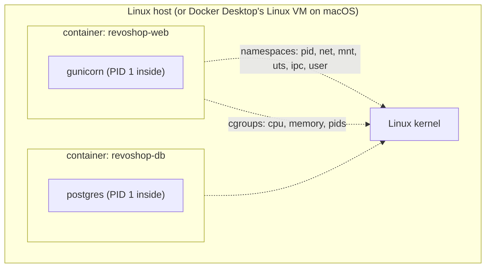

::part[Learn the Concept]{n="1"}

## 🎯 What you'll learn

- What a container is under the hood: **namespaces**, **cgroups**, **layered filesystems**
- Images, **manifests**, **digests**, tags and registries
- **CPU architectures** (`arm64` Macs vs `amd64` servers) and multi-platform images
- Container **networking**: bridge networks, DNS, published ports
- **Storage**: layers vs volumes vs bind mounts vs tmpfs
- **Resource limits**, the OOM killer and **exit codes** (137, 143, 1)
- A **debugging toolkit**: `logs`, `exec`, `inspect`, `stats`, `events`, `top`
- **Hardening**: non-root, read-only filesystem, fewer root powers, `no-new-privileges`

## 🔤 Key words

| Word | In simple words | Bahasa Indonesia |
|---|---|---|
| **Container** | A normal program running with limits on what it can see and use | Proses yang diisolasi |
| **Image** | The read-only package a container starts from | Paket siap jalan |
| **Namespace** | A Linux feature that hides everything outside the container from it | Sekat pandangan |
| **cgroup** | A Linux feature that limits CPU, memory and number of processes | Batas sumber daya |
| **Layer** | One saved step of an image; images are stacks of layers | Lapisan image |
| **Digest** | A fingerprint (`sha256:…`) that always points to the exact same image | Sidik jari image |
| **Volume** | Storage that lives outside the container, so data survives replacement | Penyimpanan tetap |
| **OOM killer** | The part of Linux that kills a process when memory runs out | Pembunuh saat memori habis |
| **Signal (SIGTERM / SIGKILL)** | A message to a process: "please stop" / "stop now, no choice" | Sinyal berhenti |
| **Hardening** | Removing powers the app doesn't need, to limit damage if it's hacked | Pengetatan keamanan |

## 🧠 The big idea

A container is **not a small virtual machine**. It's a normal Linux process wearing:

- **blinkers** (namespaces) — it can only see its own files, processes and network,
- a **diet plan** (cgroups) — it can only use so much CPU and memory,
- standing on a **stack of transparent sheets** (image layers), with one sheet on top it can write on.

A VM is a whole separate house with its own foundation. A container is a **room in a boarding house (kos)**: its own door and key, but the same building, water and electricity (the Linux kernel).

Once you see it this way, most Docker mysteries — "why did it die?", "why can't it reach the database?", "where did my data go?" — become Linux questions with Linux answers.

## ❓ Why it matters

In Module 2 you built a good Flask image. In production you'll also need to answer: why did the container restart at 3 a.m.? Why does the image work on my Mac but not on the server? Why is the database gone after a redeploy? Why does the app ignore `docker stop` for 10 seconds? Cloud platforms (ECS, Kubernetes) are built on exactly these pieces.

Without this understanding:

- Your RevoShop container shows **`Exited (137)`** and you "fix" it by restarting, again and again.
- You save uploaded files inside the container and lose them on the next deploy.
- An image built on an M-series Mac crashes on an x86 server with `exec format error`.
- You debug networking by publishing every port to the host "to be safe" — including PostgreSQL.

## 📖 Step by step

### 1. What a container is



| Mechanism | Gives the container |
|---|---|
| **PID namespace** | its own process list (your app is PID 1) |
| **Network namespace** | its own network interfaces, IP and ports |
| **Mount namespace** | its own view of the filesystem |
| **cgroups** | limits and counters for CPU, memory and number of processes |
| **OverlayFS** | read-only image layers + a thin writable layer on top |
| **Capabilities / seccomp** | a smaller set of root powers and allowed system calls |

On macOS and Windows, Docker Desktop runs containers inside a small **Linux VM**. That's why the total memory for all containers is limited by that VM's setting (check with `docker info`).

### 2. Images, tags and digests

```bash
docker pull python:3.13-slim
docker image inspect python:3.13-slim --format '{{index .RepoDigests 0}}'
# python@sha256:9d2e55…   ← content address: this exact image forever
```

- An **image** = settings + ordered **layers**, described by a **manifest** (a packing list).
- A **tag** (`3.13-slim`) is a **name tag** you can move to another image. A **digest** (`@sha256:…`) is a **fingerprint** — it can never point to anything else.
- A **multi-platform image** has a manifest *list*: one packing list per platform (`linux/amd64`, `linux/arm64`).
- Registries (image warehouses): Docker Hub, **GitHub Container Registry (GHCR)**, **Amazon ECR**, Google Artifact Registry.

### 3. CPU architecture: the Apple Silicon trap

```bash
uname -m                                  # arm64 on M-series Macs
docker image inspect myapp --format '{{.Architecture}}'
docker buildx build --platform linux/amd64 -t myapp:amd64 .           # for x86 servers
docker buildx build --platform linux/amd64,linux/arm64 -t ghcr.io/you/myapp:1.0.0 --push .   # both
```

Programs are compiled for one kind of CPU, like a **plug for one type of socket**. An `arm64` image won't run on an `amd64` (Intel/AMD) server → `exec format error`.

AWS offers both x86 and **Graviton (arm64)** servers — arm64 is often cheaper for the same speed, and your Mac builds it natively. Choose the target on purpose; CI (Week 2) usually builds on `amd64` machines.

### 4. Networking

```bash
docker network create shop
docker run -d --name db --network shop -e POSTGRES_PASSWORD=pw postgres:17-alpine
docker run -d --name api --network shop -p 127.0.0.1:8000:5000 myapp   # host → container
docker exec api getent hosts db          # Docker's embedded DNS resolves service names
```

| Concept | Meaning |
|---|---|
| user-defined bridge network | containers reach each other **by name** (`db:5432`) |
| `-p 8000:5000` | makes container port 5000 reachable on port 8000 of **all** the host's network interfaces |
| `-p 127.0.0.1:8000:5000` | only reachable from the host itself |
| `EXPOSE` | documentation only — doesn't publish anything |
| `localhost` inside a container | the **container itself**, not your laptop and not the database |

A Docker network is like an **office intercom**: people inside dial each other by name ("db"). Publishing a port is like giving that phone a public number. Only the receptionist (the reverse proxy) needs a public number; the database stays internal.

### 5. Storage

| Type | Lives | Use for |
|---|---|---|
| container writable layer | until the container is **removed** | nothing important |
| **named volume** (`pgdata:/var/lib/postgresql/data`) | managed by Docker, survives container replacement | database data |
| **bind mount** (`./src:/app`) | a folder on the host | development hot reload, config files |
| **tmpfs** (`--tmpfs /tmp`) | memory only | temporary files when the root filesystem is read-only |

The container's writable layer is like a **hotel room**: when you check out (container removed), the room is cleaned. A volume is a **storage locker** that stays yours between stays.

In the cloud, containers are **disposable**: files go to object storage (S3), data to managed databases (RDS), logs to stdout.

### 6. Limits, the OOM killer and exit codes

```bash
docker run --memory 256m --cpus 0.5 --pids-limit 200 myapp
docker stats                                             # live CPU/memory per container
docker inspect revoshop-web --format '{{.State.ExitCode}} OOMKilled={{.State.OOMKilled}}'
```

| Exit code | Meaning |
|---|---|
| 0 | clean exit |
| 1 (or other small numbers) | the app failed (read `docker logs`) |
| 125 / 126 / 127 | Docker couldn't run it / command not executable / command not found |
| **137** | killed with SIGKILL — **OOM killer** or `docker stop` timeout |
| **143** | stopped with SIGTERM (normal, polite stop) |

`docker stop` is like a shop closing: first "we're closing, please finish up" (**SIGTERM**), wait 10 s, then the security guard pushes everyone out (**SIGKILL**). If PID 1 is a shell (`CMD gunicorn …` in shell form), the announcement may never reach gunicorn → slow stops ending in 137.

### 7. The debugging toolkit

```bash
docker ps -a                              # status, exit codes, restart counts
docker logs --since 10m -f api            # what the app said
docker inspect api                        # env, mounts, networks, health, exit state
docker exec -it api sh                    # look around inside (if a shell exists)
docker top api                            # processes inside
docker events --since 30m                 # oom, die, health_status events
docker run --rm -it --network container:api nicolaka/netshoot   # network debugging tools next to a container
docker system df                          # disk used by images, volumes, build cache
```

Start with `ps -a` (what state?), then `logs` (what did it say?), then `inspect` (how is it configured, why did it stop?). Evidence first, fixes second — like a doctor checking symptoms before prescribing.

### 8. Hardening

```bash
docker run \
  --user 10001:10001 \
  --read-only --tmpfs /tmp \
  --cap-drop ALL \
  --security-opt no-new-privileges \
  --memory 512m --pids-limit 200 \
  myapp
```

Give the app a **visitor badge**, not a master key: not root, can't change its own files, no special powers, can't gain more powers later, limited memory. If someone breaks in, there's much less they can do.

Also: small base images, no secrets in layers, scan images (`docker scout cves`, `trivy image`), keep base images updated, and never mount `/var/run/docker.sock` into an app container (that equals root on the host).

### Choosing wisely

- **Base image:** `slim` is the most compatible; `alpine` is tiny but its different C library can break Python packages; `distroless` is the most locked-down but has no shell for debugging.
- **Target CPU:** `amd64` works almost everywhere; `arm64` is cheaper on Graviton and native on Macs.
- **Data:** a named volume is cheap and simple, but backups, failover and upgrades are then your job; a managed database handles them for you.
- 🚫 Don't treat containers like pets you log into and patch by hand — rebuild and redeploy.

## ⚠️ Common mistakes

- `localhost` in `DATABASE_URL` inside a container.
- Deleting a volume with `docker compose down -v` and losing the local database.
- Ignoring exit code 137 or restart loops (`Restarting (1)`).
- Mounting the Docker socket into an app "for convenience".
- Images that only work on the developer's CPU type.

## 🏆 Best practices

- [ ] Know your target **platform** and build for it (or publish multi-arch).
- [ ] Deploy by **digest** or a tag that never changes, never by `latest`.
- [ ] Publish only the proxy's ports; keep databases on internal networks.
- [ ] Named volumes or managed services for data; nothing important in the container layer.
- [ ] Set memory/CPU limits; watch `docker stats`; alert on restarts and OOM kills.
- [ ] Exec-form CMD so PID 1 receives SIGTERM; shut down gracefully.
- [ ] Non-root user, read-only root filesystem, `--cap-drop ALL`, `no-new-privileges`.
- [ ] Log to stdout/stderr; let the platform collect logs.
- [ ] Scan images in CI and rebuild regularly to pick up base-image security fixes.

:::revoshop
Your repo: `~/path/to/revoshop`.

1. **The 137 on your machine.** `docker ps -a` shows `revoshop-web  Exited (137)`. Run `docker inspect revoshop-web --format 'OOMKilled={{.State.OOMKilled}} ExitCode={{.State.ExitCode}}'`. On this laptop it reports `OOMKilled=false` — so it wasn't memory. What else sends SIGKILL? Look at `docker-compose.yml` (`command: flask run …`) and the production `Dockerfile` (`ENTRYPOINT ["entrypoint.sh"]` + shell-form `CMD gunicorn …`): who is PID 1, and does it receive `SIGTERM`? Test it: `docker compose up -d`, then `time docker compose stop web`.
2. **Architecture.** `docker image inspect module-2-muhammadismailhasan-web --format '{{.Architecture}} {{.Size}}'` → `arm64`, ~221 MB. Which EC2 instance families could run this image as-is, and what must change to run it on a `t3` (x86) instance?
3. **Networking.** In `docker-compose.yml` the database publishes `${DB_PORT:-5432}:5432` on **all** interfaces. Who on your Wi-Fi network can reach it? Change it to `127.0.0.1:${DB_PORT:-5432}:5432`.
4. **Storage.** The `web` service has `volumes: - .:/app` and `- /app/logs`. What kind of volume is `/app/logs`, where do those files end up, and what happens to them on `docker compose down`? Why is `LOG_TO_FILE=true` (the default in `config/base.py`) a poor fit for containers?
5. **Hardening.** Start the production image with `--read-only --tmpfs /tmp --cap-drop ALL --security-opt no-new-privileges`. What breaks first (hint: the log directory) and how will lesson 05's changes fix it?
:::

::part[Explain & Design]{n="2"}

## 🗣️ Explain it

Explain "a process with blinkers, a diet plan and transparent sheets" to a teammate who thinks containers are lightweight VMs, and use it to explain why `localhost` inside a container doesn't reach the database.

## 📐 Design it

Your RevoShop container on a 2 GB server keeps showing `Exited (137)` after traffic spikes, and each restart takes 40 seconds. Write an investigation plan (commands, what you'd look for) and a hardened `docker run` (or Compose service) with limits, health check and security options.

:::quiz
Show a possible plan

**Investigate**
1. `docker inspect revoshop-web --format '{{.State.OOMKilled}} {{.State.ExitCode}} {{.RestartCount}}'` → confirms out-of-memory vs stop timeout.
2. `docker events --since 24h --filter container=revoshop-web` → `oom` and `die` events with timestamps; compare with traffic.
3. `docker stats` during a Locust load test → memory per worker × `GUNICORN_WORKERS` (3 workers × ~150 MB + spikes).
4. `docker logs --since 1h` → slow startup: the entrypoint waits for the DB and runs **migrations on every start** (the 40 s).
5. `free -m` / `docker info` on the host → other containers (Postgres) competing for the same 2 GB.

**Fix**
- Right-size workers (`WEB_CONCURRENCY=2`, `--max-requests 1000 --max-requests-jitter 100` to replace workers that slowly leak memory) and set a memory limit with some headroom; give Postgres its own limit/`shared_buffers`.
- Move migrations to a one-off job; exec-form CMD for a graceful shutdown.

```yaml
api:
  image: ghcr.io/you/revoshop-api:sha-3f2c1ab
  restart: unless-stopped
  environment: { WEB_CONCURRENCY: "2" }
  deploy: { resources: { limits: { memory: 768M, cpus: "1.0" } } }
  read_only: true
  tmpfs: [/tmp]
  cap_drop: [ALL]
  security_opt: ["no-new-privileges:true"]
  healthcheck:
    test: ["CMD", "python", "-c", "import urllib.request; urllib.request.urlopen('http://127.0.0.1:5000/api/v1/health', timeout=2)"]
    interval: 15s
    timeout: 3s
    retries: 3
    start_period: 20s
```
:::

### 📝 Self-review checklist

- [ ] Evidence before fixes
- [ ] Limits based on measurements
- [ ] Graceful shutdown handled

::ai-review{task="design"}

::part[Toy Exercise]{n="3"}

:::exercise{path="exercises/m5/w1/01-dockerfile-audit" ai="no-ai" title="Build a Dockerfile auditor"}
Write a small Dockerfile linter: a parser that handles continuations and comments, eight rules (unpinned images, root user, shell-form CMD, cache-busting COPY, apt hygiene, baked secrets, ADD with URLs, missing HEALTHCHECK) and a CLI with exit codes. Then run it on your RevoShop Dockerfile.
:::

:::hints
- Split instructions into stages at every `FROM`; remember stage names so `FROM builder` isn't "unpinned".
- For ENV, tell `ENV A=b C=d` apart from the old `ENV A b` form.
- The registry host may contain a port (`registry:5000/app`) — look for a tag only in the last part of the path.
:::

## ✅ Quick check

:::quiz
Why does a named volume survive `docker compose up --build`, but a file written inside the container doesn't survive `docker compose up --force-recreate`?

Recreating replaces the container and its writable layer; the named volume is a separate Docker object that's attached again to the new container.
:::

:::quiz
What does `-p 127.0.0.1:5432:5432` change compared with `-p 5432:5432`?

The port is only published on the host's loopback interface, so other machines on the network (or the internet) can't reach the database.
:::

## 📚 Keep learning

- [Docker docs: Engine security](https://docs.docker.com/engine/security/) · [Networking overview](https://docs.docker.com/engine/network/) · [Volumes](https://docs.docker.com/engine/storage/volumes/)
- [Docker docs: Multi-platform builds](https://docs.docker.com/build/building/multi-platform/)
- [OWASP Docker Security Cheat Sheet](https://cheatsheetseries.owasp.org/cheatsheets/Docker_Security_Cheat_Sheet.html)
