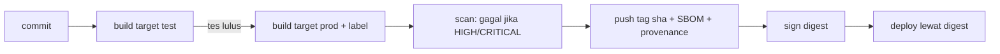

::part[Pelajari Konsepnya]{n="1"}

## 🎯 Yang akan kamu pelajari

- Satu Dockerfile dengan target **`dev`**, **`test`**, dan **`prod`**
- Di mana nilai `ARG` terlihat, dan **build argument** untuk versi
- **Label OCI** yang menghubungkan image ke source code-nya
- **Strategi tag**: commit SHA, branch, semantic version, `latest`
- Push ke registry: **GHCR** dan **Amazon ECR**
- Build **multi-arsitektur** dengan `buildx`
- **Cache** build di CI (cache registry dan GitHub Actions)
- Dasar keamanan rantai pasok: **scanning**, **SBOM**, **provenance**, dan **signing**

## 🔤 Istilah penting

| Istilah | Artinya (sederhana) |
|---|---|
| **Stage** | Satu bagian `FROM` di Dockerfile |
| **Target** | Stage yang kamu minta Docker untuk dibuat (`--target test`) |
| **Build arg (`ARG`)** | Nilai yang kamu berikan saat build (misalnya nomor versi) |
| **Label** | Catatan yang disimpan di dalam image (repo sumber, commit) |
| **Tag** | Nama yang mudah dibaca untuk versi image (`1.4.2`, `sha-3f2c1ab`) |
| **Registry** | Gudang image online (GHCR, ECR, Docker Hub) |
| **CVE** | Celah keamanan yang sudah diketahui publik dan punya nomor ID |
| **SBOM** | Daftar semua paket di dalam image, seperti label komposisi makanan |
| **Provenance** | Bukti bagaimana dan di mana image dibuat |
| **Signing** | Segel digital yang membuktikan image berasal darimu dan tidak diubah |

## 🧠 Ide besarnya

Dockerfile dengan target itu seperti **dapur restoran dengan beberapa stasiun**. Bahan yang sudah disiapkan (base + dependency) masuk ke tiga stasiun:

- **stasiun cicip** (`dev`) — lengkap dengan semua peralatan,
- **stasiun inspeksi** (`test`) — kalau masakan gagal inspeksi, ia tidak pernah keluar dari dapur,
- **stasiun penyajian** (`prod`) — hanya yang dimakan pelanggan.

Tag dan label adalah **stiker batch** di setiap piring: versi resep yang mana, dimasak kapan, dari bahan apa.

## ❓ Kenapa ini penting

- Developer dan CI sebaiknya tidak merawat tiga Dockerfile yang lama-lama jadi berbeda.
- Saat production rusak, pertanyaan "kode mana yang sedang berjalan?" harus bisa dijawab dalam hitungan detik.
- Registry, jenis CPU, dan cache menentukan seberapa cepat (dan aman) kamu bisa rilis dan rollback.

Tanpa ini:

- `Dockerfile.dev` memasang Python 3.12, `Dockerfile` memakai 3.13 — bug "di lokal jalan kok".
- Setiap deploy mem-push `revoshop:latest`; rollback berarti menebak build mana yang bagus.
- CI membangun ulang dependency dari nol setiap kali jalan (8 menit, bukan 1 menit).
- Image dengan CVE kritis di `openssl` berbulan-bulan ada di production karena tidak ada yang melakukan scan.

## 📖 Langkah demi langkah

### 1. Target

```dockerfile
# syntax=docker/dockerfile:1
ARG PYTHON_VERSION=3.13                      # before the first FROM: usable in FROM lines

FROM python:${PYTHON_VERSION}-slim AS base
ENV PYTHONUNBUFFERED=1 PYTHONDONTWRITEBYTECODE=1
WORKDIR /app
COPY --from=ghcr.io/astral-sh/uv:0.11.29 /uv /bin/uv

FROM base AS deps
COPY pyproject.toml uv.lock ./
RUN --mount=type=cache,target=/root/.cache/uv uv sync --locked --no-dev --no-install-project

FROM deps AS dev
RUN --mount=type=cache,target=/root/.cache/uv uv sync --locked --no-install-project
CMD ["uv", "run", "flask", "--app", "app:create_app", "run", "--debug", "--host", "0.0.0.0", "--port", "5091"]

FROM dev AS test
COPY . .
RUN uv run python -m pytest -q               # failing tests = failing build

FROM base AS prod                            # clean: no uv cache, no dev deps, no tests
ARG VERSION=dev
ARG REVISION=unknown
LABEL org.opencontainers.image.version=$VERSION org.opencontainers.image.revision=$REVISION
COPY --from=deps /app/.venv /app/.venv
COPY . .
USER 10001
CMD ["gunicorn", "-c", "gunicorn.conf.py", "wsgi:app"]
```

```bash
docker build --target dev  -t api:dev .
docker build --target test .                               # CI: runs the tests inside the build
docker build --build-arg VERSION=1.4.2 --build-arg REVISION=$(git rev-parse HEAD) -t api:1.4.2 .   # prod (last stage)
```

- BuildKit hanya membangun stage yang dibutuhkan target yang dipilih.
- `prod` dimulai dari `base`, bukan dari `dev` — jadi alat tes tidak pernah sampai ke pelanggan.
- Taruh `prod` di **paling akhir**, supaya `docker build .` biasa menghasilkan image production.

### 2. Di mana `ARG` terlihat

| Dideklarasikan | Terlihat di |
|---|---|
| sebelum `FROM` pertama | hanya baris `FROM` (tulis `ARG NAME` lagi di dalam stage untuk memakainya di sana) |
| di dalam stage | hanya stage itu |

Build arg **tersimpan di riwayat image** — siapa pun yang mengunduh image bisa membacanya, seperti menulis password di bagian luar kardus. Jangan pernah memberikan secret lewat `--build-arg`. Untuk secret yang dibutuhkan saat build, pakai `RUN --mount=type=secret,id=npm_token`.

### 3. Label OCI

```dockerfile
LABEL org.opencontainers.image.title="revoshop-api" \
      org.opencontainers.image.source="https://github.com/you/revoshop" \
      org.opencontainers.image.version=$VERSION \
      org.opencontainers.image.revision=$REVISION \
      org.opencontainers.image.created=$CREATED
```

Label itu seperti **label informasi di kemasan**. GHCR memakai `source` untuk menghubungkan image ke repository-nya, dan siapa pun (termasuk kamu, jam 3 pagi) bisa menjalankan `docker inspect` untuk menemukan commit yang persis.

### 4. Strategi tag

| Kejadian | Tag |
|---|---|
| build apa pun | `sha-3f2c1ab` (tidak berubah, deploy yang ini) |
| push ke `main` | `main`, `edge` |
| branch `feat/login` | `feat-login` |
| tag rilis `v1.4.2` | `1.4.2`, `1.4`, `1`, `latest` |
| pre-release `v2.0.0-rc.1` | hanya `2.0.0-rc.1` |
| pull request #42 | `pr-42` |

- Tag SHA itu seperti **nomor struk**: unik dan tidak pernah dipakai ulang. **Deploy lewat tag SHA atau digest.**
- `1.4`, `1`, `latest` itu seperti "edisi terbaru" — praktis untuk manusia, tapi bisa berpindah.
- Inilah yang dihitung `docker/metadata-action` di GitHub Actions (Week 2) — dan yang kamu buat di latihan.

### 5. Registry

```bash
# GitHub Container Registry
echo "$GITHUB_TOKEN" | docker login ghcr.io -u your-username --password-stdin
docker push ghcr.io/your-username/revoshop-api:sha-3f2c1ab

# Amazon ECR (Week 3–4)
aws ecr get-login-password --region ap-southeast-3 | docker login --username AWS --password-stdin <account>.dkr.ecr.ap-southeast-3.amazonaws.com
```

| Registry | Cocok untuk | Catatan |
|---|---|---|
| GHCR | proyek GitHub, image publik gratis | login dengan `GITHUB_TOKEN` di Actions |
| Docker Hub | image publik | batas unduhan untuk pengguna anonim |
| Amazon ECR | deploy ke ECS/EKS/App Runner | login lewat IAM, scanning image, lifecycle policy |

Atur **lifecycle policy** (misalnya simpan 30 tag SHA terakhir) supaya penyimpanan — dan tagihannya — tidak terus membengkak. Seperti membersihkan stok lama dari gudang.

### 6. Beberapa jenis CPU dalam satu image

```bash
docker buildx create --use --name multi
docker buildx build --platform linux/amd64,linux/arm64 \
  -t ghcr.io/you/revoshop-api:sha-3f2c1ab --push .
docker buildx imagetools inspect ghcr.io/you/revoshop-api:sha-3f2c1ab   # shows both platforms
```

Satu tag, dua versi di dalamnya — seperti kotak charger yang berisi adaptor untuk stopkontak berbeda; Docker memilih yang cocok. Build untuk CPU "yang lain" memakai emulasi QEMU, yang lambat saat memasang dependency. Alternatif: mesin CI arm64 native, atau pilih satu jenis CPU untuk production.

### 7. Cache di CI

```bash
docker buildx build \
  --cache-from type=gha --cache-to type=gha,mode=max \
  --target prod -t … .
```

Atau `type=registry,ref=ghcr.io/you/revoshop-api:buildcache`. Mesin CI selalu mulai dalam keadaan kosong — cache itu seperti **bahan setengah jadi** yang disimpan di freezer untuk dipakai lagi. Cache hanya membantu kalau Dockerfile diurutkan dari yang jarang berubah (dependency) ke yang sering berubah (source code).

### 8. Rantai pasok: scan, SBOM, provenance, sign

```bash
trivy image --severity HIGH,CRITICAL --exit-code 1 ghcr.io/you/revoshop-api:sha-3f2c1ab
docker buildx build --sbom=true --provenance=mode=max …        # attach SBOM and provenance attestations
cosign sign ghcr.io/you/revoshop-api@sha256:…                   # keyless signing with OIDC in CI
```

Anggap saja keamanan pangan untuk image:

- **Scan** = mencocokkan bahan dengan daftar produk yang ditarik (CVE yang diketahui).
- **SBOM** = label komposisi, supaya kamu bisa cepat menjawab "apakah kita memakai library yang bermasalah ini?"
- **Provenance** = di mana dan bagaimana dimasak.
- **Signing** = segel anti-rusak di tutupnya.



### Kapan pakai apa

- ✅ Target setiap kali image dev dan prod berbeda (hampir selalu).
- ✅ Tag SHA + label untuk semua yang di-deploy.
- 🚫 Jangan jalankan tes integrasi yang butuh PostgreSQL di dalam `docker build` — jalankan di CI dengan service container (Week 2). Unit test di dalam build tidak masalah, tapi feedback-nya lebih lambat daripada menjalankan pytest langsung.
- 🚫 Jangan `--push` dari laptop ke registry production; biarkan CI yang menerbitkan.
- Scanning yang ketat mencegah rilis yang rentan, tapi temuan yang terlalu banyak bisa ikut menghambat — simpan daftar risiko yang diterima dan terdokumentasi.

## ⚠️ Kesalahan umum

- `ARG VERSION` dideklarasikan sebelum `FROM` lalu dipakai di `LABEL` tanpa dideklarasikan ulang → label kosong.
- Target test yang menyalin source **sebelum** memasang dependency → tidak ada caching.
- Merilis stage `test` karena `prod` bukan stage terakhir dan lupa memakai `--target`.
- `latest` di-push dari branch fitur.

## 🏆 Praktik terbaik

- [ ] Satu Dockerfile, target `dev` → `test` → `prod`, dengan `prod` paling akhir.
- [ ] Kunci versi base image dan alat (versi uv); pertimbangkan digest untuk base image.
- [ ] Build arg untuk versi; **secret hanya lewat secret mount**.
- [ ] Label OCI: title, source, version, revision, created.
- [ ] Tag SHA yang tidak berubah untuk deploy; tag semver untuk rilis; `latest` hanya untuk rilis stabil.
- [ ] Lifecycle policy di registry; kredensial registry dengan hak secukupnya.
- [ ] Pilih jenis CPU target dengan sengaja.
- [ ] Cache build di CI; scan image dan gagalkan untuk HIGH/CRITICAL; lampirkan SBOM/provenance; tanda tangani image rilis.

:::revoshop
1. **Hari ini hanya satu stage.** `Dockerfile`-mu punya satu stage yang menyalin seluruh repo. Sementara itu `.dockerignore` mengecualikan `tests/` dan `requirements-dev.txt` — jadi kamu *tidak bisa* menjalankan 467 tesmu di image mana pun. Buat sketsa target `test` dan `prod`: apa yang di-`COPY` masing-masing, dan kenapa `prod` hanya menyalin `app/`, `config/`, `migrations/`, `run.py`, dan `gunicorn.conf.py`?
2. **Dependency dev itu berat.** Buka `requirements-dev.txt`: Locust membawa `gevent`, `pyzmq`, `psutil`, dan lainnya. Perkirakan tambahan ukurannya di image production, dan kenapa menyimpannya di target `test` itu penting.
3. **Tag untuk branch-mu.** Repo-mu punya `main`, `dev`, dan `dev-docs`. Pakai `image_meta.py` dari latihan: `image_tags("ghcr.io/<you>/revoshop-api", ref="refs/heads/dev-docs", sha=$(git rev-parse HEAD))`. Tag apa yang dihasilkan push ke `dev`, dan branch mana yang sebaiknya mendapat `edge`?
4. **Label.** `docker image inspect module-2-muhammadismailhasan-web --format '{{json .Config.Labels}}'` → tidak ada label OCI. Empat label mana yang paling membantu kalau production rusak di malam hari?
5. **Rencana registry.** Repository asalmu mungkin milik organisasi orang lain. Ke mana kamu akan push image — GHCR di akun pribadimu (Week 2) atau ECR (Week 4)? Tulis nama image lengkapnya sekarang.
:::

::part[Jelaskan & Rancang]{n="2"}

## 🗣️ Jelaskan

Jelaskan analogi stasiun dapur, lalu jelaskan kenapa production sebaiknya men-deploy `sha-3f2c1ab` (atau digest) alih-alih `latest`.

## 📐 Rancang

Rancang pipeline image untuk RevoShop: target dan isi masing-masing, cara tes dijalankan (unit di dalam build? integrasi dengan PostgreSQL di mana?), daftar tag untuk `main`, sebuah PR, dan rilis `v1.0.0`, registry yang dipakai, jenis CPU target, dan gerbang keamanannya.

:::quiz
Lihat contoh rancangan

- **Target:** `base` (python:3.13-slim, env) → `deps` (dependency production dari lock file) → `dev` (+ dependency dev, `flask run --debug`) → `test` (salin source, `pytest tests/unit`) → `prod` (venv + source, non-root, gunicorn, label, HEALTHCHECK).
- **Tes integrasi** (route + SQLAlchemy terhadap PostgreSQL sungguhan) dijalankan di GitHub Actions dengan service container `postgres`, memakai image `dev` atau environment uv — bukan di dalam `docker build`.
- **Tag:** push ke `main` → `sha-<7>`, `main`, `edge`; PR #12 → `sha-<7>`, `pr-12` (dibuat dan di-scan, tapi **tidak** di-push ke registry production — atau di-push ke repo terpisah); tag `v1.0.0` → `sha-<7>`, `1.0.0`, `1.0`, `1`, `latest`.
- **Registry:** GHCR selama deploy ke VPS/EC2; salin ke ECR saat pindah ke ECS (Week 4).
- **Jenis CPU:** `linux/amd64` untuk instance t3, atau `linux/arm64` untuk t4g (Graviton) — pilih satu dan build di CI.
- **Gerbang:** tes lulus → Trivy HIGH/CRITICAL = gagal (dengan file ignore terdokumentasi untuk risiko yang diterima) → SBOM + provenance → deploy lewat digest.
:::

### 📝 Checklist review mandiri

- [ ] Image prod tidak berisi alat dev
- [ ] Setiap image yang bisa di-deploy bisa dilacak ke sebuah commit
- [ ] Ada gerbang keamanan sebelum deploy

::ai-review{task="design"}

::part[Latihan Kecil]{n="3"}

:::exercise{path="exercises/m5/w1/02-targets-tags-labels" ai="no-ai" title="Target, tag, dan label"}
Tulis Dockerfile dengan target `base`, `deps`, `dev`, `test`, dan `prod` (cache mount, prod yang bersih dan non-root dengan label OCI), dan modul Python yang menghitung tag image dari Git ref (SHA, branch, semver, pre-release, PR) serta label OCI. Opsional: `RUN_DOCKER_TESTS=1` membangun image sungguhan.
:::

:::hints
- `ARG PYTHON_VERSION` harus dideklarasikan sebelum `FROM` pertama supaya bisa dipakai di `FROM python:${PYTHON_VERSION}-slim`.
- Di `prod`, deklarasikan lagi `ARG VERSION` dan `ARG REVISION` sebelum `LABEL`.
- Kumpulkan tag di `set`, lalu urutkan — pre-release tidak pernah mendapat `latest`.
:::

## ✅ Cek cepat

:::quiz
Stage `test`-mu lulus, tapi image `prod` masih berisi pytest. Apa yang salah?

`prod` dibuat `FROM dev` atau `FROM test` (atau menyalin seluruh `/app` dari stage yang punya dependency dev). Buat `prod` dari `base` dan salin hanya `.venv` production dari `deps`.
:::

:::quiz
Kenapa token GitHub tidak boleh diberikan lewat `--build-arg`?

Build arg tersimpan di metadata/riwayat image; siapa pun yang mengunduh image bisa membacanya. Pakai secret mount dari BuildKit.
:::

## 📚 Lanjut belajar

- [Dokumentasi Docker: Multi-stage builds](https://docs.docker.com/build/building/multi-stage/) · [Build cache backends](https://docs.docker.com/build/cache/backends/) · [Attestations](https://docs.docker.com/build/metadata/attestations/)
- [docker/metadata-action](https://github.com/docker/metadata-action)
- [SLSA framework](https://slsa.dev/)
