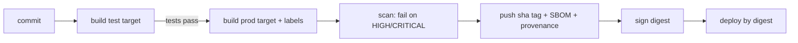

::part[Learn the Concept]{n="1"}

## 🎯 What you'll learn

- One Dockerfile with **`dev`**, **`test`** and **`prod`** targets
- Where `ARG` values are visible, and **build arguments** for versions
- **OCI labels** that connect an image to its source code
- A **tagging strategy**: commit SHA, branch, semantic versions, `latest`
- Pushing to registries: **GHCR** and **Amazon ECR**
- **Multi-architecture** builds with `buildx`
- Build **cache** in CI (registry and GitHub Actions caches)
- Supply-chain basics: **scanning**, **SBOMs**, **provenance** and **signing**

## 🔤 Key words

| Word | In simple words | Bahasa Indonesia |
|---|---|---|
| **Stage** | One `FROM` section of a Dockerfile | Tahap build |
| **Target** | The stage you ask Docker to build (`--target test`) | Tahap yang dipilih |
| **Build arg (`ARG`)** | A value you pass in while building (like a version number) | Argumen build |
| **Label** | A note stored inside the image (source repo, commit) | Label keterangan |
| **Tag** | A human-friendly name for an image version (`1.4.2`, `sha-3f2c1ab`) | Label versi |
| **Registry** | An online warehouse for images (GHCR, ECR, Docker Hub) | Gudang image |
| **CVE** | A publicly known security hole with an ID number | Celah keamanan yang tercatat |
| **SBOM** | A list of every package inside the image, like an ingredients label | Daftar isi komponen |
| **Provenance** | Proof of how and where the image was built | Bukti asal-usul |
| **Signing** | A digital seal proving the image came from you and wasn't changed | Tanda tangan digital |

## 🧠 The big idea

A Dockerfile with targets is a **restaurant kitchen with stations**. The same prepared ingredients (base + dependencies) go to three stations:

- the **tasting station** (`dev`) — with all the tools,
- the **inspection station** (`test`) — if the dish fails inspection, it never leaves the kitchen,
- the **plating station** (`prod`) — only what the customer eats.

Tags and labels are the **batch sticker** on every plate: which recipe version, cooked when, from which ingredients.

## ❓ Why it matters

- Developers and CI shouldn't maintain three Dockerfiles that slowly become different.
- When production breaks, "which code is running?" must be answerable in seconds.
- Registries, CPU types and caches decide how fast (and how safely) you can release and roll back.

Without this:

- `Dockerfile.dev` installs Python 3.12, `Dockerfile` uses 3.13 — "works locally" bugs.
- Every deploy pushes `revoshop:latest`; a rollback means guessing which build was good.
- CI rebuilds dependencies from scratch every run (8 minutes instead of 1).
- An image with a critical CVE in `openssl` sits in production for months because nobody scans.

## 📖 Step by step

### 1. Targets

```dockerfile
# syntax=docker/dockerfile:1
ARG PYTHON_VERSION=3.13                      # before the first FROM: usable in FROM lines

FROM python:${PYTHON_VERSION}-slim AS base
ENV PYTHONUNBUFFERED=1 PYTHONDONTWRITEBYTECODE=1
WORKDIR /app
COPY --from=ghcr.io/astral-sh/uv:0.11.29 /uv /bin/uv

FROM base AS deps
COPY pyproject.toml uv.lock ./
RUN --mount=type=cache,target=/root/.cache/uv uv sync --locked --no-dev --no-install-project

FROM deps AS dev
RUN --mount=type=cache,target=/root/.cache/uv uv sync --locked --no-install-project
CMD ["uv", "run", "flask", "--app", "app:create_app", "run", "--debug", "--host", "0.0.0.0", "--port", "5091"]

FROM dev AS test
COPY . .
RUN uv run python -m pytest -q               # failing tests = failing build

FROM base AS prod                            # clean: no uv cache, no dev deps, no tests
ARG VERSION=dev
ARG REVISION=unknown
LABEL org.opencontainers.image.version=$VERSION org.opencontainers.image.revision=$REVISION
COPY --from=deps /app/.venv /app/.venv
COPY . .
USER 10001
CMD ["gunicorn", "-c", "gunicorn.conf.py", "wsgi:app"]
```

```bash
docker build --target dev  -t api:dev .
docker build --target test .                               # CI: runs the tests inside the build
docker build --build-arg VERSION=1.4.2 --build-arg REVISION=$(git rev-parse HEAD) -t api:1.4.2 .   # prod (last stage)
```

- BuildKit only builds the stages the chosen target needs.
- `prod` starts from `base`, not from `dev` — so test tools never reach customers.
- Put `prod` **last**, so a plain `docker build .` produces the production image.

### 2. Where `ARG` is visible

| Declared | Visible in |
|---|---|
| before the first `FROM` | `FROM` lines only (write `ARG NAME` again inside a stage to use it there) |
| inside a stage | that stage only |

Build args are **saved in the image history** — anyone who pulls the image can read them, like writing a password on the outside of a box. Never pass secrets with `--build-arg`. For secrets needed during the build, use `RUN --mount=type=secret,id=npm_token`.

### 3. OCI labels

```dockerfile
LABEL org.opencontainers.image.title="revoshop-api" \
      org.opencontainers.image.source="https://github.com/you/revoshop" \
      org.opencontainers.image.version=$VERSION \
      org.opencontainers.image.revision=$REVISION \
      org.opencontainers.image.created=$CREATED
```

Labels are the **nutrition label on the package**. GHCR uses `source` to link an image to its repository, and anyone (including you, at 3 a.m.) can run `docker inspect` to find the exact commit.

### 4. Tagging strategy

| Event | Tags |
|---|---|
| any build | `sha-3f2c1ab` (immutable, deploy this) |
| push to `main` | `main`, `edge` |
| branch `feat/login` | `feat-login` |
| release tag `v1.4.2` | `1.4.2`, `1.4`, `1`, `latest` |
| pre-release `v2.0.0-rc.1` | `2.0.0-rc.1` only |
| pull request #42 | `pr-42` |

- The SHA tag is like a **receipt number**: unique and never reused. **Deploy by SHA tag or digest.**
- `1.4`, `1`, `latest` are like "the newest edition" — handy for people, but they move.
- This is what `docker/metadata-action` computes in GitHub Actions (Week 2) — and what you build in the exercise.

### 5. Registries

```bash
# GitHub Container Registry
echo "$GITHUB_TOKEN" | docker login ghcr.io -u your-username --password-stdin
docker push ghcr.io/your-username/revoshop-api:sha-3f2c1ab

# Amazon ECR (Week 3–4)
aws ecr get-login-password --region ap-southeast-3 | docker login --username AWS --password-stdin <account>.dkr.ecr.ap-southeast-3.amazonaws.com
```

| Registry | Good for | Notes |
|---|---|---|
| GHCR | GitHub projects, free public images | log in with `GITHUB_TOKEN` in Actions |
| Docker Hub | public images | download limits for anonymous users |
| Amazon ECR | deploying to ECS/EKS/App Runner | IAM login, image scanning, lifecycle policies |

Set **lifecycle policies** (e.g. keep the last 30 SHA tags) so storage — and the bill — doesn't grow forever. Like clearing out old stock from the warehouse.

### 6. Several CPU types in one image

```bash
docker buildx create --use --name multi
docker buildx build --platform linux/amd64,linux/arm64 \
  -t ghcr.io/you/revoshop-api:sha-3f2c1ab --push .
docker buildx imagetools inspect ghcr.io/you/revoshop-api:sha-3f2c1ab   # shows both platforms
```

One tag, two versions inside — like a phone charger box with adapters for different sockets; Docker picks the right one. Building for the "other" CPU uses QEMU emulation, which is slow for installing dependencies. Alternatives: native arm64 CI machines, or choose one production CPU type.

### 7. Cache in CI

```bash
docker buildx build \
  --cache-from type=gha --cache-to type=gha,mode=max \
  --target prod -t … .
```

Or `type=registry,ref=ghcr.io/you/revoshop-api:buildcache`. CI machines start empty every time — the cache is like **leftover prepared ingredients** saved in the freezer for next time. It only helps if the Dockerfile is ordered from rarely-changing (dependencies) to often-changing (source code).

### 8. Supply chain: scan, SBOM, provenance, sign

```bash
trivy image --severity HIGH,CRITICAL --exit-code 1 ghcr.io/you/revoshop-api:sha-3f2c1ab
docker buildx build --sbom=true --provenance=mode=max …        # attach SBOM and provenance attestations
cosign sign ghcr.io/you/revoshop-api@sha256:…                   # keyless signing with OIDC in CI
```

Think of food safety for images:

- **Scan** = checking ingredients against a recall list (known CVEs).
- **SBOM** = the ingredients label, so you can quickly answer "do we use this broken library?"
- **Provenance** = where and how it was cooked.
- **Signing** = a tamper-proof seal on the lid.



### When to use what

- ✅ Targets whenever dev and prod images differ (they almost always do).
- ✅ SHA tags + labels for anything deployed.
- 🚫 Don't run integration tests that need PostgreSQL inside `docker build` — run them in CI with service containers (Week 2). Unit tests inside the build are fine, but feedback is slower than running pytest directly.
- 🚫 Don't `--push` from laptops to production registries; let CI publish.
- Strict scanning blocks vulnerable releases, but noisy findings can block you too — keep a documented list of accepted risks.

## ⚠️ Common mistakes

- `ARG VERSION` declared before `FROM` and used in a `LABEL` without declaring it again → empty label.
- A test target that copies the source **before** installing dependencies → no caching.
- Shipping the `test` stage because `prod` isn't the last stage and `--target` was forgotten.
- `latest` pushed from feature branches.

## 🏆 Best practices

- [ ] One Dockerfile, targets `dev` → `test` → `prod`, with `prod` last.
- [ ] Pin base images and tools (uv version); consider digests for base images.
- [ ] Build args for versions; **secrets only through secret mounts**.
- [ ] OCI labels: title, source, version, revision, created.
- [ ] Immutable SHA tags for deploys; semver tags for releases; `latest` only for stable releases.
- [ ] Registry lifecycle policies; registry credentials with only the rights they need.
- [ ] Choose target CPU types on purpose.
- [ ] Cache builds in CI; scan images and fail on HIGH/CRITICAL; attach SBOM/provenance; sign release images.

:::revoshop
1. **One stage today.** Your `Dockerfile` has a single stage that copies the whole repo. Meanwhile `.dockerignore` excludes `tests/` and `requirements-dev.txt` — so you *can't* run your 467 tests inside any image. Sketch the `test` and `prod` targets: what does each `COPY`, and why does `prod` copy only `app/`, `config/`, `migrations/`, `run.py` and `gunicorn.conf.py`?
2. **Dev dependencies are heavy.** Open `requirements-dev.txt`: Locust brings `gevent`, `pyzmq`, `psutil` and more. Estimate what they'd add to a production image, and why keeping them in a `test` target matters.
3. **Tags for your branches.** Your repo has `main`, `dev` and `dev-docs`. Use your `image_meta.py` from the exercise: `image_tags("ghcr.io/<you>/revoshop-api", ref="refs/heads/dev-docs", sha=$(git rev-parse HEAD))`. Which tags would a push to `dev` produce, and which branch should get `edge`?
4. **Labels.** `docker image inspect module-2-muhammadismailhasan-web --format '{{json .Config.Labels}}'` → no OCI labels. Which four labels would have helped you most if production broke at night?
5. **Registry plan.** Your bootcamp repository belongs to an organization. Where will you push images — GHCR under your personal account (Week 2) or ECR (Week 4)? Write the full image names now.
:::

::part[Explain & Design]{n="2"}

## 🗣️ Explain it

Explain the kitchen-stations analogy, then explain why production should deploy `sha-3f2c1ab` (or a digest) instead of `latest`.

## 📐 Design it

Design the image pipeline for RevoShop: targets and what each contains, how tests run (unit inside the build? integration with PostgreSQL where?), the tag list for `main`, a PR and a `v1.0.0` release, the registry you'd use, target CPU type(s), and the security gates.

:::quiz
Show a possible design

- **Targets:** `base` (python:3.13-slim, env) → `deps` (production deps from a lock file) → `dev` (+ dev deps, `flask run --debug`) → `test` (copy source, `pytest tests/unit`) → `prod` (venv + source, non-root, gunicorn, labels, HEALTHCHECK).
- **Integration tests** (routes + SQLAlchemy against real PostgreSQL) run in GitHub Actions with a `postgres` service container, using the `dev` image or a uv environment — not inside `docker build`.
- **Tags:** push to `main` → `sha-<7>`, `main`, `edge`; PR #12 → `sha-<7>`, `pr-12` (built and scanned, but **not** pushed to the production registry — or pushed to a separate repo); tag `v1.0.0` → `sha-<7>`, `1.0.0`, `1.0`, `1`, `latest`.
- **Registry:** GHCR while deploying to a VPS/EC2; copy to ECR when moving to ECS (Week 4).
- **CPU type:** `linux/amd64` for a t3 instance, or `linux/arm64` for t4g (Graviton) — pick one and build it in CI.
- **Gates:** tests pass → Trivy HIGH/CRITICAL = fail (with a documented ignore file for accepted risks) → SBOM + provenance → deploy by digest.
:::

### 📝 Self-review checklist

- [ ] The prod image contains no dev tools
- [ ] Every deployable image can be traced to a commit
- [ ] A security gate before deploy

::ai-review{task="design"}

::part[Toy Exercise]{n="3"}

:::exercise{path="exercises/m5/w1/02-targets-tags-labels" ai="no-ai" title="Targets, tags and labels"}
Write a Dockerfile with `base`, `deps`, `dev`, `test` and `prod` targets (cache mounts, clean non-root prod with OCI labels), and a Python module that computes image tags from Git refs (SHA, branch, semver, pre-release, PR) and OCI labels. Optional: `RUN_DOCKER_TESTS=1` builds the real images.
:::

:::hints
- `ARG PYTHON_VERSION` must be declared before the first `FROM` to be used in `FROM python:${PYTHON_VERSION}-slim`.
- In `prod`, declare `ARG VERSION` and `ARG REVISION` again before `LABEL`.
- Collect tags in a `set`, then sort — pre-releases never get `latest`.
:::

## ✅ Quick check

:::quiz
Your `test` stage passes, but the `prod` image still contains pytest. What went wrong?

`prod` was built `FROM dev` or `FROM test` (or copied the whole `/app` from a stage with dev dependencies). Build `prod` from `base` and copy only the production `.venv` from `deps`.
:::

:::quiz
Why shouldn't a GitHub token be passed with `--build-arg`?

Build args are saved in the image's metadata/history; anyone who pulls the image can read them. Use BuildKit secret mounts.
:::

## 📚 Keep learning

- [Docker docs: Multi-stage builds](https://docs.docker.com/build/building/multi-stage/) · [Build cache backends](https://docs.docker.com/build/cache/backends/) · [Attestations](https://docs.docker.com/build/metadata/attestations/)
- [docker/metadata-action](https://github.com/docker/metadata-action)
- [SLSA framework](https://slsa.dev/)
