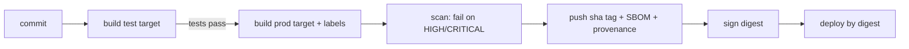

::part[Learn the Concept]{n="1"}

## 🎯 What you'll learn

- One Dockerfile with **`dev`**, **`test`** and **`prod`** targets
- `ARG` scope rules and **build arguments** for versions
- **OCI labels** that connect an image to its source
- A **tagging strategy**: commit SHA, branch, semantic versions, `latest`
- Pushing to registries: **GHCR** and **Amazon ECR**
- **Multi-architecture** builds with `buildx`
- Build **cache** in CI (registry and GitHub Actions caches)
- Supply-chain basics: **scanning**, **SBOMs**, **provenance** and **signing**

## 🧠 The big idea

A Dockerfile with targets is a **restaurant kitchen with stations**. The same prepared ingredients (base + dependencies) go to three stations: the **tasting station** (dev, with all the tools), the **inspection station** (test — if the dish fails inspection, it never leaves the kitchen) and the **plating station** (prod — only what the customer eats). Tags and labels are the **batch sticker** on every plate: which recipe version, cooked when, from which ingredients.

## ❓ Why does this matter?

- Developers and CI shouldn't maintain three Dockerfiles that drift apart.
- When production breaks, "which code is running?" must be answerable in seconds.
- Registries, architectures and caches decide how fast (and how safely) you can ship and roll back.

## 💥 What happens if we DON'T?

- `Dockerfile.dev` installs Python 3.12, `Dockerfile` uses 3.13 — "works locally" bugs.
- Every deploy pushes `revoshop:latest`; a rollback means guessing which build was good.
- CI rebuilds dependencies from scratch every run (8 minutes instead of 1).
- An image with a critical CVE in `openssl` sits in production for months because nobody scans.

## 📖 How it works, step by step

### 1. Targets

```dockerfile
# syntax=docker/dockerfile:1
ARG PYTHON_VERSION=3.13                      # before the first FROM: usable in FROM lines

FROM python:${PYTHON_VERSION}-slim AS base
ENV PYTHONUNBUFFERED=1 PYTHONDONTWRITEBYTECODE=1
WORKDIR /app
COPY --from=ghcr.io/astral-sh/uv:0.11.29 /uv /bin/uv

FROM base AS deps
COPY pyproject.toml uv.lock ./
RUN --mount=type=cache,target=/root/.cache/uv uv sync --locked --no-dev --no-install-project

FROM deps AS dev
RUN --mount=type=cache,target=/root/.cache/uv uv sync --locked --no-install-project
CMD ["uv", "run", "flask", "--app", "app:create_app", "run", "--debug", "--host", "0.0.0.0", "--port", "5091"]

FROM dev AS test
COPY . .
RUN uv run python -m pytest -q               # failing tests = failing build

FROM base AS prod                            # clean: no uv cache, no dev deps, no tests
ARG VERSION=dev
ARG REVISION=unknown
LABEL org.opencontainers.image.version=$VERSION org.opencontainers.image.revision=$REVISION
COPY --from=deps /app/.venv /app/.venv
COPY . .
USER 10001
CMD ["gunicorn", "-c", "gunicorn.conf.py", "wsgi:app"]
```

```bash
docker build --target dev  -t api:dev .
docker build --target test .                               # CI: runs the tests inside the build
docker build --build-arg VERSION=1.4.2 --build-arg REVISION=$(git rev-parse HEAD) -t api:1.4.2 .   # prod (last stage)
```

BuildKit only builds the stages the target needs. Put `prod` **last** so a plain `docker build .` produces production.

### 2. ARG scope

| Declared | Visible in |
|---|---|
| before the first `FROM` | `FROM` lines only (re-declare `ARG NAME` inside a stage to use it there) |
| inside a stage | that stage only |

Build args are **visible in image history** — never pass secrets with `--build-arg`. Use `RUN --mount=type=secret,id=npm_token` for build-time secrets.

### 3. OCI labels

```dockerfile
LABEL org.opencontainers.image.title="revoshop-api" \
      org.opencontainers.image.source="https://github.com/you/revoshop" \
      org.opencontainers.image.version=$VERSION \
      org.opencontainers.image.revision=$REVISION \
      org.opencontainers.image.created=$CREATED
```

GHCR links an image with `source` to its repository; your tooling (and you, at 3 a.m.) can read `docker inspect` to find the exact commit.

### 4. Tagging strategy

| Event | Tags |
|---|---|
| any build | `sha-3f2c1ab` (immutable, deploy this) |
| push to `main` | `main`, `edge` |
| branch `feat/login` | `feat-login` |
| release tag `v1.4.2` | `1.4.2`, `1.4`, `1`, `latest` |
| pre-release `v2.0.0-rc.1` | `2.0.0-rc.1` only |
| pull request #42 | `pr-42` |

This is what `docker/metadata-action` computes in GitHub Actions (Week 2) — and what you implement in the exercise. **Deploy by SHA tag or digest**; human-friendly tags are for people.

### 5. Registries

```bash
# GitHub Container Registry
echo "$GITHUB_TOKEN" | docker login ghcr.io -u your-username --password-stdin
docker push ghcr.io/your-username/revoshop-api:sha-3f2c1ab

# Amazon ECR (Week 3–4)
aws ecr get-login-password --region ap-southeast-3 | docker login --username AWS --password-stdin <account>.dkr.ecr.ap-southeast-3.amazonaws.com
```

| Registry | Good for | Notes |
|---|---|---|
| GHCR | GitHub projects, free public images | auth with `GITHUB_TOKEN` in Actions |
| Docker Hub | public images | pull rate limits for anonymous users |
| Amazon ECR | deploying to ECS/EKS/App Runner | IAM auth, image scanning, lifecycle policies |

Set **lifecycle policies** (e.g. keep the last 30 SHA tags) so storage doesn't grow forever.

### 6. Multi-architecture

```bash
docker buildx create --use --name multi
docker buildx build --platform linux/amd64,linux/arm64 \
  -t ghcr.io/you/revoshop-api:sha-3f2c1ab --push .
docker buildx imagetools inspect ghcr.io/you/revoshop-api:sha-3f2c1ab   # shows both platforms
```

Cross-building uses QEMU emulation (slow for dependency installs). Alternatives: native arm64 CI runners, or pick one production architecture.

### 7. Cache in CI

```bash
docker buildx build \
  --cache-from type=gha --cache-to type=gha,mode=max \
  --target prod -t … .
```

Or `type=registry,ref=ghcr.io/you/revoshop-api:buildcache`. Order layers from least to most frequently changing — the cache only helps if the Dockerfile is cache-friendly.

### 8. Supply chain: scan, SBOM, provenance, sign

```bash
trivy image --severity HIGH,CRITICAL --exit-code 1 ghcr.io/you/revoshop-api:sha-3f2c1ab
docker buildx build --sbom=true --provenance=mode=max …        # attach SBOM and provenance attestations
cosign sign ghcr.io/you/revoshop-api@sha256:…                   # keyless signing with OIDC in CI
```



## ⚖️ Trade-offs

| Choice | ✅ | ❌ |
|---|---|---|
| Tests inside `docker build` | same environment as prod; one command | slower feedback than running pytest directly; needs services (DB) handled separately |
| Separate Dockerfiles per env | simple to read | drift |
| Multi-arch images | run anywhere | slower builds, bigger registry use |
| Strict scanning gates | fewer vulnerable deploys | noisy findings block releases; need an exception process |

## ✅ When to use it / 🚫 When NOT to use it

- ✅ Targets whenever dev and prod images differ (they almost always do).
- ✅ SHA tags + labels for anything deployed.
- 🚫 Don't run integration tests needing PostgreSQL inside `docker build` — run them in CI with service containers (Week 2).
- 🚫 Don't `--push` from laptops to production registries; let CI publish.

## 🏆 Best practices

- [ ] One Dockerfile, targets `dev` → `test` → `prod`, with `prod` last.
- [ ] Pin base images and tools (uv version); consider digests for base images.
- [ ] Build args for versions; **secrets only via secret mounts**.
- [ ] OCI labels: title, source, version, revision, created.
- [ ] Immutable SHA tags for deploys; semver tags for releases; `latest` only for stable releases.
- [ ] Registry lifecycle policies; least-privilege registry credentials.
- [ ] Decide target architectures explicitly.
- [ ] Cache builds in CI; scan images and fail on HIGH/CRITICAL; attach SBOM/provenance; sign release images.

## 🏭 How it's used in industry

- `docker/metadata-action` + `docker/build-push-action` with GHA cache is a standard GitHub Actions setup for container projects.
- Supply-chain security frameworks (SLSA) and tools like cosign and Sigstore are adopted to prove where images came from.
- Cloud registries (ECR, Artifact Registry) scan images on push and integrate with deployment policies.

## ⚠️ Common mistakes

- `ARG VERSION` declared before `FROM` and then used in a `LABEL` without re-declaring → empty label.
- Test target that copies the source **before** installing dependencies → no caching.
- Shipping the `test` stage by forgetting `--target` order.
- `latest` pushed from feature branches.

::part[Explain & Design]{n="2"}

## 🗣️ Explain it

Explain the kitchen-stations analogy, then explain why production should deploy `sha-3f2c1ab` (or a digest) instead of `latest`.

## 📐 Design it

Design the image pipeline for RevoShop: targets and what each contains, how tests run (unit inside the build? integration with PostgreSQL where?), tag list for `main`, a PR and a `v1.0.0` release, the registry you'd use, target architecture(s), and the security gates.

:::quiz
Show a possible design

- **Targets:** `base` (python:3.13-slim, env) → `deps` (production deps from a lock) → `dev` (+ dev deps, `flask run --debug`) → `test` (copy source, `pytest tests/unit`) → `prod` (venv + source, non-root, gunicorn, labels, HEALTHCHECK).
- **Integration tests** (routes + SQLAlchemy against real PostgreSQL) run in GitHub Actions with a `postgres` service container using the `dev` image or a uv environment — not inside `docker build`.
- **Tags:** push to `main` → `sha-<7>`, `main`, `edge`; PR #12 → `sha-<7>`, `pr-12` (built, scanned, **not** pushed to the production registry or pushed to a separate repo); tag `v1.0.0` → `sha-<7>`, `1.0.0`, `1.0`, `1`, `latest`.
- **Registry:** GHCR while deploying to a VPS/EC2; mirror to ECR when moving to ECS (Week 4).
- **Architecture:** `linux/amd64` for a t3 instance, or `linux/arm64` for t4g (Graviton) — pick one and build it in CI.
- **Gates:** tests pass → Trivy HIGH/CRITICAL = fail (with a documented ignore file for accepted risks) → SBOM + provenance → deploy by digest.
:::

### 📝 Self-review checklist

- [ ] Prod image contains no dev tools
- [ ] Every deployable image traceable to a commit
- [ ] Security gate before deploy

::ai-review{task="design"}

::part[Toy Exercise]{n="3"}

:::exercise{path="exercises/m5/w1/02-targets-tags-labels" ai="no-ai" title="Targets, tags and labels"}
Write a Dockerfile with `base`, `deps`, `dev`, `test` and `prod` targets (cache mounts, clean non-root prod with OCI labels), and a Python module that computes image tags from Git refs (SHA, branch, semver, pre-release, PR) and OCI labels. Optional: `RUN_DOCKER_TESTS=1` builds the real images.
:::

:::hints
- `ARG PYTHON_VERSION` must be declared before the first `FROM` to be used in `FROM python:${PYTHON_VERSION}-slim`.
- In `prod`, re-declare `ARG VERSION` and `ARG REVISION` before `LABEL`.
- Collect tags in a `set`, then sort — pre-releases never get `latest`.
:::

## ✅ Quick check

:::quiz
Your `test` stage passes, but the `prod` image still contains pytest. What went wrong?

`prod` was built `FROM dev` or `FROM test` (or copied the whole `/app` from a stage that had dev dependencies). Build `prod` from `base` and copy only the production `.venv` from `deps`.
:::

:::quiz
Why shouldn't a GitHub token be passed with `--build-arg`?

Build args are recorded in image metadata/history; anyone who pulls the image can read them. Use BuildKit secret mounts.
:::

## 📖 Kamus (glossary)

| Term | Bahasa Indonesia |
|---|---|
| Build target | Tahap build yang dipilih |
| Registry | Tempat penyimpanan image |
| Tag | Label versi image |
| SBOM | Daftar komponen perangkat lunak |
| Provenance | Bukti asal-usul build |
| Supply chain security | Keamanan rantai pasok perangkat lunak |

## 📚 Keep learning

- [Docker docs: Multi-stage builds](https://docs.docker.com/build/building/multi-stage/) · [Build cache backends](https://docs.docker.com/build/cache/backends/) · [Attestations](https://docs.docker.com/build/metadata/attestations/)
- [docker/metadata-action](https://github.com/docker/metadata-action)
- [SLSA framework](https://slsa.dev/)
