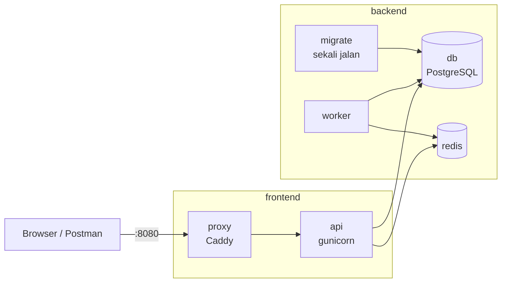

::part[Pelajari Konsepnya]{n="1"}

## 🎯 Yang akan kamu pelajari

- Merancang stack multi-service: **proxy → api → worker**, **db**, **redis**, dan **migrate** sekali jalan
- Urutan startup dengan **health check** dan `service_completed_successfully`
- **Environment variable** di Compose: default `${VAR:-x}` dan wajib `${VAR:?message}`
- **Override file** (`compose.override.yaml`), beberapa file `-f`, dan **profile**
- Network, named volume, restart policy, dan batas sumber daya
- Alur kerja developer: bind mount, **`docker compose watch`**, menjalankan perintah sekali jalan
- Mengoperasikannya: log, exec, scaling, backup — dan kapan Compose di satu server sudah cukup

## 🔤 Istilah penting

| Istilah | Artinya (sederhana) |
|---|---|
| **Service** | Satu jenis container di Compose (api, db, redis…) |
| **Reverse proxy** | Pintu depan yang menerima semua traffic web lalu meneruskannya ke service yang tepat |
| **Worker** | Proses yang mengerjakan tugas di latar belakang (kirim email), bukan menjawab request web |
| **Migration** | Script yang mengubah struktur database (menambah tabel atau kolom) |
| **One-off service** | Container yang menjalankan satu tugas lalu berhenti |
| **Health check** | Perintah yang dijalankan Docker untuk mengecek apakah service benar-benar siap |
| **Interpolation** | Mengisi `${VAR}` di file Compose dengan nilai sungguhan |
| **Override file** | File Compose kedua yang mengubah atau menambah pengaturan |
| **Profile** | Kelompok service opsional yang hanya menyala kalau diminta |

## 🧠 Ide besarnya

`compose.yaml` itu seperti **denah gedung kecil**:

- ruangan apa saja yang ada (service),
- pintu mana yang menghubungkannya (network),
- ruangan mana yang punya brankas (volume),
- pintu mana yang menghadap jalan (port yang dipublikasikan),
- urutan lampu menyala di pagi hari (dependency).

Siapa pun yang punya denahnya bisa membangun gedung yang sama di mana saja — laptopmu, mesin CI, atau server.

## ❓ Kenapa ini penting

Produk sungguhan terdiri dari beberapa program: RevoShop butuh API, PostgreSQL, cara menjalankan migrasi, dan — seiring berkembang — Redis, worker latar belakang, dan reverse proxy dengan HTTPS. Tanpa Compose, developer baru menghabiskan sehari untuk instalasi, dan perbedaan "di mesinku jalan" menyembunyikan bug. Dengan Compose: `git clone && docker compose up`.

Kalau rancangannya buruk:

- `depends_on: [db]` tanpa kondisi health → API menyala sebelum PostgreSQL menerima koneksi → crash berulang-ulang.
- Migrasi dijalankan di setiap container API saat start → dua salinan menjalankannya bersamaan.
- Setiap service mempublikasikan port "untuk debugging" → Redis terbuka ke internet di server.
- Satu `compose.yaml` besar dengan `FLASK_DEBUG=1` dipakai di server production.

## 📖 Langkah demi langkah

### 1. Arsitekturnya



Satu image (`shop-api:local`) dijalankan sebagai **api**, **worker**, dan **migrate** dengan perintah berbeda — build sekali, jalan tiga cara. Seperti satu karyawan yang dilatih jadi kasir, petugas gudang, dan penghitung stok: orangnya sama, tugasnya beda tiap shift.

### 2. Startup berurutan berdasarkan health

```yaml
services:
  api:
    image: shop-api:local
    depends_on:
      db:
        condition: service_healthy
      redis:
        condition: service_healthy
      migrate:
        condition: service_completed_successfully
    healthcheck:
      test: ["CMD", "python", "-c", "import urllib.request; urllib.request.urlopen('http://127.0.0.1:5091/health/live', timeout=2)"]
      interval: 15s
      timeout: 3s
      retries: 3
      start_period: 10s

  migrate:
    image: shop-api:local
    command: ["flask", "--app", "wsgi:app", "db", "upgrade"]
    depends_on:
      db:
        condition: service_healthy
    restart: "no"

  db:
    image: postgres:17-alpine
    healthcheck:
      test: ["CMD-SHELL", "pg_isready -U shop -d shop"]
      interval: 5s
      retries: 10
```

Seperti toko yang buka di pagi hari: kasir (api) tidak mulai bekerja sebelum lampu menyala (db **healthy**) dan rak sudah terisi (migrate **completed**).

`depends_on` hanya mengatur urutan **startup** di satu mesin. Aplikasimu tetap harus mencoba ulang koneksi — database bisa restart dan jaringan bisa tersendat.

### 3. Konfigurasi dan secret

```yaml
x-db-url: &database-url postgresql+psycopg://shop:${POSTGRES_PASSWORD:?set POSTGRES_PASSWORD}@db:5432/shop

services:
  api:
    environment:
      JWT_SECRET_KEY: ${JWT_SECRET_KEY:?set JWT_SECRET_KEY}   # refuse to start without it
      DATABASE_URL: *database-url                             # YAML anchor: one definition, reused
      LOG_LEVEL: ${LOG_LEVEL:-INFO}                           # default
```

- `${VAR:-x}` = "pakai x kalau tidak ada". `${VAR:?message}` = "berhenti dan tampilkan pesan ini kalau tidak ada" — lebih baik untuk secret daripada default yang lemah.
- Nilainya berasal dari shell-mu atau file `.env` di sebelah file Compose (jangan pernah di-commit; commit `.env.example`).
- `docker compose config` mencetak hasil akhir setelah semua nilai diisi — pakai untuk debugging.
- Compose juga mendukung `secrets:` (file yang di-mount di `/run/secrets/`), sehingga secret tidak muncul di output `docker inspect`.

### 4. Override dan profile

```text
compose.yaml            production-like defaults (no debug, no extra ports)
compose.override.yaml   loaded AUTOMATICALLY by `docker compose up` → dev settings
compose.prod.yaml       server-specific additions (e.g. real domain, log driver)
```

```yaml
# compose.override.yaml
services:
  api:
    build: { target: dev }
    volumes: ["./api:/app"]
    environment: { FLASK_DEBUG: "1" }
    ports: ["5092:5091"]
  db:
    ports: ["5493:5432"]   # connect your SQL client locally
```

```bash
docker compose up                                        # compose.yaml + compose.override.yaml
docker compose -f compose.yaml up -d                     # production-like only
docker compose -f compose.yaml -f compose.prod.yaml up -d
docker compose --profile tools up -d                     # + services with profiles: [tools] (mailpit, adminer)
```

File dasar adalah **denah rumah standar**; override adalah **catatan tempel** berisi perubahan untuk rumahmu ("tambah meja di sini"). Daftar seperti `ports` dan `volumes` **digabung**; nilai tunggal diganti. Cek hasilnya dengan `config`.

Profile itu seperti **kursi lipat di gudang**: ada, tapi baru dikeluarkan kalau diminta (`--profile tools`).

### 5. Network, volume, restart, batas

```yaml
services:
  api:
    networks: [frontend, backend]
    restart: unless-stopped
    read_only: true
    tmpfs: [/tmp]
    deploy:
      resources:
        limits: { memory: 512M, cpus: "1.0" }
networks:
  frontend:
  backend:
volumes:
  pgdata:
  redisdata:
```

- Hanya **proxy** yang mempublikasikan port; database dan Redis hanya bisa dijangkau di `backend` — lorong khusus karyawan.
- Hindari `container_name` — ia menghalangi `docker compose up --scale worker=3` (dua container tidak bisa punya nama yang sama).
- `docker compose down` tetap menyimpan volume; `down -v` **menghapus datamu**.

### 6. Alur kerja developer

```bash
docker compose up -d --build
docker compose logs -f api worker
docker compose exec api flask --app wsgi:app shell
docker compose run --rm migrate                       # run a one-off service again
docker compose run --rm api python -m pytest          # one-off command in a fresh container
docker compose watch                                   # Compose 2.22+: sync/rebuild on file changes (develop.watch)
docker compose up -d --scale worker=3
```

### 7. Backup (ya, walaupun di lokal)

```bash
docker compose exec -T db pg_dump -U shop -Fc shop > backup-$(date +%F).dump
docker compose exec -T db pg_restore -U shop -d shop --clean < backup-2026-09-15.dump
```

Backup yang belum pernah di-restore itu seperti kunci cadangan yang belum pernah dicoba di pintunya. Uji restore-nya.

### 8. Apakah Compose cukup untuk production?

| Situasi | Compose di satu VM | Orchestrator (ECS, Kubernetes) |
|---|---|---|
| Aplikasi portofolio, startup tahap awal, alat internal | ✅ sederhana, murah | berlebihan |
| Butuh deploy tanpa downtime di beberapa mesin | ⚠️ manual (blue/green dengan proxy) | ✅ sudah tersedia |
| Auto-scaling sesuai beban, pulih sendiri di banyak host | ❌ | ✅ |
| Database terkelola dengan backup/failover | gabungkan: aplikasi di Compose + RDS | ✅ |

Banyak produk sungguhan dimulai dengan Compose di satu VM + database terkelola — persis itulah yang akan kamu lakukan dengan RevoShop, lalu belajar ECS di Week 4.

### Pilihan yang perlu dibuat

- **Migrasi sebagai service sekali jalan:** berjalan sekali, log jelas, menghentikan deploy yang buruk — tapi ada satu service lagi yang perlu dipahami. **Di entrypoint:** "langsung jalan" untuk satu container, tapi salinannya saling balapan dan restart jadi lambat.
- ✅ Compose untuk development lokal, tes integrasi di CI, demo, deploy di satu server, dan mereproduksi bug production dengan image yang sama.
- 🚫 Bukan untuk ketersediaan tinggi di beberapa server atau autoscaling — pakai orchestrator.
- 🚫 Jangan simpan secret production di file `.env` yang di-commit atau dibagikan lewat chat.

## ⚠️ Kesalahan umum

- `depends_on` tanpa kondisi health.
- `DATABASE_URL=...@localhost:5432` di dalam container.
- `docker compose down -v` di terminal yang salah.
- Mencampur perintah `docker-compose` lama (v1, sudah pensiun) dengan dokumentasi `docker compose` (v2).

## 🏆 Praktik terbaik

- [ ] Satu image, beberapa peran (api, worker, migrate) dengan perintah berbeda.
- [ ] Health check di setiap service; kondisi `service_healthy` / `service_completed_successfully`.
- [ ] Secret wajib dengan `${VAR:?message}`; `.env.example` di-commit, `.env` diabaikan.
- [ ] `compose.yaml` yang mirip production; kemudahan developer di `compose.override.yaml`.
- [ ] Hanya proxy yang dipublikasikan; service internal di network backend.
- [ ] Named volume untuk data; backup diuji dengan restore.
- [ ] Batas, restart policy, filesystem read-only; tanpa `container_name` kalau mungkin di-scale.
- [ ] Kunci tag image (`postgres:17-alpine`, `redis:8-alpine`, `caddy:2-alpine`).
- [ ] Cek file dengan `docker compose config` di CI.

:::revoshop
Bandingkan dua file Compose-mu berdampingan.

1. Jalankan `docker compose -f docker-compose.prod.yml config` **tanpa** file `.env`. Hasilnya gagal dengan `set POSTGRES_USER` — bagus, kamu sudah memakai `${VAR:?}` untuk secret yang wajib. Variabel wajib apa saja yang di file **dev** diam-diam diberi default (`JWT_SECRET_KEY: ${JWT_SECRET_KEY:-dev-secret-key-change-me}`)? Apakah itu bisa diterima untuk development?
2. **Migrasi.** Kedua file mengatur `RUN_MIGRATIONS: "true"` dan `docker/entrypoint.sh` menjalankan `flask db upgrade` setiap container menyala. Tulis ulang sebagai service `migrate` sekali jalan dengan `service_completed_successfully`, seperti di latihan.
3. **Keterbukaan.** `docker-compose.prod.yml` mempublikasikan gunicorn langsung di `${WEB_PORT:-8000}`. Di mana Caddy ditempatkan, ke network mana PostgreSQL dipindahkan, dan `ports:` mana yang hilang?
4. **Penghalang scaling.** Kedua file memakai `container_name` yang tetap. Coba `docker compose -f docker-compose.prod.yml up -d --scale web=2` dan baca error-nya.
5. **Health.** Healthcheck prod memanggil `/api/v1/health`, yang melakukan query ke PostgreSQL (`app/routes/health.py`). Kenapa itu sinyal *readiness* yang bagus tapi sinyal *liveness* yang berisiko? Endpoint apa yang akan kamu tambahkan?
6. Gambar stack target RevoShop sebagai tabel (service · image · command · networks · ports · depends_on) sebelum kamu menyentuh file-filenya di materi 05.
:::

::part[Jelaskan & Rancang]{n="2"}

## 🗣️ Jelaskan

Jelaskan analogi "denah gedung" dan kenapa hanya pintu proxy yang boleh menghadap jalan.

## 📐 Rancang

RevoShop akan menambahkan: upload gambar produk ke object storage, email konfirmasi pesanan yang dikirim di latar belakang, dan admin yang butuh UI database hanya selama development. Rancang service Compose-nya (nama, image, perintah, network, volume, port, dependency, profile) untuk development dan penggunaan yang mirip production.

:::quiz
Lihat contoh rancangan

| Service | Image / perintah | Network | Port | Bergantung pada | Catatan |
|---|---|---|---|---|---|
| proxy | `caddy:2-alpine` | frontend | `80, 443` (prod) / `8080` (dev) | api healthy | Caddyfile read-only; volume `caddy_data` untuk sertifikat |
| api | target prod `revoshop-api`; gunicorn | frontend, backend | tidak ada | db, redis healthy; migrate completed | rootfs read-only, batas sumber daya |
| worker | image yang sama; `python -m app.worker` | backend | tidak ada | db, redis healthy; migrate completed | mengirim email dari antrean Redis |
| migrate | image yang sama; `flask db upgrade` | backend | tidak ada | db healthy | `restart: "no"` |
| db | `postgres:17-alpine` | backend | hanya dev `5493:5432` (override) | — | volume `pgdata` |
| redis | `redis:8-alpine --appendonly yes` | backend | hanya dev `6392:6379` | — | volume `redisdata` |
| minio | `minio/minio` (dikunci versinya) — storage kompatibel S3 untuk **dev** | backend | console dev `9001` | — | profile `dev-storage`; production memakai S3 sungguhan |
| mailpit | `axllent/mailpit` (dikunci versinya) | backend | `8025` | — | profile `tools`; menangkap email di dev |
| adminer | `adminer` (dikunci versinya) | backend | `8081` | db | hanya profile `tools` |

Production: `docker compose -f compose.yaml -f compose.prod.yaml up -d` dengan kredensial S3 dari IAM role atau secret, tanpa profile tools, domain asli di Caddyfile.
:::

### 📝 Checklist review mandiri

- [ ] Port hanya dipublikasikan di tempat yang perlu
- [ ] Service khusus dev berada di balik profile
- [ ] Startup berurutan berdasarkan health; migrasi berjalan sekali

::ai-review{task="design"}

::part[Latihan Kecil]{n="3"}

:::exercise{path="exercises/m5/w1/03-compose-full-stack" ai="no-ai" title="Seluruh stack di Compose"}
Tulis `compose.yaml` yang mirip production (proxy, api, migrate, worker, db, redis, profile mailpit) dengan secret wajib, startup berurutan berdasarkan health, service data yang hanya internal, dan batas sumber daya, plus override untuk development. Dinilai dengan `docker compose config`, jadi tidak ada yang di-build.
:::

:::hints
- Sering-sering jalankan `docker compose -f stack/compose.yaml config` — ia menunjukkan persis apa yang dipahami Compose.
- `${VAR:?set VAR}` membuat Compose berhenti dengan pesan itu saat variabelnya tidak ada.
- YAML anchor (`&name` / `*name`) mencegah pengulangan URL database.
:::

## ✅ Cek cepat

:::quiz
Apa bedanya `docker compose run --rm migrate` dan `docker compose up migrate`?

`run` menyalakan container baru sekali jalan untuk service itu (dan menghapusnya dengan `--rm`) — berguna untuk mengulang sebuah tugas. `up` membuat/menyalakan service sebagai bagian dari proyek dan mengikuti siklus hidupnya.
:::

:::quiz
Kamu menambahkan `ports: ["6379:6379"]` ke redis di `compose.yaml` untuk debugging. Kenapa itu berbahaya di server, dan sebaiknya ditaruh di mana?

Itu membuka Redis (sering tanpa password) di network interface publik server. Taruh di `compose.override.yaml` khusus untuk development lokal, atau bind ke `127.0.0.1`.
:::

## 📚 Lanjut belajar

- [Dokumentasi Docker: Compose file reference](https://docs.docker.com/reference/compose-file/) · [Startup order](https://docs.docker.com/compose/how-tos/startup-order/) · [Profiles](https://docs.docker.com/compose/how-tos/profiles/) · [Compose Watch](https://docs.docker.com/compose/how-tos/file-watch/)
- [Caddy: reverse proxy quick start](https://caddyserver.com/docs/quick-starts/reverse-proxy)
