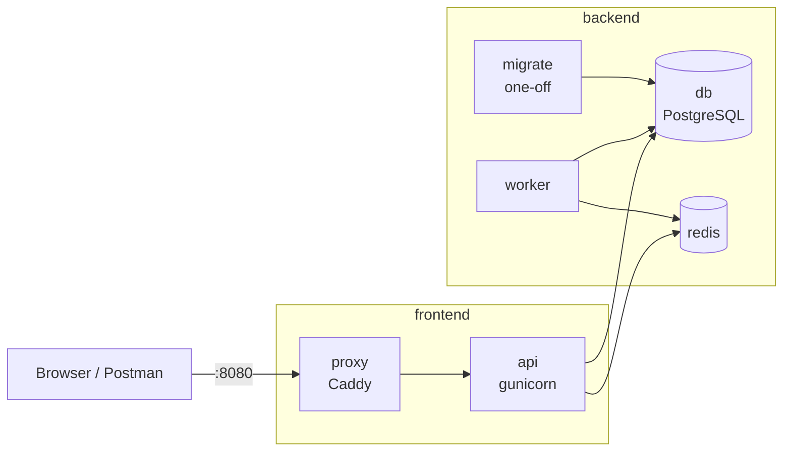

::part[Learn the Concept]{n="1"}

## 🎯 What you'll learn

- Designing a multi-service stack: **proxy → api → worker**, **db**, **redis**, one-off **migrate**
- Startup ordering with **health checks** and `service_completed_successfully`
- **Environment interpolation**: defaults `${VAR:-x}` and required `${VAR:?message}`
- **Override files** (`compose.override.yaml`), multiple `-f` files and **profiles**
- Networks, named volumes, restart policies and resource limits
- Developer experience: bind mounts, **`docker compose watch`**, running one-off commands
- Operating it: logs, exec, scaling, backups — and when Compose on one server is enough

## 🧠 The big idea

`compose.yaml` is the **floor plan of a small building**: which rooms exist (services), which doors connect them (networks), which rooms have safes (volumes), which door faces the street (published ports) and the order the lights come on in the morning (dependencies). Anyone with the plan can build the same building on any plot — your laptop, a CI runner or a server.

## ❓ Why does this matter?

A real product is several processes: RevoShop needs the API, PostgreSQL, a way to run migrations, and — as it grows — Redis, a background worker and a reverse proxy with HTTPS. Without Compose, new developers spend a day installing things, and "works on my machine" differences hide bugs. With it: `git clone && docker compose up`.

## 💥 What happens if we DON'T design it well?

- `depends_on: [db]` without a health condition → the API starts before PostgreSQL accepts connections → crash loop.
- Migrations run inside every API container at start → two replicas run them at the same time.
- Every service publishes ports "for debugging" → Redis open to the internet on a server.
- One giant `compose.yaml` with `FLASK_DEBUG=1` used on the production server.

## 📖 How it works, step by step

### 1. The architecture



One image (`shop-api:local`) runs as **api**, **worker** and **migrate** with different commands — build once, run three ways.

### 2. Health-ordered startup

```yaml
services:
  api:
    image: shop-api:local
    depends_on:
      db:
        condition: service_healthy
      redis:
        condition: service_healthy
      migrate:
        condition: service_completed_successfully
    healthcheck:
      test: ["CMD", "python", "-c", "import urllib.request; urllib.request.urlopen('http://127.0.0.1:5091/health/live', timeout=2)"]
      interval: 15s
      timeout: 3s
      retries: 3
      start_period: 10s

  migrate:
    image: shop-api:local
    command: ["flask", "--app", "wsgi:app", "db", "upgrade"]
    depends_on:
      db:
        condition: service_healthy
    restart: "no"

  db:
    image: postgres:17-alpine
    healthcheck:
      test: ["CMD-SHELL", "pg_isready -U shop -d shop"]
      interval: 5s
      retries: 10
```

`depends_on` only orders **startup** on one machine. Your app must still retry connections — databases restart, networks blip.

### 3. Configuration and secrets

```yaml
x-db-url: &database-url postgresql+psycopg://shop:${POSTGRES_PASSWORD:?set POSTGRES_PASSWORD}@db:5432/shop

services:
  api:
    environment:
      JWT_SECRET_KEY: ${JWT_SECRET_KEY:?set JWT_SECRET_KEY}   # refuse to start without it
      DATABASE_URL: *database-url                             # YAML anchor: one definition, reused
      LOG_LEVEL: ${LOG_LEVEL:-INFO}                           # default
```

- Values come from your shell or a `.env` file next to the Compose file (never commit it; commit `.env.example`).
- `docker compose config` prints the fully resolved model — use it to debug interpolation.
- Compose also supports `secrets:` (mounted files under `/run/secrets/`), which avoids secrets in `docker inspect` environment output.

### 4. Overrides and profiles

```text
compose.yaml            production-like defaults (no debug, no extra ports)
compose.override.yaml   loaded AUTOMATICALLY by `docker compose up` → dev settings
compose.prod.yaml       server-specific additions (e.g. real domain, log driver)
```

```yaml
# compose.override.yaml
services:
  api:
    build: { target: dev }
    volumes: ["./api:/app"]
    environment: { FLASK_DEBUG: "1" }
    ports: ["5092:5091"]
  db:
    ports: ["5493:5432"]   # connect your SQL client locally
```

```bash
docker compose up                                        # compose.yaml + compose.override.yaml
docker compose -f compose.yaml up -d                     # production-like only
docker compose -f compose.yaml -f compose.prod.yaml up -d
docker compose --profile tools up -d                     # + services with profiles: [tools] (mailpit, adminer)
```

Lists like `ports` and `volumes` are **merged**; scalar values are replaced. Check the result with `config`.

### 5. Networks, volumes, restart, limits

```yaml
services:
  api:
    networks: [frontend, backend]
    restart: unless-stopped
    read_only: true
    tmpfs: [/tmp]
    deploy:
      resources:
        limits: { memory: 512M, cpus: "1.0" }
networks:
  frontend:
  backend:
volumes:
  pgdata:
  redisdata:
```

- Only the **proxy** publishes ports; the database and Redis are reachable only on `backend`.
- Avoid `container_name` — it prevents `docker compose up --scale worker=3`.
- `docker compose down` keeps volumes; `down -v` **deletes your data**.

### 6. Developer loop

```bash
docker compose up -d --build
docker compose logs -f api worker
docker compose exec api flask --app wsgi:app shell
docker compose run --rm migrate                       # run a one-off service again
docker compose run --rm api python -m pytest          # one-off command in a fresh container
docker compose watch                                   # Compose 2.22+: sync/rebuild on file changes (develop.watch)
docker compose up -d --scale worker=3
```

### 7. Backups (yes, even locally)

```bash
docker compose exec -T db pg_dump -U shop -Fc shop > backup-$(date +%F).dump
docker compose exec -T db pg_restore -U shop -d shop --clean < backup-2026-09-15.dump
```

### 8. Is Compose enough for production?

| Situation | Compose on one VM | Orchestrator (ECS, Kubernetes) |
|---|---|---|
| Portfolio app, early startup, internal tool | ✅ simple, cheap | overkill |
| Needs zero-downtime deploys across machines | ⚠️ manual (blue/green with a proxy) | ✅ built in |
| Auto-scaling on load, self-healing across hosts | ❌ | ✅ |
| Managed database with backups/failover | combine: Compose app + RDS | ✅ |

Many real products start with Compose on a VM + a managed database — you'll do exactly that with RevoShop, then learn ECS in Week 4.

## ⚖️ Trade-offs

| Choice | ✅ | ❌ |
|---|---|---|
| Migrations as a one-off service | runs once, clear logs, blocks bad deploys | one more service to understand |
| Migrations in the entrypoint | "just works" for one container | races with replicas, slow restarts |
| Override file for dev | prod-like defaults are safe | merge rules can surprise |
| Profiles for tools | tools off by default | easy to forget they exist |

## ✅ When to use it / 🚫 When NOT to use it

- ✅ Local development, CI integration tests, demos, single-server deployments.
- ✅ Reproducing a production bug with the same images and versions.
- 🚫 Multi-host high availability and autoscaling — use an orchestrator.
- 🚫 Don't keep production secrets in a `.env` file committed or copied around by chat.

## 🏆 Best practices

- [ ] One image, several roles (api, worker, migrate) with different commands.
- [ ] Health checks on every service; `service_healthy` / `service_completed_successfully` conditions.
- [ ] Required secrets with `${VAR:?message}`; `.env.example` committed, `.env` ignored.
- [ ] Production-like `compose.yaml`; developer conveniences in `compose.override.yaml`.
- [ ] Publish only the proxy; internal services on a backend network.
- [ ] Named volumes for data, backups tested with a restore.
- [ ] Limits, restart policies, read-only filesystems; no `container_name` if you may scale.
- [ ] Pin image tags (`postgres:17-alpine`, `redis:8-alpine`, `caddy:2-alpine`).
- [ ] Validate with `docker compose config` in CI.

## 🏭 How it's used in industry

- Compose is the standard way to give developers a one-command local environment and to run integration tests in CI.
- Small companies and indie products run production on a single VM with Compose and a reverse proxy (Caddy, Traefik, Nginx).
- The Compose Specification is also accepted by some cloud tools (e.g. converting to other formats), so the model you learn is portable.

## ⚠️ Common mistakes

- `depends_on` without health conditions.
- `DATABASE_URL=...@localhost:5432` inside a container.
- `docker compose down -v` in the wrong terminal.
- Mixing `docker-compose` (v1, retired) commands and `docker compose` (v2) docs.

::part[Explain & Design]{n="2"}

## 🗣️ Explain it

Explain the "floor plan" analogy and why only the proxy's door should face the street.

## 📐 Design it

RevoShop is adding: product image uploads to object storage, order confirmation emails sent in the background, and an admin that needs a database UI during development only. Design the Compose services (names, images, commands, networks, volumes, ports, dependencies, profiles) for development and production-like use.

:::quiz
Show a possible design

| Service | Image / command | Networks | Ports | Depends on | Notes |
|---|---|---|---|---|---|
| proxy | `caddy:2-alpine` | frontend | `80, 443` (prod) / `8080` (dev) | api healthy | Caddyfile read-only; `caddy_data` volume for certificates |
| api | `revoshop-api` prod target; gunicorn | frontend, backend | none | db, redis healthy; migrate completed | read-only rootfs, limits |
| worker | same image; `python -m app.worker` | backend | none | db, redis healthy; migrate completed | sends emails from a Redis queue |
| migrate | same image; `flask db upgrade` | backend | none | db healthy | `restart: "no"` |
| db | `postgres:17-alpine` | backend | dev only `5493:5432` (override) | — | `pgdata` volume |
| redis | `redis:8-alpine --appendonly yes` | backend | dev only `6392:6379` | — | `redisdata` volume |
| minio | `minio/minio` (pinned) — S3-compatible storage for **dev** | backend | dev `9001` console | — | profile `dev-storage`; production uses real S3 |
| mailpit | `axllent/mailpit` (pinned) | backend | `8025` | — | profile `tools`; SMTP sink for emails in dev |
| adminer | `adminer` (pinned) | backend | `8081` | db | profile `tools` only |

Production: `docker compose -f compose.yaml -f compose.prod.yaml up -d` with S3 credentials via IAM role or secrets, no tools profile, real domain in the Caddyfile.
:::

### 📝 Self-review checklist

- [ ] Ports published only where needed
- [ ] Dev-only services behind profiles
- [ ] Startup ordering by health, migrations once

::ai-review{task="design"}

::part[Toy Exercise]{n="3"}

:::exercise{path="exercises/m5/w1/03-compose-full-stack" ai="no-ai" title="The whole stack in Compose"}
Write a production-like `compose.yaml` (proxy, api, migrate, worker, db, redis, mailpit profile) with required secrets, health-ordered startup, internal-only data services and limits, plus a development override. Graded with `docker compose config`, so nothing gets built.
:::

:::hints
- Run `docker compose -f stack/compose.yaml config` often — it shows exactly what Compose understood.
- `${VAR:?set VAR}` makes Compose fail with that message when the variable is missing.
- YAML anchors (`&name` / `*name`) avoid repeating the database URL.
:::

## ✅ Quick check

:::quiz
What's the difference between `docker compose run --rm migrate` and `docker compose up migrate`?

`run` starts a new one-off container for that service (and removes it with `--rm`), useful for repeating a task; `up` creates/starts the service as part of the project and attaches to its lifecycle.
:::

:::quiz
You added `ports: ["6379:6379"]` to redis in `compose.yaml` for debugging. Why is that dangerous on a server, and where should it go instead?

It exposes Redis (often without a password) on the server's public interface. Put it in `compose.override.yaml` for local development only, or bind to `127.0.0.1`.
:::

## 📖 Kamus (glossary)

| Term | Bahasa Indonesia |
|---|---|
| Service | Layanan (satu jenis kontainer di Compose) |
| Override file | Berkas penimpa konfigurasi |
| Profile | Profil (kelompok layanan opsional) |
| Health check | Pemeriksaan kesehatan |
| Interpolation | Penyisipan nilai variabel |
| Reverse proxy | Proksi balik (pintu masuk lalu lintas) |

## 📚 Keep learning

- [Docker docs: Compose file reference](https://docs.docker.com/reference/compose-file/) · [Startup order](https://docs.docker.com/compose/how-tos/startup-order/) · [Profiles](https://docs.docker.com/compose/how-tos/profiles/) · [Compose Watch](https://docs.docker.com/compose/how-tos/file-watch/)
- [Caddy: reverse proxy quick start](https://caddyserver.com/docs/quick-starts/reverse-proxy)
