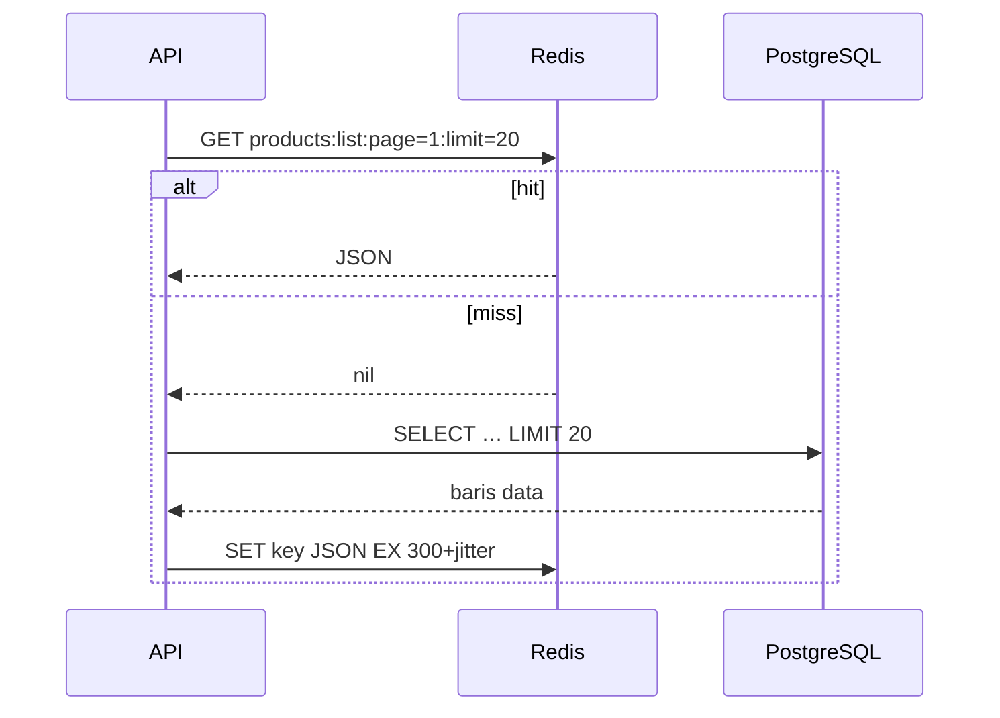

::part[Pelajari Konsepnya]{n="1"}

## 🎯 Yang akan kamu pelajari

- Redis bagus untuk apa, dan **struktur data** utamanya
- **Cache-aside** dengan TTL, **jitter**, dan invalidasi — serta apa yang layak di-cache
- **Cache stampede** dan bagaimana lock melindunginya
- **Rate limiting** (fixed dan sliding window) yang dibuat aman dengan **Lua**
- **Antrean yang andal** (`BLMOVE`), **Streams** dengan consumer group, dan kapan memakai job library atau SQS
- **Idempotency key** untuk webhook dan pembayaran
- Menyimpan data ke disk (RDB/AOF), batas memori, **eviction**, dan dasar keamanan
- Memakai Redis dari Flask

## 🔤 Istilah penting

| Istilah | Artinya (sederhana) |
|---|---|
| **Redis** | Penyimpanan data kecil di memori yang sangat cepat |
| **Cache** | Salinan jawaban yang lambat, supaya lain kali cepat |
| **TTL** | Berapa lama sebuah key hidup sebelum dihapus Redis |
| **Invalidation** | Membuang salinan cache karena data aslinya berubah |
| **Cache stampede** | Banyak request membangun ulang cache yang sama saat kedaluwarsa bersamaan |
| **Rate limiting** | Hanya mengizinkan N percobaan dalam rentang waktu tertentu |
| **Atomic** | Terjadi sebagai satu langkah — tidak ada yang bisa menyelinap di tengah |
| **Queue** | Antrean tugas yang menunggu dikerjakan worker |
| **Idempotent** | Dijalankan dua kali hasilnya sama dengan sekali |
| **Eviction** | Redis menghapus key saat memori penuh |

## 🧠 Ide besarnya

Redis itu seperti **papan tulis yang sangat cepat di tengah kantor**. Semua orang bisa membacanya seketika, menulis catatan pendek di sana, dan mengatur catatan agar terhapus sendiri setelah beberapa saat. Cocok untuk:

- "produk terlaris hari ini" (cache),
- "berapa kali orang ini mengetuk pintu dalam semenit terakhir" (rate limit),
- "kartu tugas yang menunggu diambil" (antrean).

Redis **bukan** lemari arsip tempat menyimpan kontrak — itu tugas database-mu.

## ❓ Kenapa ini penting

Daftar produk RevoShop jauh lebih sering dibaca daripada diubah. Halaman login menjadi sasaran tebak-tebakan password. Midtrans bisa mengirim notifikasi pembayaran yang sama dua kali. Mengirim email di dalam request membuat checkout lambat. Redis menyelesaikan keempatnya dengan beberapa pola yang sudah umum — dan memakai pola itu secara salah adalah penyebab insiden production terparah.

Kalau dikerjakan asal-asalan:

- Setiap request daftar produk memukul PostgreSQL; satu kampanye marketing menjatuhkan database.
- Cache tanpa invalidasi menampilkan harga lama setelah penjual mengubahnya.
- Antrean `LPUSH`/`RPOP`: worker crash di tengah job → email pesanan hilang selamanya.
- Rate limiter yang ditulis sebagai `GET` lalu `SET` meloloskan 30 percobaan bersamaan pada batas 5.
- Webhook ganda menandai pesanan sudah dibayar dua kali dan memicu dua pengiriman.

## 📖 Langkah demi langkah

### 1. Struktur data yang akan kamu pakai

| Tipe | Perintah | Kegunaan |
|---|---|---|
| String | `SET key value EX 60 NX`, `GET`, `INCR` | isi cache, lock, penghitung, idempotency key |
| Hash | `HSET`, `HGET`, `HINCRBY` | object kecil, metadata job |
| List | `LPUSH`, `BLMOVE`, `LREM` | antrean sederhana |
| Set | `SADD`, `SISMEMBER` | pengunjung unik, tag |
| Sorted set | `ZADD`, `ZRANGEBYSCORE`, `ZREMRANGEBYSCORE` | papan peringkat, rate limit sliding window, job terjadwal |
| Stream | `XADD`, `XREADGROUP`, `XACK`, `XAUTOCLAIM` | aliran event/job yang awet dengan consumer group |

Satu perintah pada satu key bersifat atomik. Logika dengan beberapa langkah butuh transaksi `MULTI` atau **script Lua**, yang dijalankan Redis sebagai satu langkah tanpa disela.

### 2. Cache-aside

```python
def cache_aside(r, key, ttl, loader, *, jitter=0.1, rng=random.random):
    cached = r.get(key)
    if cached is not None:
        return json.loads(cached)
    value = loader()                                   # e.g. ProductService.get_all(...)
    if value is None:
        return None
    r.set(key, json.dumps(value), ex=ttl + int(ttl * jitter * rng()))
    return value
```



Seperti pemilik toko yang menulis harga produk populer hari ini di papan tulis: lihat papan dulu; kalau tidak ada, cari di buku besar (database) lalu tulis di papan untuk pembeli berikutnya.

**Key** harus memuat semua yang memengaruhi jawabannya: `products:v2:list:category=3:page=1:limit=20:sort=price_asc`. Bagian `v2` memungkinkanmu membuang semua entri lama setelah format data berubah, cukup dengan mengganti versinya.

Pilihan **invalidasi**:

- **Hanya TTL** — sederhana; data bisa basi selama maksimal TTL. Cocok untuk daftar (60–300 detik).
- **Hapus saat menulis** — setelah memperbarui produk 7, hapus `product:7` dan naikkan penghitung `products:list:version` yang ikut dipakai di key daftar.
- Jangan pernah menyimpan data pribadi satu pengguna di key yang bisa dibaca pengguna lain.

Yang layak di-cache: data mahal, sering dibaca, dan boleh sedikit basi (katalog, kategori, statistik hasil hitungan). Yang tidak: jumlah stok yang dipakai untuk menerima pesanan, status pembayaran, apa pun yang harus persis.

### 3. Perlindungan dari stampede

Saat key populer kedaluwarsa, ratusan request meleset bersamaan dan semuanya memukul database — seperti satu contoh barang di toko habis dan semua pembeli serentak menyerbu gudang.

```python
lock_key, token = f"lock:{key}", secrets.token_hex(16)
if r.set(lock_key, token, nx=True, px=5000):             # only one request recomputes
    try:
        value = loader(); r.set(key, json.dumps(value), ex=ttl); return value
    finally:
        r.eval("if redis.call('GET', KEYS[1]) == ARGV[1] then return redis.call('DEL', KEYS[1]) end return 0", 1, lock_key, token)
else:
    ...poll for the value briefly, then fall back to loader()
```

- Hanya request yang mendapat lock yang pergi ke gudang; yang lain menunggu sebentar sampai papan diperbarui.
- Lepaskan lock hanya kalau **token-mu** masih ada di sana — kalau pekerjaanmu lebih lama dari TTL lock, bisa jadi lock itu sudah milik orang lain.
- Teknik lain: jitter (supaya key tidak kedaluwarsa bersamaan), **stale-while-revalidate** (sajikan nilai lama sambil memperbarui), dan mengisi duluan key yang populer.

### 4. Rate limiting

```lua
-- sliding window: atomic check-and-add
redis.call('ZREMRANGEBYSCORE', KEYS[1], '-inf', ARGV[1] - ARGV[2])
if redis.call('ZCARD', KEYS[1]) < tonumber(ARGV[3]) then
  redis.call('ZADD', KEYS[1], ARGV[1], ARGV[4])
  redis.call('EXPIRE', KEYS[1], ARGV[5])
  return {1, '0'}
end
```

Seperti ATM yang memblokir kartu setelah 3 kali PIN salah. Pengecekan dan pencatatannya harus terjadi **bersama-sama** di dalam Lua — kalau tidak, 30 request bisa sama-sama membaca "baru 4 percobaan" sebelum ada satu pun yang menulis "5".

| Algoritma | ✅ | ❌ |
|---|---|---|
| Fixed window (`INCR` + `EXPIRE`) | paling murah | lonjakan di batas jendela (bisa 2× limit) |
| Sliding window log (sorted set) | akurat | memakai memori per request |
| Token bucket | mengizinkan lonjakan yang halus, umum di API | logikanya sedikit lebih rumit |

Batasi berdasarkan hal yang sulit diganti penyerang: percobaan login per **email** *dan* per **IP**. Kembalikan `429 Too Many Requests` dengan header `Retry-After`. Library seperti **Flask-Limiter** bisa menyimpan hitungannya di Redis.

### 5. Antrean

```python
raw = r.blmove("emails:ready", "emails:processing", timeout=5, src="RIGHT", dest="LEFT")   # atomic hand-off
process(json.loads(raw))
r.lrem("emails:processing", 1, raw)                                                        # ack
# a janitor moves jobs stuck in processing back to ready (visibility timeout)
```

Bayangkan rel tiket pesanan di dapur: juru masak memindahkan tiket dari "menunggu" ke "dimasak" dalam satu gerakan, dan mencabutnya hanya setelah makanan disajikan. Kalau juru masaknya menghilang, tiketnya masih ada di rel "dimasak" — ada yang mengembalikannya ke "menunggu".

Ini memberi jaminan **at-least-once**: satu job bisa jalan dua kali (worker crash setelah pekerjaan selesai tapi sebelum tiketnya dicabut) → handler harus **idempoten**.

| Pilihan | Kapan |
|---|---|
| List + `BLMOVE` | belajar, beban kerja kecil |
| **Redis Streams** + consumer group | sudah ada acknowledgement, daftar pending, dan pengambilan pesan yang macet |
| Job library: **RQ**, **Celery**, **Dramatiq** (Python) | retry, penjadwalan, monitoring sudah termasuk |
| **Amazon SQS** (Week 5) | terkelola, awet, bisa diskalakan, punya dead-letter queue |

### 6. Idempotency key

```python
def run_once(r, key, ttl, action):
    if r.set(key, "__pending__", nx=True, ex=ttl):
        try:
            result = action()
        except Exception:
            r.delete(key); raise
        r.set(key, json.dumps(result), keepttl=True)
        return result, True
    stored = r.get(key)
    if stored == "__pending__":
        raise InProgressError(key)
    return json.loads(stored), False
```

Seperti **nomor resep di apotek**: kalau nomor resep yang sama datang dua kali, apotekernya melihat obatnya sudah diserahkan dan tidak memberikannya lagi.

Untuk notifikasi Midtrans, key-nya `idem:midtrans:{order_id}:{transaction_status}`. Tetap jadikan **database** sebagai penjaga terakhir (unique constraint atau `UPDATE … WHERE status = 'pending'` bersyarat) — Redis adalah pengecekan cepat tambahan, bukan satu-satunya.

### 7. Mengoperasikan Redis

| Topik | Panduan |
|---|---|
| Menyimpan ke disk | Snapshot **RDB** (ringkas, bisa kehilangan tulisan terakhir) dan/atau **AOF** (catatan setiap tulisan, lebih awet). Murni cache: opsional. Antrean: nyalakan AOF. |
| Memori | atur `maxmemory` dan kebijakan eviction: `allkeys-lru`/`allkeys-lfu` untuk cache, `noeviction` kalau Redis menyimpan antrean atau lock yang tidak boleh hilang |
| Keamanan | jangan pernah membuka port 6379 ke internet; wajibkan auth/ACL; TLS di layanan terkelola |
| Instance terpisah | cache dan antrean sering butuh pengaturan eviction/persistence yang berbeda |
| Pilihan terkelola | Amazon ElastiCache (Redis OSS / Valkey), Redis Cloud, Upstash |
| Monitoring | rasio hit (`INFO stats` keyspace_hits/misses), memori, eviction, slow log |

Catatan lisensi: Redis pindah ke lisensi source-available pada 2024 dan menambahkan opsi AGPL di Redis 8. Fork dari Linux Foundation, **Valkey**, memakai protokol yang sama dan tersedia di cloud besar. Kode aplikasimu memakai API klien yang sama.

### 8. Redis di Flask

```python
# app/extensions.py
import redis
redis_client: redis.Redis | None = None

def init_redis(app):
    global redis_client
    redis_client = redis.Redis.from_url(app.config["REDIS_URL"], decode_responses=True, socket_timeout=1, health_check_interval=30)
```

Pakai timeout pendek, dan putuskan apa yang terjadi saat Redis mati:

- cache sebaiknya **fail open** (langsung ke database),
- rate limiter biasanya fail open dan mengirim alert,
- penjaga idempotensi jatuh kembali ke constraint database.

### Kapan dipakai

- ✅ Data yang sering dibaca dan boleh basi beberapa detik; penghitung; rate limit; lock berumur pendek; session; antrean kecil.
- 🚫 Sebagai satu-satunya salinan data penting (pesanan, pembayaran).
- 🚫 Caching sebelum mengukur — perbaiki dulu query N+1 dan tambahkan index.
- 🚫 Lock untuk perpindahan uang yang kebenarannya kritis — pakai transaksi dan constraint database.

Setiap cache ada harganya: data lama, bug invalidasi, dan satu komponen lagi yang bisa rusak. TTL pendek memberi data lebih segar tapi hit cache lebih sedikit.

## ⚠️ Kesalahan umum

- Key tanpa TTL memenuhi memori; `KEYS *` di production (ia memblokir Redis — pakai `SCAN`).
- Menyimpan harga `Decimal` sebagai float di JSON cache.
- Menghapus lock milik request lain.
- Menjalankan Redis di VM kecil yang sama tanpa batas memori, lalu data antrean ikut ter-evict.

## 🏆 Praktik terbaik

- [ ] Ukur dulu (jumlah query, latensi p95); cache jalur yang terbukti paling sering dipakai.
- [ ] Key yang berversi dan deskriptif; TTL di setiap key cache; jitter untuk key populer.
- [ ] Invalidasi saat menulis kalau data basi berbahaya; jangan simpan data per pengguna di key bersama.
- [ ] Lindungi key populer dari stampede.
- [ ] Logika multi-langkah secara atomik dengan Lua atau transaksi.
- [ ] Antrean at-least-once dengan handler idempoten, retry, dan rencana untuk job yang gagal.
- [ ] Idempotency key untuk webhook dan aksi pembayaran, didukung constraint database.
- [ ] `maxmemory` + kebijakan eviction yang sesuai; tidak pernah publik; auth/TLS di production.
- [ ] Timeout klien yang pendek dan rencana jelas saat Redis tidak tersedia.
- [ ] Pantau rasio hit, eviction, dan memori.

:::revoshop
1. **Ukur sebelum caching.** Nyalakan stack dev (`config/development.py` punya `SQLALCHEMY_ECHO = True`) lalu panggil `GET /api/v1/products/?page=1&limit=20`. Hitung jumlah statement SQL di `docker compose logs web`. Apakah ada N+1 pada gambar produk atau kategori? Perbaiki query dulu, cache belakangan.
2. **Cache daftar produk.** `ProductList.get` di `app/routes/products.py` menerima `name`, `category_id`, `seller_id`, `min_price`, `max_price`, `sort_by`, `order`, `page`, dan `limit`. Rancang cache key-nya, TTL-nya, dan titik persis di `app/services/product_service.py` di mana create/update/delete harus melakukan invalidasi. Kenapa harga harus tetap berupa string (`Numeric`) di JSON yang di-cache?
3. **Login.** `AuthLogin.post` di `app/routes/auth.py` belum punya batas. Tentukan batas per email dan per IP, isi body `429` dalam format `make_response` milik RevoShop, dan apa yang terjadi saat Redis mati.
4. **Webhook-mu sudah setengah idempoten.** Baca `PaymentService.handle_notification` di `app/services/payment_service.py`: ia memverifikasi tanda tangan dengan perbandingan waktu-konstan dan mengabaikan notifikasi saat `payment.status == new_payment_status`. Bagus. Sekarang bayangkan Midtrans mengirim notifikasi yang **sama** dua kali **pada saat yang sama**: kedua request membaca `pending` sebelum salah satunya commit. Apa yang terjadi? Bandingkan dua perbaikan: penjaga `run_once` di Redis vs `UPDATE payments SET status = … WHERE id = … AND status = 'pending'` bersyarat di repository.
5. **Pekerjaan latar belakang.** Bagian lambat mana di checkout atau pembayaran yang akan kamu pindahkan ke antrean (email konfirmasi, mengedaluwarsakan pesanan yang belum dibayar setelah `MIDTRANS_EXPIRY_MINUTES`)? Tulis payload job untuk salah satunya.
:::

::part[Jelaskan & Rancang]{n="2"}

## 🗣️ Jelaskan

Jelaskan analogi "papan tulis kantor", lalu jelaskan ke rekan tim kenapa harga produk yang di-cache harus dihapus saat penjual mengubahnya, sementara daftar kategori yang di-cache cukup dibiarkan kedaluwarsa sendiri.

## 📐 Rancang

Rancang pemakaian Redis untuk RevoShop: cache daftar/detail produk (key, TTL, invalidasi), rate limit login (batas, identitas, respons), idempotensi webhook Midtrans (key dan cadangan di database), dan email pesanan di latar belakang (pilihan antrean, retry). Sertakan apa yang terjadi saat Redis mati untuk masing-masing.

:::quiz
Lihat contoh rancangan

| Fitur | Rancangan | Saat Redis mati |
|---|---|---|
| Detail produk | `product:v1:{id}` cache-aside, TTL 300 detik + jitter 10%; **hapus saat update/delete** di `ProductService` | fail open → DB |
| Daftar produk | `products:v1:list:{hash(query params)}:gen={list_generation}`; `INCR products:list:generation` di setiap penulisan produk; TTL 60 detik; lock untuk key halaman pertama | fail open → DB (pantau beban DB) |
| Kategori | `categories:v1:all`, TTL 1 jam, hapus saat kategori diubah | fail open |
| Rate limit login | sliding window: 5 percobaan / 15 menit per email **dan** 20 / 15 menit per IP → `429` + `Retry-After`, teks error yang umum | fail open + alert (atau limiter kecil di dalam proses) |
| Webhook Midtrans | `run_once("idem:midtrans:{order_id}:{transaction_status}", 24 jam)` + DB: `UPDATE payments SET status='settlement' WHERE id=:id AND status <> 'settlement'` dan unique constraint pada id transaksi provider | penjaga DB tetap mencegah pemrosesan ganda |
| Email pesanan | Antrean Redis dengan RQ (atau Streams): retry dengan backoff, maksimal 5, job gagal disimpan untuk diperiksa; handler mengecek `order.confirmation_sent_at` sebelum mengirim | enqueue gagal → simpan baris `outbox` di PostgreSQL dalam transaksi yang sama; worker mengirimnya belakangan (pola outbox) |

Instance: satu Redis untuk cache + rate limit (`allkeys-lru`), dan antrean di Redis terpisah dengan AOF + `noeviction`, atau di SQS nanti.
:::

### 📝 Checklist review mandiri

- [ ] Setiap cache punya TTL dan alasan invalidasinya
- [ ] Kebenaran yang berkaitan dengan uang tidak bergantung pada Redis saja
- [ ] Ada rencana kegagalan untuk tiap fitur

::ai-review{task="design"}

::part[Latihan Kecil]{n="3"}

:::exercise{path="exercises/m5/w1/04-redis-patterns" ai="no-ai" title="Lima pola Redis di Redis sungguhan"}
Implementasikan cache-aside dengan jitter, lock anti-stampede dengan pelepasan yang aman, rate limiter sliding window atomik dengan Lua, antrean andal yang mengembalikan job macet, dan eksekusi idempoten — diuji dengan beberapa thread bersamaan terhadap Redis di port 6391.
:::

:::hints
- `r.register_script(lua)` mengembalikan objek yang bisa dipanggil; berikan `keys=[...]` dan `args=[...]`.
- `BLMOVE` dengan `src="RIGHT", dest="LEFT"` memberi urutan masuk-pertama-keluar-pertama kalau job ditambahkan dengan `LPUSH`.
- Untuk `requeue_stale`, kembalikan dengan `RPUSH` supaya job itu yang diambil berikutnya.
:::

## ✅ Cek cepat

:::quiz
Kenapa pelepasan lock harus membandingkan token, bukan sekadar menjalankan `DEL lock:key`?

Kalau pekerjaanmu lebih lama dari TTL lock, klien lain mungkin sudah mengambil lock itu; `DEL` tanpa pengecekan akan menghapus lock *milik mereka* dan membiarkan klien ketiga masuk.
:::

:::quiz
Antreanmu menjamin pengiriman at-least-once. Handler job harus bagaimana, dan kenapa?

Idempoten — satu job bisa jalan dua kali (crash setelah pekerjaan selesai tapi sebelum acknowledgement), jadi menjalankannya lagi tidak boleh mengulang efek seperti email atau penagihan.
:::

## 📚 Lanjut belajar

- [Dokumentasi Redis: Data types](https://redis.io/docs/latest/develop/data-types/) · [Scripting with Lua](https://redis.io/docs/latest/develop/programmability/eval-intro/) · [Streams](https://redis.io/docs/latest/develop/data-types/streams/)
- [Dokumentasi redis-py](https://redis.readthedocs.io/)
- [Stripe: Idempotent requests](https://docs.stripe.com/api/idempotent_requests)
