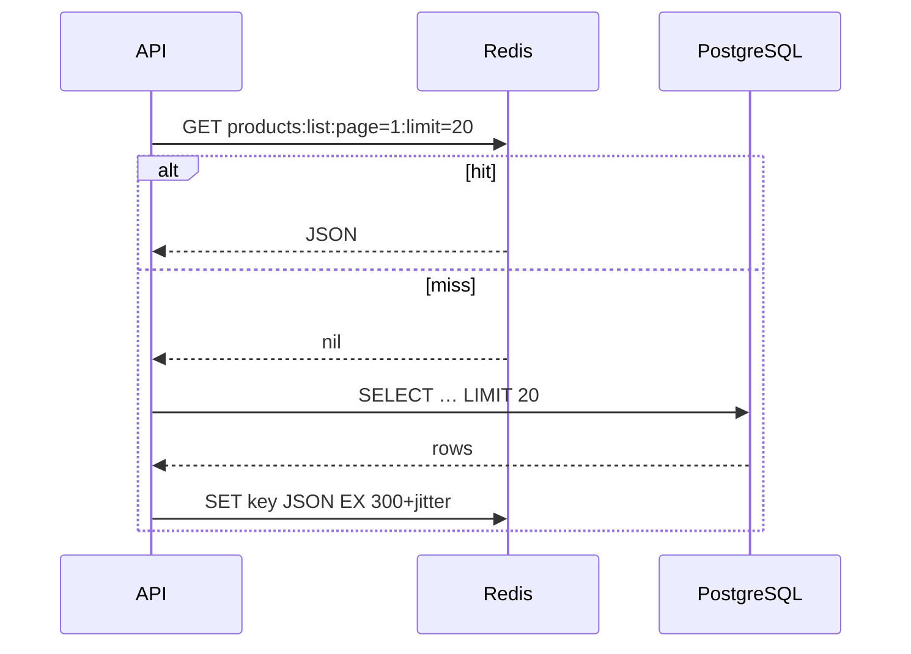

::part[Learn the Concept]{n="1"}

## 🎯 What you'll learn

- What Redis is good at, and its main **data structures**
- **Cache-aside** with TTLs, **jitter** and invalidation — and what to cache
- **Cache stampedes** and how locks protect against them
- **Rate limiting** (fixed and sliding windows) made safe with **Lua**
- **Reliable queues** (`BLMOVE`), **Streams** with consumer groups, and when to use a job library or SQS
- **Idempotency keys** for webhooks and payments
- Saving data to disk (RDB/AOF), memory limits and **eviction**, security basics
- Using Redis from Flask

## 🔤 Key words

| Word | In simple words | Bahasa Indonesia |
|---|---|---|
| **Redis** | A very fast in-memory store for small pieces of data | Penyimpanan data di memori |
| **Cache** | A saved copy of a slow answer, so next time it's fast | Salinan sementara |
| **TTL** | How long a key lives before Redis deletes it | Masa berlaku |
| **Invalidation** | Removing a cached copy because the real data changed | Membuang cache lama |
| **Cache stampede** | Many requests rebuilding the same expired cache at once | Serbuan saat cache habis |
| **Rate limiting** | Allowing only N attempts per time window | Pembatasan jumlah permintaan |
| **Atomic** | Happens as one step — nothing can sneak in between | Satu langkah utuh |
| **Queue** | A line of jobs waiting for a worker | Antrean tugas |
| **Idempotent** | Doing it twice has the same effect as doing it once | Diulang pun hasilnya sama |
| **Eviction** | Redis deleting keys when memory is full | Pengusiran data |

## 🧠 The big idea

Redis is a **very fast whiteboard in the middle of the office**. Everyone can read it instantly, write short notes on it, and set notes to erase themselves after a while. It's perfect for:

- "today's best-sellers" (cache),
- "how many times did this person knock in the last minute" (rate limit),
- "to-do cards waiting to be picked up" (queue).

It is **not** the filing cabinet where contracts are kept — that's your database.

## ❓ Why it matters

RevoShop's product list is read far more often than products change. Login is a target for password guessing. Midtrans may send the same payment notification twice. Sending an email inside the request makes checkout slow. Redis solves all four with a few well-known patterns — and using those patterns wrongly causes some of the worst production incidents.

Done naively:

- Every product list request hits PostgreSQL; a marketing campaign takes the database down.
- A cache without invalidation shows an old price after the seller changes it.
- A `LPUSH`/`RPOP` queue: a worker crashes in the middle of a job → the order email is lost forever.
- A rate limiter written as `GET` then `SET` lets 30 simultaneous attempts through a limit of 5.
- A duplicate webhook marks the order paid twice and triggers two shipments.

## 📖 Step by step

### 1. Data structures you'll use

| Type | Commands | Use |
|---|---|---|
| String | `SET key value EX 60 NX`, `GET`, `INCR` | cache entries, locks, counters, idempotency keys |
| Hash | `HSET`, `HGET`, `HINCRBY` | small objects, job metadata |
| List | `LPUSH`, `BLMOVE`, `LREM` | simple queues |
| Set | `SADD`, `SISMEMBER` | unique visitors, tags |
| Sorted set | `ZADD`, `ZRANGEBYSCORE`, `ZREMRANGEBYSCORE` | leaderboards, sliding-window rate limits, scheduled jobs |
| Stream | `XADD`, `XREADGROUP`, `XACK`, `XAUTOCLAIM` | durable event/job streams with consumer groups |

One command on one key is atomic. Logic with several steps needs `MULTI` transactions or **Lua scripts**, which Redis runs as one uninterrupted step.

### 2. Cache-aside

```python
def cache_aside(r, key, ttl, loader, *, jitter=0.1, rng=random.random):
    cached = r.get(key)
    if cached is not None:
        return json.loads(cached)
    value = loader()                                   # e.g. ProductService.get_all(...)
    if value is None:
        return None
    r.set(key, json.dumps(value), ex=ttl + int(ttl * jitter * rng()))
    return value
```



Like a shopkeeper who writes today's popular prices on the whiteboard: check the board first; if it's not there, look it up in the ledger (database) and write it on the board for the next customer.

**Keys** must include everything the answer depends on: `products:v2:list:category=3:page=1:limit=20:sort=price_asc`. The `v2` lets you throw away all old entries after a data format change, just by changing the version.

**Invalidation** options:

- **TTL only** — simple; data can be old for up to the TTL. Fine for listings (60–300 s).
- **Delete on write** — after updating product 7, delete `product:7` and increase a `products:list:version` counter that list keys include.
- Never cache one user's private data under a key another user could read.

What to cache: expensive, often-read data that can be a little old (catalog, categories, calculated stats). What not to cache: stock numbers used to accept an order, payment status, anything that must be exact.

### 3. Stampede protection

When a popular key expires, hundreds of requests miss at the same moment and all hit the database — like a shop's single sample running out and every customer rushing to the warehouse at once.

```python
lock_key, token = f"lock:{key}", secrets.token_hex(16)
if r.set(lock_key, token, nx=True, px=5000):             # only one request recomputes
    try:
        value = loader(); r.set(key, json.dumps(value), ex=ttl); return value
    finally:
        r.eval("if redis.call('GET', KEYS[1]) == ARGV[1] then return redis.call('DEL', KEYS[1]) end return 0", 1, lock_key, token)
else:
    ...poll for the value briefly, then fall back to loader()
```

- Only the request that gets the lock goes to the warehouse; the others wait a moment for the board to be updated.
- Release the lock only if **your token** is still on it — if your work took longer than the lock's TTL, someone else may own the lock now.
- Other techniques: jitter (so keys don't all expire together), **stale-while-revalidate** (serve the old value while refreshing), pre-filling popular keys.

### 4. Rate limiting

```lua
-- sliding window: atomic check-and-add
redis.call('ZREMRANGEBYSCORE', KEYS[1], '-inf', ARGV[1] - ARGV[2])
if redis.call('ZCARD', KEYS[1]) < tonumber(ARGV[3]) then
  redis.call('ZADD', KEYS[1], ARGV[1], ARGV[4])
  redis.call('EXPIRE', KEYS[1], ARGV[5])
  return {1, '0'}
end
```

Like an ATM that blocks your card after 3 wrong PINs. The check and the count must happen **together** in Lua — otherwise 30 requests can all read "4 attempts so far" before any of them writes "5".

| Algorithm | ✅ | ❌ |
|---|---|---|
| Fixed window (`INCR` + `EXPIRE`) | cheapest | bursts at window edges (up to 2× the limit) |
| Sliding window log (sorted set) | accurate | uses memory per request |
| Token bucket | allows smooth bursts, common in APIs | slightly more logic |

Limit by things attackers can't change cheaply: login attempts per **email** *and* per **IP**. Return `429 Too Many Requests` with a `Retry-After` header. Libraries such as **Flask-Limiter** can store counts in Redis.

### 5. Queues

```python
raw = r.blmove("emails:ready", "emails:processing", timeout=5, src="RIGHT", dest="LEFT")   # atomic hand-off
process(json.loads(raw))
r.lrem("emails:processing", 1, raw)                                                        # ack
# a janitor moves jobs stuck in processing back to ready (visibility timeout)
```

Think of a kitchen order rail: the cook moves the ticket from "waiting" to "cooking" in one motion, and removes it only when the dish is served. If the cook disappears, the ticket is still on the "cooking" rail — someone puts it back in "waiting".

This gives **at-least-once** delivery: a job can run twice (the worker crashed after doing the work but before removing the ticket) → handlers must be **idempotent**.

| Option | When |
|---|---|
| Lists + `BLMOVE` | learning, tiny workloads |
| **Redis Streams** + consumer groups | built-in acknowledgements, pending lists, reclaiming stuck messages |
| Job libraries: **RQ**, **Celery**, **Dramatiq** (Python) | retries, scheduling, monitoring included |
| **Amazon SQS** (Week 5) | managed, durable, scales, dead-letter queues |

### 6. Idempotency keys

```python
def run_once(r, key, ttl, action):
    if r.set(key, "__pending__", nx=True, ex=ttl):
        try:
            result = action()
        except Exception:
            r.delete(key); raise
        r.set(key, json.dumps(result), keepttl=True)
        return result, True
    stored = r.get(key)
    if stored == "__pending__":
        raise InProgressError(key)
    return json.loads(stored), False
```

Like a **receipt number** at a pharmacy: if the same prescription number shows up twice, the pharmacist sees it was already given out and doesn't hand out the medicine again.

For a Midtrans notification, the key is `idem:midtrans:{order_id}:{transaction_status}`. Also keep the **database** as the final guard (a unique constraint or a conditional `UPDATE … WHERE status = 'pending'`) — Redis is an extra fast check, not the only one.

### 7. Running Redis

| Topic | Guidance |
|---|---|
| Saving to disk | **RDB** snapshots (compact, may lose the latest writes) and/or **AOF** (a log of every write, more durable). Pure cache: optional. Queues: turn on AOF. |
| Memory | set `maxmemory` and an eviction policy: `allkeys-lru`/`allkeys-lfu` for caches, `noeviction` when Redis holds queues or locks you can't lose |
| Security | never open port 6379 to the internet; require auth/ACLs; TLS on managed services |
| Separate instances | cache and queue often need different eviction/persistence settings |
| Managed options | Amazon ElastiCache (Redis OSS / Valkey), Redis Cloud, Upstash |
| Monitoring | hit ratio (`INFO stats` keyspace_hits/misses), memory, evictions, slow log |

License note: Redis moved to source-available licenses in 2024 and added AGPL as an option in Redis 8. The Linux Foundation fork **Valkey** speaks the same protocol and is offered by major clouds. Your application code uses the same client APIs.

### 8. Redis in Flask

```python
# app/extensions.py
import redis
redis_client: redis.Redis | None = None

def init_redis(app):
    global redis_client
    redis_client = redis.Redis.from_url(app.config["REDIS_URL"], decode_responses=True, socket_timeout=1, health_check_interval=30)
```

Use short timeouts, and decide what happens when Redis is down:

- a cache should **fail open** (go to the database),
- a rate limiter usually fails open and sends an alert,
- an idempotency guard falls back to the database constraint.

### When to use it

- ✅ Often-read data that can be a few seconds old; counters; rate limits; short-lived locks; sessions; small queues.
- 🚫 As the only copy of important data (orders, payments).
- 🚫 Caching before measuring — first fix N+1 queries and add indexes.
- 🚫 Locks for money movement where correctness is critical — use database transactions and constraints.

Every cache adds a cost: old data, invalidation bugs, and one more thing that can break. A short TTL gives fresher data but fewer cache hits.

## ⚠️ Common mistakes

- Keys without a TTL filling memory; `KEYS *` in production (it blocks Redis — use `SCAN`).
- Saving `Decimal` prices as floats in cached JSON.
- Deleting another request's lock.
- Running Redis on the same small VM without memory limits and letting it evict queue data.

## 🏆 Best practices

- [ ] Measure first (query counts, p95 latency); cache the paths proven to be hot.
- [ ] Versioned, descriptive keys; a TTL on every cache key; jitter for hot keys.
- [ ] Invalidate on writes where old data hurts; never cache per-user data under shared keys.
- [ ] Protect hot keys from stampedes.
- [ ] Multi-step logic atomically with Lua or transactions.
- [ ] At-least-once queues with idempotent handlers, retries and a plan for failed jobs.
- [ ] Idempotency keys for webhooks and payment actions, backed by database constraints.
- [ ] `maxmemory` + an eviction policy that fits the use; never public; auth/TLS in production.
- [ ] Short client timeouts and a clear plan for when Redis is unavailable.
- [ ] Track hit ratio, evictions and memory.

:::revoshop
1. **Measure before caching.** Start the dev stack (`config/development.py` has `SQLALCHEMY_ECHO = True`) and call `GET /api/v1/products/?page=1&limit=20`. Count the SQL statements in `docker compose logs web`. Is there an N+1 on product images or categories? Fix queries first; cache second.
2. **Product list cache.** `ProductList.get` in `app/routes/products.py` takes `name`, `category_id`, `seller_id`, `min_price`, `max_price`, `sort_by`, `order`, `page` and `limit`. Design the cache key, the TTL, and the exact places in `app/services/product_service.py` where a create/update/delete must invalidate it. Why must prices stay strings (`Numeric`) in the cached JSON?
3. **Login.** `AuthLogin.post` in `app/routes/auth.py` has no limit. Decide limits per email and per IP, the `429` body in RevoShop's `make_response` format, and what happens when Redis is down.
4. **Your webhook is already partly idempotent.** Read `PaymentService.handle_notification` in `app/services/payment_service.py`: it verifies the signature with a constant-time compare and ignores a notification when `payment.status == new_payment_status`. Great. Now imagine Midtrans delivers the **same** notification twice **at the same moment**: both requests read `pending` before either commits. What happens? Compare two fixes: a Redis `run_once` guard vs a conditional `UPDATE payments SET status = … WHERE id = … AND status = 'pending'` in the repository.
5. **Background work.** Which slow things in checkout or payments would you move to a queue (confirmation emails, expiring unpaid orders after `MIDTRANS_EXPIRY_MINUTES`)? Write the job payload for one of them.
:::

::part[Explain & Design]{n="2"}

## 🗣️ Explain it

Explain the "office whiteboard" analogy, then explain to a teammate why a cached product price must be removed when a seller edits it, but a cached category list can simply expire.

## 📐 Design it

Design Redis usage for RevoShop: product list/detail caching (keys, TTLs, invalidation), login rate limiting (limits, identities, response), Midtrans webhook idempotency (key and database fallback), and background order emails (queue choice, retries). Include what happens when Redis is down for each.

:::quiz
Show a possible design

| Feature | Design | Redis down |
|---|---|---|
| Product detail | `product:v1:{id}` cache-aside, TTL 300 s + 10% jitter; **delete on update/delete** in `ProductService` | fail open → DB |
| Product list | `products:v1:list:{hash(query params)}:gen={list_generation}`; `INCR products:list:generation` on any product write; TTL 60 s; lock on the first page key | fail open → DB (watch DB load) |
| Categories | `categories:v1:all`, TTL 1 h, delete on category write | fail open |
| Login rate limit | sliding window: 5 attempts / 15 min per email **and** 20 / 15 min per IP → `429` + `Retry-After`, generic error text | fail open + alert (or a small in-process limiter) |
| Midtrans webhook | `run_once("idem:midtrans:{order_id}:{transaction_status}", 24 h)` + DB: `UPDATE payments SET status='settlement' WHERE id=:id AND status <> 'settlement'` and a unique constraint on the provider transaction id | the DB guard still prevents double processing |
| Order emails | Redis queue with RQ (or Streams): retries with backoff, max 5, failed jobs kept for inspection; the handler checks `order.confirmation_sent_at` before sending | enqueue fails → store an `outbox` row in PostgreSQL in the same transaction; a worker sends them later (outbox pattern) |

Instances: one Redis for cache + rate limits (`allkeys-lru`), and queues either on a separate Redis with AOF + `noeviction` or on SQS later.
:::

### 📝 Self-review checklist

- [ ] Every cache has a TTL and a reason for its invalidation
- [ ] Money-related correctness doesn't depend on Redis alone
- [ ] A failure plan for each feature

::ai-review{task="design"}

::part[Toy Exercise]{n="3"}

:::exercise{path="exercises/m5/w1/04-redis-patterns" ai="no-ai" title="Five Redis patterns on a real Redis"}
Implement cache-aside with jitter, a stampede lock with safe release, an atomic sliding-window rate limiter in Lua, a reliable queue with stale-job requeueing, and idempotent execution — tested with concurrent threads against Redis on port 6391.
:::

:::hints
- `r.register_script(lua)` returns a callable; pass `keys=[...]` and `args=[...]`.
- `BLMOVE` with `src="RIGHT", dest="LEFT"` gives first-in-first-out when you add jobs with `LPUSH`.
- For `requeue_stale`, push back with `RPUSH` so the job is picked up next.
:::

## ✅ Quick check

:::quiz
Why must the lock release compare a token instead of just running `DEL lock:key`?

If your work took longer than the lock's TTL, another client may have taken the lock; a blind `DEL` would remove *their* lock and let a third client in.
:::

:::quiz
Your queue guarantees at-least-once delivery. What must job handlers be, and why?

Idempotent — a job can run twice (a crash after doing the work but before acknowledging), so running it again must not repeat effects like emails or charges.
:::

## 📚 Keep learning

- [Redis docs: Data types](https://redis.io/docs/latest/develop/data-types/) · [Scripting with Lua](https://redis.io/docs/latest/develop/programmability/eval-intro/) · [Streams](https://redis.io/docs/latest/develop/data-types/streams/)
- [redis-py documentation](https://redis.readthedocs.io/)
- [Stripe: Idempotent requests](https://docs.stripe.com/api/idempotent_requests)
