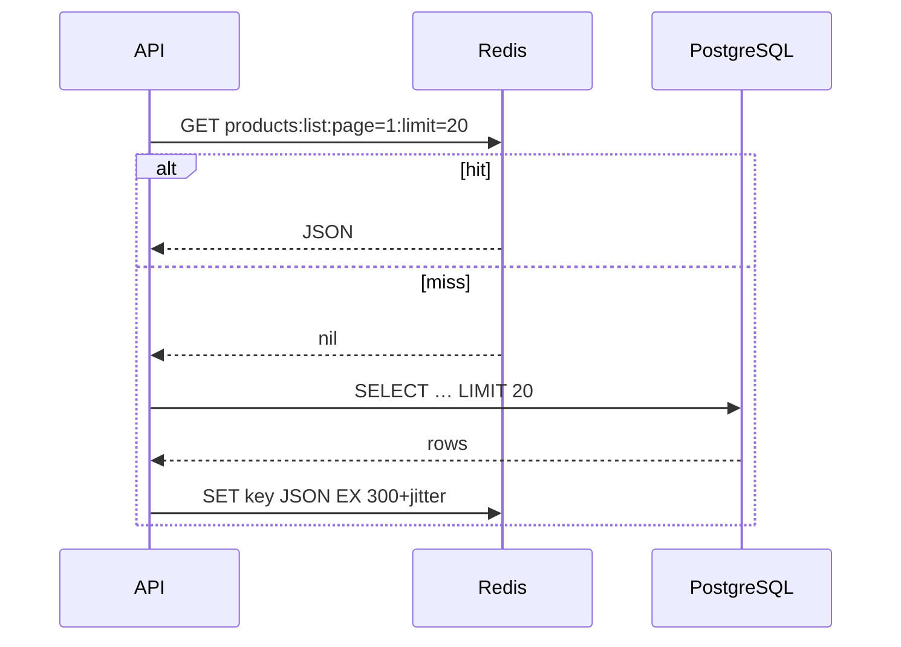

::part[Learn the Concept]{n="1"}

## 🎯 What you'll learn

- What Redis is good at, and its core **data structures**
- **Cache-aside** with TTLs, **jitter** and invalidation — and what to cache
- **Cache stampedes** and lock-based protection
- **Rate limiting** (fixed and sliding windows) made atomic with **Lua**
- **Reliable queues** (`BLMOVE`), **Streams** with consumer groups, and when to use a job library or SQS
- **Idempotency keys** for webhooks and payments
- Persistence (RDB/AOF), memory limits and **eviction** policies, security basics
- Using Redis from Flask

## 🧠 The big idea

Redis is a **very fast whiteboard in the middle of the office**. Everyone can read it instantly, write short notes on it, and set notes to erase themselves after a while. It's perfect for "today's best-sellers" (cache), "how many times did this person knock in the last minute" (rate limit) and "to-do cards to pick up" (queue). It is **not** the filing cabinet where contracts are stored (your database).

## ❓ Why does this matter?

RevoShop's product list is read far more often than products change. Login is a target for password guessing. Midtrans may deliver the same payment notification twice. Sending an email inside the request makes checkout slow. Redis solves all four with a few well-known patterns — and misuse of those patterns causes some of the worst production incidents (stampedes, lost jobs, double charges).

## 💥 What happens if we DON'T (or do it naively)?

- Every product list request hits PostgreSQL; a marketing push takes the database down.
- A cache without invalidation shows an old price after the seller changes it.
- `LPUSH`/`RPOP` queue: a worker crashes mid-job → the order email is lost forever.
- A rate limiter implemented as `GET` then `SET` lets 30 concurrent attempts through a limit of 5.
- A duplicate webhook marks the order paid twice and triggers two shipments.

## 📖 How it works, step by step

### 1. Data structures you'll use

| Type | Commands | Use |
|---|---|---|
| String | `SET key value EX 60 NX`, `GET`, `INCR` | cache entries, locks, counters, idempotency keys |
| Hash | `HSET`, `HGET`, `HINCRBY` | small objects, job metadata |
| List | `LPUSH`, `BLMOVE`, `LREM` | simple queues |
| Set | `SADD`, `SISMEMBER` | unique visitors, tags |
| Sorted set | `ZADD`, `ZRANGEBYSCORE`, `ZREMRANGEBYSCORE` | leaderboards, sliding-window rate limits, scheduled jobs |
| Stream | `XADD`, `XREADGROUP`, `XACK`, `XAUTOCLAIM` | durable event/job streams with consumer groups |

Operations on one key are atomic; multi-step logic needs `MULTI` transactions or **Lua scripts** (run atomically on the server).

### 2. Cache-aside

```python
def cache_aside(r, key, ttl, loader, *, jitter=0.1, rng=random.random):
    cached = r.get(key)
    if cached is not None:
        return json.loads(cached)
    value = loader()                                   # e.g. ProductService.get_all(...)
    if value is None:
        return None
    r.set(key, json.dumps(value), ex=ttl + int(ttl * jitter * rng()))
    return value
```



**Keys** encode everything the result depends on: `products:v2:list:category=3:page=1:limit=20:sort=price_asc`. The `v2` lets you invalidate everything after a schema change by bumping the version.

**Invalidation** strategies:
- **TTL only** — simple; data is stale for up to TTL. Fine for listings (60–300 s).
- **Delete on write** — after updating product 7, delete `product:7` and bump a `products:list:version` counter that list keys include.
- Never cache per-user sensitive data under keys another user could hit.

What to cache: expensive, frequently read, tolerant of short staleness (catalog, categories, computed stats). What not: stock counts used for checkout decisions, payment state, anything that must be exact.

### 3. Stampede protection

When a hot key expires, hundreds of requests miss at once and all hit the database.

```python
lock_key, token = f"lock:{key}", secrets.token_hex(16)
if r.set(lock_key, token, nx=True, px=5000):             # only one request recomputes
    try:
        value = loader(); r.set(key, json.dumps(value), ex=ttl); return value
    finally:
        r.eval("if redis.call('GET', KEYS[1]) == ARGV[1] then return redis.call('DEL', KEYS[1]) end return 0", 1, lock_key, token)
else:
    ...poll for the value briefly, then fall back to loader()
```

Release with a **token check** — if your work took longer than the lock TTL, someone else may hold the lock now. Other techniques: jitter (spreads expirations), **stale-while-revalidate**, pre-warming popular keys.

### 4. Rate limiting

```lua
-- sliding window: atomic check-and-add
redis.call('ZREMRANGEBYSCORE', KEYS[1], '-inf', ARGV[1] - ARGV[2])
if redis.call('ZCARD', KEYS[1]) < tonumber(ARGV[3]) then
  redis.call('ZADD', KEYS[1], ARGV[1], ARGV[4])
  redis.call('EXPIRE', KEYS[1], ARGV[5])
  return {1, '0'}
end
```

| Algorithm | ✅ | ❌ |
|---|---|---|
| Fixed window (`INCR` + `EXPIRE`) | cheapest | bursts at window edges (2× limit) |
| Sliding window log (sorted set) | accurate | memory per request |
| Token bucket | smooth bursts, common in APIs | slightly more logic |

Limit by what attackers can't cheaply rotate: login attempts per **email** *and* per **IP**. Return `429 Too Many Requests` with a `Retry-After` header. Libraries such as **Flask-Limiter** support Redis storage.

### 5. Queues

```python
raw = r.blmove("emails:ready", "emails:processing", timeout=5, src="RIGHT", dest="LEFT")   # atomic hand-off
process(json.loads(raw))
r.lrem("emails:processing", 1, raw)                                                        # ack
# a janitor moves jobs stuck in processing back to ready (visibility timeout)
```

Guarantees are **at-least-once**: a job can run twice (worker crashed after doing the work, before ack) → make handlers **idempotent**.

| Option | When |
|---|---|
| Lists + `BLMOVE` | learning, tiny workloads |
| **Redis Streams** + consumer groups | built-in acknowledgements, pending lists, claiming stale messages |
| Job libraries: **RQ**, **Celery**, **Dramatiq** (Python) | retries, scheduling, monitoring out of the box |
| **Amazon SQS** (Week 5) | managed, durable, scales, dead-letter queues |

### 6. Idempotency keys

```python
def run_once(r, key, ttl, action):
    if r.set(key, "__pending__", nx=True, ex=ttl):
        try:
            result = action()
        except Exception:
            r.delete(key); raise
        r.set(key, json.dumps(result), keepttl=True)
        return result, True
    stored = r.get(key)
    if stored == "__pending__":
        raise InProgressError(key)
    return json.loads(stored), False
```

For a Midtrans notification: key `idem:midtrans:{order_id}:{transaction_status}`. Keep the **database** as the source of truth too (a unique constraint or conditional `UPDATE … WHERE status = 'pending'`) — Redis is an extra fast guard, not the only one.

### 7. Operating Redis

| Topic | Guidance |
|---|---|
| Persistence | **RDB** snapshots (compact, may lose recent writes) and/or **AOF** (append-only, more durable). Pure cache: persistence optional. Queues: enable AOF. |
| Memory | set `maxmemory`; choose an eviction policy: `allkeys-lru`/`allkeys-lfu` for caches, `noeviction` when Redis holds queues or locks you can't lose |
| Security | never expose port 6379 publicly; require auth/ACLs; TLS on managed services |
| Separate instances | cache vs queue often deserve different eviction/persistence settings |
| Managed options | Amazon ElastiCache (Redis OSS / Valkey), Redis Cloud, Upstash |
| Observability | hit ratio (`INFO stats` keyspace_hits/misses), memory, evictions, slow log |

Licensing note: Redis moved to source-available licenses in 2024 and added AGPL as an option in Redis 8; the Linux Foundation fork **Valkey** is protocol-compatible and offered by major clouds. For application code, the client APIs are the same.

### 8. Redis in Flask

```python
# app/extensions.py
import redis
redis_client: redis.Redis | None = None

def init_redis(app):
    global redis_client
    redis_client = redis.Redis.from_url(app.config["REDIS_URL"], decode_responses=True, socket_timeout=1, health_check_interval=30)
```

Set short socket timeouts and decide what happens when Redis is down: a cache should **fail open** (go to the database); a rate limiter usually fails open with an alert; an idempotency guard should fall back to the database constraint.

## ⚖️ Trade-offs

| Choice | ✅ | ❌ |
|---|---|---|
| Caching | lower latency and DB load | staleness, invalidation bugs, another dependency |
| Short TTL | fresher data | lower hit ratio |
| Redis queue | fast, already in the stack | durability and retries are your job |
| SQS / Celery | mature features | more infrastructure or concepts |

## ✅ When to use it / 🚫 When NOT to use it

- ✅ Read-heavy data tolerant of seconds of staleness; counters; rate limits; short-lived locks; sessions; small queues.
- 🚫 As the only copy of important data (orders, payments).
- 🚫 Caching before measuring — first fix N+1 queries and add indexes.
- 🚫 Distributed locks for correctness-critical money movement — use database transactions and constraints.

## 🏆 Best practices

- [ ] Measure first (query counts, p95 latency); cache the proven hot paths.
- [ ] Versioned, descriptive keys; TTL on every cache key; jitter for hot keys.
- [ ] Invalidate on writes where staleness hurts; never cache per-user data under shared keys.
- [ ] Protect hot keys from stampedes.
- [ ] Atomic multi-step logic with Lua or transactions.
- [ ] At-least-once queues with idempotent handlers, retries and a dead-letter strategy.
- [ ] Idempotency keys for webhooks and payment actions, backed by DB constraints.
- [ ] `maxmemory` + eviction policy matched to the use; no public exposure; auth/TLS in production.
- [ ] Short client timeouts and a defined failure mode when Redis is unavailable.
- [ ] Track hit ratio, evictions and memory.

## 🏭 How it's used in industry

- E-commerce and marketplaces cache catalog pages and search results heavily, often at several layers (CDN, Redis, database).
- API providers publish rate limits (`429` + `Retry-After`) implemented with Redis or API gateways.
- Payment providers (e.g. Stripe's idempotency keys) popularized idempotent APIs; webhook consumers are expected to deduplicate.

## ⚠️ Common mistakes

- Keys without TTL filling memory; `KEYS *` in production (blocks Redis — use `SCAN`).
- JSON-serializing `Decimal` prices as floats in the cache.
- Deleting another request's lock.
- Using Redis on the same small VM without memory limits and letting it evict queue data.

:::revoshop
1. **Measure before caching.** Start the dev stack (`config/development.py` has `SQLALCHEMY_ECHO = True`) and call `GET /api/v1/products/?page=1&limit=20`. Count the SQL statements in `docker compose logs web`. Is there an N+1 on product images or categories? Fix queries first; cache second.
2. **Product list cache.** `ProductList.get` in `app/routes/products.py` takes `name`, `category_id`, `seller_id`, `min_price`, `max_price`, `sort_by`, `order`, `page` and `limit`. Design the cache key, the TTL, and the exact places in `app/services/product_service.py` where a create/update/delete must invalidate it. Why must prices stay strings (`Numeric`) in the cached JSON?
3. **Login.** `AuthLogin.post` in `app/routes/auth.py` has no limit. Decide limits per email and per IP, the `429` body in RevoShop's `make_response` format, and what happens when Redis is down.
4. **Your webhook is already partly idempotent.** Read `PaymentService.handle_notification` in `app/services/payment_service.py`: it verifies the signature with a constant-time compare and ignores a notification when `payment.status == new_payment_status`. Great. Now imagine Midtrans delivers the **same** notification twice **at the same moment**: both requests read `pending` before either commits. What happens? Compare two fixes: a Redis `run_once` guard vs a conditional `UPDATE payments SET status = … WHERE id = … AND status = 'pending'` in the repository.
5. **Background work.** Which slow things in checkout or payments would you move to a queue (confirmation emails, expiring unpaid orders after `MIDTRANS_EXPIRY_MINUTES`)? Write the job payload for one of them.
:::

::part[Explain & Design]{n="2"}

## 🗣️ Explain it

Explain the "office whiteboard" analogy, then explain to a teammate why a cached product price must be invalidated when a seller edits it, but a cached category list can simply expire.

## 📐 Design it

Design Redis usage for RevoShop: product list/detail caching (keys, TTLs, invalidation), login rate limiting (limits, identities, response), Midtrans webhook idempotency (key and DB fallback), and background order emails (queue choice, retries). Include what happens when Redis is down for each.

:::quiz
Show a possible design

| Feature | Design | Redis down |
|---|---|---|
| Product detail | `product:v1:{id}` cache-aside, TTL 300 s + 10% jitter; **delete on update/delete** in `ProductService` | fail open → DB |
| Product list | `products:v1:list:{hash(query params)}:gen={list_generation}`; `INCR products:list:generation` on any product write; TTL 60 s; lock on the first page key | fail open → DB (watch DB load) |
| Categories | `categories:v1:all`, TTL 1 h, delete on category write | fail open |
| Login rate limit | sliding window: 5 attempts / 15 min per email **and** 20 / 15 min per IP → `429` + `Retry-After`, generic error text | fail open + alert (or a small in-process limiter) |
| Midtrans webhook | `run_once("idem:midtrans:{order_id}:{transaction_status}", 24 h)` + DB: `UPDATE payments SET status='settlement' WHERE id=:id AND status <> 'settlement'` and a unique constraint on the provider transaction id | DB guard still prevents double processing |
| Order emails | Redis queue with RQ (or Streams): retries with backoff, max 5, failed jobs kept for inspection; job handler checks `order.confirmation_sent_at` before sending | enqueue fails → store an `outbox` row in PostgreSQL in the same transaction; a worker drains it (outbox pattern) |

Instances: one Redis for cache + rate limits (`allkeys-lru`), and queues either on a separate Redis with AOF + `noeviction` or SQS later.
:::

### 📝 Self-review checklist

- [ ] Every cache has TTL and invalidation reasoning
- [ ] Money-related correctness doesn't depend on Redis alone
- [ ] Failure mode defined per feature

::ai-review{task="design"}

::part[Toy Exercise]{n="3"}

:::exercise{path="exercises/m5/w1/04-redis-patterns" ai="no-ai" title="Five Redis patterns on a real Redis"}
Implement cache-aside with jitter, a stampede lock with safe release, an atomic sliding-window rate limiter in Lua, a reliable queue with stale-job requeueing, and idempotent execution — tested with concurrent threads against Redis on port 6391.
:::

:::hints
- `r.register_script(lua)` returns a callable; pass `keys=[...]` and `args=[...]`.
- `BLMOVE` with `src="RIGHT", dest="LEFT"` gives FIFO when you enqueue with `LPUSH`.
- For `requeue_stale`, push back with `RPUSH` so the job is reserved next.
:::

## ✅ Quick check

:::quiz
Why must the lock release compare a token instead of just `DEL lock:key`?

If your work outlived the lock TTL, another client may have acquired the lock; a blind `DEL` would remove *their* lock and let a third client in.
:::

:::quiz
Your queue guarantees at-least-once delivery. What must job handlers be, and why?

Idempotent — a job can run twice (crash after doing the work but before acknowledging), so running it again must not duplicate effects like emails or charges.
:::

## 📖 Kamus (glossary)

| Term | Bahasa Indonesia |
|---|---|
| Cache | Tembolok / penyimpanan sementara |
| TTL (time to live) | Masa berlaku data |
| Cache stampede | Serbuan permintaan saat cache kedaluwarsa |
| Rate limiting | Pembatasan laju permintaan |
| Idempotency | Idempotensi — diulang pun hasilnya sama |
| Eviction | Pengusiran data saat memori penuh |

## 📚 Keep learning

- [Redis docs: Data types](https://redis.io/docs/latest/develop/data-types/) · [Scripting with Lua](https://redis.io/docs/latest/develop/programmability/eval-intro/) · [Streams](https://redis.io/docs/latest/develop/data-types/streams/)
- [redis-py documentation](https://redis.readthedocs.io/)
- [Stripe: Idempotent requests](https://docs.stripe.com/api/idempotent_requests)
