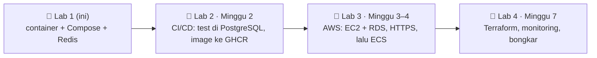

## 🎯 Tujuan

Di akhir Module 5, RevoShop akan berjalan di AWS dengan HTTPS, CI/CD dan infrastruktur sebagai kode. Lab pertama ini membuatnya **siap di-deploy ke mana saja**: image kecil dan aman, setting yang menolak startup saat ada yang penting hilang, stack mirip production yang bisa dijalankan dengan satu perintah, dan test yang memberi tahu dalam hitungan detik apakah deployment berhasil.

```text
Sebelum                                    Setelah lab ini
──────────────────────────────────────     ─────────────────────────────────────────────
image single-stage, shell-form CMD         target test + prod, exec-form gunicorn, label
migrasi dijalankan di setiap container     service migrate sekali jalan, berjalan sekali per deploy
log ditulis ke file di container           log ke stdout
JWT secret diam-diam pakai default         production menolak startup tanpa secret sungguhan
port 8000 dipublikasikan langsung, no TLS  Caddy reverse proxy (HTTPS otomatis nanti)
tidak ada pembatas di /auth/login          pembatas sliding-window Redis → 429 + Retry-After
"sepertinya berhasil"                      smoke test terhadap stack yang berjalan
```

## 🔤 Istilah penting

| Istilah | Artinya (sederhana) |
|---|---|
| **Fail fast** | Aplikasi berhenti langsung saat startup jika ada setting hilang atau tidak aman, bukan nanti saat di depan user |
| **Exec form `CMD`** | `CMD ["gunicorn", …]` — tidak ada shell di tengahnya, jadi gunicorn sendiri yang terima sinyal "tolong berhenti" |
| **Image non-root** | Program di dalam container berjalan sebagai user biasa, bukan administrator |
| **One-off job** | Container yang menjalankan tugas sekali (di sini: database migration) lalu keluar |
| **Reverse proxy** | Pintu depan (Caddy) yang menerima semua traffic web dan meneruskannya ke API |
| **Liveness vs readiness** | "Apakah prosesnya hidup?" (restart jika tidak) vs "bisakah ia layani user sekarang?" (kirim traffic atau tidak) |
| **Sliding window limit** | Menghitung percobaan dalam N menit terakhir, jadi 5 coba per 15 menit benar-benar 5 |
| **Smoke test** | Segelintir cek cepat yang membuktikan deployment sebenarnya berfungsi |

:::warning[Kerja di salinanmu sendiri dari RevoShop]
Kalau repository RevoShop-mu tinggal di **organisasi GitHub orang lain**, kamu mungkin tidak bisa menambah GitHub Actions secret atau deploy key (dibutuhkan minggu depan). Buat repository **pribadi** dan push salinannya ke sana — biarkan remote asalnya tetap tidak berubah. Cek aturan organisasinya sebelum membuat salinannya **publik**; repo pribadi berhasil untuk semuanya di Module 5.
:::

## 🗺️ Di mana ini cocok



## 🧭 Checkpoint

### C0 · Salinanmu sendiri dan satu branch (20 menit)

```bash
cd ~/path/to/revoshop
git status                                   # commit or stash anything in progress
git switch main && git pull                  # or the branch that has your latest work (you have dev/main)

# create an EMPTY repository on github.com first (e.g. revoshop), then:
git remote add personal git@github.com:<your-username>/revoshop.git
git push personal --all
git push personal --tags

git switch -c deploy/production-containers
```

Jangan pernah commit `.env` atau `.env.docker` — cek bahwa `git check-ignore -v .env .env.docker` mencetak keduanya.

### C1 · Audit apa yang kamu punya (30 menit)

Jalankan auditor yang kamu buat di exercise 01:

```bash
cd ~/Documents/LEARNING/Programming/Fullstack-Flask-React/fsse-handbook/exercises
uv run python m5/w1/01-dockerfile-audit/dockerfile_audit.py ~/path/to/revoshop/Dockerfile
```

Ia melaporkan **shell-form `CMD`** dan **`HEALTHCHECK`** yang hilang. Linter hanya bisa lihat file, bukan bagaimana aplikasi berperilaku saat berjalan — seperti inspektur bangunan yang baca denah tapi tidak pernah nyalain air. Jadi tuliskan masalah runtime sendiri, di `docs/deployment-audit.md`:

| # | Temuan di RevoShop | Kenapa penting di production |
|---|---|---|
| 1 | `CMD gunicorn …` (shell form) setelah script `ENTRYPOINT` | shell duduk di tengah Docker dan gunicorn; `docker stop` bisa berakhir dengan SIGKILL (exit 137) bukan shutdown bersih |
| 2 | `docker/entrypoint.sh` jalankan `flask db upgrade` di **setiap** start | dua salinan jalankannya bersamaan; restart lambat; migrasi yang gagal restart selamanya |
| 3 | loop `netcat` wait diinstal dengan apt | tunggu database itu kerja Compose/ECS; ini satu package lagi di image |
| 4 | single stage copy seluruh repo (`COPY . .`) | test tool dikirim ke production; semakin besar attack surface |
| 5 | `config/base.py` diam-diam pakai default `JWT_SECRET_KEY='super-secret-key-change-in-production'` | satu variabel yang terlupakan diam-diam buat setiap token bisa di-forge |
| 6 | `LOG_TO_FILE` default `true` | log hilang saat container dibunuh; filesystem read-only pecah |
| 7 | `create_app()` baca `FLASK_ENV` | Flask tidak lagi kasih makna `FLASK_ENV`; nilai yang tidak dikenal raise `KeyError` |
| 8 | `docker-compose.prod.yml` publikasikan `8000` langsung dari gunicorn, tidak ada proxy | tidak ada TLS, tidak ada kompresi, tidak ada security header; gunicorn terbuka ke internet |
| 9 | `container_name` yang tetap | tidak bisa scale, dan dua stack tidak bisa berjalan berdampingan |
| 10 | `/api/v1/health` query database | bagus untuk **readiness**; sebagai cek **liveness**, satu hiccup database restart container API yang sehat |
| 11 | `/auth/login` tidak ada rate limit | guess password dengan kecepatan penuh |

### C2 · Image dengan target dan konfigurasi gunicorn (1 jam)

**`gunicorn.conf.py`** (baru, root repo):

```python
"""Gunicorn settings for containers. Values come from the environment."""

import os

bind = f"0.0.0.0:{os.environ.get('PORT', '5000')}"
workers = int(os.environ.get("WEB_CONCURRENCY", "2"))
threads = int(os.environ.get("GUNICORN_THREADS", "1"))
timeout = 30
graceful_timeout = 20
keepalive = 5

# Recycle workers regularly so slow memory leaks can't grow forever.
max_requests = 1000
max_requests_jitter = 100

# Logs to stdout/stderr: the container platform collects them.
accesslog = "-"
errorlog = "-"

# Trust X-Forwarded-* only from the reverse proxy on the private network.
forwarded_allow_ips = os.environ.get("FORWARDED_ALLOW_IPS", "127.0.0.1")
```

**`Dockerfile`** (ganti):

```dockerfile
# syntax=docker/dockerfile:1
ARG PYTHON_VERSION=3.12

# ---------- base ----------
FROM python:${PYTHON_VERSION}-slim AS base
ENV PYTHONDONTWRITEBYTECODE=1 \
    PYTHONUNBUFFERED=1 \
    PIP_DISABLE_PIP_VERSION_CHECK=1 \
    VIRTUAL_ENV=/opt/venv \
    PATH="/opt/venv/bin:$PATH"
WORKDIR /app

# ---------- deps: production dependencies in a virtualenv ----------
FROM base AS deps
RUN python -m venv /opt/venv
COPY requirements.txt .
RUN --mount=type=cache,target=/root/.cache/pip \
    pip install -r requirements.txt

# ---------- test: optional, `docker build --target test .` ----------
FROM deps AS test
COPY requirements-dev.txt .
RUN --mount=type=cache,target=/root/.cache/pip \
    pip install -r requirements-dev.txt
COPY . .
RUN python -m pytest -q -p no:cacheprovider

# ---------- prod (last stage = default) ----------
FROM base AS prod
ARG VERSION=dev
ARG REVISION=unknown
LABEL org.opencontainers.image.title="revoshop-api" \
      org.opencontainers.image.version=$VERSION \
      org.opencontainers.image.revision=$REVISION
RUN groupadd --system --gid 10001 app \
    && useradd --system --uid 10001 --gid app --no-create-home --shell /usr/sbin/nologin app
COPY --from=deps /opt/venv /opt/venv
COPY --chown=app:app app ./app
COPY --chown=app:app config ./config
COPY --chown=app:app migrations ./migrations
COPY --chown=app:app run.py gunicorn.conf.py ./
ENV APP_ENV=production \
    FLASK_APP=run:application \
    PORT=5000 \
    WEB_CONCURRENCY=2 \
    LOG_TO_FILE=false
USER 10001
EXPOSE 5000
HEALTHCHECK --interval=15s --timeout=3s --start-period=15s --retries=3 \
    CMD ["python", "-c", "import os, urllib.request; urllib.request.urlopen(f\"http://127.0.0.1:{os.environ['PORT']}/api/v1/health/live\", timeout=2)"]
CMD ["gunicorn", "-c", "gunicorn.conf.py", "run:application"]
```

- `prod` copy **hanya** apa yang berjalan (`app`, `config`, `migrations`, `run.py`, `gunicorn.conf.py`) — test tool dan dokumen tidak sampai ke production. Jadi kamu bisa berhenti exclude `tests/` di `.dockerignore` (target `test` butuh mereka).
- Keluarkan `docker/entrypoint.sh` dari path production (simpan untuk compose lama sampai kamu ganti).
- Test suite lengkapmu lambat di Docker (bcrypt hashing di VM terbatas). Minggu depan CI jalankannya langsung lawan PostgreSQL sungguhan; target `test` tetap tersedia untuk cek lokal.

**`.dockerignore`** — simpan secret dan sampah keluar, tapi izinkan `tests/` dan `requirements-dev.txt` untuk target test:

```text
__pycache__/
*.pyc
.pytest_cache/
.coverage
htmlcov/
venv/
.venv/
.env
.env.*
!.env.example
!.env.docker.example
logs/
*.log
.git/
.idea/
.vscode/
.DS_Store
jira/
locust/
images/
postman/
docs/
```

Cek: `docker build -t revoshop-api:local .`, lalu jalankan auditor di Dockerfile baru — nol error.

### C3 · Setting fail-fast, log stdout, endpoint liveness (45 menit)

Pilot cek bahan bakar dan instrumen **sebelum** terbang, tidak di udara. Aplikasimu harus begitu dengan setting-nya.

**`app/__init__.py`** — choose the environment on purpose and check it:

```python
def create_app(config_name=None):
    if config_name is None:
        # APP_ENV is ours; FLASK_ENV is kept only for backwards compatibility.
        config_name = os.getenv('APP_ENV') or os.getenv('FLASK_ENV', 'development')
    if config_name not in config_by_name:
        raise RuntimeError(f"Unknown APP_ENV {config_name!r}; use one of {sorted(config_by_name)}")

    flask_app = Flask(__name__)
    flask_app.config.from_object(config_by_name[config_name])
    config_by_name[config_name].validate(flask_app.config)
    ...
```

**`config/base.py`** — hook validasi dan setting Redis:

```python
class BaseConfig:
    @classmethod
    def validate(cls, config):
        """Hook for environment-specific checks (see ProductionConfig)."""

    # ... existing settings ...

    # ─── Redis (optional: rate limiting, caching) ─────────────────────────────
    REDIS_URL = os.getenv('REDIS_URL')
```

**`config/production.py`**:

```python
class ProductionConfig(BaseConfig):
    DEBUG = False
    SQLALCHEMY_ECHO = False
    LOG_LEVEL = 'INFO'
    # Containers log to stdout; the platform collects logs.
    LOG_TO_FILE = os.getenv('LOG_TO_FILE', 'false').lower() == 'true'

    @classmethod
    def validate(cls, config):
        """Fail fast: refuse to start with missing or unsafe settings."""
        problems = []
        if not config.get('SQLALCHEMY_DATABASE_URI'):
            problems.append('DATABASE_URL is not set')
        if len(os.getenv('JWT_SECRET_KEY', '')) < 32:
            problems.append('JWT_SECRET_KEY must be set to at least 32 random characters')
        if problems:
            raise RuntimeError('Invalid production configuration: ' + '; '.join(problems))
```

**`app/routes/health.py`** — tambah liveness di sebelah readiness check yang sudah ada:

```python
@health_blp.route('/live')
class Liveness(MethodView):
    """Is the process alive? No dependencies: orchestrators restart the container if this fails."""

    def get(self):
        return make_response('alive')
```

Liveness itu cek detak; readiness itu cek bahwa staff berada di stationnya. Tulis dua test: production config raise tanpa `JWT_SECRET_KEY` yang kuat; `/api/v1/health/live` return 200 walaupun database turun (hint: arahkan `DATABASE_URL` ke port yang tertutup).

### C4 · Stack mirip production (1,5 jam)

**`Caddyfile`**:

```text
# Local: SITE_ADDRESS=:80 (plain HTTP). On a server with a domain: SITE_ADDRESS=api.example.com → automatic HTTPS.
{$SITE_ADDRESS::80} {
	encode zstd gzip
	header {
		-Server
		X-Content-Type-Options nosniff
		Referrer-Policy strict-origin-when-cross-origin
	}
	reverse_proxy api:5000 {
		health_uri /api/v1/health/live
	}
}
```

**`compose.prod.yaml`** (baru — kamu bisa hapus `docker-compose.prod.yml` setelah ini berhasil):

```yaml
# Production-like RevoShop stack.
#   cp .env.production.example .env.production   # fill in real values
#   docker compose --env-file .env.production -f compose.prod.yaml up -d --build
name: revoshop

x-app-env: &app-env
  APP_ENV: production
  DATABASE_URL: postgresql://revoshop:${POSTGRES_PASSWORD:?set POSTGRES_PASSWORD}@db:5432/revoshop
  JWT_SECRET_KEY: ${JWT_SECRET_KEY:?set JWT_SECRET_KEY}
  REDIS_URL: redis://redis:6379/0
  MIDTRANS_SERVER_KEY: ${MIDTRANS_SERVER_KEY:-}
  MIDTRANS_CLIENT_KEY: ${MIDTRANS_CLIENT_KEY:-}
  MIDTRANS_IS_PRODUCTION: ${MIDTRANS_IS_PRODUCTION:-false}

services:
  proxy:
    image: caddy:2-alpine
    restart: unless-stopped
    ports:
      - "${HTTP_PORT:-8080}:80"
      - "${HTTPS_PORT:-8443}:443"
    environment:
      SITE_ADDRESS: ${SITE_ADDRESS:-:80}
    volumes:
      - ./Caddyfile:/etc/caddy/Caddyfile:ro
      - caddy_data:/data
    depends_on:
      api:
        condition: service_healthy
    networks: [frontend]

  api:
    build:
      context: .
      target: prod
    image: ${API_IMAGE:-revoshop-api:local}
    restart: unless-stopped
    environment:
      <<: *app-env
      WEB_CONCURRENCY: ${WEB_CONCURRENCY:-2}
      FORWARDED_ALLOW_IPS: "*"   # only the proxy can reach the api (internal networks)
    depends_on:
      db:
        condition: service_healthy
      redis:
        condition: service_healthy
      migrate:
        condition: service_completed_successfully
    networks: [frontend, backend]
    read_only: true
    tmpfs: [/tmp]
    cap_drop: [ALL]
    security_opt: ["no-new-privileges:true"]
    deploy:
      resources:
        limits: { memory: 768M }

  migrate:
    image: ${API_IMAGE:-revoshop-api:local}
    command: ["flask", "db", "upgrade"]
    environment: *app-env
    depends_on:
      db:
        condition: service_healthy
    networks: [backend]
    restart: "no"

  db:
    image: postgres:16-alpine
    restart: unless-stopped
    environment:
      POSTGRES_USER: revoshop
      POSTGRES_DB: revoshop
      POSTGRES_PASSWORD: ${POSTGRES_PASSWORD:?set POSTGRES_PASSWORD}
    volumes:
      - pgdata:/var/lib/postgresql/data
    healthcheck:
      test: ["CMD-SHELL", "pg_isready -U revoshop -d revoshop"]
      interval: 5s
      timeout: 3s
      retries: 10
    networks: [backend]
    deploy:
      resources:
        limits: { memory: 512M }

  redis:
    image: redis:8-alpine
    restart: unless-stopped
    command: ["redis-server", "--maxmemory", "128mb", "--maxmemory-policy", "allkeys-lru"]
    healthcheck:
      test: ["CMD", "redis-cli", "ping"]
      interval: 5s
      timeout: 3s
      retries: 10
    networks: [backend]

networks:
  frontend:
  backend:

volumes:
  pgdata:
  caddy_data:
```

**`.env.production.example`** (commit ini; `.env.production` tetap diabaikan — `.env.*` sudah):

```text
# Copy to .env.production (never commit it). Generate secrets with: openssl rand -hex 32
POSTGRES_PASSWORD=
JWT_SECRET_KEY=
MIDTRANS_SERVER_KEY=
MIDTRANS_CLIENT_KEY=
MIDTRANS_IS_PRODUCTION=false
# Local: leave SITE_ADDRESS=:80 and open http://localhost:8080 · Server: SITE_ADDRESS=api.your-domain.com, HTTP_PORT=80, HTTPS_PORT=443
SITE_ADDRESS=:80
HTTP_PORT=8080
HTTPS_PORT=8443
WEB_CONCURRENCY=2
```

Jalankan:

```bash
cp .env.production.example .env.production        # then fill POSTGRES_PASSWORD and JWT_SECRET_KEY
docker compose --env-file .env.production -f compose.prod.yaml up -d --build
docker compose --env-file .env.production -f compose.prod.yaml ps
docker compose --env-file .env.production -f compose.prod.yaml logs migrate   # all Alembic upgrades, then exit 0
curl -i http://localhost:8080/api/v1/health
```

Hentikan container `revoshop-db` / `revoshop-web` lama-mu dulu jika mereka pakai port yang sama (`docker compose -f docker-compose.yml down` di repo).

### C5 · Rate-limit login dengan Redis (1,5 jam) — 🚫🤖 logika inti oleh kamu

Seperti ATM yang blokir kartu setelah beberapa PIN salah. Pakai apa yang kamu buat di exercise 04, tambah `app/rate_limit.py` dengan fungsi:

```python
def allow(identity: str, *, limit: int, window_seconds: int) -> tuple[bool, int]:
    """Return (allowed, retry_after_seconds). Fails open when Redis is not configured or unavailable."""
```

dan panggilnya di awal `AuthLogin.post` di `app/routes/auth.py`:

- **5 percobaan / 15 menit per email** (huruf kecil) **dan 20 / 15 menit per client IP**
- melebihi limit → `429` dengan body JSON RevoShop biasa dan header `Retry-After`
- tidak ada `REDIS_URL` (test suite-mu) atau Redis tidak terjangkau → izinkan request, log warning
- di belakang Caddy, client IP adalah alamat pertama di `X-Forwarded-For`

Lalu tulis test untuk itu (mock `allow`, atau pakai exercise Redis di port 6391 dengan `REDIS_URL=redis://localhost:6391/15`).

:::quiz
Lihat implementasi referensi (setelah kamu coba)

```python
"""Sliding-window rate limiting backed by Redis (Module 5 · Week 1)."""

import math
import time
import uuid
from functools import lru_cache

import redis
from flask import current_app

SLIDING_WINDOW = """
redis.call('ZREMRANGEBYSCORE', KEYS[1], '-inf', ARGV[1] - ARGV[2])
if redis.call('ZCARD', KEYS[1]) < tonumber(ARGV[3]) then
  redis.call('ZADD', KEYS[1], ARGV[1], ARGV[4])
  redis.call('EXPIRE', KEYS[1], ARGV[5])
  return {1, '0'}
end
local oldest = redis.call('ZRANGE', KEYS[1], 0, 0, 'WITHSCORES')
return {0, tostring(tonumber(oldest[2]) + ARGV[2] - ARGV[1])}
"""


@lru_cache(maxsize=4)
def _client(url: str) -> redis.Redis:
    return redis.Redis.from_url(url, decode_responses=True, socket_timeout=0.5, socket_connect_timeout=0.5)


def allow(identity: str, *, limit: int, window_seconds: int) -> tuple[bool, int]:
    url = current_app.config.get('REDIS_URL')
    if not url:
        return True, 0
    now = time.time()
    try:
        allowed, retry_after = _client(url).eval(
            SLIDING_WINDOW, 1, f"ratelimit:{identity}", repr(now), window_seconds, limit,
            f"{now}:{uuid.uuid4().hex}", window_seconds,
        )
    except redis.RedisError:
        current_app.logger.warning('rate limiter unavailable; allowing request')
        return True, 0
    return bool(allowed), math.ceil(float(retry_after))
```

```python
# app/routes/auth.py (top of AuthLogin.post)
email = validated_data['email'].strip().lower()
ip = request.headers.get('X-Forwarded-For', request.remote_addr or 'unknown').split(',')[0].strip()
for identity, limit in ((f"login:email:{email}", 5), (f"login:ip:{ip}", 20)):
    allowed, retry_after = allow(identity, limit=limit, window_seconds=900)
    if not allowed:
        body, _ = make_response('too many login attempts, try again later', status=False, status_code=429)
        body.status_code = 429
        body.headers['Retry-After'] = str(retry_after)
        return body
```

Tambah `redis==8.1.0` (atau versi sekarang) ke `requirements.txt`. Percaya `X-Forwarded-For` hanya aman karena API hanya bisa dijangkau **melalui** Caddy di network internal.
:::

Verify:

```bash
for i in 1 2 3 4 5 6; do curl -s -o /dev/null -w "%{http_code} " -X POST http://localhost:8080/api/v1/auth/login \
  -H 'content-type: application/json' -d '{"email":"nobody@example.com","password":"wrong"}'; done
# 401 401 401 401 401 429
```

### C6 · Buktikan berhasil (45 menit)

Smoke test adalah tukang ledeng yang nyalain setiap keran sebelum pergi.

```bash
cd ~/Documents/LEARNING/Programming/Fullstack-Flask-React/fsse-handbook/exercises
REVOSHOP_URL=http://localhost:8080 uv run pytest m5/w1/05-revoshop-smoke -v
```

Lalu cek perilaku production dengan tangan dan catat hasil di `docs/deployment-audit.md`:

```bash
docker compose --env-file .env.production -f compose.prod.yaml exec api id                    # uid=10001(app)
time docker compose --env-file .env.production -f compose.prod.yaml stop api                  # ~1 s, not 10+ s
docker compose --env-file .env.production -f compose.prod.yaml start api
JWT_SECRET_KEY=short docker compose --env-file .env.production -f compose.prod.yaml up api    # refuses to start
docker stats --no-stream                                                                     # memory per service
```

Opsional: jalankan skenario Locust-mu lawan `http://localhost:8080` dan bandingkan p95 dengan hasil Module 2-mu.

### C7 · Dokumentasi dan buka pull request (30 menit)

- Bagian README **"Jalankan dalam mode production"**: tiga perintah, variabel wajib, port, cara jalankan smoke test.
- `docs/deployment-audit.md` dengan tabel temuan dan apa yang kamu ubah.
- Commit dalam langkah kecil (`build: add prod and test targets`, `feat(config): fail fast on unsafe production settings`, `feat(auth): rate-limit login with Redis`, …), push ke repo pribadi-mu dan buka PR ke `main` milikmu sendiri. Review diff-mu sendiri keesokan harinya sebelum merge.

## ✅ Selesai saat

- [ ] Repo pribadi dengan PR `deploy/production-containers` yang di-merge
- [ ] Auditor menunjukkan **0 error** di Dockerfile baru
- [ ] Stack `compose.prod.yaml` menyala dengan migrasi berjalan sekali, API sehat di belakang Caddy
- [ ] Production menolak startup tanpa `JWT_SECRET_KEY` yang kuat
- [ ] Login return `429` + `Retry-After` setelah 5 percobaan buruk; test mencover itu
- [ ] Smoke test pass lawan `http://localhost:8080`
- [ ] Kamu bisa jelaskan setiap baris Dockerfile, `gunicorn.conf.py`, Caddyfile dan `compose.prod.yaml`

## 🧠 Kebijakan AI

🤖✅ AI boleh bantu dengan syntax Compose/Caddy dan wording README. 🚫🤖 Tulis wiring rate limiter dan test sendiri, dan siap pertahankan setiap setting production — pertanyaan *Pertahankan RevoShop Kamu* sekarang mencakup deployment.

## ❓ Pertanyaan yang mungkin ditanya interviewer

- Kenapa kamu pindahkan migrasi keluar dari container entrypoint? Bagaimana kamu jalankannya di ECS?
- Apa beda antara `/health` dan `/health/live`, dan mana yang seharusnya load balancer pakai?
- Kenapa exec-form `CMD`? Exit code apa yang kamu lihat sebelumnya, dan kenapa?
- Kenapa mempercaya `X-Forwarded-For` aman di setup-mu — dan kapan itu akan berbahaya?
- Apa yang terjadi login saat Redis turun? Kenapa kamu pilih itu?

## 📣 Bagikan

:::linkedin{type="weekly"}
🐳 Module 5 · Minggu 1: membuat RevoShop API siap production.

Apa yang saya ubah setelah audit Dockerfile saya sendiri:
- build target test + prod, image non-root dan konfigurasi gunicorn sungguhan (graceful shutdown bukan exit 137)
- migrasi sebagai one-off job bukan dijalankan di setiap container start
- aplikasi sekarang menolak startup tanpa strong JWT secret (dulu pakai default 😬)
- Caddy di depan, PostgreSQL dan Redis di network internal saja
- rate limiting sliding-window Redis di login → 429 setelah 5 percobaan buruk

Dan smoke test yang bilang dalam 10 detik apakah deployment benar-benar berhasil.

Minggu depan: CI/CD. ⚙️

#Docker #Python #Flask #DevOps #LearningInPublic
:::
