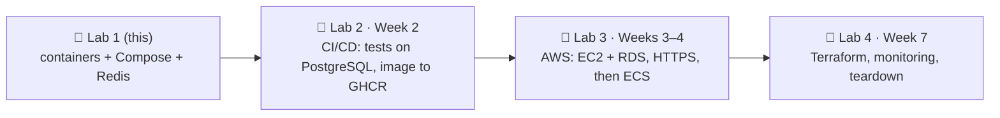

## 🎯 Goal

At the end of Module 5, RevoShop will run on AWS with HTTPS, CI/CD and infrastructure as code. This first lab makes it **ready to deploy anywhere**: a small, safe image, settings that refuse to start when something important is missing, a production-like stack you can start with one command, and tests that tell you in seconds whether a deployment works.

```text
Before                                         After this lab
─────────────────────────────────────────      ─────────────────────────────────────────────────
single-stage image, shell-form CMD             test + prod targets, exec-form gunicorn, labels
migrations run inside every container start    one-off migrate service, runs once per deploy
logs written to files inside the container     logs on stdout
JWT secret silently falls back to a default    production refuses to start without a real secret
port 8000 published directly, no TLS           Caddy reverse proxy (automatic HTTPS later)
no rate limiting on /auth/login                Redis sliding-window limit → 429 + Retry-After
"it seems to work"                             smoke tests against the running stack
```

## 🔤 Key words

| Word | In simple words |
|---|---|
| **Fail fast** | The app stops immediately at startup if a setting is missing or unsafe, instead of failing later in front of users |
| **Exec form `CMD`** | `CMD ["gunicorn", …]` — no shell in between, so gunicorn itself receives the "please stop" signal |
| **Non-root image** | The program inside the container runs as a normal user, not as administrator |
| **One-off job** | A container that runs a task once (here: database migrations) and then exits |
| **Reverse proxy** | The front door (Caddy) that receives all web traffic and passes it to the API |
| **Liveness vs readiness** | "Is the process alive?" (restart it if not) vs "can it serve users now?" (send traffic or not) |
| **Sliding window limit** | Counting attempts in the last N minutes, so 5 tries per 15 minutes really means 5 |
| **Smoke test** | A handful of quick checks that prove a deployment basically works |

:::warning[Work in your own copy of RevoShop]
Your RevoShop repository lives in your **bootcamp's GitHub organization**, where you may not be able to add GitHub Actions secrets or deploy keys (needed next week). Create a **personal** repository and push a copy there — leave the bootcamp remote untouched. Check your program's rules before making the copy **public**; a private repo works for everything in Module 5.
:::

## 🗺️ Where this fits



## 🧭 Checkpoints

### C0 · Your own copy and a branch (20 min)

```bash
cd ~/path/to/revoshop
git status                                   # commit or stash anything in progress
git switch main && git pull                  # or the branch that has your latest work (you have dev/main)

# create an EMPTY repository on github.com first (e.g. revoshop), then:
git remote add personal git@github.com:<your-username>/revoshop.git
git push personal --all
git push personal --tags

git switch -c deploy/production-containers
```

Never commit `.env` or `.env.docker` — check that `git check-ignore -v .env .env.docker` prints both.

### C1 · Audit what you have (30 min)

Run the auditor you built in exercise 01:

```bash
cd ~/Documents/LEARNING/Programming/Fullstack-Flask-React/fsse-handbook/exercises
uv run python m5/w1/01-dockerfile-audit/dockerfile_audit.py ~/path/to/revoshop/Dockerfile
```

It reports the **shell-form `CMD`** and the missing **`HEALTHCHECK`**. A linter can only see the file, not how the app behaves when it runs — like a building inspector who reads the plans but never turns on the water. So write the runtime problems down yourself, in `docs/deployment-audit.md`:

| # | Finding in RevoShop | Why it matters in production |
|---|---|---|
| 1 | `CMD gunicorn …` (shell form) after an `ENTRYPOINT` script | a shell sits between Docker and gunicorn; `docker stop` can end in SIGKILL (exit 137) instead of a clean shutdown |
| 2 | `docker/entrypoint.sh` runs `flask db upgrade` on **every** start | two copies migrate at the same time; slow restarts; a failed migration restarts forever |
| 3 | `netcat` wait loop installed with apt | waiting for the database is Compose/ECS's job; this is one more package in the image |
| 4 | single stage copies the whole repo (`COPY . .`) | test tools ship to production; bigger attack surface |
| 5 | `config/base.py` falls back to `JWT_SECRET_KEY='super-secret-key-change-in-production'` | one forgotten variable silently makes every token forgeable |
| 6 | `LOG_TO_FILE` defaults to `true` | logs disappear with the container; a read-only filesystem breaks |
| 7 | `create_app()` reads `FLASK_ENV` | Flask no longer gives `FLASK_ENV` any meaning; an unknown value raises `KeyError` |
| 8 | `docker-compose.prod.yml` publishes `8000` straight from gunicorn, no proxy | no TLS, no compression, no security headers; gunicorn exposed to the internet |
| 9 | fixed `container_name`s | can't scale, and two stacks can't run side by side |
| 10 | `/api/v1/health` queries the database | good for **readiness**; as a **liveness** check, one database hiccup restarts healthy API containers |
| 11 | `/auth/login` has no rate limit | password guessing at full speed |

### C2 · Image with targets and a gunicorn config (1 h)

**`gunicorn.conf.py`** (new, repo root):

```python
"""Gunicorn settings for containers. Values come from the environment."""

import os

bind = f"0.0.0.0:{os.environ.get('PORT', '5000')}"
workers = int(os.environ.get("WEB_CONCURRENCY", "2"))
threads = int(os.environ.get("GUNICORN_THREADS", "1"))
timeout = 30
graceful_timeout = 20
keepalive = 5

# Recycle workers regularly so slow memory leaks can't grow forever.
max_requests = 1000
max_requests_jitter = 100

# Logs to stdout/stderr: the container platform collects them.
accesslog = "-"
errorlog = "-"

# Trust X-Forwarded-* only from the reverse proxy on the private network.
forwarded_allow_ips = os.environ.get("FORWARDED_ALLOW_IPS", "127.0.0.1")
```

**`Dockerfile`** (replace):

```dockerfile
# syntax=docker/dockerfile:1
ARG PYTHON_VERSION=3.12

# ---------- base ----------
FROM python:${PYTHON_VERSION}-slim AS base
ENV PYTHONDONTWRITEBYTECODE=1 \
    PYTHONUNBUFFERED=1 \
    PIP_DISABLE_PIP_VERSION_CHECK=1 \
    VIRTUAL_ENV=/opt/venv \
    PATH="/opt/venv/bin:$PATH"
WORKDIR /app

# ---------- deps: production dependencies in a virtualenv ----------
FROM base AS deps
RUN python -m venv /opt/venv
COPY requirements.txt .
RUN --mount=type=cache,target=/root/.cache/pip \
    pip install -r requirements.txt

# ---------- test: optional, `docker build --target test .` ----------
FROM deps AS test
COPY requirements-dev.txt .
RUN --mount=type=cache,target=/root/.cache/pip \
    pip install -r requirements-dev.txt
COPY . .
RUN python -m pytest -q -p no:cacheprovider

# ---------- prod (last stage = default) ----------
FROM base AS prod
ARG VERSION=dev
ARG REVISION=unknown
LABEL org.opencontainers.image.title="revoshop-api" \
      org.opencontainers.image.version=$VERSION \
      org.opencontainers.image.revision=$REVISION
RUN groupadd --system --gid 10001 app \
    && useradd --system --uid 10001 --gid app --no-create-home --shell /usr/sbin/nologin app
COPY --from=deps /opt/venv /opt/venv
COPY --chown=app:app app ./app
COPY --chown=app:app config ./config
COPY --chown=app:app migrations ./migrations
COPY --chown=app:app run.py gunicorn.conf.py ./
ENV APP_ENV=production \
    FLASK_APP=run:application \
    PORT=5000 \
    WEB_CONCURRENCY=2 \
    LOG_TO_FILE=false
USER 10001
EXPOSE 5000
HEALTHCHECK --interval=15s --timeout=3s --start-period=15s --retries=3 \
    CMD ["python", "-c", "import os, urllib.request; urllib.request.urlopen(f\"http://127.0.0.1:{os.environ['PORT']}/api/v1/health/live\", timeout=2)"]
CMD ["gunicorn", "-c", "gunicorn.conf.py", "run:application"]
```

- `prod` copies **only** what runs (`app`, `config`, `migrations`, `run.py`, `gunicorn.conf.py`) — tests, Locust files and docs never reach production. So you can stop excluding `tests/` in `.dockerignore` (the `test` target needs them).
- Take `docker/entrypoint.sh` out of the production path (keep it for the old dev compose until you replace that too).
- Your full test suite is slow inside Docker (bcrypt hashing on a limited VM). Next week CI runs it directly against a real PostgreSQL; the `test` target stays available for local checks.

**`.dockerignore`** — keep secrets and junk out, but allow `tests/` and `requirements-dev.txt` for the test target:

```text
__pycache__/
*.pyc
.pytest_cache/
.coverage
htmlcov/
venv/
.venv/
.env
.env.*
!.env.example
!.env.docker.example
logs/
*.log
.git/
.idea/
.vscode/
.DS_Store
jira/
locust/
images/
postman/
docs/
```

Check: `docker build -t revoshop-api:local .`, then run the auditor on the new Dockerfile — zero errors.

### C3 · Fail-fast settings, stdout logs, a liveness endpoint (45 min)

A pilot checks fuel and instruments **before** take-off, not in the air. Your app should do the same with its settings.

**`app/__init__.py`** — choose the environment on purpose and check it:

```python
def create_app(config_name=None):
    if config_name is None:
        # APP_ENV is ours; FLASK_ENV is kept only for backwards compatibility.
        config_name = os.getenv('APP_ENV') or os.getenv('FLASK_ENV', 'development')
    if config_name not in config_by_name:
        raise RuntimeError(f"Unknown APP_ENV {config_name!r}; use one of {sorted(config_by_name)}")

    flask_app = Flask(__name__)
    flask_app.config.from_object(config_by_name[config_name])
    config_by_name[config_name].validate(flask_app.config)
    ...
```

**`config/base.py`** — a validation hook and Redis settings:

```python
class BaseConfig:
    @classmethod
    def validate(cls, config):
        """Hook for environment-specific checks (see ProductionConfig)."""

    # ... existing settings ...

    # ─── Redis (optional: rate limiting, caching) ─────────────────────────────
    REDIS_URL = os.getenv('REDIS_URL')
```

**`config/production.py`**:

```python
class ProductionConfig(BaseConfig):
    DEBUG = False
    SQLALCHEMY_ECHO = False
    LOG_LEVEL = 'INFO'
    # Containers log to stdout; the platform collects logs.
    LOG_TO_FILE = os.getenv('LOG_TO_FILE', 'false').lower() == 'true'

    @classmethod
    def validate(cls, config):
        """Fail fast: refuse to start with missing or unsafe settings."""
        problems = []
        if not config.get('SQLALCHEMY_DATABASE_URI'):
            problems.append('DATABASE_URL is not set')
        if len(os.getenv('JWT_SECRET_KEY', '')) < 32:
            problems.append('JWT_SECRET_KEY must be set to at least 32 random characters')
        if problems:
            raise RuntimeError('Invalid production configuration: ' + '; '.join(problems))
```

**`app/routes/health.py`** — add liveness next to the readiness check you already have:

```python
@health_blp.route('/live')
class Liveness(MethodView):
    """Is the process alive? No dependencies: orchestrators restart the container if this fails."""

    def get(self):
        return make_response('alive')
```

Liveness is checking a pulse; readiness is checking that the staff member is at their station. Write two tests: production config raises without a strong `JWT_SECRET_KEY`; `/api/v1/health/live` returns 200 even when the database is down (hint: point `DATABASE_URL` at a closed port).

### C4 · The production-like stack (1.5 h)

**`Caddyfile`**:

```text
# Local: SITE_ADDRESS=:80 (plain HTTP). On a server with a domain: SITE_ADDRESS=api.example.com → automatic HTTPS.
{$SITE_ADDRESS::80} {
	encode zstd gzip
	header {
		-Server
		X-Content-Type-Options nosniff
		Referrer-Policy strict-origin-when-cross-origin
	}
	reverse_proxy api:5000 {
		health_uri /api/v1/health/live
	}
}
```

**`compose.prod.yaml`** (new — you can delete `docker-compose.prod.yml` once this works):

```yaml
# Production-like RevoShop stack.
#   cp .env.production.example .env.production   # fill in real values
#   docker compose --env-file .env.production -f compose.prod.yaml up -d --build
name: revoshop

x-app-env: &app-env
  APP_ENV: production
  DATABASE_URL: postgresql://revoshop:${POSTGRES_PASSWORD:?set POSTGRES_PASSWORD}@db:5432/revoshop
  JWT_SECRET_KEY: ${JWT_SECRET_KEY:?set JWT_SECRET_KEY}
  REDIS_URL: redis://redis:6379/0
  MIDTRANS_SERVER_KEY: ${MIDTRANS_SERVER_KEY:-}
  MIDTRANS_CLIENT_KEY: ${MIDTRANS_CLIENT_KEY:-}
  MIDTRANS_IS_PRODUCTION: ${MIDTRANS_IS_PRODUCTION:-false}

services:
  proxy:
    image: caddy:2-alpine
    restart: unless-stopped
    ports:
      - "${HTTP_PORT:-8080}:80"
      - "${HTTPS_PORT:-8443}:443"
    environment:
      SITE_ADDRESS: ${SITE_ADDRESS:-:80}
    volumes:
      - ./Caddyfile:/etc/caddy/Caddyfile:ro
      - caddy_data:/data
    depends_on:
      api:
        condition: service_healthy
    networks: [frontend]

  api:
    build:
      context: .
      target: prod
    image: ${API_IMAGE:-revoshop-api:local}
    restart: unless-stopped
    environment:
      <<: *app-env
      WEB_CONCURRENCY: ${WEB_CONCURRENCY:-2}
      FORWARDED_ALLOW_IPS: "*"   # only the proxy can reach the api (internal networks)
    depends_on:
      db:
        condition: service_healthy
      redis:
        condition: service_healthy
      migrate:
        condition: service_completed_successfully
    networks: [frontend, backend]
    read_only: true
    tmpfs: [/tmp]
    cap_drop: [ALL]
    security_opt: ["no-new-privileges:true"]
    deploy:
      resources:
        limits: { memory: 768M }

  migrate:
    image: ${API_IMAGE:-revoshop-api:local}
    command: ["flask", "db", "upgrade"]
    environment: *app-env
    depends_on:
      db:
        condition: service_healthy
    networks: [backend]
    restart: "no"

  db:
    image: postgres:16-alpine
    restart: unless-stopped
    environment:
      POSTGRES_USER: revoshop
      POSTGRES_DB: revoshop
      POSTGRES_PASSWORD: ${POSTGRES_PASSWORD:?set POSTGRES_PASSWORD}
    volumes:
      - pgdata:/var/lib/postgresql/data
    healthcheck:
      test: ["CMD-SHELL", "pg_isready -U revoshop -d revoshop"]
      interval: 5s
      timeout: 3s
      retries: 10
    networks: [backend]
    deploy:
      resources:
        limits: { memory: 512M }

  redis:
    image: redis:8-alpine
    restart: unless-stopped
    command: ["redis-server", "--maxmemory", "128mb", "--maxmemory-policy", "allkeys-lru"]
    healthcheck:
      test: ["CMD", "redis-cli", "ping"]
      interval: 5s
      timeout: 3s
      retries: 10
    networks: [backend]

networks:
  frontend:
  backend:

volumes:
  pgdata:
  caddy_data:
```

**`.env.production.example`** (commit this one; `.env.production` stays ignored — `.env.*` already is):

```text
# Copy to .env.production (never commit it). Generate secrets with: openssl rand -hex 32
POSTGRES_PASSWORD=
JWT_SECRET_KEY=
MIDTRANS_SERVER_KEY=
MIDTRANS_CLIENT_KEY=
MIDTRANS_IS_PRODUCTION=false
# Local: leave SITE_ADDRESS=:80 and open http://localhost:8080 · Server: SITE_ADDRESS=api.your-domain.com, HTTP_PORT=80, HTTPS_PORT=443
SITE_ADDRESS=:80
HTTP_PORT=8080
HTTPS_PORT=8443
WEB_CONCURRENCY=2
```

Run it:

```bash
cp .env.production.example .env.production        # then fill POSTGRES_PASSWORD and JWT_SECRET_KEY
docker compose --env-file .env.production -f compose.prod.yaml up -d --build
docker compose --env-file .env.production -f compose.prod.yaml ps
docker compose --env-file .env.production -f compose.prod.yaml logs migrate   # all Alembic upgrades, then exit 0
curl -i http://localhost:8080/api/v1/health
```

Stop your old `revoshop-db` / `revoshop-web` containers first if they use the same ports (`docker compose -f docker-compose.yml down` in the repo).

### C5 · Rate-limit login with Redis (1.5 h) — 🚫🤖 core logic by you

Like an ATM that blocks the card after a few wrong PINs. Using what you built in exercise 04, add `app/rate_limit.py` with a function:

```python
def allow(identity: str, *, limit: int, window_seconds: int) -> tuple[bool, int]:
    """Return (allowed, retry_after_seconds). Fails open when Redis is not configured or unavailable."""
```

and call it at the top of `AuthLogin.post` in `app/routes/auth.py`:

- **5 attempts / 15 minutes per email** (lower-cased) **and 20 / 15 minutes per client IP**
- over the limit → `429` with the usual RevoShop JSON body and a `Retry-After` header
- no `REDIS_URL` (your test suite) or Redis unreachable → allow the request, and log a warning
- behind Caddy, the client IP is the first address in `X-Forwarded-For`

Then write tests for it (mock `allow`, or use the exercise Redis on port 6391 with `REDIS_URL=redis://localhost:6391/15`).

:::quiz
Show a reference implementation (after you've tried)

```python
"""Sliding-window rate limiting backed by Redis (Module 5 · Week 1)."""

import math
import time
import uuid
from functools import lru_cache

import redis
from flask import current_app

SLIDING_WINDOW = """
redis.call('ZREMRANGEBYSCORE', KEYS[1], '-inf', ARGV[1] - ARGV[2])
if redis.call('ZCARD', KEYS[1]) < tonumber(ARGV[3]) then
  redis.call('ZADD', KEYS[1], ARGV[1], ARGV[4])
  redis.call('EXPIRE', KEYS[1], ARGV[5])
  return {1, '0'}
end
local oldest = redis.call('ZRANGE', KEYS[1], 0, 0, 'WITHSCORES')
return {0, tostring(tonumber(oldest[2]) + ARGV[2] - ARGV[1])}
"""


@lru_cache(maxsize=4)
def _client(url: str) -> redis.Redis:
    return redis.Redis.from_url(url, decode_responses=True, socket_timeout=0.5, socket_connect_timeout=0.5)


def allow(identity: str, *, limit: int, window_seconds: int) -> tuple[bool, int]:
    url = current_app.config.get('REDIS_URL')
    if not url:
        return True, 0
    now = time.time()
    try:
        allowed, retry_after = _client(url).eval(
            SLIDING_WINDOW, 1, f"ratelimit:{identity}", repr(now), window_seconds, limit,
            f"{now}:{uuid.uuid4().hex}", window_seconds,
        )
    except redis.RedisError:
        current_app.logger.warning('rate limiter unavailable; allowing request')
        return True, 0
    return bool(allowed), math.ceil(float(retry_after))
```

```python
# app/routes/auth.py (top of AuthLogin.post)
email = validated_data['email'].strip().lower()
ip = request.headers.get('X-Forwarded-For', request.remote_addr or 'unknown').split(',')[0].strip()
for identity, limit in ((f"login:email:{email}", 5), (f"login:ip:{ip}", 20)):
    allowed, retry_after = allow(identity, limit=limit, window_seconds=900)
    if not allowed:
        body, _ = make_response('too many login attempts, try again later', status=False, status_code=429)
        body.status_code = 429
        body.headers['Retry-After'] = str(retry_after)
        return body
```

Add `redis==8.1.0` (or the current version) to `requirements.txt`. Trusting `X-Forwarded-For` is only safe because the API can be reached **only** through Caddy on the internal network.
:::

Verify:

```bash
for i in 1 2 3 4 5 6; do curl -s -o /dev/null -w "%{http_code} " -X POST http://localhost:8080/api/v1/auth/login \
  -H 'content-type: application/json' -d '{"email":"nobody@example.com","password":"wrong"}'; done
# 401 401 401 401 401 429
```

### C6 · Prove it works (45 min)

Smoke tests are the plumber turning on every tap before leaving the house.

```bash
cd ~/Documents/LEARNING/Programming/Fullstack-Flask-React/fsse-handbook/exercises
REVOSHOP_URL=http://localhost:8080 uv run pytest m5/w1/05-revoshop-smoke -v
```

Then check the production behaviour by hand and note the results in `docs/deployment-audit.md`:

```bash
docker compose --env-file .env.production -f compose.prod.yaml exec api id                    # uid=10001(app)
time docker compose --env-file .env.production -f compose.prod.yaml stop api                  # ~1 s, not 10+ s
docker compose --env-file .env.production -f compose.prod.yaml start api
JWT_SECRET_KEY=short docker compose --env-file .env.production -f compose.prod.yaml up api    # refuses to start
docker stats --no-stream                                                                     # memory per service
```

Optional: run your Locust scenario against `http://localhost:8080` and compare p95 with your Module 2 results.

### C7 · Document and open a pull request (30 min)

- README section **"Run in production mode"**: the three commands, required variables, ports, how to run smoke tests.
- `docs/deployment-audit.md` with the findings table and what you changed.
- Commit in small steps (`build: add prod and test targets`, `feat(config): fail fast on unsafe production settings`, `feat(auth): rate-limit login with Redis`, …), push to your personal repo and open a PR to your own `main`. Review your own diff the next morning before merging.

## ✅ Done when

- [ ] Personal repo with a `deploy/production-containers` PR merged
- [ ] Auditor shows **0 errors** on the new Dockerfile
- [ ] `compose.prod.yaml` stack starts with migrations running once, API healthy behind Caddy
- [ ] Production refuses to start without a strong `JWT_SECRET_KEY`
- [ ] Login returns `429` + `Retry-After` after 5 bad attempts; tests cover it
- [ ] Smoke tests pass against `http://localhost:8080`
- [ ] You can explain every line of the Dockerfile, `gunicorn.conf.py`, Caddyfile and `compose.prod.yaml`

## 🧠 AI policy

🤖✅ AI may help with Compose/Caddy syntax and README wording. 🚫🤖 Write the rate limiter wiring and tests yourself, and be ready to defend every production setting — the *Defend Your RevoShop* questions now include deployment.

## ❓ Questions an interviewer might ask

- Why did you move migrations out of the container entrypoint? How would you run them on ECS?
- What's the difference between `/health` and `/health/live`, and which one should a load balancer use?
- Why exec-form `CMD`? What exit code did you see before, and why?
- Why is trusting `X-Forwarded-For` safe in your setup — and when would it be dangerous?
- What happens to login when Redis is down? Why did you choose that?

## 📣 Share it

:::linkedin{type="weekly"}
🐳 Module 5 · Week 1: getting my RevoShop API production-ready.

What I changed after auditing my own Dockerfile:
- test + prod build targets, a non-root image and a real gunicorn config (graceful shutdown instead of exit 137)
- migrations as a one-off job instead of running in every container start
- the app now refuses to start without a strong JWT secret (it used to fall back to a default 😬)
- Caddy in front, PostgreSQL and Redis on an internal network only
- Redis sliding-window rate limiting on login → 429 after 5 bad attempts

And smoke tests that tell me in 10 seconds whether a deployment actually works.

Next week: CI/CD. ⚙️

#Docker #Python #Flask #DevOps #LearningInPublic
:::
