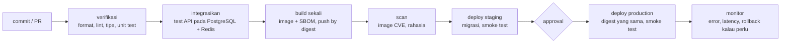

::part[Pelajari Konsepnya]{n="1"}

## 🎯 Yang akan kamu pelajari

- **CI**, **continuous delivery** dan **continuous deployment** — dan mana yang kamu butuhkan
- **Tahap** pipeline, **quality gate** dan **artifact**
- **Build sekali, deploy berkali-kali**: memindahkan image yang sama antar lingkungan
- **Trunk-based development**, perubahan kecil, dan feature flag
- Merancang untuk **feedback cepat** (aturan 10 menit)
- **Rollback** dan **roll-forward**, plus migrasi database di pipeline
- **DORA metric** untuk mengukur sebaik apa kamu deliver

## 🔤 Istilah penting

| Istilah | Artinya (sederhana) |
|---|---|
| **Pipeline** | Rangkaian langkah otomatis yang dilalui setiap perubahan: pemeriksaan, build, deploy |
| **CI (continuous integration)** | Semua orang merge perubahan kecil sering-sering, dan setiap merge dicheck otomatis |
| **Artifact** | Barang yang benar-benar di-deploy (image container, zip, situs yang sudah di-build) |
| **Digest** | Sidik jari image (`sha256:…`), jadi "build yang persis ini" tidak ambiguous |
| **Quality gate** | Pemeriksaan yang menghentikan pipeline saat ada yang salah |
| **Environment** | Tempat aplikasi jalan: staging (latihan) atau production (pengguna asli) |
| **Promote** | Pindahkan artifact yang sudah ditest ke lingkungan berikutnya |
| **Feature flag** | Sakelar yang menyembunyikan fitur yang belum selesai di production |
| **Rollback** | Kembali ke versi sebelumnya |
| **Lead time** | Waktu dari commit sampai kode jalan untuk pengguna |

## 🧠 Ide besarnya

Pipeline itu seperti **keamanan dan boarding di bandara** untuk kode kamu.

Setiap perubahan adalah penumpang:

- dicek di gerbang (lint, test),
- bagasi di-scan (security scan),
- dikasih boarding pass yang tidak bisa dipalsukan (image digest),
- dan penumpang yang sama yang lolos keamanan naik pesawat (production) — tidak ada yang tukar tas di jet bridge.

Kalau pesawat punya masalah, ada prosedur yang sudah dilatih untuk kembali ke gerbang (rollback).

## ❓ Kenapa ini penting

Rilis manual itu lambat, stress, dan tidak pernah persis sama dua kali: seseorang login ke server, pull kode, lupa migrasi, restart service yang salah. Tim yang ship perubahan kecil sering-sering, melalui pipeline otomatis, rilis lebih cepat **dan** break production lebih jarang — itu temuan konsisten dari penelitian DORA.

Tanpa pipeline:

- "Release day" setiap dua minggu dengan 60 perubahan: pas break, tidak tahu mana yang salah.
- Production di-build di laptop seseorang, dengan file yang tidak pernah di-commit.
- Staging test image A; production dapat image B, di-rebuild nanti dengan dependency yang lebih baru.
- Rollback berarti "revert dan berharap", karena tidak pernah latihan.

## 📖 Langkah demi langkah

### 1. Tiga istilah

| Praktik | Setiap perubahan… | Rilis production |
|---|---|---|
| **Continuous integration (CI)** | di-merge ke main sering-sering, di-check otomatis | — |
| **Continuous delivery** | hasilkan artifact yang siap release, deploy ke staging otomatis | tombol / approval |
| **Continuous deployment** | jalan sampai habis otomatis | otomatis |

Kebanyakan tim mulai dengan CI + continuous delivery (staging otomatis, production approval), lalu pindah ke continuous deployment saat test dan monitoring bisa dipercaya.

### 2. Tahap dan gerbang

| Jenis gerbang | Contoh | Pipeline gagal saat |
|---|---|---|
| kebenaran | unit, API, E2E test | ada test yang gagal |
| kualitas | lint, type check, coverage floor | ada pelanggaran baru |
| keamanan | scan dependency dan image, scan secret | HIGH/CRITICAL tanpa exception yang diterima |
| release | smoke test staging, approval manual | smoke test gagal / tidak approved |
| kesehatan production | error rate dan latency setelah deploy | alarm menyala → rollback |

**Susun tahap berdasarkan kecepatan**, seperti bandara yang pasang metal detector sebelum meja passport: typo harus gagal dalam 30 detik, bukan setelah build 6 menit.

### 3. Artifact dan "build sekali, deploy berkali-kali"

- **Artifact** adalah yang di-deploy: image digest (`ghcr.io/you/revoshop@sha256:…`), static bundle, Lambda zip.
- **Build sekali** per commit, lalu promote digest yang sama dari staging ke production.
- Hanya konfigurasi yang beda per lingkungan (variable, secret). **Jangan** di-rebuild per lingkungan — itu seperti test satu kue tapi layani kue beda.

### 4. Trunk-based development

| | Long-lived branch | Trunk-based |
|---|---|---|
| Umur branch | minggu | jam sampai 1–2 hari |
| Merge | besar, konflik sakit | kecil, sering, membosankan |
| Fitur yang belum selesai | tersembunyi di branch | tersembunyi di balik **feature flag** |
| Pipeline | jarang di main | setiap merge ke main |

Pull request kecil, di-review cepat, di-merge di balik flag saat fitur belum selesai. Seperti bayar sedikit setiap minggu daripada satu tagihan besar di akhir.

### 5. Feedback cepat

Target umum: **PR check di bawah ~10 menit**. Caranya: cache dependency dan Docker layer, jalankan job parallel, split test suite lambat di beberapa mesin (sharding), jalankan suite mahal (full E2E, load test) malam hari, dan skip job saat file tidak terkait berubah.

Pipeline lambat bukan hanya buang waktu — ubah perilaku: orang berhenti tunggu, batch perubahan, dan kamu kehilangan benefit rilis kecil.

### 6. Rollback, roll-forward, dan migrasi

- **Rollback**: deploy digest sebelumnya lagi — cepat, kalau database masih sesuai kode lama.
- **Roll-forward**: ship fix cepat — perlu saat migrasi tidak bisa di-undo.
- Buat migrasi **backward compatible** (expand → deploy → contract): tambah kolom nullable, deploy kode yang tulis old dan new, backfill data, dan hapus kolom lama di rilis *berikutnya*.

Begitu image lama masih jalan setelah migrasi — seperti perpanjang jalan sebelum tutup jalur lama, jadi traffic tidak pernah berhenti.

### 7. DORA metric

| Metric | Pertanyaannya |
|---|---|
| **Deployment frequency** | Seberapa sering kami berhasil rilis ke production? |
| **Change lead time** | Berapa lama dari commit sampai jalan di production? |
| **Change failure rate** | Berapa share deployment yang punya masalah (rollback, hotfix, incident)? |
| **Failed deployment recovery time** | Berapa lama pulih setelah deployment buruk? |

Mereka seimbang satu sama lain: deploy sering bagus hanya kalau kegagalan tetap jarang dan recovery cepat. Lihat tren tim kamu sendiri, bukan angka tim lain.

### Pilih setup kamu

- ✅ Setiap proyek yang jalan di mana saja selain laptop kamu — bahkan aplikasi portfolio.
- ✅ Deploy staging otomatis dari main; production dari tag atau approval.
- 🚫 Jangan otomasi proses yang tidak bisa kamu lakukan manual — deploy manual sekali, tulis langkahnya, baru otomasi.
- 🚫 Jangan tambah gerbang yang tidak ada yang act: peringatan yang semua abaikan ajarkan orang untuk abaikan kegagalan asli.
- Continuous deployment beri feedback tercepat tapi butuh test kuat, monitoring dan flag; approval manual tambah cek manusia tapi gampang jadi rubber stamp.

## ⚠️ Kesalahan umum

- Di-rebuild image per lingkungan ("the prod build").
- Pipeline 45 menit, jadi developer batch perubahan.
- Migrasi yang tidak bisa di-undo, di-deploy bareng kode yang butuh migrasi itu.
- Hitung deploy tanpa track kegagalan dan recovery.

## 🏆 Praktik terbaik

- [ ] Perubahan kecil: branch short-lived, PR kecil, merge sering-sering.
- [ ] Cek cepat dulu; jaga feedback PR di bawah ~10 menit.
- [ ] Build satu artifact unchangeable per commit dan promote by digest.
- [ ] Simpan konfigurasi di luar artifact; lingkungan beda hanya di konfigurasi.
- [ ] Deploy staging otomatis + smoke test; deploy production terkontrol.
- [ ] Migrasi backward-compatible; latihan rollback sebelum butuh.
- [ ] Lihat error dan latency setelah setiap deploy; otomasi rollback di sinyal jelas.
- [ ] Track DORA metric dan bahas di retrospective.

:::revoshop
1. **Pipeline hari ini.** Repo kamu tidak punya `.github/workflows/`. Tulis bagaimana RevoShop pergi dari commit ke "jalan" hari ini, langkah demi langkah (siapa run test, siapa build, di mana jalan). Itu pipeline *sekarang* — yang manual.
2. **Branch.** Kamu punya long-lived `main`, `dev` dan `dev-docs`. Merge `dev` ke `main` seperti apa setelah seminggu kerja? Trunk-based development ubah apa?
3. **Waktu feedback.** Time suite kamu: `time python -m pytest -q`. Di lingkungan bersih butuh sekitar **7.5 menit** untuk 467 test. Buka `app/auth.py`: `bcrypt.gensalt()` pakai default cost untuk *setiap* test user. Itu apakah ke lead time kamu? (Materi 05 perbaiki.)
4. **Baseline merah.** Di checkout bersih (tanpa `.env`), **5 test gagal** — di antaranya `tests/integration/test_products.py::TestGetProducts::test_get_products_no_auth`, yang harap `401` tapi API kasih `200` untuk public product list. Sebelum otomasi apa pun: kode yang benar, atau test yang benar? Pipeline yang merah sejak hari pertama ajarkan semua untuk abaikan.
5. **Baseline DORA.** Isi empat metric RevoShop jujur (deployment frequency "tidak pernah" itu jawab sah) dan set target untuk akhir Module 5.
:::

::part[Jelaskan & Rancang]{n="2"}

## 🗣️ Jelaskan

Jelaskan analogi bandara ke teammate yang mau "rebuild image untuk production dengan production settings".

## 📐 Rancang

Rancang pipeline delivery RevoShop: tahap dengan check dan time budget, mana yang jalan di PR vs main vs tag, artifact dan cara di-promote, approval di mana, migrasi bagaimana, dan kamu rollback gimana. Terus bilang metric DORA mana yang setiap pilihan improve.

:::quiz
Lihat contoh rancangan

| Tahap | Jalan di | Check | Budget |
|---|---|---|---|
| verifikasi | PR, main | ruff/pylint, import check, unit test (no database) | 2 min |
| integrasikan | PR, main | test API pada PostgreSQL 16 + Redis service; migrasi `upgrade` dari DB kosong | 6 min |
| build | PR (no push), main, tag | target `prod`, SBOM, Trivy HIGH/CRITICAL gate; push `sha-*` di main/tag | 4 min |
| deploy staging | main | job `migrate` (migrasi backward-compatible) → deploy digest → smoke test | 5 min |
| deploy production | tag `v*` + approval | digest yang sama; migrasi sudah proven di staging → deploy → smoke test → watch 5xx/p95 10 min | 10 min |

- **Promotion:** tag menunjuk ke commit yang sudah di-build di main → production deploy digest commit itu (no rebuild).
- **Rollback:** deploy digest sebelumnya lagi (ada di deployment history); migrasi ikuti expand/contract, jadi versi lama jalan fine di schema baru.
- **DORA:** PR kecil + cek cepat → *lead time* dan *frequency*; test integrasi di PostgreSQL asli + smoke test → *change failure rate*; redeploy one-click digest lama + alarm → *recovery time*.
:::

### 📝 Checklist review mandiri

- [ ] Artifact yang sama di-promote
- [ ] Time budget per tahap
- [ ] Rollback path sesuai dengan migrasi

::ai-review{task="design"}

::part[Latihan Kecil]{n="3"}

:::exercise{path="exercises/m5/w2/01-dora-metrics" ai="no-ai" title="Ukur performa delivery"}
Hitung deployment frequency, change lead time (median antar commit), change failure rate (outcome + incident) dan recovery time dari deployment dan incident record, lalu klasifikasi tim dari elite sampai low.
:::

:::hints
- Filter ke `environment == "production"` dulu, di satu helper.
- Lead time per **commit**, bukan per deployment — flatten list sebelum median.
- Level keseluruhan adalah level **paling buruk** di antara metric individual.
:::

## ✅ Cek cepat

:::quiz
Tim kamu deploy 20 kali sehari tapi setengah deployment di-rollback. Itu "elite"?

Tidak — 50% change failure rate itu low performance. DORA metric harus dibaca bareng: kecepatan tanpa stabilitas bukan high performance.
:::

:::quiz
Kenapa migrasi backward-compatible buat rollback lebih aman?

Setelah migrasi jalan, versi lama aplikasi masih kerja dengan struktur database baru, jadi kamu bisa deploy image lama lagi tanpa restore database.
:::

## 📚 Lanjut belajar

- [DORA: Four key metrics](https://dora.dev/guides/dora-metrics-four-keys/)
- [Martin Fowler: Continuous Integration](https://martinfowler.com/articles/continuousIntegration.html)
- [trunkbaseddevelopment.com](https://trunkbaseddevelopment.com/)
