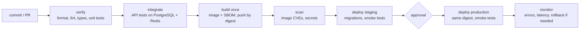

::part[Learn the Concept]{n="1"}

## 🎯 What you'll learn

- **CI**, **continuous delivery** and **continuous deployment** — and which one you need
- Pipeline **stages**, **quality gates** and **artifacts**
- **Build once, deploy many**: promoting the same image through environments
- **Trunk-based development**, small batches and feature flags
- Designing for **fast feedback** (the 10-minute rule)
- **Rollback** and **roll-forward** paths, database migrations in pipelines
- **DORA metrics** to measure delivery performance

## 🧠 The big idea

A pipeline is an **airport security and boarding process** for code. Every change is a passenger: it's checked at the gate (lint, tests), its luggage is scanned (security scans), it gets a boarding pass that can't be forged (an immutable image digest), and the *same passenger* boards the plane (production) that passed through security — nobody swaps bags on the jet bridge. If a plane has a problem, there's a practiced procedure to return to the gate (rollback).

## ❓ Why does this matter?

Manual releases are slow, scary and inconsistent: someone SSHs into the server, pulls code, forgets a migration, restarts the wrong service. Teams that deploy small changes often, through automated pipelines, ship faster **and** break production less — that's the consistent finding of the DORA research program.

## 💥 What happens if we DON'T?

- "Release day" every two weeks with 60 changes: when something breaks, nobody knows which change caused it.
- Production is built from a laptop with uncommitted files.
- Staging tested image A, production got image B rebuilt later with a new dependency version.
- Rolling back means "revert and hope" because nobody practiced it.

## 📖 How it works, step by step

### 1. The three terms

| Practice | Every change… | Production release |
|---|---|---|
| **Continuous integration (CI)** | merged to main frequently, verified automatically | — |
| **Continuous delivery** | produces a releasable artifact, deployed to staging automatically | a button / approval |
| **Continuous deployment** | goes all the way automatically | automatic |

Most teams start with CI + continuous delivery (automatic staging, approved production), then move to continuous deployment as tests and monitoring get trustworthy.

### 2. Stages and gates

| Gate type | Examples | Fails the pipeline when |
|---|---|---|
| correctness | unit, API, E2E tests | a test fails |
| quality | lint, type checks, coverage floor | new violations |
| security | dependency and image scans, secret scanning | HIGH/CRITICAL without an accepted exception |
| release | staging smoke tests, manual approval | smoke tests fail / not approved |
| production health | error rate and latency after deploy | alarm → rollback |

**Order by speed**: cheap checks first, so a typo fails in 30 seconds, not after a 6-minute build.

### 3. Artifacts and build once, deploy many

- The **artifact** is what you deploy: an image digest (`ghcr.io/you/revoshop@sha256:…`), a static bundle, a Lambda zip.
- Build it **once** per commit; promote the *same* digest from staging to production.
- Configuration differs per environment (variables, secrets) — **never** rebuild per environment.

### 4. Trunk-based development

| | Long-lived branches | Trunk-based |
|---|---|---|
| Branch lifetime | weeks | hours to 1–2 days |
| Merge pain | big conflicts | small, frequent merges |
| Unfinished features | hidden in branches | hidden behind **feature flags** |
| Pipeline | runs rarely on main | runs on every merge to main |

Pull requests stay small, reviewed quickly, and merged behind flags when incomplete.

### 5. Fast feedback

A common target: **PR checks under ~10 minutes**. Techniques: caching dependencies and Docker layers, running jobs in parallel, splitting slow test suites (sharding), running expensive suites (full E2E, load tests) nightly, and skipping jobs when unrelated paths change.

### 6. Rollback vs roll-forward, and migrations

- **Rollback**: redeploy the previous digest — fast if the database is compatible.
- **Roll-forward**: ship a fix quickly — needed when a migration can't be reversed.
- Make migrations **backward compatible** (expand → deploy → contract): add a nullable column, deploy code that writes both, backfill, then remove the old column in a later release. Then the previous image still works after a migration, and rollback stays safe.

### 7. DORA metrics

| Metric | Question |
|---|---|
| **Deployment frequency** | How often do we successfully release to production? |
| **Change lead time** | How long from commit to running in production? |
| **Change failure rate** | What share of deployments cause a failure (rollback, hotfix, incident)? |
| **Failed deployment recovery time** | How long does it take to restore service after a failed deployment? |

They balance each other: deploying often is only good if failures stay rare and recovery is fast. Measure trends for your team, not league tables against others.

## ⚖️ Trade-offs

| Choice | ✅ | ❌ |
|---|---|---|
| Continuous deployment | fastest feedback, smallest changes | needs strong tests, monitoring, flags |
| Manual production approval | human check, compliance | slower; approvals become rubber stamps |
| Tests inside image builds | same environment as prod | slower feedback, harder to parallelize |
| Monorepo pipeline | one place, shared tooling | needs path filtering to stay fast |

## ✅ When to use it / 🚫 When NOT to use it

- ✅ Every project that runs somewhere other than your laptop — even a portfolio app.
- ✅ Automatic staging deploys from main; production from tags or approvals.
- 🚫 Don't automate a process you don't understand manually — deploy by hand once, write it down, then automate.
- 🚫 Don't add gates nobody acts on (warnings everyone ignores train people to ignore failures).

## 🏆 Best practices

- [ ] Small batches: short-lived branches, small PRs, frequent merges.
- [ ] Fast checks first; keep PR feedback under ~10 minutes.
- [ ] Build one immutable artifact per commit and promote it by digest.
- [ ] Separate config from artifacts; environments differ only in configuration.
- [ ] Automated staging deploy + smoke tests; controlled production deploys.
- [ ] Backward-compatible migrations; practice rollback before you need it.
- [ ] Monitor after deploys; automate rollback on clear signals when possible.
- [ ] Track DORA metrics and review them in retrospectives.

## 🏭 How it's used in industry

- The annual DORA / Accelerate State of DevOps research is widely used to benchmark delivery; high performers deploy on demand with low failure rates.
- Large tech companies deploy thousands of times per day using trunk-based development and feature flags; regulated industries add approvals and audit trails to the same pipeline shape.
- Platform teams offer "golden path" pipeline templates (reusable workflows) so every service gets the same gates.

## ⚠️ Common mistakes

- Rebuilding images per environment ("prod build").
- A pipeline that takes 45 minutes, so developers batch changes.
- Irreversible migrations deployed together with code that depends on them.
- Counting deploys without tracking failures and recovery.

:::revoshop
1. **Today's pipeline.** Your repo has no `.github/workflows/`. Write down how RevoShop gets from a commit to "running" today, step by step (who runs tests, who builds, where it runs). That's your *current* pipeline — manual.
2. **Branches.** You have long-lived `main`, `dev` and `dev-docs`. What does merging `dev` into `main` look like after a week of work? What would trunk-based development change?
3. **Feedback time.** Time your suite: `time python -m pytest -q`. In a clean environment it took about **7.5 minutes** for 467 tests. Open `app/auth.py`: `bcrypt.gensalt()` uses the default cost for *every* test user. What does that do to change lead time? (Lesson 05 fixes it.)
4. **A red baseline.** In a clean checkout (no `.env`), **5 tests fail** — among them `tests/integration/test_products.py::TestGetProducts::test_get_products_no_auth`, which expects `401` while the API returns `200` for the public product list. Before automating anything: is the code right or the test? A pipeline that is red from day one teaches everyone to ignore it.
5. **DORA baseline.** Fill in RevoShop's four metrics honestly (deployment frequency "never" is a valid answer) and set a target for the end of Module 5.
:::

::part[Explain & Design]{n="2"}

## 🗣️ Explain it

Explain the airport analogy to a teammate who wants to "just rebuild the image for production with production settings".

## 📐 Design it

Design RevoShop's delivery pipeline: stages with their checks and time budgets, which run on PRs vs main vs tags, the artifact and how it's promoted, the approval point, how migrations run, and how you'd roll back. Then say which DORA metric each design choice improves.

:::quiz
Show a possible design

| Stage | Runs on | Checks | Budget |
|---|---|---|---|
| verify | PR, main | ruff/pylint, import checks, unit tests (SQLite-free services) | 2 min |
| integrate | PR, main | API tests on PostgreSQL 16 + Redis services; migrations `upgrade` from empty DB | 6 min |
| build | PR (no push), main, tags | `prod` target, SBOM, Trivy HIGH/CRITICAL gate; push `sha-*` on main/tags | 4 min |
| deploy staging | main | `migrate` job (backward-compatible migrations) → deploy digest → smoke tests | 5 min |
| deploy production | tag `v*` + approval | same digest; migrations already proven in staging → deploy → smoke tests → watch 5xx/p95 for 10 min | 10 min |

- **Promotion:** the tag points to a commit already built on main → production uses that commit's digest (no rebuild).
- **Rollback:** redeploy the previous digest (recorded in the deployment history); migrations follow expand/contract so the previous version runs on the new schema.
- **DORA:** small PRs + fast checks → *lead time* and *frequency*; integration tests on real PostgreSQL + smoke tests → *change failure rate*; one-click redeploy of the previous digest + alarms → *recovery time*.
:::

### 📝 Self-review checklist

- [ ] Same artifact promoted
- [ ] Time budget per stage
- [ ] Rollback path compatible with migrations

::ai-review{task="design"}

::part[Toy Exercise]{n="3"}

:::exercise{path="exercises/m5/w2/01-dora-metrics" ai="no-ai" title="Measure delivery performance"}
Compute deployment frequency, change lead time (median over commits), change failure rate (outcomes plus incidents) and recovery time from deployment and incident records, then classify the team from elite to low.
:::

:::hints
- Filter to `environment == "production"` first, in one helper.
- Lead time is per **commit**, not per deployment — flatten before taking the median.
- The overall level is the **worst** level of the individual metrics.
:::

## ✅ Quick check

:::quiz
Your team deploys 20 times a day but half the deployments are rolled back. Is that "elite"?

No — change failure rate of 50% is low performance. DORA metrics must be read together: speed without stability isn't high performance.
:::

:::quiz
Why do backward-compatible migrations make rollbacks safer?

After the migration runs, the previous application version still works with the new schema, so you can redeploy the old image without restoring the database.
:::

## 📖 Kamus (glossary)

| Term | Bahasa Indonesia |
|---|---|
| Continuous integration | Integrasi berkelanjutan |
| Continuous delivery / deployment | Pengiriman / penerapan berkelanjutan |
| Quality gate | Gerbang kualitas |
| Artifact | Artefak (hasil build yang di-deploy) |
| Rollback | Kembali ke versi sebelumnya |
| Lead time | Waktu tunggu dari commit sampai produksi |

## 📚 Keep learning

- [DORA: Four key metrics](https://dora.dev/guides/dora-metrics-four-keys/)
- [Martin Fowler: Continuous Integration](https://martinfowler.com/articles/continuousIntegration.html)
- [trunkbaseddevelopment.com](https://trunkbaseddevelopment.com/)
