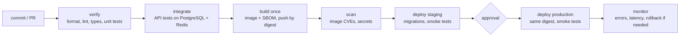

::part[Learn the Concept]{n="1"}

## 🎯 What you'll learn

- **CI**, **continuous delivery** and **continuous deployment** — and which one you need
- Pipeline **stages**, **quality gates** and **artifacts**
- **Build once, deploy many**: moving the same image through environments
- **Trunk-based development**, small changes and feature flags
- Designing for **fast feedback** (the 10-minute rule)
- **Rollback** and **roll-forward**, and database migrations in pipelines
- **DORA metrics** to measure how well you deliver

## 🔤 Key words

| Word | In simple words | Bahasa Indonesia |
|---|---|---|
| **Pipeline** | The automatic steps a change goes through: checks, build, deploy | Rangkaian langkah otomatis |
| **CI (continuous integration)** | Everyone merges small changes often, and every merge is checked automatically | Integrasi berkelanjutan |
| **Artifact** | The thing you actually deploy (a container image, a zip, a built site) | Hasil build yang di-deploy |
| **Digest** | An image's fingerprint (`sha256:…`), so "this exact build" is never ambiguous | Sidik jari image |
| **Quality gate** | A check that stops the pipeline when something is wrong | Gerbang pemeriksaan |
| **Environment** | A place the app runs: staging (rehearsal) or production (real users) | Lingkungan |
| **Promote** | Move the already-tested artifact to the next environment | Naikkan ke tahap berikutnya |
| **Feature flag** | A switch that hides an unfinished feature in production | Sakelar fitur |
| **Rollback** | Go back to the previous version | Kembali ke versi lama |
| **Lead time** | How long from a commit to that code running for users | Waktu commit → production |

## 🧠 The big idea

A pipeline is **airport security and boarding** for your code. Every change is a passenger:

- checked at the gate (lint, tests),
- luggage scanned (security scans),
- given a boarding pass that can't be forged (an image digest),
- and the *same passenger* who passed security boards the plane (production) — nobody swaps bags on the jet bridge.

If a flight has a problem, there's a practised procedure to return to the gate (rollback).

## ❓ Why it matters

Manual releases are slow, stressful and never quite the same twice: someone logs into the server, pulls the code, forgets a migration, restarts the wrong service. Teams that ship small changes often, through automatic pipelines, release faster **and** break production less — the consistent finding of the DORA research.

Without a pipeline:

- "Release day" every two weeks with 60 changes: when it breaks, nobody knows which change did it.
- Production is built on someone's laptop, with files that were never committed.
- Staging tested image A; production got image B, rebuilt later with a newer dependency.
- Rolling back means "revert and hope", because nobody ever practised it.

## 📖 Step by step

### 1. The three terms

| Practice | Every change… | Production release |
|---|---|---|
| **Continuous integration (CI)** | merged to main often, checked automatically | — |
| **Continuous delivery** | produces a releasable artifact, deployed to staging automatically | a button / approval |
| **Continuous deployment** | goes all the way automatically | automatic |

Most teams start with CI + continuous delivery (staging automatic, production approved), then move to continuous deployment once tests and monitoring can be trusted.

### 2. Stages and gates

| Gate type | Examples | Fails the pipeline when |
|---|---|---|
| correctness | unit, API, E2E tests | a test fails |
| quality | lint, type checks, coverage floor | new violations |
| security | dependency and image scans, secret scanning | HIGH/CRITICAL without an accepted exception |
| release | staging smoke tests, manual approval | smoke tests fail / not approved |
| production health | error rate and latency after deploy | an alarm fires → roll back |

**Order the stages by speed**, like an airport putting the metal detector before the passport desk: a typo should fail in 30 seconds, not after a 6-minute build.

### 3. Artifacts and "build once, deploy many"

- The **artifact** is what you deploy: an image digest (`ghcr.io/you/revoshop@sha256:…`), a static bundle, a Lambda zip.
- Build it **once** per commit, then promote that same digest from staging to production.
- Only the configuration differs per environment (variables, secrets). **Never** rebuild per environment — that's testing one cake and serving a different one.

### 4. Trunk-based development

| | Long-lived branches | Trunk-based |
|---|---|---|
| Branch lifetime | weeks | hours to 1–2 days |
| Merging | big, painful conflicts | small, frequent, boring |
| Unfinished features | hidden in branches | hidden behind **feature flags** |
| Pipeline | runs rarely on main | runs on every merge to main |

Small pull requests, reviewed quickly, merged behind a flag when the feature isn't finished. Like paying a little every week instead of one huge bill at the end.

### 5. Fast feedback

A common target: **pull request checks under ~10 minutes**. How: cache dependencies and Docker layers, run jobs in parallel, split slow test suites across machines (sharding), run expensive suites (full E2E, load tests) nightly, and skip jobs when unrelated files change.

Slow pipelines don't just waste time — they change behaviour: people stop waiting, batch their changes, and you lose the benefit of small releases.

### 6. Rollback, roll-forward, and migrations

- **Rollback**: deploy the previous digest again — fast, if the database still fits the old code.
- **Roll-forward**: ship a fix quickly — needed when a migration can't be undone.
- Make migrations **backward compatible** (expand → deploy → contract): add a nullable column, deploy code that writes both old and new, backfill the data, and remove the old column in a *later* release.

That way the previous image still runs after the migration — like widening a road before closing the old lane, so traffic never stops.

### 7. DORA metrics

| Metric | Question |
|---|---|
| **Deployment frequency** | How often do we successfully release to production? |
| **Change lead time** | How long from commit to running in production? |
| **Change failure rate** | What share of deployments cause a problem (rollback, hotfix, incident)? |
| **Failed deployment recovery time** | How long to restore service after a bad deployment? |

They balance each other: deploying often is only good if failures stay rare and recovery is fast. Watch your own trend over time, not other teams' numbers.

### Choosing your setup

- ✅ Every project that runs somewhere other than your laptop — even a portfolio app.
- ✅ Automatic staging deploys from main; production from tags or an approval.
- 🚫 Don't automate a process you can't do by hand — deploy manually once, write the steps down, then automate them.
- 🚫 Don't add gates nobody acts on: warnings everyone ignores teach people to ignore real failures too.
- Continuous deployment gives the fastest feedback but needs strong tests, monitoring and flags; a manual approval adds a human check but easily becomes a rubber stamp.

## ⚠️ Common mistakes

- Rebuilding images per environment ("the prod build").
- A 45-minute pipeline, so developers batch changes.
- Migrations that can't be undone, deployed together with the code that needs them.
- Counting deploys without tracking failures and recovery.

## 🏆 Best practices

- [ ] Small changes: short-lived branches, small PRs, frequent merges.
- [ ] Fast checks first; keep PR feedback under ~10 minutes.
- [ ] Build one unchangeable artifact per commit and promote it by digest.
- [ ] Keep configuration out of the artifact; environments differ only in configuration.
- [ ] Automatic staging deploy + smoke tests; controlled production deploys.
- [ ] Backward-compatible migrations; practise rollback before you need it.
- [ ] Watch errors and latency after every deploy; automate rollback on clear signals.
- [ ] Track DORA metrics and talk about them in retrospectives.

:::revoshop
1. **Today's pipeline.** Your repo has no `.github/workflows/`. Write down how RevoShop gets from a commit to "running" today, step by step (who runs tests, who builds, where it runs). That's your *current* pipeline — a manual one.
2. **Branches.** You have long-lived `main`, `dev` and `dev-docs`. What does merging `dev` into `main` look like after a week of work? What would trunk-based development change?
3. **Feedback time.** Time your suite: `time python -m pytest -q`. In a clean environment it took about **7.5 minutes** for 467 tests. Open `app/auth.py`: `bcrypt.gensalt()` uses the default cost for *every* test user. What does that do to your change lead time? (Lesson 05 fixes it.)
4. **A red baseline.** In a clean checkout (no `.env`), **5 tests fail** — among them `tests/integration/test_products.py::TestGetProducts::test_get_products_no_auth`, which expects `401` while the API returns `200` for the public product list. Before automating anything: is the code right, or the test? A pipeline that is red from day one teaches everyone to ignore it.
5. **DORA baseline.** Fill in RevoShop's four metrics honestly (deployment frequency "never" is a valid answer) and set a target for the end of Module 5.
:::

::part[Explain & Design]{n="2"}

## 🗣️ Explain it

Explain the airport analogy to a teammate who wants to "just rebuild the image for production with production settings".

## 📐 Design it

Design RevoShop's delivery pipeline: the stages with their checks and time budgets, which run on PRs vs main vs tags, the artifact and how it's promoted, where the approval sits, how migrations run, and how you'd roll back. Then say which DORA metric each choice improves.

:::quiz
Show a possible design

| Stage | Runs on | Checks | Budget |
|---|---|---|---|
| verify | PR, main | ruff/pylint, import checks, unit tests (no database) | 2 min |
| integrate | PR, main | API tests on PostgreSQL 16 + Redis services; migrations `upgrade` from an empty DB | 6 min |
| build | PR (no push), main, tags | `prod` target, SBOM, Trivy HIGH/CRITICAL gate; push `sha-*` on main/tags | 4 min |
| deploy staging | main | `migrate` job (backward-compatible migrations) → deploy digest → smoke tests | 5 min |
| deploy production | tag `v*` + approval | same digest; migrations already proven in staging → deploy → smoke tests → watch 5xx/p95 for 10 min | 10 min |

- **Promotion:** the tag points to a commit already built on main → production deploys that commit's digest (no rebuild).
- **Rollback:** deploy the previous digest again (it's in the deployment history); migrations follow expand/contract, so the previous version runs fine on the new schema.
- **DORA:** small PRs + fast checks → *lead time* and *frequency*; integration tests on real PostgreSQL + smoke tests → *change failure rate*; one-click redeploy of the previous digest + alarms → *recovery time*.
:::

### 📝 Self-review checklist

- [ ] The same artifact is promoted
- [ ] A time budget per stage
- [ ] The rollback path fits the migrations

::ai-review{task="design"}

::part[Toy Exercise]{n="3"}

:::exercise{path="exercises/m5/w2/01-dora-metrics" ai="no-ai" title="Measure delivery performance"}
Compute deployment frequency, change lead time (median over commits), change failure rate (outcomes plus incidents) and recovery time from deployment and incident records, then classify the team from elite to low.
:::

:::hints
- Filter to `environment == "production"` first, in one helper.
- Lead time is per **commit**, not per deployment — flatten the list before taking the median.
- The overall level is the **worst** level among the individual metrics.
:::

## ✅ Quick check

:::quiz
Your team deploys 20 times a day but half the deployments are rolled back. Is that "elite"?

No — a 50% change failure rate is low performance. The DORA metrics must be read together: speed without stability isn't high performance.
:::

:::quiz
Why do backward-compatible migrations make rollbacks safer?

After the migration has run, the previous version of the app still works with the new database structure, so you can deploy the old image again without restoring the database.
:::

## 📚 Keep learning

- [DORA: Four key metrics](https://dora.dev/guides/dora-metrics-four-keys/)
- [Martin Fowler: Continuous Integration](https://martinfowler.com/articles/continuousIntegration.html)
- [trunkbaseddevelopment.com](https://trunkbaseddevelopment.com/)
