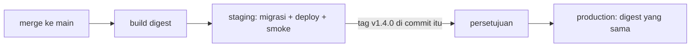

::part[Pelajari Konsepnya]{n="1"}

## 🎯 Yang akan kamu pelajari

- Untuk apa **local, CI, preview, staging dan production** masing-masing
- **Konfigurasi twelve-factor**: satu artifact, pengaturan dari lingkungan
- **Kesetaraan** dan **penyimpangan** — dan cara mendeteksi penyimpangan sebelum merusak
- **GitHub environment**: aturan perlindungan, reviewer wajib, batas branch/tag, secret dan variable terbatas scope
- **Aturan promosi** dan strategi rilis dari staging ke production
- **Data**: seed data, salinan anonim, migrasi, sandbox pihak ketiga (Midtrans)
- **Feature flag** untuk memisahkan deploy dari release

## 🔤 Istilah penting

| Istilah | Artinya (sederhana) |
|---|---|
| **Environment** | Satu tempat aplikasi berjalan, punya pengaturan dan datanya sendiri |
| **Staging** | Salinan latihan yang berperilaku seperti production tapi tanpa pelanggan sungguhan |
| **Parity** | Menjaga lingkungan tetap mirip satu sama lain |
| **Drift** | Perbedaan antar lingkungan yang tidak direncanakan |
| **Twelve-factor config** | Aturan bahwa pengaturan berasal dari lingkungan, bukan dari kode |
| **Promotion** | Memindahkan build yang sudah diuji ke lingkungan berikutnya |
| **Sandbox** | Mode uji pihak ketiga di mana apa pun tidak sungguhan (uang palsu) |
| **Seed data** | Akun dan produk siap pakai untuk bisa uji dengan cepat |
| **Anonymized data** | Data asli dengan detail pribadi diganti data palsu |
| **Feature flag** | Sakelar untuk menyalakan atau mematikan fitur tanpa deploy baru |

## 🧠 Ide besarnya

Lingkungan itu seperti **latihan teater sebelum pertunjukan nyata**. Latihan pakai naskah, panggung, dan kostum yang sama dengan malam pertunjukan — cuma penontonnya beda. Kalau panggung latihan setengah ukuran, atau aktor baca naskah berbeda, latihan tidak pernah bilang apa yang akan terjadi di malam pertunjukan.

## ❓ Kenapa ini penting

RevoShop terhubung dengan PostgreSQL, Redis, dan Midtrans. Di production itu pesanan pelanggan sungguhan dan uang sungguhan. Kamu butuh tempat yang berperilaku seperti production supaya bisa uji deploy, migrasi, dan callback pembayaran **tanpa menyentuh uang sungguhan** — plus cara terkontrol untuk memajukan rilis.

Tanpa ini:

- Staging pakai SQLite, production PostgreSQL → migrasi yang rusak hanya rusak di production.
- Staging pakai kunci Midtrans production "sebentar aja" → charge sungguhan terjadi.
- Variabel baru `REDIS_URL` ditambah di staging tapi lupa di production → login rusak setelah rilis.
- Seseorang salin database production ke laptop untuk debug → bocor data pelanggan.

## 📖 Langkah demi langkah

### 1. Lingkungan dan tugasnya

| Lingkungan | Tujuan | Data | Siapa deploy |
|---|---|---|---|
| **Local** | coding cepat | seed, data palsu | kamu |
| **CI** | cek otomatis | database uji sekali jalan | pipeline, per run |
| **Preview** (opsional) | review PR di browser | seed | pipeline, per PR, hapus setelah |
| **Staging** | latihan deploy, migrasi, integrasi | seed atau data anonim; pembayaran **sandbox** | pipeline saat merge ke main |
| **Production** | layani pelanggan | data asli | pipeline saat release disetujui |

Jaga jumlahnya tetap kecil. Setiap lingkungan menghabis uang dan perhatian, dan staging yang diabaikan akan drift sampai orang tidak percaya — seperti ruang latihan yang tidak pernah dibersihkan.

### 2. Satu artifact, pengaturan di luar

```text
image yang sama ghcr.io/you/revoshop-api@sha256:abc…
   ├── staging:    APP_ENV=production  DATABASE_URL=…staging-db…  MIDTRANS_IS_PRODUCTION=false  LOG_LEVEL=DEBUG
   └── production: APP_ENV=production  DATABASE_URL=…prod-db…     MIDTRANS_IS_PRODUCTION=true   LOG_LEVEL=INFO
```

Aturan twelve-factor: apa pun yang berubah antar tempat (kredensial, nama host, sakelar) berasal dari **lingkungan**, tidak dari kode atau image. Rice cooker yang sama, beras berbeda.

Perhatikan bahwa staging menjalankan **kelas konfigurasi production** (`APP_ENV=production`) — ini latihan production, bukan setup development kedua.

### 3. Kesetaraan dan penyimpangan

| Jenis kesetaraan | Jaga tetap sama | Boleh berbeda |
|---|---|---|
| **Software** | image digest, versi runtime, migrasi | — |
| **Services** | engine database dan versi major, versi Redis, proxy | ukuran instance |
| **Bentuk config** | *himpunan* nama variable | nilainya |
| **Topology** | komponen yang sama (proxy → api → db/redis, worker) | berapa banyak salinannya |

**Penyimpangan** adalah perbedaan yang tidak direncanakan — panggung latihan perlahan-lahan diatur ulang. Deteksi otomatis: bandingkan nama variable per lingkungan di CI (latihan 03), kelola infrastruktur sebagai kode (Week 7), dan rebuild staging dari awal kadang-kadang.

### 4. GitHub environment

```yaml
jobs:
  deploy:
    environment:
      name: production
      url: https://api.revoshop.example.com
```

Di **Settings → Environments → production** kamu bisa atur:

| Pengaturan | Gunakan untuk |
|---|---|
| Required reviewers | manusia setujui setiap deploy production (opsional bukan orang yang picu) |
| Wait timer | tunda sebelum deploy dimulai, jadi rilis salah bisa dibatalkan |
| Deployment branches and tags | hanya `main` / tag `v*` boleh deploy di sini |
| Environment secrets | `DEPLOY_SSH_KEY`, password database — cuma job target environment ini bisa baca |
| Environment variables | `APP_URL`, `AWS_ROLE_ARN`, `DEPLOY_HOST` |

Required reviewer dan beberapa aturan perlindungan butuh paket berbayar untuk repo **private**; repo publik gratis. Di repo private gratis, pakai deploy tag-only production dan branch protection.

### 5. Promosi dan strategi rilis



| Strategi | Caranya | Bagus untuk |
|---|---|---|
| Recreate | matikan yang lama, nyalakan yang baru | aplikasi kecil di mana downtime singkat bisa |
| Rolling | ganti salinan satu per satu | service stateless di balik load balancer (ECS default) |
| **Blue/green** | jalankan versi baru di samping yang lama, lalu alihkan traffic | rollback instan |
| **Canary** | kirim 5% traffic ke versi baru, lihat, lalu naik | banyak traffic, perubahan berisiko |

Canary seperti biar beberapa pelanggan coba resep baru sebelum ganti seluruh menu. Kamu akan implementasi rolling dan blue/green di AWS di Week 4 dan 7.

### 6. Data antar lingkungan

- **Jangan pernah** salin data production mentah ke staging atau laptop. Kalau kamu butuh data realistis, tulis job anonimisasi (hash email, nama/alamat palsu, hapus detail pembayaran).
- Script seed bikin akun uji terkenal (buyer, seller, admin) — `seeders/` RevoShop adalah awal yang bagus.
- Migrasi jalan di **staging dulu**, dengan perintah yang sama yang production pakai.
- Pihak ketiga: staging pakai akun **sandbox** (kunci Midtrans sandbox `SB-Mid-…`, URL notifikasi sandbox); production pakai kunci production dan URL notifikasi production.
- Email dari staging pergi ke catcher (Mailpit) atau daftar izin pendek, tidak pernah ke pelanggan sungguhan.

### 7. Feature flag

```python
if flags.enabled("new_checkout", user=current_user):
    return new_checkout(cart)
return legacy_checkout(cart)
```

- **Deploy** letakkan kode di server; **release** nyalakan perilaku untuk pengguna. Flag memisahkan keduanya — seperti counter toko baru yang dibangun tapi masih tertutup tirai.
- Tipe: release flag (jangka pendek, hapus setelah rollout), kill switch (matikan fitur mahal saat beban tinggi), permission flag (pengguna beta).
- Mulai sederhana (environment variable atau tabel database); ambil service (Unleash, Flagsmith, LaunchDarkly, penyedia OpenFeature apa pun) saat kamu butuh targeting dan audit trail.
- Hapus flag lama — setiap flag dua-kaliin jalan yang harus kamu uji.

### Pilih setup-mu

- ✅ Minimal: local + CI + production, dan staging segera ada pelanggan atau uang sungguhan.
- ✅ Aturan perlindungan production dari hari pertama — tidak ada biaya.
- 🚫 Jangan buat "dev-server", "test-server", "uat", "pre-prod" tanpa pemilik dan tujuan.
- 🚫 Jangan taruh nama environment di kode (`if env == "staging": …`) — pakai konfigurasi dan flag.
- Trade-off: staging jangka panjang beri latihan realistis tapi habis uang dan drift; preview per-PR pisahkan review tapi tambah kompleks; persetujuan manual beri kontrol tapi jadi rutinitas klik; data production anonim cari bug asli cuma kalau anonimisasinya benar dan terawat.

## ⚠️ Kesalahan umum

- `DEBUG=True` tertinggal di staging "karena bukan production" — lalu disalin ke production.
- Staging di engine database atau versi major berbeda.
- Satu file `.env` bersama diteruskan lewat chat.
- URL webhook (URL notifikasi Midtrans) masih tunjuk staging setelah launch.

## 🏆 Praktik terbaik

- [ ] Satu artifact tak berubah untuk semua lingkungan; pengaturan di variable dan secret.
- [ ] Staging cermin software, service, dan himpunan variable production; jalankan kelas config production.
- [ ] Cek penyimpangan config otomatis sebelum deploy.
- [ ] Secret terbatas scope lingkungan; secret production tidak dibagi dengan staging.
- [ ] Deploy production terbatas pada `main`/tag rilis, dengan persetujuan kalau tersedia.
- [ ] Migrasi dilatih di staging pakai prosedur production.
- [ ] Akun pihak ketiga sandbox di luar production; email catcher di staging.
- [ ] Tidak ada data production mentah di luar production.
- [ ] Feature flag pisahkan deploy dari release — dengan rencana hapusnya.

:::revoshop
1. **Kelas konfigurasi.** `config/__init__.py` map hanya `development` dan `production`, dipilih `FLASK_ENV` di `app/__init__.py`. Test tidak pakai kelas — `tests/conftest.py` patch konfigurasi. Setelah W1·05 pilih dengan `APP_ENV`. Kelas mana yang **staging** pakai, dan kenapa tidak kelas `StagingConfig` baru penuh `if` statement?
2. **Penyimpangan kunci yang sudah ada.** Bandingkan nama variable di `.env.example` dan `.env.docker.example` (nama saja — jangan buka `.env` sungguhan). Jalankan parity checker dari latihan 03 di dua file contoh. Kunci apa saja yang ada di satu tapi tidak di satunya?
3. **Midtrans per lingkungan.** `MIDTRANS_IS_PRODUCTION` ganti antara `SANDBOX_SNAP_URL` dan `PRODUCTION_SNAP_URL` di `app/integrations/midtrans.py`. **URL notifikasi** bukan di kode — itu diatur di dashboard Midtrans. Tulis dashboard mana (sandbox vs production), URL apa setiap lingkungan pakai, dan apa yang terjadi pembayaran staging kalau seseorang tunjuk URL notifikasi sandbox ke production.
4. **Data staging.** Kamu punya `seeders/seeders.py`. Akun dan produk apa yang staging harus selalu ada supaya kamu bisa uji beli, bayar (sandbox), dan penuhi penjual dalam lima menit?
5. **Deploy vs release.** Pilih satu perubahan RevoShop mendatang (misalnya rate limit login) dan jelaskan bagaimana simple environment-variable flag biar kamu deploy dengan switch mati dan nyalakan nanti.
:::

::part[Jelaskan & Rancang]{n="2"}

## 🗣️ Jelaskan

Jelaskan analogi dress-rehearsal, lalu jelaskan kenapa staging pakai `APP_ENV=production` walaupun bukan production.

## 📐 Rancang

Definisikan lingkungan RevoShop: untuk local, CI, staging dan production daftar database, Redis, mode dan kunci Midtrans, penanganan email, domain, siapa boleh deploy dan caranya, aturan perlindungan, dan variabel mana yang berbeda. Lalu jelaskan bagaimana rilis bergerak dari PR merged ke production.

:::quiz
Lihat definisi yang mungkin

| | Local | CI | Staging | Production |
|---|---|---|---|---|
| Config app | `development` | `testing`/SQLite + job PostgreSQL | kelas `production` | kelas `production` |
| Database | Compose PostgreSQL 16 | container service PostgreSQL 16 | managed PostgreSQL 16 (kecil) | managed PostgreSQL 16 (backup, Multi-AZ nanti) |
| Redis | Compose | container service | instance kecil | managed Redis/Valkey |
| Midtrans | kunci sandbox, ngrok untuk webhook | di-mock | kunci sandbox, URL notifikasi `https://staging-api…/api/v1/payments/webhook/midtrans` | kunci production, URL notifikasi production |
| Email | Mailpit | tidak ada | Mailpit / daftar izin | penyedia asli |
| Domain | `localhost:8080` | — | `staging-api.revoshop.example.com` | `api.revoshop.example.com` |
| Deploy | `docker compose up` | per run | pipeline saat merge ke `main` | pipeline saat tag `v*` + reviewer wajib |
| Secret | `.env` (diabaikan) | tidak ada | secret terbatas scope GitHub / AWS SSM | terbatas scope, nilai berbeda, rotasi |

Nilai boleh berbeda: `DATABASE_URL`, `REDIS_URL`, `JWT_SECRET_KEY`, `MIDTRANS_*`, `LOG_LEVEL`, `APP_URL`, `WEB_CONCURRENCY`. Cek kesetaraan di CI bandingkan **nama** variable.

**Alur rilis:** cek PR → merge → build digest → staging migrasi + deploy + smoke test → cek staging dengan tangan (bayar Midtrans sandbox) → tag `v1.3.0` di commit itu → persetujuan → production deploy digest yang sama → smoke test → lihat error 15 menit.
:::

### 📝 Checklist review mandiri

- [ ] Pengaturan pihak ketiga sandbox vs production jelas
- [ ] Artifact yang sama dipromosi
- [ ] Production punya aturan perlindungan

::ai-review{task="design"}

::part[Latihan Kecil]{n="3"}

:::exercise{path="exercises/m5/w2/03-env-parity" ai="no-ai" title="Pemeriksa kesetaraan environment"}
Parse file `.env` (kutip, escape, inline comment, `export`), lalu deteksi kunci hilang dan drift, mode debug, localhost dan pengaturan sandbox Midtrans di production, secret lemah dan bersama — tanpa pernah print nilai secret.
:::

:::hints
- Tangani kutip karakter demi karakter; cuma nilai tanpa kutip boleh punya inline comment.
- `DRIFT` bandingkan himpunan kunci di semua lingkungan.
- Bangun setiap pesan hanya dari nama kunci.
:::

## ✅ Cek cepat

:::quiz
Kenapa staging dan production tidak boleh pakai `JWT_SECRET_KEY` yang sama?

Token yang dibuat (atau dipalsukan) di staging akan diterima production, dan bocor di staging akan kompromikan production.
:::

:::quiz
Apa arti "deploy bukan release"?

Kode bisa berada di production dengan fitur switch mati pakai flag; release adalah flip flag itu untuk pengguna — terpisah, bertahap, dan gampang undo.
:::

## 📚 Lanjut belajar

- [The Twelve-Factor App: Config](https://12factor.net/config) · [Dev/prod parity](https://12factor.net/dev-prod-parity)
- [Dokumentasi GitHub: Managing environments for deployment](https://docs.github.com/en/actions/managing-workflow-runs-and-deployments/managing-deployments/managing-environments-for-deployment)
- [Martin Fowler: Feature Toggles](https://martinfowler.com/articles/feature-toggles.html)
