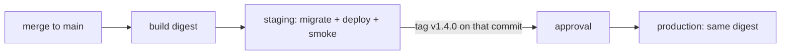

::part[Learn the Concept]{n="1"}

## 🎯 What you'll learn

- The purpose of **local, CI, preview, staging and production** environments
- **Twelve-factor configuration**: one artifact, config in the environment
- **Parity** and **drift** — and how to detect drift before it bites
- **GitHub environments**: protection rules, required reviewers, branch/tag restrictions, scoped secrets and variables
- **Promotion rules** and release strategies from staging to production
- **Data**: seed data, anonymized copies, migrations, third-party sandboxes (Midtrans)
- **Feature flags** to separate deploy from release

## 🧠 The big idea

Environments are **dress rehearsals** for a theater show. The rehearsal uses the same script, stage layout and costumes as opening night — only the audience is different. If the rehearsal stage is half the size or the actors read a different script, the rehearsal tells you nothing about opening night.

## ❓ Why does this matter?

RevoShop talks to PostgreSQL, Redis and Midtrans. In production those are real customers' orders and real money. You need somewhere that behaves like production to test deploys, migrations and payment callbacks — without touching real money — and a controlled way to move a release forward.

## 💥 What happens if we DON'T?

- Staging uses SQLite, production PostgreSQL → the migration that failed only fails in production.
- Staging runs Midtrans production keys "just for a quick test" → a real charge.
- A new variable `REDIS_URL` is added to staging but forgotten in production → login breaks after release.
- Someone copies the production database to a laptop for debugging → customer data leak.

## 📖 How it works, step by step

### 1. Environments and their jobs

| Environment | Purpose | Data | Who deploys |
|---|---|---|---|
| **Local** | develop fast | seeds, fake data | you |
| **CI** | automated verification | ephemeral test databases | pipeline, per run |
| **Preview** (optional) | review a PR in a browser | seeds | pipeline, per PR, auto-deleted |
| **Staging** | rehearse deploys, migrations, integrations | seeds or anonymized data; **sandbox** payments | pipeline on merge to main |
| **Production** | serve customers | real data | pipeline on approved release |

Keep the number small. Every environment costs money and attention; a neglected staging drifts until nobody trusts it.

### 2. One artifact, config outside

```text
same image ghcr.io/you/revoshop-api@sha256:abc…
   ├── staging:    APP_ENV=production  DATABASE_URL=…staging-db…  MIDTRANS_IS_PRODUCTION=false  LOG_LEVEL=DEBUG
   └── production: APP_ENV=production  DATABASE_URL=…prod-db…     MIDTRANS_IS_PRODUCTION=true   LOG_LEVEL=INFO
```

Twelve-factor rule: anything that varies between deploys (credentials, hostnames, feature switches) lives in the **environment**, never in code or the image. Staging runs the **production configuration class** (`APP_ENV=production`) — it's a rehearsal of production, not a second development environment.

### 3. Parity and drift

| Kind of parity | Keep equal | Allowed to differ |
|---|---|---|
| **Software** | image digest, runtime versions, migrations | — |
| **Services** | database engine and major version, Redis version, proxy | instance sizes |
| **Config shape** | the *set* of variable names | values |
| **Topology** | same components (proxy → api → db/redis, worker) | replica counts |

**Drift** = differences nobody intended. Detect it automatically: compare variable names per environment in CI (exercise 03), manage infrastructure as code (Week 7), and rebuild staging from scratch periodically.

### 4. GitHub environments

```yaml
jobs:
  deploy:
    environment:
      name: production
      url: https://api.revoshop.example.com
```

In **Settings → Environments → production** configure:

| Setting | Use |
|---|---|
| Required reviewers | a human approves each production deploy (can't be the person who triggered it, if you enable that option) |
| Wait timer | delay before deploy starts (e.g. to cancel a mistaken release) |
| Deployment branches and tags | only `main` / `v*` tags may deploy here |
| Environment secrets | `DEPLOY_SSH_KEY`, database passwords — only jobs targeting this environment can read them |
| Environment variables | `APP_URL`, `AWS_ROLE_ARN`, `DEPLOY_HOST` |

Required reviewers and some protection rules for **private** repositories need a paid GitHub plan; public repositories get them on the free plan. On a free private repo, use tag-only production deploys and branch protection instead.

### 5. Promotion and release strategies



| Strategy | How | Good for |
|---|---|---|
| Recreate | stop old, start new | tiny apps, acceptable brief downtime |
| Rolling | replace instances gradually | stateless services behind a load balancer (ECS default) |
| **Blue/green** | run new version beside old, switch traffic | instant rollback |
| **Canary** | send 5% of traffic to new version, watch metrics, increase | large traffic, risky changes |

You'll implement rolling and blue/green on AWS in Weeks 4 and 7.

### 6. Data across environments

- **Never** copy raw production data to staging or laptops. If you need realistic data, build an anonymization job (hash emails, fake names/addresses, drop payment details).
- Seed scripts create known test accounts (buyer, seller, admin) — RevoShop's `seeders/` are a good start.
- Migrations run in **staging first** with the same command production will use.
- Third parties: staging uses **sandbox** accounts (Midtrans sandbox keys `SB-Mid-…`, sandbox notification URL); production uses production keys and a production notification URL.
- Emails in staging go to a sink (Mailpit) or an allow-list, never real customers.

### 7. Feature flags

```python
if flags.enabled("new_checkout", user=current_user):
    return new_checkout(cart)
return legacy_checkout(cart)
```

- **Deploy** puts code on servers; **release** turns behavior on for users. Flags separate them.
- Types: release flags (short-lived, delete after rollout), ops kill switches (turn off an expensive feature under load), permission flags (beta users).
- Start simple (environment variables or a database table); adopt a service (e.g. Unleash, Flagsmith, LaunchDarkly, OpenFeature-compatible providers) when you need targeting and audit.
- Remove old flags — each one doubles the code paths to test.

## ⚖️ Trade-offs

| Choice | ✅ | ❌ |
|---|---|---|
| Long-lived staging | realistic rehearsals, integration testing | cost, drift, shared-state conflicts |
| Preview per PR | isolated reviews | infrastructure complexity, seed data per preview |
| Manual approvals | control, compliance | slower; approval fatigue |
| Feature flags | safe, gradual releases | complexity, stale flags |
| Anonymized prod data in staging | realistic bugs found | anonymization must be correct and maintained |

## ✅ When to use it / 🚫 When NOT to use it

- ✅ At least: local + CI + production, and a staging once real users or money are involved.
- ✅ Protection rules on production from day one — they cost nothing.
- 🚫 Don't create "dev-server", "test-server", "uat", "pre-prod" without owners and purpose.
- 🚫 Don't put environment names in code (`if env == "staging": …`) — use configuration and flags.

## 🏆 Best practices

- [ ] One immutable artifact for all environments; config in variables and secrets.
- [ ] Staging mirrors production's software, services and config shape; runs the production config class.
- [ ] Detect config drift automatically before deploys.
- [ ] Environment-scoped secrets; production secrets never shared with staging.
- [ ] Production deploys restricted to `main`/release tags, with approval where available.
- [ ] Migrations rehearsed in staging with the production procedure.
- [ ] Sandbox third-party accounts outside production; email sinks in staging.
- [ ] No raw production data outside production.
- [ ] Feature flags to decouple deploy from release — with an expiry plan.

## 🏭 How it's used in industry

- Most product companies run staging + production with automated promotion; high-scale teams add canaries and progressive delivery.
- Preview environments per pull request are common with platforms like Vercel/Netlify for frontends and Kubernetes namespaces for backends.
- Data protection laws (such as Indonesia's Personal Data Protection Law, UU PDP) make uncontrolled copies of production data a legal risk, not just a security one.

## ⚠️ Common mistakes

- `DEBUG=True` left on in staging "because it's not production", which then gets copied to production.
- Staging on a different database engine or major version.
- A single shared `.env` file passed around in chat.
- Webhook URLs (Midtrans notification URL) still pointing to staging after launch.

:::revoshop
1. **Config classes.** `config/__init__.py` maps only `development` and `production`, chosen by `FLASK_ENV` in `app/__init__.py`. Tests don't use a class at all — `tests/conftest.py` patches the config. After W1·05 you select with `APP_ENV`. Which class should **staging** use, and why not a new `StagingConfig` full of `if` statements?
2. **Key drift you already have.** Compare the variable names in `.env.example` and `.env.docker.example` (names only — don't open your real `.env`). Run the parity checker from exercise 03 on the two example files. Which keys exist in one but not the other?
3. **Midtrans per environment.** `MIDTRANS_IS_PRODUCTION` switches between `SANDBOX_SNAP_URL` and `PRODUCTION_SNAP_URL` in `app/integrations/midtrans.py`. The **notification URL** isn't in your code — it's set in the Midtrans dashboard. Write down which dashboard (sandbox vs production), which URL each environment will use, and what happens to staging payments if someone points the sandbox notification URL at production.
4. **Staging data.** You have `seeders/seeders.py`. Which accounts and products should staging always contain so you can test buying, paying (sandbox) and seller fulfillment in five minutes?
5. **Deploy vs release.** Pick one upcoming RevoShop change (e.g. the login rate limit) and describe how a simple environment-variable flag would let you deploy it dark and turn it on later.
:::

::part[Explain & Design]{n="2"}

## 🗣️ Explain it

Explain the dress-rehearsal analogy, then explain why staging should use `APP_ENV=production` even though it isn't production.

## 📐 Design it

Define RevoShop's environments: for local, CI, staging and production list the database, Redis, Midtrans mode and keys, email handling, domain, who can deploy and how, protection rules, and which variables differ. Then describe how a release moves from a merged PR to production.

:::quiz
Show a possible definition

| | Local | CI | Staging | Production |
|---|---|---|---|---|
| App config | `development` | `testing`/SQLite + a PostgreSQL job | `production` class | `production` class |
| Database | Compose PostgreSQL 16 | service container PostgreSQL 16 | managed PostgreSQL 16 (small) | managed PostgreSQL 16 (backups, Multi-AZ later) |
| Redis | Compose | service container | small instance | managed Redis/Valkey |
| Midtrans | sandbox keys, ngrok for webhooks | mocked | sandbox keys, notification URL `https://staging-api…/api/v1/payments/webhook/midtrans` | production keys, production notification URL |
| Email | Mailpit | none | Mailpit / allow-list | real provider |
| Domain | `localhost:8080` | — | `staging-api.revoshop.example.com` | `api.revoshop.example.com` |
| Deploys | `docker compose up` | per run | pipeline on merge to `main` | pipeline on `v*` tag + required reviewer |
| Secrets | `.env` (ignored) | none | env-scoped GitHub secrets / AWS SSM | env-scoped, separate values, rotated |

Differences allowed: `DATABASE_URL`, `REDIS_URL`, `JWT_SECRET_KEY`, `MIDTRANS_*`, `LOG_LEVEL`, `APP_URL`, `WEB_CONCURRENCY`. Parity check in CI compares variable names.

**Release flow:** PR checks → merge → build digest → staging migrate + deploy + smoke tests → QA on staging (pay with Midtrans sandbox) → tag `v1.3.0` on that commit → approval → production deploys the same digest → smoke tests → watch errors for 15 min.
:::

### 📝 Self-review checklist

- [ ] Sandbox vs production third-party config is explicit
- [ ] Same artifact promoted
- [ ] Protection on production

::ai-review{task="design"}

::part[Toy Exercise]{n="3"}

:::exercise{path="exercises/m5/w2/03-env-parity" ai="no-ai" title="Environment parity checker"}
Parse `.env` files (quotes, escapes, inline comments, `export`), then detect missing and drifting keys, debug mode, localhost and Midtrans sandbox settings in production, weak and shared secrets — without ever printing a secret value.
:::

:::hints
- Handle quotes character by character; only unquoted values have inline comments.
- `DRIFT` compares key sets across all environments.
- Build messages from key names only.
:::

## ✅ Quick check

:::quiz
Why shouldn't staging and production share the same `JWT_SECRET_KEY`?

A token issued (or forged) in staging would be accepted by production, and a staging leak would compromise production.
:::

:::quiz
What does "deploy is not release" mean?

Code can be deployed to production with a feature turned off by a flag; releasing is flipping the flag for users — separately, gradually and reversibly.
:::

## 📖 Kamus (glossary)

| Term | Bahasa Indonesia |
|---|---|
| Staging | Lingkungan uji mirip produksi |
| Parity | Kesetaraan antar lingkungan |
| Drift | Penyimpangan konfigurasi |
| Promotion | Promosi rilis ke lingkungan berikutnya |
| Feature flag | Saklar fitur |
| Sandbox | Lingkungan uji pihak ketiga |

## 📚 Keep learning

- [The Twelve-Factor App: Config](https://12factor.net/config) · [Dev/prod parity](https://12factor.net/dev-prod-parity)
- [GitHub docs: Managing environments for deployment](https://docs.github.com/en/actions/managing-workflow-runs-and-deployments/managing-deployments/managing-environments-for-deployment)
- [Martin Fowler: Feature Toggles](https://martinfowler.com/articles/feature-toggles.html)
