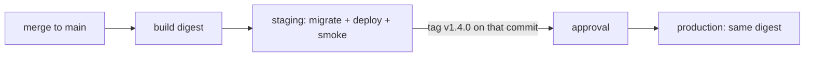

::part[Learn the Concept]{n="1"}

## 🎯 What you'll learn

- What **local, CI, preview, staging and production** are each for
- **Twelve-factor configuration**: one artifact, settings from the environment
- **Parity** and **drift** — and how to notice drift before it hurts
- **GitHub environments**: protection rules, required reviewers, branch/tag limits, scoped secrets and variables
- **Promotion rules** and release strategies from staging to production
- **Data**: seed data, anonymized copies, migrations, third-party sandboxes (Midtrans)
- **Feature flags** to separate deploying from releasing

## 🔤 Key words

| Word | In simple words | Bahasa Indonesia |
|---|---|---|
| **Environment** | One place where the app runs, with its own settings and data | Lingkungan |
| **Staging** | A rehearsal copy that behaves like production but has no real customers | Lingkungan gladi resik |
| **Parity** | Keeping environments as similar as possible | Kesetaraan lingkungan |
| **Drift** | Differences between environments that nobody planned | Penyimpangan |
| **Twelve-factor config** | The rule that settings come from the environment, not from code | Konfigurasi dari luar kode |
| **Promotion** | Moving a tested build to the next environment | Naik ke tahap berikutnya |
| **Sandbox** | A third-party test mode where nothing is real (no real money) | Mode uji pihak ketiga |
| **Seed data** | Prepared accounts and products so you can test quickly | Data awal untuk uji |
| **Anonymized data** | Real data with personal details replaced by fake ones | Data yang disamarkan |
| **Feature flag** | A switch that turns a feature on or off without a new deploy | Sakelar fitur |

## 🧠 The big idea

Environments are **dress rehearsals** for a theatre show. The rehearsal uses the same script, stage and costumes as opening night — only the audience is different. If the rehearsal stage is half the size, or the actors read a different script, the rehearsal tells you nothing about opening night.

## ❓ Why it matters

RevoShop talks to PostgreSQL, Redis and Midtrans. In production those are real customers' orders and real money. You need a place that behaves like production so you can test deploys, migrations and payment callbacks **without touching real money** — plus a controlled way to move a release forward.

Without it:

- Staging uses SQLite, production PostgreSQL → the migration that breaks only breaks in production.
- Staging uses Midtrans production keys "just for a quick test" → a real charge.
- A new variable `REDIS_URL` is added to staging but forgotten in production → login breaks after release.
- Someone copies the production database to a laptop for debugging → customer data leak.

## 📖 Step by step

### 1. Environments and their jobs

| Environment | Purpose | Data | Who deploys |
|---|---|---|---|
| **Local** | develop fast | seeds, fake data | you |
| **CI** | automatic checks | throwaway test databases | the pipeline, per run |
| **Preview** (optional) | review a PR in a browser | seeds | the pipeline, per PR, deleted after |
| **Staging** | rehearse deploys, migrations, integrations | seeds or anonymized data; **sandbox** payments | the pipeline on merge to main |
| **Production** | serve customers | real data | the pipeline on an approved release |

Keep the number small. Every environment costs money and attention, and a neglected staging drifts until nobody trusts it — like a rehearsal room nobody cleans.

### 2. One artifact, settings outside

```text
same image ghcr.io/you/revoshop-api@sha256:abc…
   ├── staging:    APP_ENV=production  DATABASE_URL=…staging-db…  MIDTRANS_IS_PRODUCTION=false  LOG_LEVEL=DEBUG
   └── production: APP_ENV=production  DATABASE_URL=…prod-db…     MIDTRANS_IS_PRODUCTION=true   LOG_LEVEL=INFO
```

Twelve-factor rule: anything that changes between places (credentials, hostnames, switches) comes from the **environment**, never from code or the image. Same rice cooker, different rice.

Note that staging runs the **production config class** (`APP_ENV=production`) — it's a rehearsal of production, not a second development setup.

### 3. Parity and drift

| Kind of parity | Keep equal | Allowed to differ |
|---|---|---|
| **Software** | image digest, runtime versions, migrations | — |
| **Services** | database engine and major version, Redis version, proxy | instance sizes |
| **Config shape** | the *set* of variable names | the values |
| **Topology** | the same components (proxy → api → db/redis, worker) | how many copies |

**Drift** is differences nobody intended — the rehearsal stage slowly getting rearranged. Catch it automatically: compare variable names per environment in CI (exercise 03), manage infrastructure as code (Week 7), and rebuild staging from scratch now and then.

### 4. GitHub environments

```yaml
jobs:
  deploy:
    environment:
      name: production
      url: https://api.revoshop.example.com
```

In **Settings → Environments → production** you can set:

| Setting | Use |
|---|---|
| Required reviewers | a human approves each production deploy (optionally not the person who triggered it) |
| Wait timer | a delay before the deploy starts, so a mistaken release can be cancelled |
| Deployment branches and tags | only `main` / `v*` tags may deploy here |
| Environment secrets | `DEPLOY_SSH_KEY`, database passwords — only jobs targeting this environment can read them |
| Environment variables | `APP_URL`, `AWS_ROLE_ARN`, `DEPLOY_HOST` |

Required reviewers and some protection rules need a paid plan for **private** repositories; public repositories get them for free. On a free private repo, use tag-only production deploys and branch protection instead.

### 5. Promotion and release strategies



| Strategy | How | Good for |
|---|---|---|
| Recreate | stop the old, start the new | tiny apps where short downtime is fine |
| Rolling | replace copies one by one | stateless services behind a load balancer (ECS default) |
| **Blue/green** | run the new version beside the old, then switch traffic | instant rollback |
| **Canary** | send 5% of traffic to the new version, watch, then increase | lots of traffic, risky changes |

Canary is like letting a few customers taste the new recipe before changing the whole menu. You'll implement rolling and blue/green on AWS in Weeks 4 and 7.

### 6. Data across environments

- **Never** copy raw production data to staging or laptops. If you need realistic data, write an anonymization job (hash emails, fake names/addresses, drop payment details).
- Seed scripts create known test accounts (buyer, seller, admin) — RevoShop's `seeders/` are a good start.
- Migrations run in **staging first**, with the same command production will use.
- Third parties: staging uses **sandbox** accounts (Midtrans sandbox keys `SB-Mid-…`, sandbox notification URL); production uses production keys and a production notification URL.
- Emails from staging go to a catcher (Mailpit) or a short allow-list, never to real customers.

### 7. Feature flags

```python
if flags.enabled("new_checkout", user=current_user):
    return new_checkout(cart)
return legacy_checkout(cart)
```

- **Deploy** puts the code on the server; **release** turns the behaviour on for users. Flags separate the two — like a new shop counter that's built but still curtained off.
- Types: release flags (short-lived, delete after rollout), kill switches (turn off an expensive feature under load), permission flags (beta users).
- Start simple (an environment variable or a database table); adopt a service (Unleash, Flagsmith, LaunchDarkly, any OpenFeature provider) when you need targeting and audit trails.
- Remove old flags — every flag doubles the paths you must test.

### Choosing your setup

- ✅ At minimum: local + CI + production, and a staging as soon as real users or money are involved.
- ✅ Protection rules on production from day one — they cost nothing.
- 🚫 Don't create "dev-server", "test-server", "uat", "pre-prod" without an owner and a purpose.
- 🚫 Don't put environment names in code (`if env == "staging": …`) — use configuration and flags.
- Trade-offs: a long-lived staging gives realistic rehearsals but costs money and drifts; per-PR previews isolate reviews but add complexity; manual approvals add control but become routine clicking; anonymized production data finds real bugs only if the anonymization is correct and maintained.

## ⚠️ Common mistakes

- `DEBUG=True` left on in staging "because it's not production" — then copied to production.
- Staging on a different database engine or major version.
- One shared `.env` file passed around in chat.
- Webhook URLs (the Midtrans notification URL) still pointing at staging after launch.

## 🏆 Best practices

- [ ] One unchangeable artifact for all environments; settings in variables and secrets.
- [ ] Staging mirrors production's software, services and set of variables; it runs the production config class.
- [ ] Check for config drift automatically before deploys.
- [ ] Environment-scoped secrets; production secrets never shared with staging.
- [ ] Production deploys restricted to `main`/release tags, with approval where available.
- [ ] Migrations rehearsed in staging using the production procedure.
- [ ] Sandbox third-party accounts outside production; an email catcher in staging.
- [ ] No raw production data outside production.
- [ ] Feature flags to separate deploy from release — with a plan to delete them.

:::revoshop
1. **Config classes.** `config/__init__.py` maps only `development` and `production`, chosen by `FLASK_ENV` in `app/__init__.py`. Tests don't use a class at all — `tests/conftest.py` patches the config. After W1·05 you select with `APP_ENV`. Which class should **staging** use, and why not a new `StagingConfig` full of `if` statements?
2. **Key drift you already have.** Compare the variable names in `.env.example` and `.env.docker.example` (names only — don't open your real `.env`). Run the parity checker from exercise 03 on the two example files. Which keys exist in one but not the other?
3. **Midtrans per environment.** `MIDTRANS_IS_PRODUCTION` switches between `SANDBOX_SNAP_URL` and `PRODUCTION_SNAP_URL` in `app/integrations/midtrans.py`. The **notification URL** isn't in your code — it's set in the Midtrans dashboard. Write down which dashboard (sandbox vs production), which URL each environment will use, and what happens to staging payments if someone points the sandbox notification URL at production.
4. **Staging data.** You have `seeders/seeders.py`. Which accounts and products should staging always contain so you can test buying, paying (sandbox) and seller fulfilment in five minutes?
5. **Deploy vs release.** Pick one upcoming RevoShop change (for example the login rate limit) and describe how a simple environment-variable flag would let you deploy it switched off and turn it on later.
:::

::part[Explain & Design]{n="2"}

## 🗣️ Explain it

Explain the dress-rehearsal analogy, then explain why staging should use `APP_ENV=production` even though it isn't production.

## 📐 Design it

Define RevoShop's environments: for local, CI, staging and production list the database, Redis, Midtrans mode and keys, email handling, domain, who can deploy and how, protection rules, and which variables differ. Then describe how a release moves from a merged PR to production.

:::quiz
Show a possible definition

| | Local | CI | Staging | Production |
|---|---|---|---|---|
| App config | `development` | `testing`/SQLite + a PostgreSQL job | `production` class | `production` class |
| Database | Compose PostgreSQL 16 | service container PostgreSQL 16 | managed PostgreSQL 16 (small) | managed PostgreSQL 16 (backups, Multi-AZ later) |
| Redis | Compose | service container | small instance | managed Redis/Valkey |
| Midtrans | sandbox keys, ngrok for webhooks | mocked | sandbox keys, notification URL `https://staging-api…/api/v1/payments/webhook/midtrans` | production keys, production notification URL |
| Email | Mailpit | none | Mailpit / allow-list | real provider |
| Domain | `localhost:8080` | — | `staging-api.revoshop.example.com` | `api.revoshop.example.com` |
| Deploys | `docker compose up` | per run | pipeline on merge to `main` | pipeline on a `v*` tag + required reviewer |
| Secrets | `.env` (ignored) | none | env-scoped GitHub secrets / AWS SSM | env-scoped, different values, rotated |

Values allowed to differ: `DATABASE_URL`, `REDIS_URL`, `JWT_SECRET_KEY`, `MIDTRANS_*`, `LOG_LEVEL`, `APP_URL`, `WEB_CONCURRENCY`. A parity check in CI compares the variable **names**.

**Release flow:** PR checks → merge → build digest → staging migrate + deploy + smoke tests → check staging by hand (pay with Midtrans sandbox) → tag `v1.3.0` on that commit → approval → production deploys the same digest → smoke tests → watch errors for 15 minutes.
:::

### 📝 Self-review checklist

- [ ] Sandbox vs production third-party settings are explicit
- [ ] The same artifact is promoted
- [ ] Production has protection rules

::ai-review{task="design"}

::part[Toy Exercise]{n="3"}

:::exercise{path="exercises/m5/w2/03-env-parity" ai="no-ai" title="Environment parity checker"}
Parse `.env` files (quotes, escapes, inline comments, `export`), then detect missing and drifting keys, debug mode, localhost and Midtrans sandbox settings in production, weak and shared secrets — without ever printing a secret value.
:::

:::hints
- Handle quotes character by character; only unquoted values can have an inline comment.
- `DRIFT` compares the key sets across all environments.
- Build every message from key names only.
:::

## ✅ Quick check

:::quiz
Why shouldn't staging and production share the same `JWT_SECRET_KEY`?

A token created (or forged) in staging would be accepted by production, and a leak in staging would then compromise production.
:::

:::quiz
What does "deploy is not release" mean?

Code can sit in production with the feature switched off by a flag; releasing is flipping that flag for users — separately, gradually, and easy to undo.
:::

## 📚 Keep learning

- [The Twelve-Factor App: Config](https://12factor.net/config) · [Dev/prod parity](https://12factor.net/dev-prod-parity)
- [GitHub docs: Managing environments for deployment](https://docs.github.com/en/actions/managing-workflow-runs-and-deployments/managing-deployments/managing-environments-for-deployment)
- [Martin Fowler: Feature Toggles](https://martinfowler.com/articles/feature-toggles.html)
