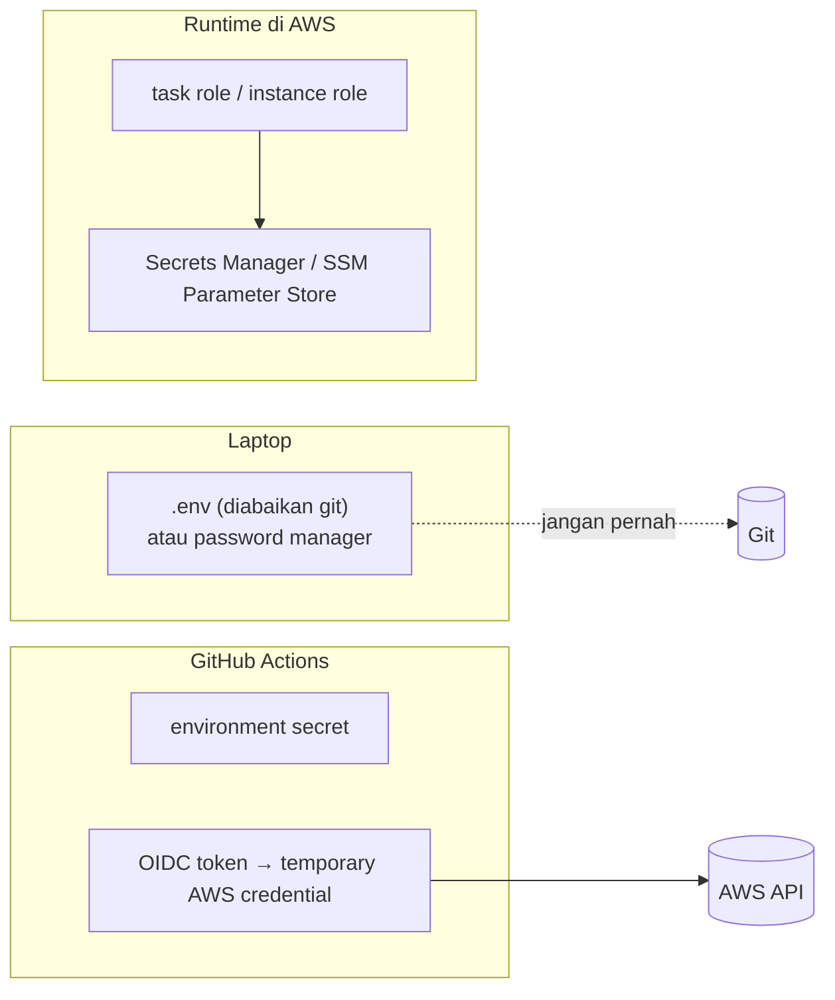
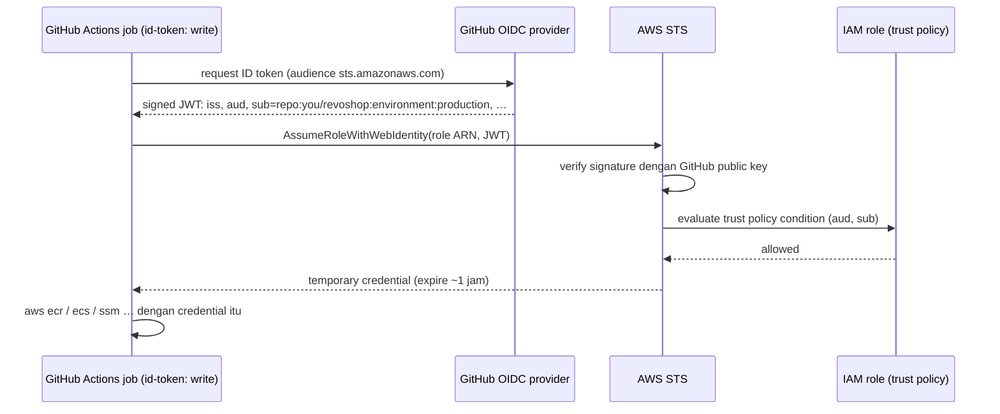

::part[Pelajari Konsepnya]{n="1"}

## 🎯 Yang akan kamu pelajari

- Jenis-jenis secret dan **siklus hidupnya**: buat, simpan, kirim, ganti berkala, cabut
- Di mana secret seharusnya hidup di setiap tahap (laptop, CI, runtime)
- **GitHub secret dan variabel**: jangkauan, penyensoran, perilaku fork, batas
- **Pemindaian secret**, push protection, dan apa yang harus dilakukan setelah **kebocoran**
- Mengapa **kunci cloud jangka panjang** di CI berbahaya
- Cara **OIDC federation** bekerja: token claim (`iss`, `aud`, `sub`), provider IAM, role, **trust policy**
- Kebijakan izin **least-privilege** untuk role deploy
- Secret runtime di AWS: **SSM Parameter Store** dan **Secrets Manager** (pratinjau Minggu 3–4)

## 🔤 Istilah penting

| Istilah | Artinya (sederhana) |
|---|---|
| **Secret** | Nilai yang memberi akses dan harus tetap tersembunyi (password, API key) |
| **Rotation** | Mengganti secret dengan yang baru sesuai jadwal atau setelah kebocoran |
| **Revoke** | Membuat kredensial yang ada berhenti bekerja |
| **Masking** | GitHub mengganti secret dengan `***` di log |
| **IAM role** | Identitas di AWS yang bisa dipinjam sementara |
| **OIDC** | Standar di mana GitHub membuktikan siapa job-nya, dan AWS memberikan kartu akses jangka pendek |
| **Claim** | Satu fakta di dalam token bertanda tangan itu (`sub` = repo dan environment mana) |
| **Trust policy** | Aturan AWS yang mengatakan *siapa* yang boleh meminjam role |
| **Permission policy** | Aturan AWS yang mengatakan *apa* yang boleh dilakukan role itu |
| **Least privilege** | Berikan hanya akses yang benar-benar diperlukan job |

## 🧠 Ide besarnya

Kunci akses jangka panjang adalah **kunci rumah yang kamu fotokopi dan berikan ke pembersih**: ia bekerja selamanya, kamu tidak tahu ada berapa banyak salinannya, dan mengubah kunci menjadi menyakitkan.

OIDC adalah **kartu kunci hotel yang dikeluarkan di meja depan**: mereka mengecek ID-mu (token bertanda tangan yang mengatakan "Aku environment `production` dari `kamu/revoshop`"), memberimu kartu yang hanya membuka kamarmu, dan kartunya berhenti bekerja dalam satu jam.

## ❓ Kenapa ini penting

Pipeline-mu harus push image dan deploy ke AWS. AWS key yang bocor ditemukan dan disalahgunakan bot dalam hitungan menit setelah masuk repository publik — biasanya untuk tambang kripto, yang membuat tagihan membesar cepat. Kebanyakan break-in di proyek kecil bukan serangan cerdas; itu kredensial di tempat yang salah.

Kalau sembarangan:

- `AWS_SECRET_ACCESS_KEY` duduk di GitHub secret, tidak pernah diganti, milik user IAM admin.
- Langkah debug `env | sort` mencetak token yang penyensoran GitHub tidak kenal.
- `.env` dengan server key Midtrans di-commit sekali dan "dihapus" di commit berikutnya — ia tetap di Git history selamanya.
- Trust policy dengan `"repo:kamu/*"` membiarkan *semua* repository-mu — termasuk eksperimen lama — deploy ke production.

## 📖 Langkah demi langkah

### 1. Jenis-jenis secret

| Jenis | Contoh RevoShop | Rotation |
|---|---|---|
| Signing key | `JWT_SECRET_KEY` | ganti dengan hati-hati (ia membatalkan token) atau terima dua key selama switch |
| Database credential | `POSTGRES_PASSWORD` | sesuai jadwal; rotation terkelola dengan Secrets Manager |
| API key pihak ketiga | `MIDTRANS_SERVER_KEY` | saat staf berubah atau setelah kebocoran |
| Deploy credential | SSH deploy key, cloud credential | lebih suka jangka pendek (OIDC) |
| Encryption key | KMS key | dikelola cloud KMS |

Bukan secret (bisa jadi variabel biasa): URL, nama region, role ARN, dan Midtrans **client** key — itu berjalan di browser.

### 2. Di mana secret hidup



Aturan: jangan di Git, image, build arg, log, URL, tiket atau chat. Runtime app harus dapat secret dari platform (variabel env diisi dari Secrets Manager/SSM, atau file) pakai **IAM role** — bukan key yang dipanggang di server.

### 3. GitHub secret dan variabel

| Level | Terlihat ke |
|---|---|
| Repository secret | semua workflow di repo (bukan pull request dari fork) |
| **Environment secret** | hanya job yang deklarasikan `environment:` itu dan lolos protection rule-nya |
| Organization secret | repository pilihan |
| Variabel (`vars.*`) | config bukan secret, ditampilkan di log |

- Nilai **disensor** di log saat dicetak persis — tapi bukan saat berubah (base64, substring, di JSON). Jadi jangan cetak sama sekali.
- Secret tidak diberikan workflow yang dipicu pull request dari **fork**.
- Reusable workflow dapat secret via `secrets: inherit` atau mapping `secrets:` eksplisit.

### 4. Pemindaian dan kebocoran

- Nyalakan **secret scanning** dan **push protection** (GitHub blokir push berisi format secret yang dikenal).
- Jalankan **gitleaks** lokal (sebagai pre-commit hook) dan di CI untuk pattern yang GitHub tidak tahu.

**Kalau secret bocor**, dalam urutan ini:

1. **Cabut atau ganti segera** di provider (nonaktifkan AWS key, key Midtrans baru, password DB baru).
2. Periksa log provider untuk penyalahgunaan (CloudTrail, dashboard Midtrans).
3. Hapus dari history (`git filter-repo`) dan force-push — *setelah* ganti; anggap sudah disalin.
4. Tulis apa yang terjadi dan tambahkan kontrol yang mencegahnya terjadi lagi.

Perlakukan seperti kartu ATM hilang: blokir kartunya dulu, perdebatannya nanti.

### 5. OIDC federation, langkah demi langkah



**Setup AWS sekali** (Minggu 3 lakukan di konsol, Minggu 7 di Terraform):

1. IAM → Identity provider → tambah **OpenID Connect** provider `https://token.actions.githubusercontent.com` dengan audience `sts.amazonaws.com`.
2. Buat **role** dengan trust policy ini:

```json
{
  "Version": "2012-10-17",
  "Statement": [{
    "Effect": "Allow",
    "Principal": { "Federated": "arn:aws:iam::123456789012:oidc-provider/token.actions.githubusercontent.com" },
    "Action": "sts:AssumeRoleWithWebIdentity",
    "Condition": {
      "StringEquals": { "token.actions.githubusercontent.com:aud": "sts.amazonaws.com" },
      "StringLike": { "token.actions.githubusercontent.com:sub": "repo:you/revoshop:environment:production" }
    }
  }]
}
```

3. Pasang **permission policy least-privilege** (hanya apa yang deploy butuh: push ke satu ECR repository, update satu ECS service, baca SSM parameter spesifik).
4. Di workflow:

```yaml
permissions:
  id-token: write
  contents: read
steps:
  - uses: aws-actions/configure-aws-credentials@cbe3b392738ccf3f987d68400dafcf4b0624a56c # v6.2.4
    with:
      role-to-assume: ${{ vars.AWS_ROLE_ARN }}
      aws-region: ap-southeast-3          # Jakarta
  - run: aws sts get-caller-identity       # prove it works
```

**Claim `sub` menentukan siapa yang masuk** — itu nama di daftar tamu.

| Format `sub` | Kapan |
|---|---|
| `repo:OWNER/REPO:environment:NAME` | job memakai `environment: NAME` (terbaik untuk role deploy) |
| `repo:OWNER/REPO:ref:refs/heads/BRANCH` | job tanpa environment, di branch |
| `repo:OWNER/REPO:ref:refs/tags/TAG` | build tag |
| `repo:OWNER/REPO:pull_request` | workflow PR — **jangan** percaya untuk deploy role |

Pakai **role terpisah** per environment (`revoshop-deploy-staging`, `revoshop-deploy-production`), masing-masing dengan izin sendiri.

### 6. Permission policy least-privilege

```json
{
  "Version": "2012-10-17",
  "Statement": [
    { "Effect": "Allow", "Action": "ecr:GetAuthorizationToken", "Resource": "*" },
    { "Effect": "Allow",
      "Action": ["ecr:BatchCheckLayerAvailability", "ecr:InitiateLayerUpload", "ecr:UploadLayerPart", "ecr:CompleteLayerUpload", "ecr:PutImage"],
      "Resource": "arn:aws:ecr:ap-southeast-3:123456789012:repository/revoshop-api" },
    { "Effect": "Allow", "Action": ["ecs:UpdateService", "ecs:DescribeServices"],
      "Resource": "arn:aws:ecs:ap-southeast-3:123456789012:service/revoshop/api-production" }
  ]
}
```

Mulai sempit, seperti memberi kode pintu ke kurir tapi bukan kunci rumah. Saat deploy gagal dengan `AccessDenied`, baca aksi yang ditolak di error (atau CloudTrail) dan tambah persis itu.

### Memilih setup-mu

- ✅ OIDC untuk setiap koneksi CI → cloud yang mendukungnya (AWS, GCP, Azure, banyak tool SaaS).
- ✅ Environment secret untuk hal yang OIDC tidak bisa gantikan (SSH key, API key pihak ketiga).
- 🚫 Jangan user IAM dengan akses key untuk pipeline saat OIDC bisa.
- 🚫 Jangan wildcard `sub` lintas repository, dan jangan `pull_request` subject pada role deploy.
- Untuk secret runtime, **SSM Parameter Store** (SecureString) murah dan sederhana; **Secrets Manager** bayar per secret tapi tambah automatic rotation dan audit lebih halus.

## ⚠️ Kesalahan umum

- Lupa `permissions: id-token: write` → "Credential tidak bisa dimuat".
- Trust policy pakai `StringEquals` dengan wildcard `sub` (wildcard butuh `StringLike`) — atau `StringLike` dengan `*` di mana-mana.
- Job dengan `environment: production` tapi trust policy mengharap `ref:refs/heads/main` (pakai environment ubah `sub`).
- Ganti secret bocor *setelah* bersihkan history — jendela tetap terbuka selamanya.

## 🏆 Praktik terbaik

- [ ] Simpan daftar secret: owner, lokasi dan rencana rotation untuk setiap.
- [ ] Tidak ada secret di Git, image, build arg, log, atau code client-side (`NEXT_PUBLIC_`).
- [ ] Secret scoped environment; nilai berbeda per environment.
- [ ] Secret scanning + push protection + gitleaks; pre-commit hook lokal.
- [ ] Respons kebocoran: **ganti dulu**, lalu investigasi dan bersihkan history.
- [ ] OIDC ke AWS dengan `aud` = `sts.amazonaws.com` dan `sub` dikunci ke repo + environment.
- [ ] Satu role per environment, least privilege; `id-token: write` hanya di job deploy.
- [ ] Runtime pakai IAM role + Secrets Manager/SSM, jangan key di disk.
- [ ] Review CloudTrail untuk apa yang setiap role lakukan; alert penggunaan tidak biasa.

:::revoshop
1. **Kabar baik dulu.** `git log --all --oneline -- .env .env.docker` tidak ada di repo-mu, dan `git check-ignore -v .env .env.docker` konfirmkan keduanya diabaikan — key-mu yang nyata tidak pernah di-commit. Jaga itu: tambah pre-commit `gitleaks protect --staged` hook dan nyalakan push protection di salinan personalmu.
2. **Pindai history anyway.** Jalankan `gitleaks detect --source . --redact` di repository. Contoh Midtrans pakai placeholder `SB-Mid-server-xxxx…` — konfirmkan tidak ada yang sungguhan pernah di-commit di koleksi Postman (`postman/`) atau docs.
3. **Inventori.** Daftar setiap secret RevoShop pakai (`JWT_SECRET_KEY`, `POSTGRES_PASSWORD`, `MIDTRANS_SERVER_KEY`, …) dan tandai mana yang *bukan* secret (`MIDTRANS_CLIENT_KEY` dipakai klien; `MIDTRANS_IS_PRODUCTION` config). Untuk setiap secret: di mana ia hidup lokal, di CI, di staging dan di production.
4. **Fallback senyap.** `config/base.py` masih punya `JWT_SECRET_KEY = os.getenv('JWT_SECRET_KEY', 'super-secret-key-change-in-production')`. Setelah W1·05 production menolak start tanpa key nyata — tapi bagaimana dengan container `development` yang kebetulan exposed ke internet? Apakah kamu hapus default sepenuhnya?
5. **Rotation drill.** Rencana bagaimana kamu ganti `JWT_SECRET_KEY` tanpa logout setiap user sekaligus (hint: tanda token baru dengan key baru tapi tetap verifikasi dengan yang lama selama jendela transisi — Flask-JWT-Extended biarkan kamu pilih verification key per token dengan `@jwt.decode_key_loader`).
6. **Trust policy pertama-mu.** Dengan `trust_policy()` latihan, generate RevoShop staging dan production policy untuk nama repository personalmu, dan tulis nilai `sub` yang job-jobmu akan tampilkan.
:::

::part[Jelaskan & Rancang]{n="2"}

## 🗣️ Jelaskan

Jelaskan analogi kunci rumah vs kartu kunci hotel, dan kenapa kondisi `sub` adalah baris paling penting di trust policy.

## 📐 Rancang

Rancang rencana secret RevoShop: daftar setiap secret, di mana ia hidup untuk lokal/CI/staging/production, siapa atau apa yang boleh membacanya, dan bagaimana ia dirotasi. Lalu rancang IAM role untuk GitHub Actions (nama, trust `sub`, izin) untuk staging dan production deploy ke ECS, dengan image di ECR dan secret di SSM.

:::quiz
Lihat contoh rencana

| Secret | Lokal | CI | Runtime staging/production | Rotation |
|---|---|---|---|---|
| `JWT_SECRET_KEY` | `.env` (random per developer) | nilai test di workflow env | SSM SecureString `/revoshop/{env}/jwt_secret_key` → ECS task secret | tahunan atau setelah insiden; terima key lama selama switch |
| DB password | Compose default | default service container | Secrets Manager (RDS-managed rotation) | automatic |
| `MIDTRANS_SERVER_KEY` | sandbox key di `.env` | tidak diperlukan (mocked) | SSM per environment (sandbox vs production) | saat staf berubah / kebocoran |
| Deploy credential | — | **OIDC role** (tanpa key tersimpan) | — | tidak diperlukan (temporary) |
| SSH key (fase EC2 only) | key-mu | environment secret `DEPLOY_SSH_KEY` | `authorized_keys` untuk user `deploy` saja | saat fase EC2 berakhir |

**Role**

- `revoshop-gha-staging` · trust `sub = repo:you/revoshop:environment:staging` · boleh push ke ECR `revoshop-api`, panggil `ecs:UpdateService`/`DescribeServices` di `api-staging`, `ecs:RunTask` untuk task definition migrate, dan `iam:PassRole` dibatasi ke role task staging.
- `revoshop-gha-production` · trust `sub = repo:you/revoshop:environment:production` · aksi yang sama di resource production saja; GitHub environment `production` butuh reviewer dan hanya izin tag `v*`.
- **Task execution role** ECS baca `/revoshop/{env}/*` SSM parameter; **task role** hanya apa yang app butuh saat jalan (misalnya S3 bucket untuk gambar produk).
:::

### 📝 Checklist review mandiri

- [ ] Tidak ada key cloud jangka panjang di mana-mana
- [ ] Role dan nilai terpisah untuk staging dan production
- [ ] Rencana rotation untuk setiap secret

::ai-review{task="design"}

::part[Latihan Kecil]{n="3"}

:::exercise{path="exercises/m5/w2/04-oidc-trust-policy" ai="no-ai" title="Bangun dan uji GitHub OIDC trust policy"}
Generate IAM trust policy yang scoped ke environment dan branch repository (tolak wildcard), lalu tulis evaluator kecil untuk kondisi `StringEquals`/`StringLike` yang buktikan fork, branch lain dan pull request tidak bisa assume role.
:::

:::hints
- Ubah pattern `StringLike` jadi regex dengan escape semua kecuali `*` dan `?`.
- Principal harus match host token issuer.
- Operator kondisi yang tidak dikenal harus tolak, bukan izin.
:::

## ✅ Cek cepat

:::quiz
Job memakai `environment: staging`. Token OIDC-nya akan punya `sub` apa?

`repo:OWNER/REPO:environment:staging` — environment mengganti ref di subject, jadi trust policy harus izin persis subject itu.
:::

:::quiz
Kamu temukan `AKIA…` di public commit dari minggu lalu. Aksi pertama-mu apa?

Nonaktifkan atau ganti key di AWS sekarang juga, lalu periksa CloudTrail dan tagihan untuk penyalahgunaan, lalu bersihkan history dan tambah pencegahan (push protection, OIDC).
:::

## 📚 Lanjut belajar

- [GitHub docs: Configuring OpenID Connect in Amazon Web Services](https://docs.github.com/en/actions/security-for-github-actions/security-hardening-your-deployments/configuring-openid-connect-in-amazon-web-services)
- [aws-actions/configure-aws-credentials](https://github.com/aws-actions/configure-aws-credentials)
- [GitHub docs: Secret scanning and push protection](https://docs.github.com/en/code-security/secret-scanning)
- [gitleaks](https://github.com/gitleaks/gitleaks)
