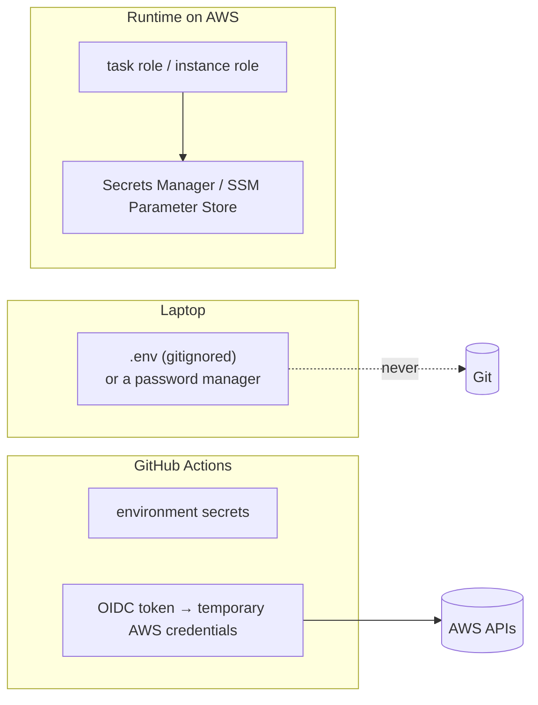
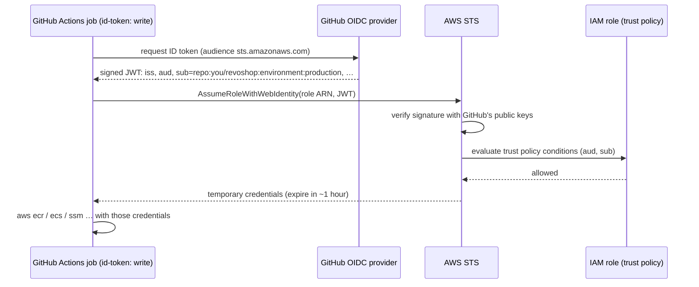

::part[Learn the Concept]{n="1"}

## 🎯 What you'll learn

- Kinds of secrets and a **secret's lifecycle**: create, store, deliver, rotate, revoke
- Where secrets should live at each stage (laptop, CI, runtime)
- **GitHub secrets and variables**: scopes, masking, fork behavior, limits
- **Secret scanning**, push protection and what to do after a **leak**
- Why **long-lived cloud keys** in CI are dangerous
- How **OIDC federation** works: token claims (`iss`, `aud`, `sub`), IAM identity provider, role, **trust policy**
- Least-privilege **permission policies** for deploy roles
- Runtime secrets on AWS: **SSM Parameter Store** and **Secrets Manager** (preview of Weeks 3–4)

## 🧠 The big idea

A long-lived access key is a **house key you copy and give to the cleaner**: it works forever, you don't know how many copies exist, and changing locks is painful. OIDC is a **hotel keycard issued at the front desk**: the desk checks your ID (a signed token saying "I'm the `main` branch of `you/revoshop`"), gives you a card that opens only your room, and the card stops working in an hour.

## ❓ Why does this matter?

Your pipeline needs to push images and deploy to AWS. Leaked AWS keys are routinely found and abused by bots within minutes of reaching a public repository — for crypto mining that can create large bills quickly. Most breaches in small projects are not clever hacks; they're credentials in the wrong place.

## 💥 What happens if we DON'T?

- `AWS_SECRET_ACCESS_KEY` in a GitHub secret, never rotated, belonging to an admin IAM user.
- A debug step `env | sort` prints a derived token that GitHub's masking doesn't know about.
- The `.env` with Midtrans server keys is committed once and "deleted" in the next commit — it stays in Git history.
- A trust policy `"repo:you/*"` lets any of your repositories — including an old experimental one with weak protections — deploy to production.

## 📖 How it works, step by step

### 1. Kinds of secrets

| Kind | RevoShop examples | Rotation |
|---|---|---|
| Signing keys | `JWT_SECRET_KEY` | rotate carefully (invalidates tokens) or support two keys during rotation |
| Database credentials | `POSTGRES_PASSWORD` | periodic; managed rotation with Secrets Manager |
| Third-party API keys | `MIDTRANS_SERVER_KEY` | on staff changes or leaks |
| Deploy credentials | SSH deploy key, cloud credentials | prefer short-lived (OIDC) |
| Encryption keys | KMS keys | managed by the cloud KMS |

Not secrets (can be variables): URLs, region names, role ARNs, Midtrans **client** key (it's used in browsers).

### 2. Where secrets live



Rules: never in Git, images, build args, logs, URLs, tickets or chat. Runtime apps should read secrets from the platform (injected env vars from Secrets Manager/SSM, or files) using an **IAM role**, not a key baked into the server.

### 3. GitHub secrets and variables

| Level | Visible to |
|---|---|
| Repository secrets | all workflows in the repo (not forks' PRs) |
| **Environment secrets** | only jobs that declare that `environment:` (and pass its protection rules) |
| Organization secrets | selected repositories |
| Variables (`vars.*`) | non-secret config, shown in logs |

- Values are **masked** in logs when printed exactly — not when transformed (base64, substrings, JSON). Don't print them at all.
- Secrets aren't available to workflows triggered by pull requests from **forks**.
- Use `secrets: inherit` or explicit `secrets:` mapping for reusable workflows.

### 4. Scanning and leaks

- Enable **secret scanning** and **push protection** (GitHub blocks pushes containing recognized secret formats).
- Run **gitleaks** locally (pre-commit) and in CI for patterns GitHub doesn't know.

**If a secret leaks** (in order):
1. **Revoke/rotate it immediately** at the provider (AWS key deactivate, new Midtrans key, new DB password).
2. Check provider logs for misuse (CloudTrail, Midtrans dashboard).
3. Remove it from history (`git filter-repo`) and force-push *after* rotating — assume it's already copied.
4. Write down what happened and add a control that prevents the repeat.

### 5. OIDC federation, step by step



**One-time AWS setup** (Week 3 walks through it in the console and Week 7 in Terraform):
1. IAM → Identity providers → add **OpenID Connect** provider `https://token.actions.githubusercontent.com` with audience `sts.amazonaws.com`.
2. Create a **role** with a trust policy:

```json
{
  "Version": "2012-10-17",
  "Statement": [{
    "Effect": "Allow",
    "Principal": { "Federated": "arn:aws:iam::123456789012:oidc-provider/token.actions.githubusercontent.com" },
    "Action": "sts:AssumeRoleWithWebIdentity",
    "Condition": {
      "StringEquals": { "token.actions.githubusercontent.com:aud": "sts.amazonaws.com" },
      "StringLike": { "token.actions.githubusercontent.com:sub": "repo:you/revoshop:environment:production" }
    }
  }]
}
```

3. Attach a **least-privilege permission policy** (only what deploying needs: push to one ECR repository, update one ECS service, read specific SSM parameters).
4. In the workflow:

```yaml
permissions:
  id-token: write
  contents: read
steps:
  - uses: aws-actions/configure-aws-credentials@cbe3b392738ccf3f987d68400dafcf4b0624a56c # v6.2.4
    with:
      role-to-assume: ${{ vars.AWS_ROLE_ARN }}
      aws-region: ap-southeast-3          # Jakarta
  - run: aws sts get-caller-identity       # prove it works
```

**The `sub` claim decides who gets in.**

| `sub` format | When |
|---|---|
| `repo:OWNER/REPO:environment:NAME` | job uses `environment: NAME` (recommended for deploy roles) |
| `repo:OWNER/REPO:ref:refs/heads/BRANCH` | job without environment on a branch |
| `repo:OWNER/REPO:ref:refs/tags/TAG` | tag builds |
| `repo:OWNER/REPO:pull_request` | PR workflows — **never** trust these for deploy roles |

Use **separate roles** per environment (`revoshop-deploy-staging`, `revoshop-deploy-production`) with their own permissions.

### 6. Least-privilege permission policy (example)

```json
{
  "Version": "2012-10-17",
  "Statement": [
    { "Effect": "Allow", "Action": "ecr:GetAuthorizationToken", "Resource": "*" },
    { "Effect": "Allow",
      "Action": ["ecr:BatchCheckLayerAvailability", "ecr:InitiateLayerUpload", "ecr:UploadLayerPart", "ecr:CompleteLayerUpload", "ecr:PutImage"],
      "Resource": "arn:aws:ecr:ap-southeast-3:123456789012:repository/revoshop-api" },
    { "Effect": "Allow", "Action": ["ecs:UpdateService", "ecs:DescribeServices"],
      "Resource": "arn:aws:ecs:ap-southeast-3:123456789012:service/revoshop/api-production" }
  ]
}
```

Start narrow and add permissions when a deploy fails with `AccessDenied` — reading the denied action in the error or CloudTrail.

## ⚖️ Trade-offs

| Choice | ✅ | ❌ |
|---|---|---|
| OIDC roles | no stored cloud keys, short-lived, auditable | initial IAM setup; trust policy mistakes are dangerous |
| Stored access keys | quick to start | long-lived, leak-prone, rotation burden |
| GitHub environment secrets | simple, scoped | secrets copied into GitHub; rotation manual |
| AWS Secrets Manager | rotation, audit, fine-grained IAM | cost per secret; more setup |
| SSM Parameter Store (SecureString) | cheap/free standard tier | fewer rotation features |

## ✅ When to use it / 🚫 When NOT to use it

- ✅ OIDC for every CI → cloud connection that supports it (AWS, GCP, Azure, many SaaS).
- ✅ Environment secrets for things OIDC can't replace (SSH keys, third-party API keys).
- 🚫 Never IAM users with access keys for pipelines when OIDC is possible.
- 🚫 Never `sub` wildcards across repositories or `pull_request` subjects on deploy roles.

## 🏆 Best practices

- [ ] Inventory secrets; know owner, location and rotation plan for each.
- [ ] Nothing secret in Git, images, build args, logs or `NEXT_PUBLIC_`/client code.
- [ ] Environment-scoped secrets; separate values per environment.
- [ ] Secret scanning + push protection + gitleaks; pre-commit hook locally.
- [ ] Leak response: **rotate first**, then investigate and clean history.
- [ ] OIDC to AWS with `aud` equals `sts.amazonaws.com` and `sub` pinned to repo + environment.
- [ ] One role per environment with least-privilege permissions; `id-token: write` only in deploy jobs.
- [ ] Runtime apps use IAM roles + Secrets Manager/SSM, not keys on disks.
- [ ] Review CloudTrail for the role's activity; alert on unusual use.

## 🏭 How it's used in industry

- GitHub, GitLab, CircleCI and others publish OIDC providers; AWS, Google Cloud and Azure recommend federation over stored keys for CI.
- Security teams scan repositories and CI logs continuously; many companies block merges when a secret is detected.
- Public reports of leaked cloud keys leading to cryptomining bills are common — cloud providers even proactively quarantine keys they find exposed.

## ⚠️ Common mistakes

- Forgetting `permissions: id-token: write` → "Credentials could not be loaded".
- Trust policy using `StringEquals` with a wildcard `sub` (wildcards need `StringLike`) — or `StringLike` with `*` everywhere.
- A job with `environment: production` but a trust policy expecting `ref:refs/heads/main` (the `sub` changes when an environment is used).
- Rotating a leaked secret *after* cleaning history (the window stays open).

:::revoshop
1. **Good news first.** `git log --all --oneline -- .env .env.docker` returns nothing in your repo, and `git check-ignore -v .env .env.docker` confirms both are ignored — your real keys were never committed. Keep it that way: add a pre-commit `gitleaks protect --staged` hook and enable push protection on your personal copy.
2. **Scan history anyway.** Run `gitleaks detect --source . --redact` on the repository. The Midtrans examples use `SB-Mid-server-xxxx…` placeholders — confirm nothing real was ever committed in Postman collections (`postman/`) or docs.
3. **Inventory.** List every secret RevoShop uses (`JWT_SECRET_KEY`, `POSTGRES_PASSWORD`, `MIDTRANS_SERVER_KEY`, …) and mark which are *not* secrets (`MIDTRANS_CLIENT_KEY` is used by clients; `MIDTRANS_IS_PRODUCTION` is config). For each secret: where it lives locally, in CI, in staging and in production.
4. **The silent fallback.** `config/base.py` still contains `JWT_SECRET_KEY = os.getenv('JWT_SECRET_KEY', 'super-secret-key-change-in-production')`. After W1·05 production refuses to start without a real key — but what about a `development` container accidentally exposed to the internet? Would you remove the default entirely?
5. **Rotation drill.** Plan how you would rotate `JWT_SECRET_KEY` without logging every user out at once (hint: sign new tokens with the new key but keep verifying with the old one during a transition window — Flask-JWT-Extended lets you choose the verification key per token with `@jwt.decode_key_loader`).
6. **Your first trust policy.** With the exercise's `trust_policy()`, generate RevoShop's staging and production policies for your personal repository name, and write the `sub` values your jobs will present.
:::

::part[Explain & Design]{n="2"}

## 🗣️ Explain it

Explain the house-key vs hotel-keycard analogy, and why the `sub` condition is the most important line in the trust policy.

## 📐 Design it

Design RevoShop's secrets plan: list every secret, where it lives for local/CI/staging/production, who or what can read it, and how it's rotated. Then design the IAM roles for GitHub Actions (names, trust `sub`, permissions) for staging and production deploys to ECS with images in ECR and secrets in SSM.

:::quiz
Show a possible plan

| Secret | Local | CI | Staging / Production runtime | Rotation |
|---|---|---|---|---|
| `JWT_SECRET_KEY` | `.env` (random per dev) | test value in workflow env | SSM SecureString `/revoshop/{env}/jwt_secret_key` → ECS task secret | yearly or on incident; support a previous key during rollover |
| DB password | Compose default | service container default | Secrets Manager (RDS-managed rotation) | automatic |
| `MIDTRANS_SERVER_KEY` | sandbox key in `.env` | not needed (mocked) | SSM per env (sandbox vs production) | on staff change / leak |
| Deploy credentials | — | **OIDC roles** (no stored keys) | — | n/a (temporary) |
| SSH key (EC2 phase only) | your key | environment secret `DEPLOY_SSH_KEY` | authorized_keys for a `deploy` user only | when EC2 phase ends |

**Roles**
- `revoshop-gha-staging` · trust `sub = repo:you/revoshop:environment:staging` · permissions: push to ECR `revoshop-api`, `ecs:UpdateService`/`DescribeServices` on `api-staging`, `ecs:RunTask` for the migrate task definition, `iam:PassRole` limited to the staging task roles, `ssm:GetParameters` not needed (ECS reads them with its execution role).
- `revoshop-gha-production` · trust `sub = repo:you/revoshop:environment:production` · same actions on production resources only; the `production` GitHub environment requires a reviewer and allows only `v*` tags.
- ECS **task execution role** reads `/revoshop/{env}/*` SSM parameters; **task role** has only what the app needs at runtime (e.g. S3 bucket for product images).
:::

### 📝 Self-review checklist

- [ ] No long-lived cloud keys anywhere
- [ ] Separate staging and production roles and values
- [ ] Rotation plan per secret

::ai-review{task="design"}

::part[Toy Exercise]{n="3"}

:::exercise{path="exercises/m5/w2/04-oidc-trust-policy" ai="no-ai" title="Build and test a GitHub OIDC trust policy"}
Generate an IAM trust policy scoped to a repository's environments and branches (rejecting wildcards), then write a small evaluator for `StringEquals`/`StringLike` conditions that proves forks, other branches and pull requests can't assume the role.
:::

:::hints
- Convert `StringLike` patterns to a regex by escaping everything except `*` and `?`.
- The principal must match the token issuer's host.
- Unknown condition operators must deny, not allow.
:::

## ✅ Quick check

:::quiz
A job uses `environment: staging`. Which `sub` will its OIDC token have?

`repo:OWNER/REPO:environment:staging` — the environment replaces the ref in the subject, so the trust policy must allow that exact subject.
:::

:::quiz
You find `AKIA…` in a public commit from last week. What's your first action?

Deactivate/rotate the key in AWS immediately, then check CloudTrail and billing for misuse, then clean the history and add prevention (push protection, OIDC).
:::

## 📖 Kamus (glossary)

| Term | Bahasa Indonesia |
|---|---|
| Secret | Rahasia (kredensial) |
| Rotation | Rotasi / penggantian berkala |
| OpenID Connect (OIDC) | Protokol identitas berbasis token |
| Trust policy | Kebijakan kepercayaan IAM |
| Least privilege | Hak akses seminimal mungkin |
| Temporary credentials | Kredensial sementara |

## 📚 Keep learning

- [GitHub docs: Configuring OpenID Connect in Amazon Web Services](https://docs.github.com/en/actions/security-for-github-actions/security-hardening-your-deployments/configuring-openid-connect-in-amazon-web-services)
- [aws-actions/configure-aws-credentials](https://github.com/aws-actions/configure-aws-credentials)
- [GitHub docs: Secret scanning and push protection](https://docs.github.com/en/code-security/secret-scanning)
- [gitleaks](https://github.com/gitleaks/gitleaks)
