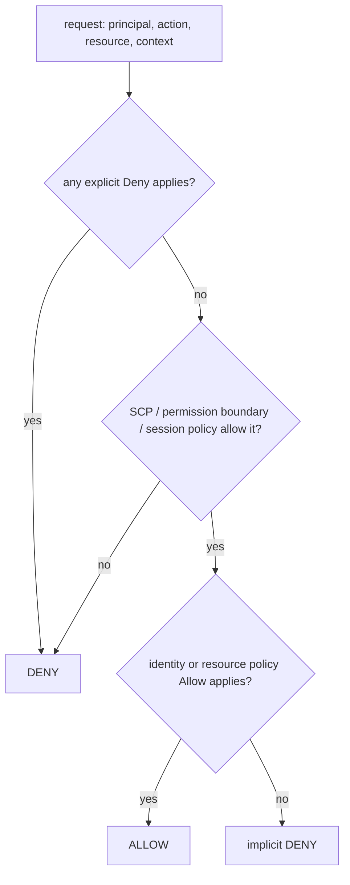

::part[Pelajari Konsepnya]{n="1"}

## 🎯 Yang akan kamu pelajari

- **Paket gratis vs Paket berbayar** (kredit, enam bulan, penutupan akun) dan cara memilih
- Mengamankan **pengguna root** dan kenapa kamu (hampir) tidak pernah menggunakannya
- Akses harian: **pengguna admin IAM dengan MFA**, **tanpa akses key**, dan `aws login` untuk CLI
- **IAM** blok bangunan: principal, policy, role, dan cara AWS **mengevaluasi** request
- **Least privilege** dalam praktik dan jenis grant yang berbahaya
- **Anggaran**, alert penggunaan free tier, Cost Explorer, dan Cost Anomaly Detection
- **Perangkap biaya** klasik dan **baseline keamanan** (CloudTrail, kontak alternatif, region)

## 🔤 Istilah penting

| Istilah | Artinya (sederhana) |
|---|---|
| **Root user** | Login pemilik akun — dia bisa lakukan apapun, termasuk tutup akun |
| **MFA** | Bukti kedua saat login (kode atau security key), bukan hanya password |
| **IAM** | Bagian AWS yang mengatur siapa boleh lakukan apa |
| **IAM user** | Login bernama untuk satu orang |
| **IAM role** | Identitas yang dipinjam seorang, server, atau pipeline untuk waktu singkat |
| **Policy** | Dokumen JSON yang berisi aksi yang diizinkan atau ditolak |
| **Least privilege** | Berikan hanya akses yang benar-benar dibutuhkan pekerjaan itu |
| **Access key** | Password permanen untuk API — mudah bocor, jadi hindari |
| **Budget alert** | Email saat pengeluaran melampaui jumlah yang kamu tentukan |
| **Region** | Kelompok data center tempat resource-mu tinggal (Singapore, Jakarta...) |

## 🧠 Ide besarnya

Akun AWS adalah **kartu kredit perusahaan plus master key ke data center**.

- Root user adalah kunci *pemilik*: kunci dalam brankas (MFA, tanpa akses key) dan pakai hanya untuk tugas pemilik saja.
- Semua orang lain — termasuk kamu, setiap hari — bekerja dengan *badge karyawan* (identitas IAM) yang hanya membuka pintu yang mereka butuhkan.
- Dan seperti kartu kredit apapun, kamu atur **alert pengeluaran dulu** sebelum pembelian pertama, bukan setelah tagihan datang.

## ❓ Kenapa ini penting

Kesalahan di AWS menghabiskan uang nyata dan data nyata: key yang bocor dipakai untuk crypto mining, NAT gateway yang lupa, RDS database berjalan berbulan-bulan, S3 bucket yang dibuat publik. Ini kecelakaan paling umum untuk pengguna cloud baru — dan hampir semuanya dicegah oleh jam pertama setup dalam pelajaran ini.

Yang terjadi kalau tanpa jam pertama itu:

- Kamu bekerja sebagai root setiap hari; satu password yang di-phishing memberi penyerang segalanya, termasuk billing dan kuasa untuk tutup akun.
- Akses key untuk pengguna admin duduk di `~/.aws/credentials` dan di `.env` yang di-push ke GitHub.
- Tidak ada alert anggaran, jadi tanda pertama masalah adalah invoice bulanan.
- Di **paket gratis**, kredit habis di tengah-tengah proyek dan akun **tertutup** — dengan database-mu di dalamnya.

## 📖 Langkah demi langkah

### 1. Paket gratis vs Paket berbayar (akun baru sejak Juli 2025)

| | Paket gratis | Paket berbayar |
|---|---|---|
| Kredit | USD 100 saat daftar + hingga USD 100 lagi dengan menyelesaikan kegiatan | sama |
| Biaya | tidak ada — kamu tidak bisa ditagih | bayar untuk penggunaan di luar kredit |
| Service | sebagian (hal yang bisa habiskan kredit, misalnya Savings Plans, Reserved Instances, beberapa penawaran Marketplace, tidak tersedia) | semuanya |
| Berakhir | setelah **6 bulan** atau kredit habis — mana yang lebih dulu | tidak tertutup |
| Saat berakhir | akun **tertutup**; data disimpan 90 hari; upgrade ke berbayar untuk pulihkan | — |
| Perangkap | bergabung dengan **AWS Organizations** atau setup Control Tower mengubah ke berbayar **dan kredit langsung kadaluarsa** | — |

Untuk belajar, paket gratis adalah jaring pengaman: tidak ada tagihan mengejutkan. Untuk URL portofolio yang ingin tetap online setelah enam bulan, rencanakan untuk **upgrade** (dan jaga biaya tetap kecil) atau **bongkar** dan simpan demo video. Kredit sendiri kadaluarsa 12 bulan setelah akun dibuat. Selalu cek syarat terbaru di halaman AWS Free Tier — mereka berubah.

### 2. Kunci pengguna root

1. Password kuat dan unik di password manager.
2. **MFA** pada root (passkey/security key atau aplikasi authenticator; daftar lebih dari satu perangkat jika bisa).
3. **Tanpa akses key** untuk root, tidak pernah.
4. Akun → **kontak alternatif** (billing, operasi, keamanan) dan alamat email yang dimonitor.
5. Pakai root hanya untuk tugas khusus root (ubah pengaturan akun, tutup akun, beberapa aksi billing).

### 3. Akses admin harian tanpa key permanen

Pada akun tunggal berdiri sendiri (dan di paket gratis, di mana bergabung AWS Organizations tidak bisa):

1. IAM → buat user, misalnya `ismail-admin`, akses console, **MFA wajib**.
2. Pasang `AdministratorAccess` (kamu satu-satunya orang; nanti kamu buat **role** yang lebih sempit untuk aplikasi dan CI).
3. Pengaman opsional: policy yang tolak semuanya kecuali mengelola MFA-mu sendiri kalau MFA belum ada.
4. **Jangan buat akses key.** Untuk CLI, login dengan identitas console-mu:

```bash
aws --version                 # 2.32.0 or newer
aws login --region ap-southeast-1
aws sts get-caller-identity   # which identity am I?
```

`aws login` menyimpan kredensial jangka pendek yang refresh dari sesi console-mu; identitas butuh policy terkelola `SignInLocalDevelopmentAccess` (sudah termasuk dalam akses admin). Aplikasi di AWS pakai **IAM role** (instance profile, ECS task role), dan GitHub Actions pakai **OIDC** role (Minggu 2) — tidak ada yang butuh akses key.

Di perusahaan dengan banyak akun kamu akan pakai **IAM Identity Center** (SSO) dengan AWS Organizations; prinsipnya sama.

### 4. Cara IAM memutuskan



| Elemen | Artinya |
|---|---|
| `Effect` | `Allow` atau `Deny` |
| `Action` / `NotAction` | Operasi API, misalnya `s3:PutObject`, `ecs:UpdateService` (tidak peka huruf besar-kecil, wildcard boleh) |
| `Resource` / `NotResource` | ARN, misalnya `arn:aws:s3:::revoshop-images/*` (peka huruf besar-kecil) |
| `Condition` | cek tambahan: `aws:MultiFactorAuthPresent`, `aws:SourceIp`, `aws:RequestedRegion`, tag... |
| Identity policy | pasang pada user/role: apa yang *dia* bisa lakukan |
| Resource policy | pasang pada resource (S3 bucket, SQS queue): siapa yang bisa pakai *dia* |
| Role + trust policy | *siapa* yang boleh ambil role (OIDC trust policy Minggu 2) |

Default adalah **tolak**: kalau tidak ada yang izinkan aksi, jawabannya tidak. Dan **Deny eksplisit selalu menang** — tanda "jangan masuk" mengalahkan izin apapun.

### 5. Least privilege, dalam praktik

- Mulai dari tugas ("push ke satu ECR repo, update satu ECS service"), bukan dari `*`.
- Cakup resource ke ARN; pakai kondisi (region, tag) kalau ARN tidak cukup.
- Awasi jalur eskalasi: `iam:PassRole` pada `*`, `iam:*`, `Allow` + `NotAction`, `sts:AssumeRole` pada `*`.
- Pakai **IAM Access Analyzer** (validasi policy, temuan akses tidak terpakai) dan CloudTrail untuk lihat aksi apa yang role-mu benar-benar pakai.

### 6. Alarm anggaran sebelum resource

| Alat | Setup |
|---|---|
| **AWS Budgets** | **anggaran biaya** bulanan (misalnya USD 10) dengan alert pada 50%, 80%, 100% aktual dan 100% **forecast** ke email-mu |
| **Alert penggunaan Free Tier** | Billing preferences → terima alert penggunaan free tier |
| **Cost Anomaly Detection** | monitor untuk AWS service dengan ringkasan email harian |
| **Cost Explorer** | cek biaya harian per service setelah setiap lab |
| Halaman Credit | sisa kredit dan tanggal kadaluarsa |

Alert hanya **memberitahu kamu**; mereka tidak matikan apa-apa — seperti gauge bensin, bukan rem. Kamu masih harus bertindak (atau setup budget action, yang terapkan policy pembatas otomatis; itu langkah lebih lanjut).

### 7. Perangkap biaya untuk dikenal

| Perangkap | Kenapa gigit |
|---|---|
| **NAT gateway** | biaya per jam + pemrosesan per GB, bahkan idle — sering lebih dari server-mu |
| **Public IPv4 address** | USD 0.005 per jam **setiap satu**, terpakai atau idle (≈ USD 3.65/bulan) |
| Idle **load balancer** | biaya per jam tanpa traffic |
| **RDS** berjalan terus | instance RDS yang "dihentikan" **menyala lagi otomatis setelah 7 hari** |
| **EBS** volume dan snapshot | tetap ada (dan tagih) setelah instance dihapus kalau tidak dihapus |
| Multi-AZ, class instance besar, Performance Insights retention | gandakan atau lebih biaya database |
| **Data transfer** keluar dan lintas-AZ | kecil per GB, mengejutkan pada skala besar |
| CloudWatch Logs tanpa retention | tumbuh selamanya |
| Resource di **region yang lupa** | Cost Explorer per region menemukannya |

### 8. Baseline keamanan

- **CloudTrail** sejarah event sudah nyala secara default (90 hari event management) — belajar cari di dalamnya.
- **Pilihan region**: Singapore (`ap-southeast-1`) sudah nyala secara default; **Jakarta (`ap-southeast-3`) adalah region opt-in** — nyalakan di pengaturan Akun dulu. Bandingkan latency ke pengguna-mu dan harga (beda per region).
- Nyalakan **IAM Access Analyzer**; pertimbangkan **GuardDuty** (punya trial; cek harga) dan **Security Hub** nanti.
- Tag semuanya: `Project=revoshop`, `Env=staging`, `Owner=kamu` — lalu filter biaya per tag.
- Nyalakan **S3 Block Public Access** di level akun.

### Pilih setup kamu

Setiap pilihan di sini adalah trade-off:

| Pilihan | ✅ | ❌ |
|---|---|---|
| Paket gratis | tidak bisa ditagih | tertutup setelah 6 bulan atau kredit habis; beberapa service tidak tersedia |
| Paket berbayar | akses penuh, akun tetap | biaya nyata di luar kredit — anggaran wajib |
| IAM user + MFA (akun berdiri sendiri) | mudah, jalan di paket gratis | identitas password jangka panjang; bukan cara multi-akun perusahaan bekerja |
| IAM Identity Center + Organizations | SSO, multi-akun, akses jangka pendek | butuh Organizations (ubah paket gratis dan kredensial langsung kadaluarsa) |
| Singapore vs Jakarta | Singapore: sudah nyala default, sering lebih murah | Jakarta: latency lebih rendah untuk pengguna Indonesia, opt-in, cek ketersediaan service |

- ✅ Lakukan baseline lengkap pada **setiap** akun — pribadi, belajar, atau perusahaan.
- ✅ Pisahkan identitas: kamu (manusia, MFA), CI (OIDC role), app (task/instance role).
- 🚫 Tidak pernah buat akses key root; hindari akses key untuk manusia sama sekali.
- 🚫 Jangan bergabung AWS Organizations pada akun paket gratis kecuali kamu mau upgrade.

## ⚠️ Kesalahan umum

- Pakai email/password root di dokumen password bersama.
- Buat akses key "hanya untuk CLI" dan lupa selama bertahun-tahun.
- Alert anggaran dikirim ke email yang tidak ada yang baca.
- Pikir "dihentikan" berarti "gratis" (EBS volume, Elastic IP dan RDS storage tetap tagih).

## 🏆 Praktik terbaik

- [ ] Root: MFA, tanpa key, kontak alternatif, jarang dipakai.
- [ ] Identitas admin manusia dengan MFA; CLI via `aws login` (tanpa key permanen).
- [ ] App dan CI pakai role (instance/task role, OIDC) dengan least privilege.
- [ ] Anggaran dengan alert aktual dan forecast, alert free tier dan anomaly detection **sebelum** resource pertama.
- [ ] Pilih region dengan sengaja; nyalakan region opt-in dengan sadar; cek Cost Explorer per region.
- [ ] Tag setiap resource dengan proyek, lingkungan, dan pemilik.
- [ ] Tahu perangkap biaya (NAT, IPv4, idle ALB, RDS auto-restart, EBS terlantar).
- [ ] Review policy IAM dengan Access Analyzer; cari CloudTrail saat sesuatu berubah tidak terduga.
- [ ] Tulis checklist bongkar untuk setiap lab dan ikuti.

:::revoshop
1. **Apa yang RevoShop butuh dari AWS.** Dari `compose.prod.yaml`-mu (Lab 1): server atau container untuk API, PostgreSQL, Redis, endpoint HTTPS publik untuk webhook Midtrans, log, dan (segera) penyimpanan gambar produk. Tulis service AWS yang kamu pilih untuk masing-masing **dan** pilihan termurah yang bisa diterima untuk deployment belajar.
2. **Estimasi.** Pakai cost guard dari latihan 02 dengan contoh harga untuk desain Minggu 3 (1 instance EC2 kecil dengan 20 GB, 1 public IPv4, 1 `db.t4g.micro` dengan 20 GB, hosted zone Route 53) dan desain Minggu 4 (2 Fargate task kecil, ALB, RDS yang sama, 3 secret). Lalu cek keduanya di AWS Pricing Calculator untuk **region pilihan-mu**. Berapa hari yang akan bertahan dari USD 100 kredit untuk masing-masing?
3. **Identitas.** Daftar setiap identitas yang akan sentuh RevoShop di AWS: kamu, GitHub Actions (staging, production), instance EC2 atau task ECS, job migrasi. Untuk masing-masing: role atau user, dan aksi 3–5 yang benar-benar dibutuhkan.
4. **Inventori secret → AWS.** Petakan `JWT_SECRET_KEY`, `MIDTRANS_SERVER_KEY` dan password database dari inventori Minggu 2-mu ke tempat mereka akan tinggal di AWS (SSM Parameter Store SecureString atau Secrets Manager) dan role mana yang boleh baca.
5. **Checklist bongkar-mu.** Sebelum buat apapun, tulis `docs/aws-teardown.md` di repo RevoShop-mu: setiap jenis resource yang kamu rencana buat dan cara menghapusnya (EC2, EBS, Elastic IP, RDS + keputusan final snapshot, S3 bucket, SSM parameter, log group, IAM role, anggaran).
:::

::part[Jelaskan & Rancang]{n="2"}

## 🗣️ Jelaskan

Jelaskan analogi "kartu kredit perusahaan dengan master key" ke teman yang mau "hanya pakai akun root buat lebih mudah".

## 📐 Rancang

Tulis rencana setup akun belajar-mu: pilihan rencana (dan kenapa), region, identitas yang kamu buat, metode MFA, jumlah dan alert anggaran, tag, dan policy (JSON) untuk **read-only auditor role** yang bisa lihat semuanya tapi tidak bisa baca object S3 atau secret.

:::quiz
Lihat contoh rencana

- **Rencana:** Paket gratis saat belajar Minggu 3–7 (tidak bisa ada biaya); putuskan di bulan 5 apakah upgrade untuk deployment portofolio tetap atau bongkar. Tidak ada AWS Organizations.
- **Region:** `ap-southeast-1` (Singapore) — sudah nyala default; Jakarta dipertimbangkan nanti untuk latency.
- **Identitas:** root (MFA, tanpa key, dikunci) · `ismail-admin` IAM user (MFA, AdministratorAccess, tanpa key, `aws login`) · `revoshop-gha-staging` / `revoshop-gha-production` OIDC role · `revoshop-ec2` instance role · nanti `revoshop-task` / `revoshop-task-execution` role.
- **Anggaran:** anggaran biaya USD 10/bulan; alert pada 50/80/100% aktual dan 100% forecast; alert penggunaan free tier nyala; ringkasan harian Cost Anomaly Detection.
- **Tag:** `Project=revoshop`, `Env=learning|staging|production`, `Owner=ismail`, `Teardown=yes|no`.
- **Policy auditor role** (pasang AWS managed `ReadOnlyAccess` **ditambah** deny ini):

```json
{
  "Version": "2012-10-17",
  "Statement": [{
    "Sid": "NoDataOrSecrets",
    "Effect": "Deny",
    "Action": ["s3:GetObject*", "secretsmanager:GetSecretValue", "ssm:GetParameter*", "kms:Decrypt", "rds-db:connect"],
    "Resource": "*"
  }]
}
```

Deny eksplisit menang, jadi akses read-only ke konfigurasi tidak pernah jadi akses ke data.
:::

### 📝 Checklist review mandiri

- [ ] Tidak ada akses key permanen dimanapun di rencana
- [ ] Alert dikonfigurasi sebelum resource
- [ ] Implikasi paket gratis dipahami

::ai-review{task="design"}

::part[Latihan Kecil]{n="3"}

:::exercise{path="exercises/m5/w3/01-iam-policy-simulator" ai="no-ai" title="IAM policy simulator"}
Evaluasi identity policy seperti AWS lakukan — aksi tidak peka huruf besar-kecil, ARN resource peka huruf besar-kecil dengan wildcard, `NotAction`/`NotResource`, kondisi (termasuk `IfExists`), preseden deny eksplisit — dan review policy untuk grant berbahaya seperti `iam:PassRole` pada `*`.
:::

:::exercise{path="exercises/m5/w3/02-cost-guard" ai="no-ai" title="Cost guard: estimasi, runway dan sampah"}
Estimasi biaya bulanan untuk desain berbasis EC2 dan ECS dari tabel harga contoh, hitung kapan kredit gratis atau paket enam bulan habis, hasilkan threshold alert anggaran dan deteksi resource terlupakan (IP idle, NAT gateway, volume tidak terpasang, load balancer kosong).
:::

:::hints
- Evaluasi dalam dua pass: lihat dulu apakah ada `Deny` yang berlaku, lalu apakah ada `Allow` yang berlaku.
- Operator `IfExists` lulus saat key tidak ada; operator normal gagal.
- Untuk runway, tambah bulan dengan menyesuaikan tahun dan bulan, lalu jepit hari ke panjang bulan.
:::

## ✅ Cek cepat

:::quiz
Kamu atur anggaran USD 10 dengan alert. Traffic lonjak dan forecast bilang USD 40. Apa yang AWS lakukan otomatis?

Hanya kirim alert yang kamu konfigurasi (kecuali kamu setup budget action). Resource tetap jalan dan tagih — kamu harus bertindak.
:::

:::quiz
Kenapa `iam:PassRole` pada `Resource: "*"` berbahaya?

Itu biarkan principal serah **apapun** role (termasuk role admin) ke service yang dia kontrol (EC2, ECS, Lambda) lalu bertindak dengan izin role itu — eskalasi hak istimewa.
:::


## 📚 Lanjut belajar

- [Dokumentasi AWS: Pilih paket Free Tier](https://docs.aws.amazon.com/awsaccountbilling/latest/aboutv2/free-tier-plans.html)
- [Dokumentasi AWS: Best practice root user](https://docs.aws.amazon.com/IAM/latest/UserGuide/root-user-best-practices.html) · [Logika evaluasi policy](https://docs.aws.amazon.com/IAM/latest/UserGuide/reference_policies_evaluation-logic.html)
- [Dokumentasi AWS: Login via AWS CLI (`aws login`)](https://docs.aws.amazon.com/signin/latest/userguide/command-line-sign-in.html)
- [AWS Budgets](https://docs.aws.amazon.com/cost-management/latest/userguide/budgets-managing-costs.html) · [Harga VPC (public IPv4)](https://aws.amazon.com/vpc/pricing/)
