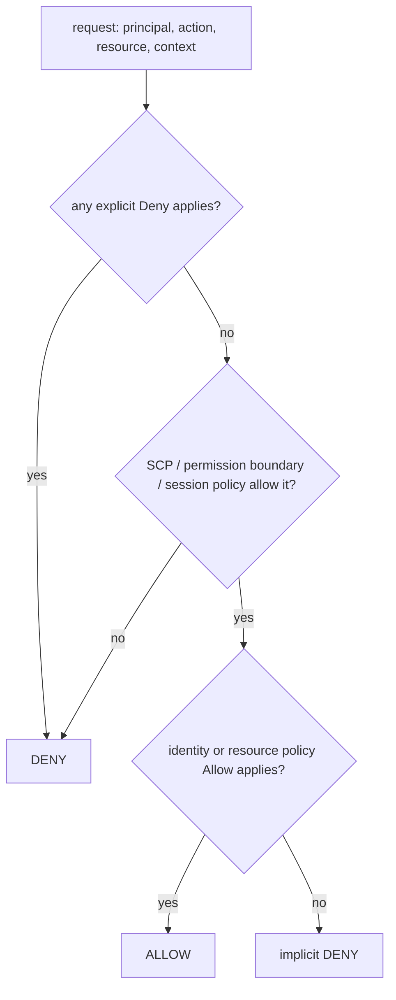

::part[Learn the Concept]{n="1"}

## 🎯 What you'll learn

- The **Free plan vs Paid plan** (credits, six months, account closure) and which to choose
- Securing the **root user** and why you then (almost) never use it
- Daily access: an **admin IAM user with MFA**, **no access keys**, and `aws login` for the CLI
- **IAM** building blocks: principals, policies, roles, and how AWS **evaluates** a request
- **Least privilege** in practice and dangerous grants to recognize
- **Budgets**, free-tier usage alerts, Cost Explorer and Cost Anomaly Detection
- The classic **cost traps** and a **security baseline** (CloudTrail, alternate contacts, regions)

## 🧠 The big idea

An AWS account is a **company credit card with a master key to a data center**. The root user is the *owner's* key: lock it in a safe (MFA, no keys) and use it only for owner-only tasks. Everyone — including you — works with a *staff badge* (an IAM identity) that opens only the doors they need. And like a credit card, you set **spending alerts before** the first purchase, not after the statement arrives.

## ❓ Why does this matter?

Mistakes on AWS cost real money and data: leaked keys used for crypto mining, a forgotten NAT gateway, an RDS instance left running for months, an S3 bucket made public. These are among the most common incidents for new cloud users — and almost all are prevented by the first hour of setup this lesson describes.

## 💥 What happens if we DON'T?

- You work as root every day; a phished password gives an attacker everything, including billing and account closure.
- Access keys for an admin user sit in `~/.aws/credentials` and in a `.env` pushed to GitHub.
- No budget alert: the first sign of trouble is the monthly invoice.
- On the **Free plan**, credits run out mid-project and the account **closes** — with your RDS database in it.

## 📖 How it works, step by step

### 1. Free plan vs Paid plan (new accounts since July 2025)

| | Free plan | Paid plan |
|---|---|---|
| Credits | USD 100 at sign-up + up to USD 100 more by completing activities | same |
| Charges | none — you can't be billed | pay for usage beyond credits |
| Services | a subset (things that could drain credits, e.g. Savings Plans, Reserved Instances, some Marketplace offers, aren't available) | everything |
| Ends | after **6 months** or when credits are used up — whichever comes first | doesn't close |
| At the end | account **closes**; data kept 90 days; upgrade to paid to restore | — |
| Traps | joining **AWS Organizations** or setting up Control Tower upgrades you to paid **and expires credits immediately** | — |

For learning, the Free plan is a safety net: no surprise bills. For a portfolio URL you want online after six months, plan either to **upgrade** (and keep costs tiny) or to **tear down** and keep a demo video. Credits themselves expire 12 months after account creation. Always check the current terms on the AWS Free Tier pages — they change.

### 2. Lock down the root user

1. Strong unique password in a password manager.
2. **MFA** on root (a passkey/security key or authenticator app; register more than one device if possible).
3. **No access keys** for root, ever.
4. Account → **alternate contacts** (billing, operations, security) and a monitored email address.
5. Use root only for root-only tasks (changing account settings, closing the account, some billing actions).

### 3. Daily admin access without long-lived keys

On a single standalone account (and on the Free plan, where joining AWS Organizations isn't an option):

1. IAM → create a user, e.g. `ismail-admin`, console access, **MFA required**.
2. Attach `AdministratorAccess` (you're the only person; you'll create narrower **roles** for applications and CI).
3. Optional guardrail: a policy that denies everything except managing your own MFA when MFA isn't present.
4. **Don't create access keys.** For the CLI, sign in with your console identity:

```bash
aws --version                 # 2.32.0 or newer
aws login --region ap-southeast-1
aws sts get-caller-identity   # which identity am I?
```

`aws login` stores short-lived credentials that refresh from your console session; the identity needs the `SignInLocalDevelopmentAccess` managed policy (included in admin access). Applications on AWS use **IAM roles** (instance profiles, ECS task roles), and GitHub Actions uses **OIDC** roles (Week 2) — nobody needs access keys.

In companies with many accounts you'll instead use **IAM Identity Center** (SSO) with AWS Organizations; the principles are the same.

### 4. How IAM decides



| Element | Meaning |
|---|---|
| `Effect` | `Allow` or `Deny` |
| `Action` / `NotAction` | API operations, e.g. `s3:PutObject`, `ecs:UpdateService` (case-insensitive, wildcards allowed) |
| `Resource` / `NotResource` | ARNs, e.g. `arn:aws:s3:::revoshop-images/*` (case-sensitive) |
| `Condition` | extra checks: `aws:MultiFactorAuthPresent`, `aws:SourceIp`, `aws:RequestedRegion`, tags… |
| Identity policy | attached to a user/role: what *it* can do |
| Resource policy | attached to a resource (S3 bucket, SQS queue): who can use *it* |
| Role + trust policy | *who* may assume the role (Week 2's OIDC trust policy) |

Default is **deny**; an explicit **Deny always wins**.

### 5. Least privilege, practically

- Start from the task ("push to one ECR repo, update one ECS service"), not from `*`.
- Scope resources to ARNs; use conditions (region, tags) when ARNs aren't enough.
- Watch for escalation paths: `iam:PassRole` on `*`, `iam:*`, `Allow` + `NotAction`, `sts:AssumeRole` on `*`.
- Use **IAM Access Analyzer** (policy validation, unused access findings) and CloudTrail to see which actions a role really uses.

### 6. Billing alarms before resources

| Tool | Set up |
|---|---|
| **AWS Budgets** | a monthly **cost budget** (e.g. USD 10) with alerts at 50%, 80%, 100% actual and 100% **forecasted** to your email |
| **Free Tier usage alerts** | Billing preferences → receive free tier usage alerts |
| **Cost Anomaly Detection** | a monitor for AWS services with a daily email summary |
| **Cost Explorer** | check daily cost by service after every lab |
| Credits page | remaining credits and expiry |

Alerts **notify**; they don't stop resources. You still have to act (or use budget actions to apply restrictive policies, which is more advanced).

### 7. Cost traps to recognize

| Trap | Why it bites |
|---|---|
| **NAT gateway** | hourly charge + per-GB processing, even idle — often more than your servers |
| **Public IPv4 addresses** | USD 0.005 per hour **each**, in use or idle (≈ USD 3.65/month) |
| Idle **load balancers** | hourly charge with zero traffic |
| **RDS** left running | "stopped" RDS instances **start again automatically after 7 days** |
| **EBS** volumes and snapshots | stay (and bill) after instances are terminated if not deleted |
| Multi-AZ, large instance classes, Performance Insights retention | double or more the database cost |
| **Data transfer** out and cross-AZ | small per GB, surprising at scale |
| CloudWatch Logs without retention | grow forever |
| Resources in a **region you forgot** | Cost Explorer by region finds them |

### 8. Security baseline

- **CloudTrail** event history is on by default (90 days of management events) — learn to search it.
- **Region choice**: Singapore (`ap-southeast-1`) is enabled by default; **Jakarta (`ap-southeast-3`) is an opt-in region** — enable it in Account settings first. Compare latency to your users and prices (they differ per region).
- Turn on **IAM Access Analyzer**; consider **GuardDuty** (has a trial; check pricing) and **Security Hub** later.
- Tag everything: `Project=revoshop`, `Env=staging`, `Owner=you` — then filter costs by tag.
- Enable **S3 Block Public Access** at the account level.

## ⚖️ Trade-offs

| Choice | ✅ | ❌ |
|---|---|---|
| Free plan | cannot be charged | closes after 6 months or when credits end; some services unavailable |
| Paid plan | full access, account persists | real charges beyond credits — budgets are mandatory |
| IAM user + MFA (standalone account) | simple, works on the Free plan | long-term password identity; not how multi-account companies work |
| IAM Identity Center + Organizations | SSO, multi-account, short-lived access | requires Organizations (upgrades a Free plan and expires credits) |
| Singapore vs Jakarta | Singapore: default-enabled, often cheaper | Jakarta: lower latency for Indonesian users, opt-in, check service availability |

## ✅ When to use it / 🚫 When NOT to use it

- ✅ Do the full baseline on **every** account — personal, learning or company.
- ✅ Separate identities: you (human, MFA), CI (OIDC role), apps (task/instance roles).
- 🚫 Never create root access keys; avoid access keys for humans entirely.
- 🚫 Don't join AWS Organizations on a Free plan account unless you intend to upgrade.

## 🏆 Best practices

- [ ] Root: MFA, no keys, alternate contacts, used rarely.
- [ ] Human admin identity with MFA; CLI via `aws login` (no long-lived keys).
- [ ] Apps and CI use roles (instance/task roles, OIDC) with least privilege.
- [ ] Budgets with actual and forecasted alerts, free tier alerts and anomaly detection **before** the first resource.
- [ ] Choose the region deliberately; enable opt-in regions consciously; check Cost Explorer by region.
- [ ] Tag every resource with project, environment and owner.
- [ ] Know the cost traps (NAT, IPv4, idle ALB, RDS auto-restart, orphaned EBS).
- [ ] Review IAM policies with Access Analyzer; search CloudTrail when something changes unexpectedly.
- [ ] Write a teardown checklist for every lab and follow it.

## 🏭 How it's used in industry

- Companies use **AWS Organizations** with separate accounts for production, staging, security and logging, IAM Identity Center for people, and service control policies as guardrails.
- FinOps practices (budgets per team, tagging policies, anomaly alerts, monthly cost reviews) are standard as cloud bills grow.
- Leaked credentials and misconfigured public resources remain top causes of cloud security incidents; AWS actively scans for exposed keys and notifies owners.

## ⚠️ Common mistakes

- Using the root email/password in a shared password document.
- Creating an access key "just for the CLI" and forgetting it for years.
- Budget alerts sent to an email nobody reads.
- Assuming "stopped" means "free" (EBS, Elastic IPs and RDS storage keep billing).

:::revoshop
1. **What RevoShop needs from AWS.** From your `compose.prod.yaml` (Lab 1): a server or containers for the API, PostgreSQL, Redis, a public HTTPS endpoint for Midtrans webhooks, logs, and (soon) product image storage. Write the AWS service you'd pick for each **and** the cheapest acceptable option for a learning deployment.
2. **Estimate it.** Use the cost guard from exercise 02 with the sample prices for the Week 3 design (1 small EC2 instance with 20 GB, 1 public IPv4, 1 `db.t4g.micro` with 20 GB, Route 53 hosted zone) and the Week 4 design (2 small Fargate tasks, an ALB, the same RDS, 3 secrets). Then check both in the AWS Pricing Calculator for **your chosen region**. How many days would USD 100 of credits last for each?
3. **Identities.** List every identity that will touch RevoShop on AWS: you, GitHub Actions (staging, production), the EC2 instance or ECS tasks, the migration job. For each: role or user, and the 3–5 actions it really needs.
4. **Secrets inventory → AWS.** Map `JWT_SECRET_KEY`, `MIDTRANS_SERVER_KEY` and the database password from your Week 2 inventory to where they'll live on AWS (SSM Parameter Store SecureString or Secrets Manager) and which role may read them.
5. **Your teardown checklist.** Before creating anything, write `docs/aws-teardown.md` in your RevoShop repo: every resource type you plan to create and how to delete it (EC2, EBS, Elastic IP, RDS + final snapshot decision, S3 buckets, SSM parameters, log groups, IAM roles, budget).
:::

::part[Explain & Design]{n="2"}

## 🗣️ Explain it

Explain the "company credit card with a master key" analogy to a friend who wants to "just use the root account to make it easier".

## 📐 Design it

Write the account setup plan for your learning account: plan choice (and why), region, the identities you'll create, MFA methods, budget amount and alerts, tags, and a policy (JSON) for a **read-only auditor role** that can look at everything but not read S3 objects or secrets.

:::quiz
Show a possible plan

- **Plan:** Free plan while learning Weeks 3–7 (no charges possible); decide by month 5 whether to upgrade for a persistent portfolio deployment or tear down. No AWS Organizations.
- **Region:** `ap-southeast-1` (Singapore) — default-enabled; Jakarta considered later for latency.
- **Identities:** root (MFA, no keys, locked away) · `ismail-admin` IAM user (MFA, AdministratorAccess, no keys, `aws login`) · `revoshop-gha-staging` / `revoshop-gha-production` OIDC roles · `revoshop-ec2` instance role · later `revoshop-task` / `revoshop-task-execution` roles.
- **Budget:** USD 10/month cost budget; alerts at 50/80/100% actual and 100% forecasted; free tier usage alerts on; Cost Anomaly Detection daily summary.
- **Tags:** `Project=revoshop`, `Env=learning|staging|production`, `Owner=ismail`, `Teardown=yes|no`.
- **Auditor role policy** (attach AWS managed `ReadOnlyAccess` **plus** this deny):

```json
{
  "Version": "2012-10-17",
  "Statement": [{
    "Sid": "NoDataOrSecrets",
    "Effect": "Deny",
    "Action": ["s3:GetObject*", "secretsmanager:GetSecretValue", "ssm:GetParameter*", "kms:Decrypt", "rds-db:connect"],
    "Resource": "*"
  }]
}
```

Explicit deny wins, so read-only access to configuration never becomes access to data.
:::

### 📝 Self-review checklist

- [ ] No long-lived access keys anywhere in the plan
- [ ] Alerts configured before resources
- [ ] Free plan implications understood

::ai-review{task="design"}

::part[Toy Exercise]{n="3"}

:::exercise{path="exercises/m5/w3/01-iam-policy-simulator" ai="no-ai" title="IAM policy simulator"}
Evaluate identity policies like AWS does — case-insensitive actions, case-sensitive resource ARNs with wildcards, `NotAction`/`NotResource`, conditions (including `IfExists`), explicit deny precedence — and review policies for dangerous grants such as `iam:PassRole` on `*`.
:::

:::exercise{path="exercises/m5/w3/02-cost-guard" ai="no-ai" title="Cost guard: estimate, runway and waste"}
Estimate monthly cost for EC2- and ECS-based designs from a sample price table, compute when free credits or the six-month plan run out, generate budget alert thresholds and detect forgotten resources (idle IPs, NAT gateways, unattached volumes, empty load balancers).
:::

:::hints
- Evaluate in two passes: first look for any applying `Deny`, then any `Allow`.
- `IfExists` operators pass when the key is missing; normal operators fail.
- For the runway, add months by adjusting year and month, then clamp the day to the month's length.
:::

## ✅ Quick check

:::quiz
You set a USD 10 budget with alerts. Traffic spikes and the forecast says USD 40. What does AWS do automatically?

Only send the alerts you configured (unless you set up budget actions). Resources keep running and billing — you must act.
:::

:::quiz
Why is `iam:PassRole` on `Resource: "*"` dangerous?

It lets the principal hand **any** role (including admin roles) to a service it controls (EC2, ECS, Lambda) and then act with that role's permissions — a privilege escalation.
:::

## 📖 Kamus (glossary)

| Term | Bahasa Indonesia |
|---|---|
| Root user | Pengguna root (pemilik akun) |
| MFA | Autentikasi multi-faktor |
| IAM role | Peran IAM (identitas sementara) |
| Least privilege | Hak akses seminimal mungkin |
| Budget alert | Peringatan anggaran |
| Explicit deny | Penolakan eksplisit |

## 📚 Keep learning

- [AWS docs: Choosing a Free Tier plan](https://docs.aws.amazon.com/awsaccountbilling/latest/aboutv2/free-tier-plans.html)
- [AWS docs: Root user best practices](https://docs.aws.amazon.com/IAM/latest/UserGuide/root-user-best-practices.html) · [Policy evaluation logic](https://docs.aws.amazon.com/IAM/latest/UserGuide/reference_policies_evaluation-logic.html)
- [AWS docs: Sign in through the AWS CLI (`aws login`)](https://docs.aws.amazon.com/signin/latest/userguide/command-line-sign-in.html)
- [AWS Budgets](https://docs.aws.amazon.com/cost-management/latest/userguide/budgets-managing-costs.html) · [VPC pricing (public IPv4)](https://aws.amazon.com/vpc/pricing/)
