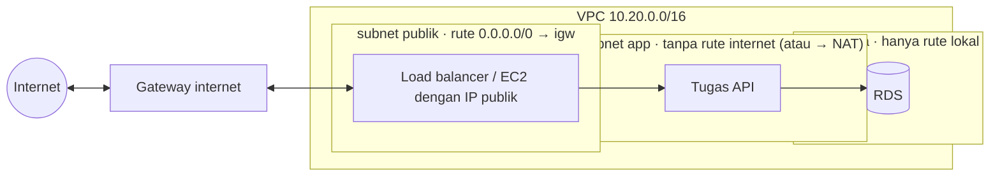

::part[Pelajari Konsepnya]{n="1"}

## 🎯 Yang akan kamu pelajari

- **Daerah (region)**, **Zona ketersediaan (AZ)** dan cara memilih (latensi, harga, layanan, aturan data, region yang buka)
- **VPC**, blok **CIDR**-nya, dan merencanakan subnet agar tidak bertabrakan nanti
- **Subnet publik, app, dan data**, serta apa yang sebenarnya membuat subnet "publik"
- **Tabel rute**, **gateway internet**, **gateway NAT** (dan biayanya)
- **Security group** (stateful, mereferensi satu sama lain) vs **network ACL**
- **VPC endpoint** (gateway dan interface), serta IPv4 vs IPv6
- Desain jaringan yang **hemat biaya** untuk RevoShop di Minggu 3 dan 4

## 🔤 Istilah penting

| Istilah | Artinya (sederhana) |
|---|---|
| **Region** | Kumpulan data center AWS di satu bagian dunia (Singapura, Jakarta) |
| **Availability Zone (AZ)** | Satu lokasi terisolasi di dalam region, dengan listrik sendiri |
| **VPC** | Jaringan pribadi milikmu di dalam AWS |
| **CIDR block** | Rentang alamat IP yang dipakai jaringan, seperti `10.20.0.0/16` |
| **Subnet** | Potongan lebih kecil dari jaringan itu, tinggal di satu AZ |
| **Tabel rute** | Penunjuk arah yang memberitahu traffic ke mana harus pergi selanjutnya |
| **Gateway internet** | Pintu antara VPC-mu dan internet |
| **Gateway NAT** | Layanan berbayar yang biarkan server privat jangkau internet sekali arah |
| **Security group** | Firewall di sekitar satu sumber daya; bisa izinkan traffic dari grup lain |
| **VPC endpoint** | Jalan pintas privat ke layanan AWS tanpa lewat internet |

## 🧠 Ide besarnya

Bayangkan sebuah kota:

- **region** adalah kotanya,
- **Zona ketersediaan** adalah taman industri terpisah di dalamnya, dengan listrik dan pertahanan banjir sendiri,
- **VPC** adalah perkebunan gated pribadmu yang membentang di beberapa taman,
- **subnet** adalah jalan-jalan di dalam perkebunan,
- **tabel rute** adalah penunjuk arah di setiap jalan,
- **gateway internet** adalah pintu gerbang utama perkebunan,
- **security group** adalah kunci di pintu setiap bangunan — dan mereka bisa bilang "hanya orang dari bangunan API boleh masuk".

## ❓ Kenapa ini penting

Setiap sumber daya AWS yang kamu deploy (EC2, RDS, load balancer, tugas ECS) tinggal di dalam VPC. Kesalahan jaringan bikin hasil terburuk: database bisa diakses dari internet, app tidak bisa jangkau Midtrans, atau gateway NAT yang biayanya lebih dari seluruh aplikasi.

Kalau tidak hati-hati:

- RDS dibuat dengan **Public access: Yes** dan security group yang izinkan `0.0.0.0/0` di port 5432.
- `10.0.0.0/16` di AWS dan `10.0.0.0/16` di jaringan kantormu — keduanya tidak bisa pernah terhubung, seperti dua rumah dengan alamat yang sama.
- Semuanya di satu subnet satu AZ, jadi satu insiden AZ jatuhkan seluruh toko.
- Wizard "VPC and more" di console bikin gateway NAT per AZ, terus dibiarkan berjalan sebulan.

## 📖 Langkah demi langkah

### 1. Daerah dan Zona ketersediaan

| Pertimbangkan | Catatan |
|---|---|
| **Latensi** | pengguna di Indonesia: Jakarta (`ap-southeast-3`) atau Singapura (`ap-southeast-1`) |
| **Harga** | layanan yang sama harganya berbeda per region — bandingkan di Pricing Calculator |
| **Ketersediaan layanan** | layanan/fitur baru sampai ke beberapa region lebih lambat |
| **Aturan data** | regulasi mungkin wajibkan data dalam negeri (tanya organisasimu untuk data terjaga) |
| **Buka** | region yang diluncurkan setelah Maret 2019 (Jakarta termasuk) harus **diaktifkan** di pengaturan akun |

**AZ** adalah satu atau lebih data center dengan listrik dan jaringan independen, terhubung latensi rendah ke AZ lain di region. Ketersediaan tinggi berarti tersebar di **minimal dua AZ**. Nama AZ (`ap-southeast-1a`) dipetakan ke zona fisik berbeda per akun; **ID** AZ (`apse1-az1`) konsisten.

### 2. VPC dan rencana CIDR

```text
VPC 10.20.0.0/16  (65,536 alamat)
├── public-a  10.20.0.0/24    public-b 10.20.1.0/24     ← load balancer, EC2 tanpa bastion di Minggu 3
├── app-a     10.20.2.0/24    app-b    10.20.3.0/24     ← tugas ECS / app server (Minggu 4+)
└── data-a    10.20.4.0/24    data-b   10.20.5.0/24     ← RDS, ElastiCache
```

- Pakai rentang privat RFC 1918 (`10.0.0.0/8`, `172.16.0.0/12`, `192.168.0.0/16`); hindari default yang semua orang pakai kalau kamu mungkin gabung jaringan nanti.
- AWS pesan **5 alamat** per subnet (satu `/24` punya 251 yang bisa dipakai).
- Tinggalkan ruang untuk tumbuh (kamu bisa tambah blok CIDR nanti, tapi ubah nomor susah).
- **VPC default** di setiap region oke untuk eksperimen tapi hanya punya subnet publik — rancang sendiri untuk apa pun yang nyata.

### 3. Apa yang bikin subnet publik

Subnet **publik** hanya karena **tabel rute**-nya kirim `0.0.0.0/0` ke **gateway internet** — dan karena sumber daya di dalamnya punya alamat IP publik. Nama tidak ada artinya; penunjuk arah yang putus. Subnet "privat" hanya tidak punya rute seperti itu.



| Tabel rute | Rute |
|---|---|
| publik | `10.20.0.0/16 → lokal`, `0.0.0.0/0 → igw-…` |
| app | `10.20.0.0/16 → lokal` (+ `0.0.0.0/0 → nat-…` kalau perlu akses internet keluar) |
| data | hanya `10.20.0.0/16 → lokal` |

### 4. Akses internet keluar dari subnet privat: NAT dan alternatif

| Opsi | Biaya | Pakai |
|---|---|---|
| **Gateway NAT** (terkelola) | per jam per AZ + per GB diproses | subnet privat production yang perlu internet (Midtrans API, install paket) |
| Subnet publik + security group (tanpa inbound rule kecuali dari ALB) | biaya IPv4 publik per tugas/instance | app kecil, belajar, setup hemat biaya |
| **VPC gateway endpoint** (S3, DynamoDB) | gratis | akses privat S3 tanpa NAT |
| **Interface endpoint** (ECR, SSM, Secrets Manager, CloudWatch Logs) | per jam per AZ + per GB | akses privat ke API AWS; beberapa bisa membengkak cepat |
| IPv6 + gateway internet hanya keluar | tanpa biaya NAT | kalau dependency mendukung IPv6 |

Untuk deploy belajar RevoShop kamu akan tempatkan **compute di subnet publik** (terlindungi security group ketat) dan jaga **subnet data tanpa rute internet sama sekali** — jadi tanpa gateway NAT, dan tanpa tagihan kejutan.

### 5. Security group vs network ACL

| | Security group | Network ACL |
|---|---|---|
| Tertempel ke | network interface (instance, tugas, RDS, ALB) | subnet |
| Kondisi | **stateful** (balasan otomatis diizinkan) | stateless (izinkan kedua arah eksplisit) |
| Aturan | hanya izinkan | izinkan dan tolak, urutan nomor |
| Sumber | CIDR **atau security group lain** | hanya CIDR |
| Default | inbound tidak ada, outbound semua | izinkan semua |

Polanya adalah **rantai security group dengan referensi** — setiap pintu hanya buka untuk orang dari bangunan sebelumnya:

| Grup | Inbound |
|---|---|
| `sg-alb` | 80, 443 dari `0.0.0.0/0` (dan `::/0`) |
| `sg-api` | 5000 dari `sg-alb` |
| `sg-db` | 5432 dari `sg-api` |
| `sg-redis` | 6379 dari `sg-api` |

Perhatikan tidak ada aturan SSH sama sekali: kamu dapat shell lewat **SSM Session Manager** sebaliknya (pelajaran 03), jadi port 22 tidak perlu buka.

### 6. Blok bangunan lain yang akan kamu ketemu

- **Elastic IP**: IPv4 publik statis (ditagih seperti IPv4 publik mana pun).
- **VPC Flow Logs**: catat traffic yang diterima/ditolak untuk debug dan keamanan (biaya untuk penyimpanan).
- **Route 53**: DNS; private hosted zone untuk nama internal.
- **VPC peering / Transit Gateway**: hubungkan VPC (kenapa CIDR yang tidak tumpang tindih penting).

### Pilih setup-mu

Setiap opsi di sini ada trade-off:

| Pilihan | ✅ | ❌ |
|---|---|---|
| Compute di subnet publik (SG-terlindungi) | tanpa biaya NAT, sederhana | IP publik per sumber daya, permukaan serangan lebih besar kalau SG salah |
| Compute di subnet privat + NAT | pertahanan berlapis, standar production | biaya NAT, lebih banyak potongan bergerak |
| Dua AZ | selamat dari kegagalan AZ | lebih banyak subnet, beberapa layanan biaya lebih (Multi-AZ RDS) |
| VPC kustom vs VPC default | tingkatan jelas, CIDR direncanakan | lebih banyak setup |

- ✅ VPC kustom dengan tier publik/app/data di dua AZ untuk apa pun di atas eksperimen.
- ✅ Referensi security group bukannya rentang IP di dalam VPC.
- 🚫 Jangan beri database akses publik, kapan pun — bahkan "sementara".
- 🚫 Jangan bikin gateway NAT "karena wizard sarankan" di akun belajar.

## ⚠️ Kesalahan umum

- Pikir subnet privat karena nama-nya.
- Buka `0.0.0.0/0` di 5432 "untuk hubung dari laptop saya" — pakai port forward Session Manager sebaliknya.
- Tempatkan RDS di hanya satu subnet (DB subnet group butuh subnet di minimal dua AZ).
- Lupa aturan `::/0` kalau IPv6 aktif.

## 🏆 Praktik terbaik

- [ ] Pilih region dengan latensi, harga, layanan dan aturan data; aktifkan region buka dengan sengaja.
- [ ] Rencanakan CIDR tidak tumpang tindih dengan ruang untuk tumbuh; dokumentasi-kan.
- [ ] Pisahkan tingkat: publik (pintu masuk), app, data; minimal dua AZ.
- [ ] Subnet data tanpa rute internet; database akses publik dinonaktifkan.
- [ ] Security group rantai dengan referensi; tidak ada `0.0.0.0/0` di SSH/DB/Redis port; tidak ada SSH sama sekali dengan Session Manager.
- [ ] Hindari biaya NAT di mana bisa (compute publik dengan SG ketat, gateway endpoint); tambah NAT sadar untuk production.
- [ ] Tag jaringan dan beri nama sumber daya konsisten (`revoshop-public-a`).
- [ ] Aktifkan Flow Logs kalau debug atau production (dengan penyimpanan).

:::revoshop
1. **Gabung jaringan → security group.** `compose.prod.yaml`-mu punya jaringan `frontend` (proxy, api) dan `backend` (api, migrate, db, redis), dan hanya proxy mempublikasikan port. Terjemahkan itu jadi security group dan aturan (sumber → target → port) untuk desain **Minggu 3** (satu instance EC2 jalankan Caddy + API + Redis, RDS terpisah) dan desain **Minggu 4** (ALB → tugas ECS → RDS).
2. **Kebutuhan outbound.** RevoShop panggil Midtrans (`https://app.sandbox.midtrans.com/snap/v1/transactions` di `app/integrations/midtrans.py`) dan tarik gambar dari GHCR. Subnet mana yang butuh akses internet keluar, dan bagaimana kamu sediakan **tanpa** gateway NAT?
3. **Kebutuhan inbound.** Midtrans harus jangkau `/api/v1/payments/webhook/midtrans` atas HTTPS dari internet. Komponen mana yang terima di setiap desain, dan port mana yang tutup?
4. **Rencanakan CIDR-mu.** Jalankan `plan_subnets("10.20.0.0/16", [<dua AZ-mu>])` dari latihan 03 dan tulis tabel itu ke `docs/aws-network.md`. Cek dengan `route_problems` bahwa tabel rute yang kamu inginkan benar.
5. **Audit sebelum klik.** Tulis security group sebagai data dan jalankan `audit()` dan `can_reach()` dari latihan untuk buktikan: internet → API port **diblok**, API → RDS 5432 **diizinkan**, internet → RDS **diblok**.
:::

::part[Jelaskan & Rancang]{n="2"}

## 🗣️ Jelaskan

Dengan analogi kota / taman industri / perkebunan gated, jelaskan kenapa subnet bernama "privat" bisa tetap publik, dan apa yang sebenarnya putuskan.

## 📐 Rancang

Rancang VPC RevoShop untuk Minggu 4 (ECS di Fargate, ALB, RDS PostgreSQL, ElastiCache Redis nanti): region, CIDR, subnet per AZ, tabel rute, security group, di mana tugas jalan, bagaimana mereka jangkau Midtrans, ECR dan SSM tanpa gateway NAT, dan apa yang akan kamu ubah untuk peluncuran production "nyata".

:::quiz
Lihat contoh desain

- **Region:** `ap-southeast-1`, AZ `a` dan `b`.
- **VPC:** `10.20.0.0/16`. Subnet: `public-a/b` `10.20.0.0/24`, `10.20.1.0/24`; `app-a/b` `10.20.2.0/24`, `10.20.3.0/24` (pesan untuk nanti); `data-a/b` `10.20.4.0/24`, `10.20.5.0/24`.
- **Rute:** publik → IGW; data → hanya lokal; app → lokal (tidak pakai di setup belajar).
- **Penempatan (belajar):** ALB di subnet publik; **tugas Fargate di subnet publik dengan `assignPublicIp: ENABLED`** (outbound ke Midtrans, ECR, SSM lewat IGW — tanpa NAT); RDS dan Redis di subnet data.
- **Security group:** `sg-alb` 80/443 dari dunia → `sg-api` 5000 hanya dari `sg-alb` → `sg-db` 5432 dari `sg-api` (dan dari `sg-migrate` kalau tugas migrasi punya grup sendiri) → `sg-redis` 6379 dari `sg-api`.
- **Endpoint:** S3 **gateway** endpoint (gratis) di tabel rute publik untuk upload/download gambar.
- **Perubahan production:** tugas pindah ke subnet app dengan **gateway NAT per AZ** (atau interface endpoint untuk ECR/SSM/Logs + NAT hanya untuk Midtrans), RDS Multi-AZ, Flow Logs dengan penyimpanan, WAF di ALB, IPv6 dual-stack di mana didukung.
:::

### 📝 Checklist review mandiri

- [ ] Database tidak bisa dijangkau dari internet dengan konstruksi
- [ ] Jalur outbound ditentukan tanpa tagihan NAT yang kebetulan
- [ ] Dua AZ untuk setiap tingkat

::ai-review{task="design"}

::part[Latihan Kecil]{n="3"}

:::exercise{path="exercises/m5/w3/03-vpc-and-security-groups" ai="no-ai" title="Perencana VPC dan reachability security group"}
Alokasikan subnet bertingkat di seluruh AZ dengan validasi, hitung IP yang bisa dipakai, deteksi kesalahan tabel rute, tentukan apakah traffic bisa mengalir antara sumber daya lewat security group rantai, dan audit grup untuk port sensitif yang buka dunia.
:::

:::hints
- `ipaddress.ip_network(cidr).subnets(new_prefix=24)` hasilkan blok berurutan.
- Grup security sumber cocok kalau **sumber daya** adalah anggota-nya.
- Rentang port: aturan `5000–6500` termasuk 5432 dan 6379.
:::

## ✅ Cek cepat

:::quiz
Instance EC2 di subnet dengan rute `0.0.0.0/0 → igw` tidak punya IP publik. Bisakah pengguna di internet jangkau langsung?

Tidak. Butuh alamat IPv4 publik (atau IPv6) juga rute — atau harus duduk di balik load balancer yang punya.
:::

:::quiz
Kenapa referensi `sg-api` di security group database bukannya CIDR subnet API?

Aturan ikuti **peran** sumber daya: apa pun instance atau tugas dengan `sg-api` bisa hubung, apakah IP atau subnet, dan tidak ada yang lain di subnet itu.
:::

## 📚 Lanjut belajar

- [Dokumentasi AWS: Cara kerja Amazon VPC](https://docs.aws.amazon.com/vpc/latest/userguide/how-it-works.html) · [Security group](https://docs.aws.amazon.com/vpc/latest/userguide/vpc-security-groups.html) · [Gateway NAT](https://docs.aws.amazon.com/vpc/latest/userguide/vpc-nat-gateway.html)
- [Dokumentasi AWS: Tentukan region AWS yang akun kamu bisa pakai](https://docs.aws.amazon.com/accounts/latest/reference/manage-acct-regions.html)
- [Kalkulator Harga AWS](https://calculator.aws/)
