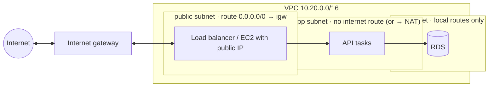

::part[Learn the Concept]{n="1"}

## 🎯 What you'll learn

- **Regions**, **Availability Zones** and how to choose (latency, price, services, data residency, opt-in regions)
- A **VPC**, its **CIDR block**, and planning subnets that won't collide later
- **Public, app and data subnets**, and what actually makes a subnet "public"
- **Route tables**, **internet gateways**, **NAT gateways** (and their cost)
- **Security groups** (stateful, referencing each other) vs **network ACLs**
- **VPC endpoints** (gateway and interface), and IPv4 vs IPv6
- A **cost-aware** network design for RevoShop in Weeks 3 and 4

## 🔤 Key words

| Word | In simple words | Bahasa Indonesia |
|---|---|---|
| **Region** | A group of AWS data centres in one part of the world (Singapore, Jakarta) | Wilayah data center |
| **Availability Zone (AZ)** | One isolated location inside a region, with its own power | Zona terpisah |
| **VPC** | Your own private network inside AWS | Jaringan privat sendiri |
| **CIDR block** | The range of IP addresses a network uses, like `10.20.0.0/16` | Rentang alamat IP |
| **Subnet** | A smaller slice of that network, living in one AZ | Bagian jaringan |
| **Route table** | The signpost that tells traffic where to go next | Tabel arah lalu lintas |
| **Internet gateway** | The door between your VPC and the internet | Pintu ke internet |
| **NAT gateway** | A paid service that lets private servers reach the internet one-way | Pintu keluar berbayar |
| **Security group** | A firewall around one resource; it can allow traffic from another group | Firewall per sumber daya |
| **VPC endpoint** | A private shortcut to an AWS service without going over the internet | Jalur privat ke layanan AWS |

## 🧠 The big idea

Picture a city:

- a **region** is the city,
- an **Availability Zone** is a separate industrial park in it, with its own power and flood defences,
- a **VPC** is your private gated estate spanning several parks,
- **subnets** are streets inside the estate,
- a **route table** is the signpost on each street,
- the **internet gateway** is the estate's main gate,
- **security groups** are the locks on each building's door — and they can say "only people coming from the API building may enter".

## ❓ Why it matters

Every AWS resource you deploy (EC2, RDS, load balancers, ECS tasks) lives inside a VPC. Network mistakes cause the worst outcomes: a database reachable from the internet, an app that can't reach Midtrans, or a NAT gateway that costs more than the whole application.

Done carelessly:

- RDS created with **Public access: Yes** and a security group allowing `0.0.0.0/0` on port 5432.
- `10.0.0.0/16` in AWS and `10.0.0.0/16` in your office network — the two can never be connected, like two houses with the same address.
- Everything in one subnet in one AZ, so one AZ incident takes the whole shop down.
- The console's "VPC and more" wizard creating a NAT gateway per AZ, left running for a month.

## 📖 Step by step

### 1. Regions and AZs

| Consider | Notes |
|---|---|
| **Latency** | users in Indonesia: Jakarta (`ap-southeast-3`) or Singapore (`ap-southeast-1`) |
| **Price** | the same service costs differently per region — compare in the Pricing Calculator |
| **Service availability** | newer services/features reach some regions later |
| **Data residency** | regulations may require data in-country (check with your organization for regulated data) |
| **Opt-in** | regions launched after March 2019 (Jakarta included) must be **enabled** in account settings |

An **AZ** is one or more data centers with independent power and networking, connected with low latency to other AZs in the region. High availability means spreading across **at least two AZs**. AZ names (`ap-southeast-1a`) map to different physical zones per account; AZ **IDs** (`apse1-az1`) are consistent.

### 2. VPC and CIDR planning

```text
VPC 10.20.0.0/16  (65,536 addresses)
├── public-a  10.20.0.0/24    public-b 10.20.1.0/24     ← load balancers, bastion-free EC2 in Week 3
├── app-a     10.20.2.0/24    app-b    10.20.3.0/24     ← ECS tasks / app servers (Week 4+)
└── data-a    10.20.4.0/24    data-b   10.20.5.0/24     ← RDS, ElastiCache
```

- Use private RFC 1918 ranges (`10.0.0.0/8`, `172.16.0.0/12`, `192.168.0.0/16`); avoid the defaults everyone else uses if you may peer networks later.
- AWS reserves **5 addresses** per subnet (a `/24` has 251 usable).
- Leave room to grow (you can add CIDR blocks later, but renumbering is painful).
- The **default VPC** in each region is fine for experiments but has only public subnets — design your own for anything real.

### 3. What makes a subnet public

A subnet is **public** only because its **route table** sends `0.0.0.0/0` to an **internet gateway** — and because the resources in it have public IP addresses. The name means nothing; the signpost decides. A "private" subnet simply has no such route.



| Route table | Routes |
|---|---|
| public | `10.20.0.0/16 → local`, `0.0.0.0/0 → igw-…` |
| app | `10.20.0.0/16 → local` (+ `0.0.0.0/0 → nat-…` if it needs outbound internet) |
| data | `10.20.0.0/16 → local` only |

### 4. Outbound internet from private subnets: NAT and alternatives

| Option | Cost | Use |
|---|---|---|
| **NAT gateway** (managed) | hourly per AZ + per GB processed | production private subnets needing internet (Midtrans API, package installs) |
| Public subnet + security group (no inbound rules except from the ALB) | public IPv4 charge per task/instance | small apps, learning, cost-sensitive setups |
| **VPC gateway endpoints** (S3, DynamoDB) | free | private access to S3 without NAT |
| **Interface endpoints** (ECR, SSM, Secrets Manager, CloudWatch Logs) | hourly per AZ + per GB | private access to AWS APIs; several add up quickly |
| IPv6 + egress-only internet gateway | no NAT charge | when your dependencies support IPv6 |

For RevoShop's learning deployments you'll put **the compute in public subnets** (protected by tight security groups) and keep **data subnets with no internet route at all** — so no NAT gateway, and no surprise bill.

### 5. Security groups vs network ACLs

| | Security group | Network ACL |
|---|---|---|
| Attached to | network interfaces (instances, tasks, RDS, ALB) | subnets |
| State | **stateful** (replies allowed automatically) | stateless (allow both directions explicitly) |
| Rules | allow only | allow and deny, numbered order |
| Sources | CIDRs **or other security groups** | CIDRs only |
| Default | inbound none, outbound all | allow all |

The pattern is to **chain security groups by reference** — each door only opens for people coming from the previous building:

| Group | Inbound |
|---|---|
| `sg-alb` | 80, 443 from `0.0.0.0/0` (and `::/0`) |
| `sg-api` | 5000 from `sg-alb` |
| `sg-db` | 5432 from `sg-api` |
| `sg-redis` | 6379 from `sg-api` |

Notice there is no SSH rule at all: you get a shell through **SSM Session Manager** instead (lesson 03), so port 22 never needs to be open.

### 6. Other building blocks you'll meet

- **Elastic IP**: a static public IPv4 (billed like any public IPv4).
- **VPC Flow Logs**: record accepted/rejected traffic for debugging and security (costs for storage).
- **Route 53**: DNS; private hosted zones for internal names.
- **VPC peering / Transit Gateway**: connect VPCs (why non-overlapping CIDRs matter).

### Choosing your setup

Every option here is a trade-off:

| Choice | ✅ | ❌ |
|---|---|---|
| Compute in public subnets (SG-protected) | no NAT cost, simple | public IPs per resource, larger attack surface if SGs are wrong |
| Compute in private subnets + NAT | defense in depth, standard for production | NAT cost, more moving parts |
| Two AZs | survives an AZ failure | more subnets, some services cost more (Multi-AZ RDS) |
| Custom VPC vs default VPC | clear tiers, planned CIDRs | more setup |

- ✅ A custom VPC with public/app/data tiers in two AZs for anything beyond an experiment.
- ✅ Security-group references instead of IP ranges inside the VPC.
- 🚫 Don't give databases public access, ever — even "temporarily".
- 🚫 Don't create NAT gateways "because the wizard suggested it" in learning accounts.

## ⚠️ Common mistakes

- Thinking a subnet is private because of its name.
- Opening `0.0.0.0/0` on 5432 "to connect from my laptop" — use Session Manager port forwarding instead.
- Placing RDS in only one subnet (a DB subnet group needs subnets in at least two AZs).
- Forgetting `::/0` rules when IPv6 is enabled.

## 🏆 Best practices

- [ ] Choose region(s) by latency, price, services and data rules; enable opt-in regions deliberately.
- [ ] Plan non-overlapping CIDRs with room to grow; document them.
- [ ] Separate tiers: public (entry points), app, data; at least two AZs.
- [ ] Data subnets have no internet routes; databases have public access disabled.
- [ ] Security groups chained by reference; no `0.0.0.0/0` on SSH/DB/Redis ports; no SSH at all with Session Manager.
- [ ] Avoid NAT costs where you can (public compute with tight SGs, gateway endpoints); add NAT consciously for production.
- [ ] Tag networks and name resources consistently (`revoshop-public-a`).
- [ ] Enable Flow Logs when debugging or for production (with retention).

:::revoshop
1. **Compose networks → security groups.** Your `compose.prod.yaml` has `frontend` (proxy, api) and `backend` (api, migrate, db, redis) networks, and only the proxy publishes ports. Translate that into security groups and rules (source → target → port) for the **Week 3** design (one EC2 instance running Caddy + API + Redis, RDS separate) and the **Week 4** design (ALB → ECS tasks → RDS).
2. **Outbound needs.** RevoShop calls Midtrans (`https://app.sandbox.midtrans.com/snap/v1/transactions` in `app/integrations/midtrans.py`) and pulls images from GHCR. Which subnets need outbound internet access, and how will you provide it **without** a NAT gateway?
3. **Inbound needs.** Midtrans must reach `/api/v1/payments/webhook/midtrans` over HTTPS from the internet. Which component receives it in each design, and which ports stay closed?
4. **Plan your CIDRs.** Run `plan_subnets("10.20.0.0/16", [<your two AZs>])` from exercise 03 and write the table into `docs/aws-network.md`. Check with `route_problems` that your intended route tables are right.
5. **Audit before you click.** Write the security groups as data and run `audit()` and `can_reach()` from the exercise to prove: internet → API port is **blocked**, API → RDS 5432 is **allowed**, internet → RDS is **blocked**.
:::

::part[Explain & Design]{n="2"}

## 🗣️ Explain it

Using the city / industrial park / gated estate analogy, explain why a subnet named "private" can still be public, and what really decides it.

## 📐 Design it

Design RevoShop's VPC for Week 4 (ECS on Fargate, ALB, RDS PostgreSQL, ElastiCache Redis later): region, CIDRs, subnets per AZ, route tables, security groups, where tasks run, how they reach Midtrans, ECR and SSM without a NAT gateway, and what you'd change for a "real" production launch.

:::quiz
Show a possible design

- **Region:** `ap-southeast-1`, AZs `a` and `b`.
- **VPC:** `10.20.0.0/16`. Subnets: `public-a/b` `10.20.0.0/24`, `10.20.1.0/24`; `app-a/b` `10.20.2.0/24`, `10.20.3.0/24` (reserved for later); `data-a/b` `10.20.4.0/24`, `10.20.5.0/24`.
- **Routes:** public → IGW; data → local only; app → local (unused in the learning setup).
- **Placement (learning):** ALB in public subnets; **Fargate tasks in public subnets with `assignPublicIp: ENABLED`** (outbound to Midtrans, ECR, SSM via the IGW — no NAT); RDS and Redis in data subnets.
- **Security groups:** `sg-alb` 80/443 from world → `sg-api` 5000 from `sg-alb` only → `sg-db` 5432 from `sg-api` (and from `sg-migrate` if the migration task has its own group) → `sg-redis` 6379 from `sg-api`.
- **Endpoints:** S3 **gateway** endpoint (free) on the public route table for image uploads/downloads.
- **Production launch changes:** tasks move to app subnets with **NAT gateways per AZ** (or interface endpoints for ECR/SSM/Logs + NAT only for Midtrans), RDS Multi-AZ, Flow Logs with retention, WAF on the ALB, IPv6 dual-stack where supported.
:::

### 📝 Self-review checklist

- [ ] Database unreachable from the internet by construction
- [ ] Outbound path defined without an accidental NAT bill
- [ ] Two AZs for every tier

::ai-review{task="design"}

::part[Toy Exercise]{n="3"}

:::exercise{path="exercises/m5/w3/03-vpc-and-security-groups" ai="no-ai" title="VPC planner and security-group reachability"}
Allocate tiered subnets across AZs with validation, count usable IPs, detect route-table mistakes, decide whether traffic can flow between resources through chained security groups, and audit groups for world-open sensitive ports.
:::

:::hints
- `ipaddress.ip_network(cidr).subnets(new_prefix=24)` yields consecutive blocks.
- A source security group matches when the **source resource** is a member of it.
- Port ranges: a rule `5000–6500` includes 5432 and 6379.
:::

## ✅ Quick check

:::quiz
An EC2 instance in a subnet with a `0.0.0.0/0 → igw` route has no public IP. Can users on the internet reach it directly?

No. It needs a public IPv4 (or IPv6) address as well as the route — or it must sit behind a load balancer that has one.
:::

:::quiz
Why reference `sg-api` in the database's security group instead of the API subnet's CIDR?

The rule follows the **role** of the resource: any instance or task with `sg-api` can connect, regardless of IP or subnet, and nothing else in that subnet can.
:::


## 📚 Keep learning

- [AWS docs: How Amazon VPC works](https://docs.aws.amazon.com/vpc/latest/userguide/how-it-works.html) · [Security groups](https://docs.aws.amazon.com/vpc/latest/userguide/vpc-security-groups.html) · [NAT gateways](https://docs.aws.amazon.com/vpc/latest/userguide/vpc-nat-gateway.html)
- [AWS docs: Specify which AWS Regions your account can use](https://docs.aws.amazon.com/accounts/latest/reference/manage-acct-regions.html)
- [AWS Pricing Calculator](https://calculator.aws/)
