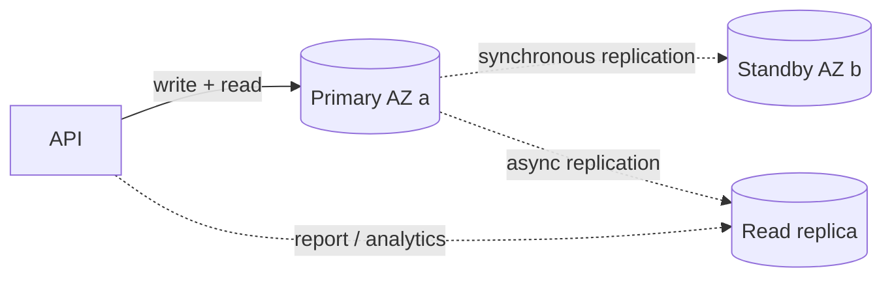

::part[Pelajari Konsepnya]{n="1"}

## 🎯 Yang akan kamu pelajari

- Apa yang **RDS kelola untuk kamu** (dan apa yang tidak)
- Engine dan **instance class**, **storage gp3**, dan storage autoscaling
- **Multi-AZ** (ketersediaan) vs **read replica** (scaling baca)
- **Automated backup**, **point-in-time recovery**, snapshot, dan drill restore
- **Parameter group** (mis. memaksa TLS, log query lambat)
- **Private networking**, **TLS dengan verifikasi sertifikat**, dan **managed master password** di Secrets Manager
- **Connection limit**, pool SQLAlchemy, `pool_pre_ping`, dan RDS Proxy
- Menjalankan **migration** dengan aman, **monitoring**, dan kontrol **biaya** (termasuk auto-start 7 hari)

## 🔤 Istilah penting

| Istilah | Artinya (sederhana) |
|---|---|
| **RDS** | AWS menjalankan PostgreSQL untukmu: patch, backup, failover otomatis |
| **Instance class** | Ukuran server database (`db.t4g.micro`) |
| **Multi-AZ** | Salinan siaga di tempat lain yang siap ambil alih saat yang pertama gagal |
| **Read replica** | Salinan ekstra hanya untuk membaca, untuk membagi beban |
| **Automated backup** | Backup harian yang disimpan beberapa hari |
| **Point-in-time recovery (PITR)** | Mengembalikan database ke menit tertentu di masa lalu |
| **Snapshot** | Backup manual yang disimpan sampai kamu menghapusnya |
| **Parameter group** | Pengaturan database (paksa TLS, log query lambat) |
| **Connection pool** | Sekumpulan koneksi database siap pakai yang app buka terus-menerus |
| **TLS verification** | App mengecek sertifikat database sebelum percaya padanya |

## 🧠 Ide besarnya

Menjalankan PostgreSQL di server sendiri seperti **memiliki mobil**. RDS seperti **sewa full-service**:

- dealer mengganti oli untuk kamu (patch dan upgrade kecil),
- menyiapkan mobil cadangan di garasi lain (Multi-AZ),
- foto mobil setiap malam (automated backup),
- dan bisa mengembalikan saat-saat bahagia Selasa lalu pukul 14:05 (point-in-time recovery).

Tapi kamu tetap yang menyetir: desain schema, index, query, dan cara app membuka koneksi semuanya milik kamu.

## ❓ Kenapa ini penting

Data pesanan dan pembayaran RevoShop adalah harta karun terbesar. Volume container di satu VM (Week 1) tidak punya backup otomatis, tidak punya failover, dan tidak ada restore yang sudah diuji — seperti menyimpan buku catatan toko satu-satunya di meja dekat jendela terbuka. RDS memberimu ketiganya dengan beberapa setting, tapi setting salah (akses publik, tidak ada backup, tanpa TLS) bisa menghancurkan semuanya.

Kalau dikerjakan buruk:

- Backup dimatikan "untuk hemat biaya"; migration buruk menghapus kolom di production tanpa jalan kembali.
- Akses publik dengan password lemah; database muncul di scan internet dalam hitungan jam.
- 4 worker gunicorn × pool default SQLAlchemy (5 + 10 extra) × 3 container → micro instance kena connection limit saat penjualan.
- Database failover ke standby, tapi setiap worker API masih pegang koneksi mati sampai di-restart.
- Seseorang "menghentikan" RDS untuk hemat; AWS menyalakannya lagi 7 hari kemudian dan tagihan terus berjalan.

## 📖 Langkah demi langkah

### 1. Apa yang RDS kelola

| RDS lakukan | Kamu lakukan |
|---|---|
| provisioning, patch OS dan engine (di jendela maintenance) | schema, index, tuning query |
| automated backup, PITR, snapshot | uji restore, pilih retensi |
| Multi-AZ failover | handle reconnect di app |
| monitoring metric, export log | alarm dan dashboard |
| storage scaling | capacity planning, biaya |

Aurora PostgreSQL adalah varian cloud-native AWS (storage berbeda, failover lebih cepat, biaya minimum lebih tinggi); RDS PostgreSQL standar adalah titik awal lebih sederhana.

### 2. Memilih instance dan storage

| Setting | Learning / small production | Catatan |
|---|---|---|
| Engine | PostgreSQL **16** (cocokkan Compose dan CI-mu) | upgrade mayor adalah acara terencana |
| Class | `db.t4g.micro` atau `db.t4g.small` | burstable; class Graviton tidak pengaruhi image app-mu |
| Storage | 20 GiB **gp3**, autoscaling dengan maksimal | kamu bayar storage yang dialokasikan |
| Deployment | Single-AZ (learning) → **Multi-AZ** (production) | Multi-AZ kira-kira dua kali biaya instance |

### 3. Ketersediaan dan scaling

Multi-AZ seperti **sopir cadangan duduk di kursi penumpang** — mobil sama, siap ambil kemudi. Read replica seperti **mobil kedua untuk penumpang yang hanya ingin baca peta**: membagi beban baca, tapi bukan backup.



| Fitur | Tujuan | Ubah app? |
|---|---|---|
| **Multi-AZ instance** | failover otomatis ke standby (sekitar semenit dua), endpoint sama | reconnect saat gagal |
| **Multi-AZ DB cluster** (2 standby readable) | failover lebih cepat + standby readable | reader endpoint opsional |
| **Read replica** | kurangi beban baca, salinan lintas region | kirim baca ke endpoint berbeda; replication lag |

### 4. Backup dan recovery

Backup yang belum pernah di-restore adalah **alat pemadam kebakaran yang belum pernah diuji**. Lakukan satu drill restore saat tidak ada masalah, catat berapa lama.

- **Automated backup**: snapshot harian + transaction log; retensi 1–35 hari (atur **7+**); mengaktifkan **point-in-time recovery** ke detik mana pun dalam window.
- **Manual snapshot**: disimpan sampai kamu hapus (ambil sebelum migration berisiko dan sebelum hapus instance).
- **Restore = instance baru** dengan endpoint baru. Latihan: restore backup tadi malam ke instance baru, jalankan smoke query, hapus. Backup yang tidak pernah di-restore adalah harapan, bukan backup.
- **Deletion protection** aktif; putuskan tentang **final snapshot** saat hapus.

### 5. Parameter group

Buat custom parameter group (default tidak bisa diedit):

| Parameter | Nilai | Kenapa |
|---|---|---|
| `rds.force_ssl` | `1` | tolak koneksi non-TLS (default sudah aktif di PostgreSQL versi terbaru — verifikasi) |
| `log_min_duration_statement` | `500` (ms) | log query lambat |
| `log_connections` / `log_disconnections` | `1` | debug connection storm (berisik — pakai sementara) |
| `idle_in_transaction_session_timeout` | `60000` | bunuh session yang terjebak di open transaction |

### 6. Keamanan

- **Public access: Tidak**; DB subnet group dengan **data subnet di dua AZ**; security group ijinkan 5432 **hanya dari app security group**.
- **TLS dengan verifikasi**: download RDS CA bundle ke image, koneksi dengan `sslmode=verify-full&sslrootcert=/path/global-bundle.pem`.
- **Managed master password**: biarkan RDS simpan dan rotasi kredensial master di **Secrets Manager**; buat **application user** terpisah dengan hanya privilege yang app butuh (bukan superuser untuk app).
- Enkripsi at-rest dengan KMS (default di console; tidak bisa aktif nanti tanpa restore).
- Opsional: **IAM database authentication** (token short-lived bukan password).

```sql
-- once, as the master user
CREATE ROLE revoshop_app LOGIN PASSWORD '…from SSM…';
GRANT CONNECT ON DATABASE revoshop TO revoshop_app;
GRANT USAGE, CREATE ON SCHEMA public TO revoshop_app;   -- CREATE only if the app user runs migrations
```

### 7. Koneksi

Koneksi database seperti **kasir di toko**: masing-masing makan memori database, small instance hanya punya beberapa. Setting pool kamu putuskan berapa kasir setiap salinan app coba buka — kalikan dengan jumlah worker dan container sebelum deploy.

PostgreSQL kasih setiap koneksi satu process; small instance support jumlah terbatas (`max_connections` berasal dari memori instance — cek `SHOW max_connections;`).

```python
# Flask-SQLAlchemy settings for a small RDS instance
SQLALCHEMY_ENGINE_OPTIONS = {
    "pool_size": 3,          # per gunicorn worker process
    "max_overflow": 2,
    "pool_pre_ping": True,   # detect dead connections after failover/restart
    "pool_recycle": 1800,
    "connect_args": {"connect_timeout": 5},
}
```

Total = process × (pool_size + max_overflow) — plus migration, worker, session admin. Saat banyak container atau Lambda koneksi, taruh **RDS Proxy** (pooled, failover-aware, biaya tambahan) atau PgBouncer di antara.

### 8. Migration di RDS

- Jalankan sebagai **one-off job** (Compose `migrate` service sekarang, ECS task di Week 4) dengan image sama.
- Migration backward-compatible (expand → contract), ambil **manual snapshot** sebelum yang berisiko.
- Lock timeout untuk DDL di tabel ramai: `SET lock_timeout = '5s';` gagal cepat bukan block checkout.

### 9. Monitoring dan biaya

- CloudWatch: `CPUUtilization`, `FreeStorageSpace`, `DatabaseConnections`, `FreeableMemory`, `ReadLatency`/`WriteLatency`, `CPUCreditBalance` (class t).
- **Performance Insights**/Database Insights untuk analisis query-level (cek harga retensi).
- Alarm: free storage < 20%, koneksi > 80% max, CPU credit rendah.
- Biaya: jam instance + storage + backup storage di atas alokasi gratis + I/O di beberapa storage type + transfer data.
- **Menghentikan** hemat jam instance tapi storage tetap tagihan, dan **RDS auto-start instance yang dihentikan setelah 7 hari**.

### Memilih setup-mu

Setiap pilihan di sini adalah trade-off:

| Pilihan | ✅ | ❌ |
|---|---|---|
| RDS vs PostgreSQL di container | backup, PITR, patch, failover | biaya, kurang power superuser, engine version AWS control |
| Single-AZ vs Multi-AZ | lebih murah | downtime saat gagal dan maintenance |
| Managed master password | rotasi, secret bukan di tangan | app harus baca secret (atau pakai app user terpisah) |
| RDS Proxy | connection pooling, failover lebih cepat | biaya tambahan dan satu hop |
| Aurora | failover lebih cepat, storage scaling | biaya minimum lebih tinggi, lebih AWS-spesific |

- ✅ Setiap database relasional production di AWS kecuali punya alasan kuat untuk self-manage.
- ✅ Instance terpisah (atau minimal database dan user terpisah) untuk staging dan production.
- 🚫 Jangan pakai RDS sebagai queue atau cache; jangan buka ke internet.
- 🚫 Jangan andalkan backup yang belum pernah di-restore.

## ⚠️ Kesalahan umum

- `sslmode=require` tanpa verifikasi (encrypt, tapi tidak terbukti kamu bicara ke database-mu).
- App koneksi sebagai master user.
- Lupa bahwa restore buat **endpoint baru** — app harus arahkan ke sana.
- Storage autoscaling tanpa maksimal.

:::revoshop
1. **Connection math-mu.** `config/base.py` tidak set `SQLALCHEMY_ENGINE_OPTIONS`, jadi setiap worker gunicorn pakai pool default SQLAlchemy (sampai 5 + 10 overflow koneksi). Dengan `WEB_CONCURRENCY=2` di satu instance, kasus terburuk apa? Dan di ECS dengan 2 task, plus task migrate? Bandingkan dengan `SHOW max_connections;` di RDS instance-mu, lalu tambah engine option dari pelajaran ini (dengan `pool_pre_ping`) ke `ProductionConfig`.
2. **TLS.** `DATABASE_URL` mu pakai `postgresql://` dengan **psycopg2**, yang pass parameter `sslmode`/`sslrootcert` query ke libpq. Tambah RDS global CA bundle ke `prod` image (satu `RUN` download dengan checksum, atau `COPY` salinan yang di-commit) dan pakai `?sslmode=verify-full&sslrootcert=…`. Di mana latihan 05's `database_url_from_secret()` cocok?
3. **App user vs master user.** Hari ini Compose buat satu superuser `revoshop`. Di RDS, buat `revoshop_app` untuk API dan putuskan: `migrate` job pakai master credential (dari Secrets Manager) atau migration user terpisah dengan right `CREATE`?
4. **Pindah data-mu.** Kamu punya data lokal di `pgdata` volume dan seeder di `seeders/seeders.py`. Rencana: seed database RDS baru, atau `pg_dump -Fc` lokal dan `pg_restore` lewat Session Manager port-forwarding tunnel. Mana yang tepat untuk staging vs production, dan apa yang TIDAK boleh disalin?
5. **Drill restore.** Setelah Lab 3, restore RDS ke titik 10 menit setelah kamu buat test order, koneksi via port forwarding, dan konfirmasi order ada. Tulis berapa lama ke `docs/aws-runbook.md`.
:::

## 🏆 Praktik terbaik

- [ ] Subnet privat, akses publik tidak, SG hanya dari app SG.
- [ ] TLS dengan verifikasi sertifikat; enkripsi at-rest; deletion protection.
- [ ] Automated backup ≥ 7 hari; manual snapshot sebelum perubahan berisiko; quarterly drill restore.
- [ ] Custom parameter group: paksa TLS, log slow query, idle transaction timeout.
- [ ] Managed master password; least-privilege application user.
- [ ] Connection pool right-size dengan `pool_pre_ping`; RDS Proxy kalau connection count meledak.
- [ ] Migration sebagai one-off job, backward compatible.
- [ ] Alarm di storage, koneksi, CPU credit; Multi-AZ untuk production dengan user sungguhan.
- [ ] Ingat auto-start 7 hari; hapus (dengan snapshot decision) bukan "stop selamanya".

::part[Jelaskan & Rancang]{n="2"}

## 🗣️ Jelaskan

Jelaskan analogi "sewa full-service" dan kenapa "kita punya backup" tidak benar sampai kamu restore satu.

## 📐 Rancang

Spesifikasi setup RDS RevoShop untuk Week 3–4: engine version, class, storage, strategi AZ, backup retention dan policy snapshot, nilai parameter group, network dan security group, credential (master vs app vs migration user), TLS, connection pool setting untuk compute-mu, alarm, dan apa yang ubah sebelum customer sungguhan datang.

:::quiz
Lihat spesifikasi yang mungkin

- **Engine:** PostgreSQL 16.x (major sama Compose/CI), auto minor upgrade di jendela maintenance Minggu 02:00–03:00 WIB.
- **Class/storage:** `db.t4g.micro`, 20 GiB gp3, autoscaling max 50 GiB, enkripsi aktif, deletion protection aktif.
- **AZ:** Single-AZ untuk learning; **Multi-AZ** sebelum launch.
- **Backup:** 7 hari automated (PITR); manual snapshot sebelum setiap production migration; final snapshot saat hapus; quarterly drill restore.
- **Parameter group `revoshop-pg16`:** `rds.force_ssl=1`, `log_min_duration_statement=500`, `idle_in_transaction_session_timeout=60000`.
- **Network:** DB subnet group `data-a`, `data-b`; `sg-db` inbound 5432 dari `sg-web` (Week 3) / `sg-api` + `sg-migrate` (Week 4); akses publik tidak.
- **Credential:** master password managed di Secrets Manager (pakai hanya job migrate dan admin); `revoshop_app` user dengan privilege DML, password di SSM SecureString `/revoshop/production/DB_PASSWORD`.
- **TLS:** `sslmode=verify-full` dengan RDS global bundle baked ke image.
- **Pool:** `pool_size=3`, `max_overflow=2`, `pool_pre_ping=True`, `pool_recycle=1800` → 2 worker × 5 = 10 koneksi per instance/task.
- **Alarm:** FreeStorageSpace < 4 GiB, DatabaseConnections > 60, CPUCreditBalance < 20, CPU > 80% selama 15 min.
- **Sebelum launch:** Multi-AZ, class lebih besar kalau perlu, retensi 14–35 hari, Performance Insights, RDS Proxy kalau task count besar, dan RPO/RTO tertulis.
:::

### 📝 Checklist review mandiri

- [ ] Tidak ada yang terjangkau dari internet
- [ ] Connection math cocok `max_connections`
- [ ] Prosedur restore ditetapkan dan timed

::ai-review{task="design"}

::part[Latihan Kecil]{n="3"}

:::exercise{path="exercises/m5/w3/05-s3-uploads-and-rds-secrets" ai="no-ai" title="Private S3 uploads dan RDS credential"}
Dengan boto3 vs moto: buat bucket S3 terkunci, versioned, encrypted dengan lifecycle rule dan TLS-only policy, generate product image key aman dan presigned POST upload, dan bangun database URL terverifikasi-TLS dari RDS-managed Secrets Manager secret dengan credential URL-encoded.
:::

:::hints
- `urllib.parse.quote(value, safe="")` encode `@`, `/`, dan `:` di password.
- Presigned POST condition ada di field `policy` base64-encoded — decode di debug-mu sendiri juga.
- Di luar `us-east-1`, `create_bucket` butuh `LocationConstraint`.
:::

## ✅ Cek cepat

:::quiz
Multi-AZ atau read replica: mana yang lindungi saat AZ primary down, dan mana yang buat reporting query cepat?

Multi-AZ lindungi ketersediaan (failover otomatis ke standby). Read replica layani traffic baca (mis. laporan), dengan replication lag dan endpoint terpisah.
:::

:::quiz
Setelah RDS failover API-mu return error beberapa menit sampai restart. Apa yang hilang?

Connection health handling: stale pool koneksi tidak terdeteksi. Pakai `pool_pre_ping=True` (dan timeout/recycling wajar) jadi pool buang koneksi mati dan reconnect ke endpoint sama.
:::


## 📚 Lanjut belajar

- [AWS docs: Amazon RDS for PostgreSQL](https://docs.aws.amazon.com/AmazonRDS/latest/UserGuide/CHAP_PostgreSQL.html) · [Using SSL/TLS](https://docs.aws.amazon.com/AmazonRDS/latest/UserGuide/UsingWithRDS.SSL.html) · [Password management with Secrets Manager](https://docs.aws.amazon.com/AmazonRDS/latest/UserGuide/rds-secrets-manager.html)
- [AWS docs: Stopping an RDS instance temporarily](https://docs.aws.amazon.com/AmazonRDS/latest/UserGuide/USER_StopInstance.html)
- [SQLAlchemy: Connection pooling](https://docs.sqlalchemy.org/en/20/core/pooling.html)
