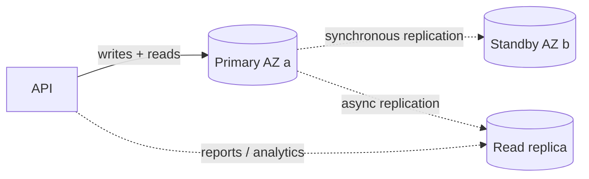

::part[Learn the Concept]{n="1"}

## 🎯 What you'll learn

- What **RDS manages** for you (and what it doesn't)
- Engines and **instance classes**, **gp3 storage** and storage autoscaling
- **Multi-AZ** (availability) vs **read replicas** (read scaling)
- **Automated backups**, **point-in-time recovery**, snapshots and restore drills
- **Parameter groups** (e.g. forcing TLS, logging slow queries)
- **Private networking**, **TLS with certificate verification**, and **managed master passwords** in Secrets Manager
- **Connection limits**, SQLAlchemy pools, `pool_pre_ping` and RDS Proxy
- Running **migrations** safely, **monitoring** and **cost** control (including the 7-day auto-start)

## 🔤 Key words

| Word | In simple words | Bahasa Indonesia |
|---|---|---|
| **RDS** | AWS running PostgreSQL for you: patching, backups, failover | Database terkelola |
| **Instance class** | The size of the database server (`db.t4g.micro`) | Ukuran server database |
| **Multi-AZ** | A standby copy in another location that takes over if the first fails | Salinan siaga |
| **Read replica** | An extra copy used only for reading, to spread load | Salinan khusus baca |
| **Automated backup** | Daily backups kept for a number of days | Backup otomatis |
| **Point-in-time recovery (PITR)** | Restoring the database to an exact minute in the past | Pemulihan ke waktu tertentu |
| **Snapshot** | A manual backup you keep until you delete it | Cadangan manual |
| **Parameter group** | The database's settings (force TLS, log slow queries) | Kumpulan pengaturan |
| **Connection pool** | A set of reusable database connections your app keeps open | Kumpulan koneksi siap pakai |
| **TLS verification** | The app checking the database's certificate before trusting it | Verifikasi sertifikat |

## 🧠 The big idea

Running PostgreSQL on your own server is like owning a car. RDS is a **full-service lease**:

- the dealer changes the oil (patching and minor upgrades),
- keeps a spare car ready in another garage (Multi-AZ),
- photographs the car every night (automated backups),
- and can hand it back exactly as it was last Tuesday at 14:05 (point-in-time recovery).

You still do the driving: schema design, indexes, queries and how your app opens connections are all yours.

## ❓ Why it matters

RevoShop's orders and payments are the most valuable data you have. A container volume on one VM (Week 1) has no automated backups, no failover and no tested restore — like keeping the shop's only ledger on a desk next to an open window. RDS gives you all three with a few settings, and a wrong setting (public access, no backups, no TLS) can undo them.

Done badly:

- Backups disabled "to save money"; a bad migration deletes a column in production with no way back.
- Public access enabled with a weak password; the database shows up in internet scans within hours.
- 4 gunicorn workers × SQLAlchemy's default pool (5 + 10 extra) × 3 containers → the micro instance hits its connection limit during a sale.
- The database fails over to its standby, but every API worker keeps holding dead connections until restarted.
- Someone "stops" RDS to save money; AWS starts it again seven days later and the billing continues.

## 📖 Step by step

### 1. What RDS manages

| RDS does | You do |
|---|---|
| provisioning, OS and engine patching (in maintenance windows) | schema, indexes, query tuning |
| automated backups, PITR, snapshots | test restores, choose retention |
| Multi-AZ failover | handle reconnects in the app |
| monitoring metrics, logs export | alarms and dashboards |
| storage scaling | capacity planning, cost |

Aurora PostgreSQL is AWS's cloud-native variant (different storage, faster failover, higher minimum cost); standard RDS PostgreSQL is the simpler starting point.

### 2. Choosing the instance and storage

| Setting | Learning / small production | Notes |
|---|---|---|
| Engine | PostgreSQL **16** (match your Compose and CI) | major upgrades are planned events |
| Class | `db.t4g.micro` or `db.t4g.small` | burstable; Graviton classes don't affect your app's image architecture |
| Storage | 20 GiB **gp3**, storage autoscaling with a max | you pay for allocated storage |
| Deployment | Single-AZ (learning) → **Multi-AZ** (production) | Multi-AZ roughly doubles instance cost |

### 3. Availability and scaling

Multi-AZ is a **spare driver sitting in the passenger seat** — same car, ready to take the wheel. A read replica is a **second car for passengers who only want to read the map**: it spreads reading work, but it is not a backup.



| Feature | Purpose | App change? |
|---|---|---|
| **Multi-AZ instance** | automatic failover to a standby (typically a minute or two), same endpoint | reconnect on failure |
| **Multi-AZ DB cluster** (2 readable standbys) | faster failover + readable standbys | optional reader endpoint |
| **Read replica** | offload reads, cross-region copies | send reads to a different endpoint; replication lag |

### 4. Backups and recovery

A backup you have never restored is a **fire extinguisher nobody has tested**. Do one restore drill while nothing is wrong, and write down how long it took.

- **Automated backups**: daily snapshots + transaction logs; retention 1–35 days (set **7+**); enables **point-in-time recovery** to any second within the window.
- **Manual snapshots**: kept until you delete them (take one before risky migrations and before deleting an instance).
- **Restore = a new instance** with a new endpoint. Practice: restore last night's backup to a new instance, run smoke queries, delete it. A backup you never restored is a hope, not a backup.
- **Deletion protection** on; decide about the **final snapshot** when deleting.

### 5. Parameter groups

Create a custom parameter group (defaults can't be edited):

| Parameter | Value | Why |
|---|---|---|
| `rds.force_ssl` | `1` | reject non-TLS connections (default is already on in recent PostgreSQL versions — verify) |
| `log_min_duration_statement` | `500` (ms) | log slow queries |
| `log_connections` / `log_disconnections` | `1` | debugging connection storms (noisy — use temporarily) |
| `idle_in_transaction_session_timeout` | `60000` | kill sessions stuck in open transactions |

### 6. Security

- **Public access: No**; DB subnet group with **data subnets in two AZs**; security group allows 5432 **only from the app's security group**.
- **TLS with verification**: download the RDS CA bundle into your image and connect with `sslmode=verify-full&sslrootcert=/path/global-bundle.pem`.
- **Managed master password**: let RDS store and rotate the master credentials in **Secrets Manager**; create a separate **application user** with only the privileges the app needs (no superuser for the app).
- Encryption at rest with KMS (on by default in the console; can't be enabled later without restore).
- Optional: **IAM database authentication** (short-lived tokens instead of passwords).

```sql
-- once, as the master user
CREATE ROLE revoshop_app LOGIN PASSWORD '…from SSM…';
GRANT CONNECT ON DATABASE revoshop TO revoshop_app;
GRANT USAGE, CREATE ON SCHEMA public TO revoshop_app;   -- CREATE only if the app user runs migrations
```

### 7. Connections

Database connections are like **checkout counters**: each one costs the database memory, and a small instance has only a few. Your pool settings decide how many counters each app copy tries to open — multiply them by the number of workers and containers before you deploy.

PostgreSQL gives each connection a process; small instances support only a limited number (`max_connections` is derived from instance memory — check `SHOW max_connections;`).

```python
# Flask-SQLAlchemy settings for a small RDS instance
SQLALCHEMY_ENGINE_OPTIONS = {
    "pool_size": 3,          # per gunicorn worker process
    "max_overflow": 2,
    "pool_pre_ping": True,   # detect dead connections after failover/restart
    "pool_recycle": 1800,
    "connect_args": {"connect_timeout": 5},
}
```

Total = processes × (pool_size + max_overflow) — plus migrations, workers, admin sessions. When many containers or Lambdas connect, put **RDS Proxy** (pooled, failover-aware, costs extra) or PgBouncer in between.

### 8. Migrations on RDS

- Run as a **one-off job** (Compose `migrate` service now, an ECS task in Week 4) with the same image.
- Backward-compatible migrations (expand → contract), take a **manual snapshot** before risky ones.
- Lock timeouts for DDL on busy tables: `SET lock_timeout = '5s';` to fail fast instead of blocking checkout.

### 9. Monitoring and cost

- CloudWatch: `CPUUtilization`, `FreeStorageSpace`, `DatabaseConnections`, `FreeableMemory`, `ReadLatency`/`WriteLatency`, `CPUCreditBalance` (t classes).
- **Performance Insights**/Database Insights for query-level analysis (check retention pricing).
- Alarms: free storage < 20%, connections > 80% of max, CPU credits low.
- Cost: instance hours + storage + backup storage beyond the free allocation + I/O on some storage types + data transfer.
- **Stopping** saves instance hours but storage still bills, and **RDS restarts a stopped instance automatically after 7 days**.

### Choosing your setup

Every option here is a trade-off:

| Choice | ✅ | ❌ |
|---|---|---|
| RDS vs PostgreSQL in a container | backups, PITR, patching, failover | cost, fewer superuser powers, engine versions controlled by AWS |
| Single-AZ vs Multi-AZ | cheaper | downtime during failures and some maintenance |
| Managed master password | rotation, no secret in your hands | app must read the secret (or use a separate app user) |
| RDS Proxy | connection pooling, faster failover | extra cost and a hop |
| Aurora | faster failover, storage scaling | higher minimum cost, more AWS-specific |

- ✅ Any production relational database on AWS unless you have a strong reason to self-manage.
- ✅ Separate instances (or at least separate databases and users) for staging and production.
- 🚫 Don't use RDS as a queue or cache; don't open it to the internet.
- 🚫 Don't rely on backups you've never restored.

## ⚠️ Common mistakes

- `sslmode=require` without verification (encrypts, but doesn't prove you're talking to your database).
- The app connecting as the master user.
- Forgetting that restoring creates a **new endpoint** — the app must be pointed at it.
- Storage autoscaling without a maximum.

:::revoshop
1. **Your connection math.** `config/base.py` sets no `SQLALCHEMY_ENGINE_OPTIONS`, so each gunicorn worker uses SQLAlchemy's default pool (up to 5 + 10 overflow connections). With `WEB_CONCURRENCY=2` on one instance, what's the worst case? And on ECS with 2 tasks, plus the migrate task? Compare with `SHOW max_connections;` on your RDS instance, then add the engine options from this lesson (with `pool_pre_ping`) to `ProductionConfig`.
2. **TLS.** Your `DATABASE_URL` uses `postgresql://` with **psycopg2**, which passes `sslmode`/`sslrootcert` query parameters to libpq. Add the RDS global CA bundle to the `prod` image (a `RUN` that downloads it with a checksum, or `COPY` a committed copy) and use `?sslmode=verify-full&sslrootcert=…`. Where does exercise 05's `database_url_from_secret()` fit?
3. **App user vs master user.** Today Compose creates one superuser `revoshop`. On RDS, create `revoshop_app` for the API and decide: does the `migrate` job use the master credentials (from Secrets Manager) or a separate migration user with `CREATE` rights?
4. **Move your data.** You have local data in the `pgdata` volume and seeders in `seeders/seeders.py`. Plan either: seed a fresh RDS database, or `pg_dump -Fc` locally and `pg_restore` through a Session Manager port-forwarding tunnel. Which is right for staging vs production, and what must never be copied?
5. **Restore drill.** After Lab 3, restore RDS to a point 10 minutes after you created a test order, connect via port forwarding, and confirm the order exists. Write the time it took into `docs/aws-runbook.md`.
:::

## 🏆 Best practices

- [ ] Private subnets, public access off, SG from app SG only.
- [ ] TLS with certificate verification; encryption at rest; deletion protection.
- [ ] Automated backups ≥ 7 days; manual snapshot before risky changes; quarterly restore drill.
- [ ] Custom parameter group: force TLS, slow query logging, idle transaction timeout.
- [ ] Managed master password; least-privilege application user.
- [ ] Right-sized connection pools with `pool_pre_ping`; RDS Proxy when connection counts explode.
- [ ] Migrations as one-off jobs, backward compatible.
- [ ] Alarms on storage, connections, CPU credits; Multi-AZ for production with real users.
- [ ] Remember the 7-day auto-start; delete (with a snapshot decision) instead of "stopping forever".

::part[Explain & Design]{n="2"}

## 🗣️ Explain it

Explain the full-service lease analogy, and why "we have backups" isn't true until you've restored one.

## 📐 Design it

Specify RevoShop's RDS setup for Weeks 3–4: engine version, class, storage, AZ strategy, backup retention and snapshot policy, parameter group values, networking and security groups, credentials (master vs app vs migration users), TLS, connection pool settings for your compute, alarms, and what changes before real customers arrive.

:::quiz
Show a possible specification

- **Engine:** PostgreSQL 16.x (same major as Compose/CI), auto minor upgrades in a Sunday 02:00–03:00 WIB maintenance window.
- **Class/storage:** `db.t4g.micro`, 20 GiB gp3, autoscaling max 50 GiB, encryption on, deletion protection on.
- **AZ:** Single-AZ for learning; **Multi-AZ** before launch.
- **Backups:** 7 days automated (PITR); manual snapshot before each production migration; final snapshot on deletion; quarterly restore drill.
- **Parameter group `revoshop-pg16`:** `rds.force_ssl=1`, `log_min_duration_statement=500`, `idle_in_transaction_session_timeout=60000`.
- **Network:** DB subnet group `data-a`, `data-b`; `sg-db` inbound 5432 from `sg-web` (Week 3) / `sg-api` + `sg-migrate` (Week 4); public access off.
- **Credentials:** master password managed in Secrets Manager (used only by the migrate job and admins); `revoshop_app` user with DML privileges, password in SSM SecureString `/revoshop/production/DB_PASSWORD`.
- **TLS:** `sslmode=verify-full` with the RDS global bundle baked into the image.
- **Pools:** `pool_size=3`, `max_overflow=2`, `pool_pre_ping=True`, `pool_recycle=1800` → 2 workers × 5 = 10 connections per instance/task.
- **Alarms:** FreeStorageSpace < 4 GiB, DatabaseConnections > 60, CPUCreditBalance < 20, CPU > 80% for 15 min.
- **Before launch:** Multi-AZ, larger class if needed, 14–35 day retention, Performance Insights, RDS Proxy if task counts grow, and a written RPO/RTO.
:::

### 📝 Self-review checklist

- [ ] Nothing reachable from the internet
- [ ] Connection math fits `max_connections`
- [ ] Restore procedure defined and timed

::ai-review{task="design"}

::part[Toy Exercise]{n="3"}

:::exercise{path="exercises/m5/w3/05-s3-uploads-and-rds-secrets" ai="no-ai" title="Private S3 uploads and RDS credentials"}
With boto3 against moto: create a locked-down, versioned, encrypted S3 bucket with lifecycle rules and a TLS-only policy, generate safe product image keys and presigned POST uploads, and build a verified-TLS database URL from an RDS-managed Secrets Manager secret with URL-encoded credentials.
:::

:::hints
- `urllib.parse.quote(value, safe="")` encodes `@`, `/` and `:` in passwords.
- Presigned POST conditions are inside the base64-encoded `policy` field — decode it in your own debugging too.
- Outside `us-east-1`, `create_bucket` needs a `LocationConstraint`.
:::

## ✅ Quick check

:::quiz
Multi-AZ or read replica: which one protects you when the primary's AZ has an outage, and which one makes reporting queries faster?

Multi-AZ protects availability (automatic failover to the standby). A read replica serves read traffic (e.g. reports), with replication lag and a separate endpoint.
:::

:::quiz
After an RDS failover your API returns errors for several minutes until restarted. What's missing?

Connection health handling: stale pooled connections aren't detected. Use `pool_pre_ping=True` (and reasonable timeouts/recycling) so the pool discards dead connections and reconnects to the same endpoint.
:::


## 📚 Keep learning

- [AWS docs: Amazon RDS for PostgreSQL](https://docs.aws.amazon.com/AmazonRDS/latest/UserGuide/CHAP_PostgreSQL.html) · [Using SSL/TLS](https://docs.aws.amazon.com/AmazonRDS/latest/UserGuide/UsingWithRDS.SSL.html) · [Password management with Secrets Manager](https://docs.aws.amazon.com/AmazonRDS/latest/UserGuide/rds-secrets-manager.html)
- [AWS docs: Stopping an RDS instance temporarily](https://docs.aws.amazon.com/AmazonRDS/latest/UserGuide/USER_StopInstance.html)
- [SQLAlchemy: Connection pooling](https://docs.sqlalchemy.org/en/20/core/pooling.html)
