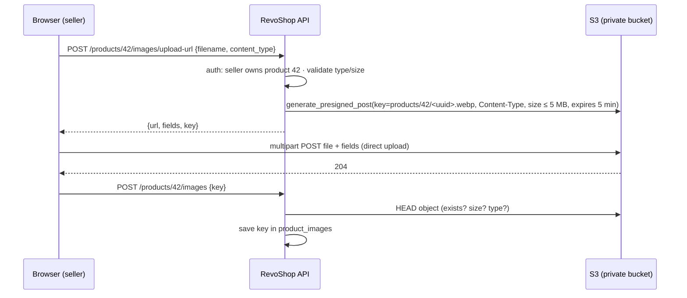

::part[Pelajari Konsepnya]{n="1"}

## 🎯 Yang akan kamu pelajari

- Konsep **S3**: bucket, key, prefix, storage class, konsistensi
- Menjaga bucket tetap pribadi: **Block Public Access**, bucket policy, enkripsi, akses TLS-only
- **Versioning** dan **lifecycle rule**
- **Presigned URL**: upload langsung dari browser (POST/PUT) dan download dengan waktu terbatas
- **CORS** untuk upload dari browser
- **CloudFront** di depan S3 dengan **Origin Access Control**, cache behavior, cache key dan **invalidation**
- Mengirim gambar yang diunggah pengguna dengan aman (tipe konten, ukuran, pemrosesan gambar)
- Biaya: penyimpanan, request, transfer data, CloudFront

## 🔤 Istilah penting

| Istilah | Artinya (sederhana) |
|---|---|
| **S3 bucket** | Wadah penyimpanan file di AWS, dengan ruang tak terbatas |
| **Key / prefix** | Nama lengkap file di bucket; bagian folder di depannya |
| **Block Public Access** | Saklar yang mencegah bucket bisa dibaca semua orang |
| **Bucket policy** | Aturan pada bucket yang mengatakan siapa boleh memakainynya |
| **Versioning** | Menyimpan salinan lama file saat file ditimpa atau dihapus |
| **Lifecycle rule** | Aturan otomatis untuk memindahkan atau menghapus file lama |
| **Presigned URL** | Tautan sementara yang membiarkan browser upload atau download satu file langsung |
| **CORS** | Aturan browser untuk website mana yang boleh panggil domain lain |
| **CloudFront** | CDN-nya AWS: salinan file-mu tersimpan dekat dengan user |
| **Origin Access Control** | Pengaturan yang membiarkan hanya CloudFront baca bucket pribadi |
| **Invalidation** | Memberitahu CloudFront untuk lupakan file yang sudah di-cache |

## 🧠 Ide besarnya

S3 itu seperti **gudang dengan rak bernomor** (key) yang tidak pernah penuh. Kamu tidak membiarkan pelanggan masuk ke gudang, dan kamu tidak menempatkan toko di depannya.

**CloudFront** adalah jaringan **minimarket di setiap kelurahan**: barang populer tersimpan di rak terdekat, jadi pelanggan mendapatkannya dengan cepat. Gudang hanya membuka pintu belakang untuk truk pengantar minimarket (itu Origin Access Control) — tidak pernah untuk publik.

## ❓ Kenapa ini penting

RevoShop menyimpan gambar produk sebagai string URL (`product_images.url`). Tapi di mana file-file itu benar-benar hidup? Di disk server API, mereka hilang saat instance diganti, dan melayaninya dari sana memperlambat API. S3 + CloudFront adalah jawaban standar untuk upload, file statis, dan backup — dan bucket yang dibuat publik adalah salah satu penyebab terkenal kebocoran data.

Kalau tidak dirawat dengan baik:

- Upload mengalir lewat gunicorn worker: 20 penjual yang upload foto 5 MB memblokir setiap request checkout.
- Bucket yang dibuat publik "untuk gambar" juga membuka `exports/users.csv` yang seseorang upload kemudian.
- User upload `evil.html`, dan domain-mu melayaninya sebagai `text/html` → stored XSS.
- Setiap halaman produk mengirim gambar utuh 4 MB dari Singapura ke ponsel di Makassar.

## 📖 Langkah demi langkah

### 1. Dasar-dasar S3

| Konsep | Detail |
|---|---|
| Bucket | nama global unik, hidup di satu region |
| Key | nama lengkap objek: `products/42/9f1c….webp` (prefix terlihat seperti folder) |
| Ukuran objek | sampai 5 TB; pakai multipart upload untuk file besar |
| Konsistensi | strong read-after-write untuk objek baru, timpa, dan hapus |
| Storage class | Standard, Intelligent-Tiering, Standard-IA, Glacier tier — penyimpanan lebih murah, akses lebih mahal/lambat |

### 2. Pribadi secara default

- **Block Public Access** aktif (level account dan bucket) — keempat pengaturan.
- **Bucket owner enforced** kepemilikan objek (ACL dinonaktifkan).
- Enkripsi default **SSE-S3** (atau SSE-KMS saat kamu butuh kontrol key dan audit).
- Bucket policy yang **menolak non-TLS** request (`aws:SecureTransport = false`).
- Akses lewat **IAM role** (task/instance role API-mu) dan **CloudFront OAC** — bukan ACL publik.

### 3. Versioning dan lifecycle

- **Versioning** menyimpan versi sebelumnya saat timpa/hapus (perlindungan dari kesalahan dan hapus gaya ransomware).
- **Lifecycle rule**: hapus versi lama setelah N hari, batalkan upload multipart yang tidak lengkap, pindahkan log/backup lama ke class lebih murah, hapus upload sementara.

### 4. Presigned upload: browser bicara langsung dengan S3

Presigned URL adalah **slip pengiriman sekali pakai**: ia mengatakan rak mana, tipe file apa, dan ukuran maksimal berapa, dan kadaluarsa dalam hitungan menit. Browser penjual menyerahkan kotak langsung ke gudang, jadi API-mu tidak perlu membawanya.



```python
post = s3.generate_presigned_post(
    Bucket=bucket,
    Key=f"products/{product_id}/{uuid4().hex}.webp",
    Fields={"Content-Type": "image/webp"},
    Conditions=[{"Content-Type": "image/webp"}, ["content-length-range", 1, 5_000_000]],
    ExpiresIn=300,
)
```

- **Presigned POST** bisa memberlakukan kondisi ukuran dan tipe konten; presigned PUT tidak bisa memberlakukan ukuran.
- Buat key di sisi server (jangan pernah percaya nama file dari user).
- **Konfirmasi** upload sebelum menyimpan (HEAD objeknya; opsional proses dulu).
- Gambar dari user sebaiknya **di-encode ulang** (misal Lambda atau worker membuat thumbnail WebP, menghapus metadata EXIF seperti lokasi GPS) dan dilayani dengan `Content-Type` yang aman — jangan pernah `text/html` atau `image/svg+xml` dari upload user.

**Presigned GET** memberikan download dengan waktu terbatas untuk file pribadi (invoice, export).

### 5. CORS untuk upload dari browser

```json
[{
  "AllowedOrigins": ["https://shop.example.com"],
  "AllowedMethods": ["POST"],
  "AllowedHeaders": ["*"],
  "MaxAgeSeconds": 3000
}]
```

Hanya origin frontend-mu; jangan pernah `*` untuk bucket upload.

### 6. CloudFront di depan S3

| Bagian | Pengaturan |
|---|---|
| Origin | bucket S3 (REST endpoint), **Origin Access Control** (OAC) — bucket policy hanya izinkan distribusi ini |
| Viewer protocol | ubah HTTP → HTTPS |
| Cache policy | misal `CachingOptimized` untuk gambar yang tidak berubah |
| Response headers policy | security header, `Cache-Control` |
| Alternate domain | `images.revoshop.example.com` dengan **ACM certificate di us-east-1** (syarat CloudFront) |
| Price class | batasi edge location untuk kurangi biaya kalau perlu |

```json
{
  "Sid": "AllowCloudFrontServicePrincipalReadOnly",
  "Effect": "Allow",
  "Principal": {"Service": "cloudfront.amazonaws.com"},
  "Action": "s3:GetObject",
  "Resource": "arn:aws:s3:::revoshop-images/*",
  "Condition": {"StringEquals": {"AWS:SourceArn": "arn:aws:cloudfront::123456789012:distribution/E2ABCDEF"}}
}
```

### 7. Caching dan invalidation

Caching adalah minimarket yang menyimpan stok di rak. Invalidation adalah memberitahu setiap cabang "buang barang itu, kami ubah" — yang butuh waktu dan uang, jadi kebiasaan lebih baik adalah beri file yang berubah nama baru (hash di nama file) sebagai gantinya.

- Pakai **immutable key** (UUID atau content hash baru tiap upload) dan TTL panjang `Cache-Control: public, max-age=31536000, immutable` → tidak perlu invalidation.
- Untuk file yang nama-nya tetap (misal `index.html`), pakai TTL pendek atau **invalidation** (`/index.html`); sejumlah invalidation path per bulan gratis, lebih dari itu ada biayanya.
- **Cache key** (URL + header/cookie/query string pilihan) menentukan apa yang dibagikan — jangan cache respons per-user di bawah key bersama.

### 8. Biaya

| Item | Catatan |
|---|---|
| S3 storage | per GB-bulan berdasarkan class |
| Request | per 1.000 PUT/POST/LIST dan GET |
| Data transfer | S3 → internet ditagih; S3 → CloudFront gratis; CloudFront → user ditagih per GB (CloudFront punya allowance gratis setiap bulan — cek syarat terbaru) |
| Versioning | versi lama adalah objek tersimpan juga — pakai lifecycle rule |

### Memilih setup-mu

Setiap pilihan di sini adalah trade-off:

| Pilihan | ✅ | ❌ |
|---|---|---|
| Presigned direct upload | API tetap cepat, skala | alur dua step, logika konfirmasi |
| Upload lewat API | validasi sederhana di satu tempat | ikat worker, bandwidth, dan memory |
| CloudFront + OAC | cepat, bucket pribadi, TLS di domain-mu | setup, pertimbangan cache invalidation |
| Bucket website publik | cepat | tidak ada HTTPS di domain kustom, risiko kebocoran, tidak ada kontrol caching |
| SSE-KMS | key policy, audit | biaya request KMS, konfigurasi lebih banyak |

- ✅ Upload user, asset statis, backup, export, log.
- ✅ CloudFront untuk apa pun yang didownload browser berkali-kali.
- 🚫 Jangan pakai S3 sebagai database atau untuk file yang butuh POSIX file locking.
- 🚫 Jangan buat bucket publik; jangan layani HTML/SVG yang diunggah user dari domain utama-mu.

## ⚠️ Kesalahan umum

- Presigned PUT tanpa batas ukuran → "foto profil" jadi upload 5 GB.
- CORS `AllowedOrigins: ["*"]` dengan credentials.
- Lupa ACM certificate untuk CloudFront harus di `us-east-1`.
- Cache respons API dengan data user di CloudFront.

:::revoshop
1. **Model hari ini.** `app/models/product_images.py` simpan `url = db.Column(db.String(500))`, dan `POST` di `app/routes/product_images.py` terima URL itu dari klien. Siapa pun bisa arahkan gambar produk ke situs mana pun. Redesain: simpan S3 **key** (dan mungkin `content_type`, `size_bytes`, `width`/`height`) dan buat URL publik dari domain CloudFront yang dikonfigurasi. Tulis rencana migrasi Alembic (perluas → isi → kecilkan).
2. **Dua endpoint baru.** Rancang `POST /api/v1/products/<id>/images/upload-url` (penjual harus punya produk — pakai ulang pengecekan kepemilikan-mu) dan `POST /api/v1/products/<id>/images` yang konfirmasi key. Pakai `presigned_upload()` dari latihan 05 untuk yang pertama. Apa yang kamu cek di step konfirmasi?
3. **Permissions.** Aksi S3 mana yang butuh role API (hint: buat presigned POST tidak butuh S3 API call, tapi **role yang sign** harus boleh `s3:PutObject` di `products/*`; konfirmasi butuh `s3:GetObject`/`HeadObject`)? Tulis policy yang dibatasi ke `arn:aws:s3:::revoshop-images-<env>/products/*`.
4. **Delivery.** Listing produk (`ProductList` di `app/routes/products.py`) kembalikan URL gambar untuk banyak produk. Dengan CloudFront + immutable key, apa `Cache-Control` yang gambar dapat, dan kenapa kamu tidak akan pernah butuh invalidation saat penjual ganti gambar?
5. **Safety.** Penjual upload `photo.jpg` yang sebenarnya file HTML. Bagian mana dari rancangan-mu yang cegahnya jadi stored XSS?
:::

## 🏆 Praktik terbaik

- [ ] Block Public Access aktif; ACL dinonaktifkan; enkripsi aktif; bucket policy TLS-only.
- [ ] IAM least-privilege untuk app (hanya prefix-nya); OAC untuk CloudFront.
- [ ] Key dibuat server; presigned POST dengan kondisi tipe dan ukuran; kadaluarsa singkat.
- [ ] Konfirmasi upload; proses/encode ulang gambar user; hapus metadata.
- [ ] Versioning + lifecycle rule (versi lama, upload multipart tidak lengkap).
- [ ] Immutable object key dengan header cache panjang; invalidation hanya untuk path mutable.
- [ ] Tight CORS origin.
- [ ] Bucket terpisah per tujuan/environment (gambar, backup, log).

::part[Jelaskan & Rancang]{n="2"}

## 🗣️ Jelaskan

Jelaskan analogi gudang dan toko kelontong, dan kenapa gudang hanya boleh buka pintu belakang ke truk pengantar toko.

## 📐 Rancang

Rancang pipeline media RevoShop: bucket (nama, region, pengaturan), layout key, alur upload dengan presigned POST, validasi dan pemrosesan (thumbnail), distribusi CloudFront dan cache policy, CORS, permissions IAM untuk API dan image processor, lifecycle rule, dan penghapusan saat produk dihapus.

:::quiz
Lihat contoh rancangan

- **Bucket:** `revoshop-uploads-prod` (pribadi, versioning, lifecycle 7 hari di `incoming/`), `revoshop-images-prod` (pribadi, versioning, lama 30 hari), kedua-duanya Block Public Access, SSE-S3, policy TLS-only, region sama dengan API.
- **Key:** `incoming/{product_id}/{uuid}` (raw upload) → diproses ke `products/{product_id}/{uuid}/{size}.webp` (`thumb`, `medium`, `large`).
- **Upload:** API terbit presigned POST untuk `incoming/…` (tipe jpeg/png/webp, ≤ 5 MB, validitas 5 min) setelah cek kepemilikan penjual.
- **Processing:** S3 event → SQS → Lambda (Minggu 4) pakai Pillow: verifikasi benar-benar gambar, hapus EXIF, ubah ukuran ke tiga WebP, tulis ke images bucket, panggil API (atau tulis DB lewat queue) untuk tandai gambar siap; kegagalan ke DLQ.
- **Delivery:** CloudFront `images.revoshop.example.com` (cert ACM di us-east-1), OAC di `revoshop-images-prod`, `CachingOptimized`, header `Cache-Control: public, max-age=31536000, immutable` diatur di objek, security headers policy (`X-Content-Type-Options: nosniff`).
- **CORS:** bucket upload izinkan `POST` dari `https://shop.revoshop.example.com` saja.
- **IAM:** API role `s3:PutObject` di `revoshop-uploads-prod/incoming/*` (untuk signing), `s3:DeleteObject` di `revoshop-images-prod/products/*`; processor role `s3:GetObject` di `incoming/*`, `s3:PutObject` di `products/*`.
- **Deletion:** saat produk/gambar dihapus, hapus object key (versioning simpan window recovery 30 hari) — tidak perlu invalidation karena key tidak pernah dipakai ulang.
:::

### 📝 Checklist review mandiri

- [ ] Bucket tidak pernah publik; CloudFront pakai OAC
- [ ] Ukuran/tipe upload diberlakukan sebelum byte tiba
- [ ] File user tidak bisa jalan sebagai HTML di domain-mu

::ai-review{task="design"}

::part[Latihan Kecil]{n="3"}

:::exercise{path="exercises/m5/w3/05-s3-uploads-and-rds-secrets" ai="no-ai" title="Upload S3 pribadi dan RDS credential"}
Kalau belum: konfigurasi bucket yang terkunci dengan boto3 terhadap moto, buat key aman dan presigned POST upload dengan kondisi ukuran dan tipe konten, dan bangun URL database dari RDS-managed secret.
:::

:::hints
- Policy yang kamu attach menolak transport tidak aman untuk **kedua-duanya** bucket ARN dan `bucket/*`.
- Bandingkan tipe konten terhadap ekstensi **sebelum** buat key.
:::

## ✅ Cek cepat

:::quiz
Kenapa pakai key baru untuk tiap gambar upload daripada timpa `products/42/main.webp`?

Immutable key bisa di-cache selamanya oleh browser dan CloudFront; timpa key paksa invalidation cache dan bisa tampilkan gambar lama.
:::

:::quiz
Apa yang Origin Access Control ubah tentang S3 bucket?

Bucket tetap pribadi: policy-nya izinkan `s3:GetObject` hanya ke CloudFront service principal untuk distribusi spesifik-mu, jadi user tidak bisa lewati CDN untuk baca objek langsung.
:::


## 📚 Lanjut belajar

- [AWS docs: Blocking public access to S3](https://docs.aws.amazon.com/AmazonS3/latest/userguide/access-control-block-public-access.html) · [Uploading objects with presigned URLs](https://docs.aws.amazon.com/AmazonS3/latest/userguide/PresignedUrlUploadObject.html)
- [AWS docs: Restricting access to an S3 origin with OAC](https://docs.aws.amazon.com/AmazonCloudFront/latest/DeveloperGuide/private-content-restricting-access-to-s3.html)
- [boto3: generate_presigned_post](https://boto3.amazonaws.com/v1/documentation/api/latest/reference/services/s3/client/generate_presigned_post.html)
