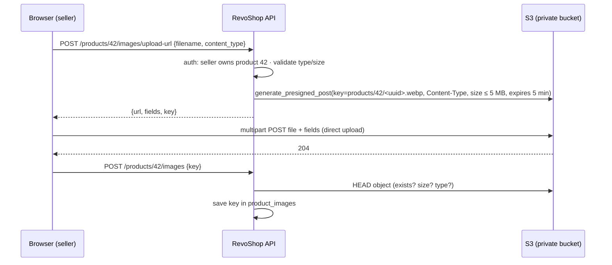

::part[Learn the Concept]{n="1"}

## 🎯 What you'll learn

- **S3** concepts: buckets, keys, prefixes, storage classes, consistency
- Keeping buckets private: **Block Public Access**, bucket policies, encryption, TLS-only access
- **Versioning** and **lifecycle rules**
- **Presigned URLs**: direct browser uploads (POST/PUT) and time-limited downloads
- **CORS** for browser uploads
- **CloudFront** in front of S3 with **Origin Access Control**, cache behaviors, cache keys and **invalidations**
- Serving user-uploaded images safely (content types, sizes, image processing)
- Costs: storage, requests, data transfer, CloudFront

## 🧠 The big idea

S3 is a **warehouse with numbered shelves** (keys) that never runs out of space; you don't put a storefront on the warehouse. **CloudFront** is the chain of **convenience stores near every neighborhood**: it keeps popular items on nearby shelves, the warehouse only opens its back door to the store's delivery trucks (Origin Access Control), and customers never walk into the warehouse.

## ❓ Why does this matter?

RevoShop stores product images as URL strings (`product_images.url`). Where do those files live? On the API server's disk, they vanish when the instance is replaced and slow the API when served. S3 + CloudFront is the standard answer for uploads, static assets and backups — and public buckets are one of the most famous sources of data leaks.

## 💥 What happens if we DON'T?

- Uploads stream through gunicorn workers: 20 sellers uploading 5 MB photos block every checkout request.
- A bucket made public "for images" also exposes `exports/users.csv` someone uploaded later.
- Users upload `evil.html` served from your domain with `text/html` → stored XSS.
- Every product page downloads full-size 4 MB images from the Singapore region to phones in Makassar.

## 📖 How it works, step by step

### 1. S3 basics

| Concept | Detail |
|---|---|
| Bucket | globally unique name, lives in one region |
| Key | the object's full name: `products/42/9f1c….webp` (prefixes look like folders) |
| Object size | up to 5 TB; multipart upload for large files |
| Consistency | strong read-after-write for new objects, overwrites and deletes |
| Storage classes | Standard, Intelligent-Tiering, Standard-IA, Glacier tiers — cheaper storage, costlier/slower access |

### 2. Private by default

- **Block Public Access** on (account and bucket level) — all four settings.
- **Bucket owner enforced** object ownership (ACLs disabled).
- Default encryption **SSE-S3** (or SSE-KMS when you need key control and audit).
- A bucket policy that **denies non-TLS** requests (`aws:SecureTransport = false`).
- Access through **IAM roles** (your API's task/instance role) and **CloudFront OAC** — not public ACLs.

### 3. Versioning and lifecycle

- **Versioning** keeps previous versions after overwrite/delete (protection against mistakes and ransomware-style deletes).
- **Lifecycle rules**: expire noncurrent versions after N days, abort incomplete multipart uploads, move old logs/backups to cheaper classes, delete temporary uploads.

### 4. Presigned uploads: the browser talks to S3



```python
post = s3.generate_presigned_post(
    Bucket=bucket,
    Key=f"products/{product_id}/{uuid4().hex}.webp",
    Fields={"Content-Type": "image/webp"},
    Conditions=[{"Content-Type": "image/webp"}, ["content-length-range", 1, 5_000_000]],
    ExpiresIn=300,
)
```

- **Presigned POST** can enforce size and content type conditions; presigned PUT can't enforce size.
- Generate keys server-side (never trust the user's filename).
- **Confirm** the upload before saving (HEAD the object; optionally process it).
- Images from users should be **re-encoded** (e.g. a Lambda or worker creating WebP thumbnails, stripping EXIF metadata such as GPS location) and served with safe `Content-Type`s — never `text/html` or `image/svg+xml` from user uploads.

**Presigned GET** gives time-limited downloads for private files (invoices, exports).

### 5. CORS for browser uploads

```json
[{
  "AllowedOrigins": ["https://shop.example.com"],
  "AllowedMethods": ["POST"],
  "AllowedHeaders": ["*"],
  "MaxAgeSeconds": 3000
}]
```

Only your frontend origins; never `*` for upload buckets.

### 6. CloudFront in front of S3

| Piece | Setting |
|---|---|
| Origin | the S3 bucket (REST endpoint), **Origin Access Control** (OAC) — bucket policy allows only this distribution |
| Viewer protocol | redirect HTTP → HTTPS |
| Cache policy | e.g. `CachingOptimized` for immutable images |
| Response headers policy | security headers, `Cache-Control` |
| Alternate domain | `images.revoshop.example.com` with an **ACM certificate in us-east-1** (CloudFront requirement) |
| Price class | limit edge locations to reduce cost if needed |

```json
{
  "Sid": "AllowCloudFrontServicePrincipalReadOnly",
  "Effect": "Allow",
  "Principal": {"Service": "cloudfront.amazonaws.com"},
  "Action": "s3:GetObject",
  "Resource": "arn:aws:s3:::revoshop-images/*",
  "Condition": {"StringEquals": {"AWS:SourceArn": "arn:aws:cloudfront::123456789012:distribution/E2ABCDEF"}}
}
```

### 7. Caching and invalidation

- Use **immutable keys** (a new UUID or content hash per upload) and long `Cache-Control: public, max-age=31536000, immutable` → no invalidations needed.
- For files that keep their name (e.g. `index.html`), use short TTLs or **invalidations** (`/index.html`); a monthly number of invalidation paths is free, beyond that they cost.
- The **cache key** (URL + chosen headers/cookies/query strings) decides what's shared — never cache per-user responses under a shared key.

### 8. Costs

| Item | Notes |
|---|---|
| S3 storage | per GB-month by class |
| Requests | per 1,000 PUT/POST/LIST and GET |
| Data transfer | S3 → internet is billed; S3 → CloudFront is free; CloudFront → users billed per GB (CloudFront has an always-free monthly allowance — check current terms) |
| Versioning | old versions are stored objects too — use lifecycle rules |

## ⚖️ Trade-offs

| Choice | ✅ | ❌ |
|---|---|---|
| Presigned direct upload | API stays fast, scales | two-step flow, confirmation logic |
| Upload through API | simple validation in one place | ties up workers, bandwidth and memory |
| CloudFront + OAC | fast, private bucket, TLS on your domain | setup, cache invalidation thinking |
| Public bucket website | quick | no HTTPS on custom domains, leaks risk, no caching control |
| SSE-KMS | key policies, audit | KMS request costs, more configuration |

## ✅ When to use it / 🚫 When NOT to use it

- ✅ User uploads, static assets, backups, exports, logs.
- ✅ CloudFront for anything browsers download repeatedly.
- 🚫 Don't use S3 as a database or for files that need POSIX file locking.
- 🚫 Don't make buckets public; don't serve user-uploaded HTML/SVG from your main domain.

## 🏆 Best practices

- [ ] Block Public Access on; ACLs disabled; encryption on; TLS-only bucket policy.
- [ ] Least-privilege IAM for the app (only its prefixes); OAC for CloudFront.
- [ ] Server-generated keys; presigned POST with type and size conditions; short expiry.
- [ ] Confirm uploads; process/re-encode user images; strip metadata.
- [ ] Versioning + lifecycle rules (noncurrent versions, incomplete multipart uploads).
- [ ] Immutable object keys with long cache headers; invalidations only for mutable paths.
- [ ] Tight CORS origins.
- [ ] Separate buckets per purpose/environment (images, backups, logs).

## 🏭 How it's used in industry

- Marketplaces and social apps upload media directly to object storage with presigned URLs, then process asynchronously into thumbnails and formats.
- CDNs (CloudFront, Cloudflare, Fastly) serve most static and media traffic on the web.
- Accidentally public S3 buckets have caused many publicized data exposures, which is why AWS turned on Block Public Access for new buckets by default.

## ⚠️ Common mistakes

- Presigned PUT without size limits → a "profile photo" becomes a 5 GB upload.
- CORS `AllowedOrigins: ["*"]` with credentials.
- Forgetting the ACM certificate for CloudFront must be in `us-east-1`.
- Caching API responses with user data in CloudFront.

:::revoshop
1. **Today's model.** `app/models/product_images.py` stores `url = db.Column(db.String(500))`, and `POST` in `app/routes/product_images.py` accepts that URL from the client. Anyone can point product images at any site. Redesign: store an S3 **key** (and maybe `content_type`, `size_bytes`, `width`/`height`) and build public URLs from a configured CloudFront domain. Write the Alembic migration plan (expand → backfill → contract).
2. **Two new endpoints.** Design `POST /api/v1/products/<id>/images/upload-url` (seller must own the product — reuse your ownership checks) and `POST /api/v1/products/<id>/images` that confirms a key. Use `presigned_upload()` from exercise 05 for the first one. What do you check in the confirm step?
3. **Permissions.** Which S3 actions does the API role need (hint: generating a presigned POST needs no S3 API call, but the **signing role** must be allowed `s3:PutObject` on `products/*`; confirming needs `s3:GetObject`/`HeadObject`)? Write the policy scoped to `arn:aws:s3:::revoshop-images-<env>/products/*`.
4. **Delivery.** Product listings (`ProductList` in `app/routes/products.py`) return image URLs for many products. With CloudFront + immutable keys, what `Cache-Control` do the images get, and why will you never need an invalidation when a seller replaces an image?
5. **Safety.** A seller uploads `photo.jpg` that is really an HTML file. Which parts of your design stop it from becoming stored XSS?
:::

::part[Explain & Design]{n="2"}

## 🗣️ Explain it

Explain the warehouse and convenience-store analogy, and why the warehouse should only open its back door to the stores' trucks.

## 📐 Design it

Design RevoShop's media pipeline: buckets (names, regions, settings), key layout, upload flow with presigned POST, validation and processing (thumbnails), CloudFront distribution and cache policy, CORS, IAM permissions for the API and the image processor, lifecycle rules, and deletion when a product is removed.

:::quiz
Show a possible design

- **Buckets:** `revoshop-uploads-prod` (private, versioning, 7-day lifecycle on `incoming/`), `revoshop-images-prod` (private, versioning, noncurrent 30 days), both Block Public Access, SSE-S3, TLS-only policy, same region as the API.
- **Keys:** `incoming/{product_id}/{uuid}` (raw uploads) → processed to `products/{product_id}/{uuid}/{size}.webp` (`thumb`, `medium`, `large`).
- **Upload:** API issues presigned POST for `incoming/…` (content types jpeg/png/webp, ≤ 5 MB, 5 min expiry) after checking seller ownership.
- **Processing:** S3 event → SQS → Lambda (Week 4) using Pillow: verify it's really an image, strip EXIF, resize to three WebP sizes, write to the images bucket, call the API (or write to the DB via a queue) to mark the image ready; failures to a DLQ.
- **Delivery:** CloudFront `images.revoshop.example.com` (ACM cert in us-east-1), OAC on `revoshop-images-prod`, `CachingOptimized`, `Cache-Control: public, max-age=31536000, immutable` set on objects, security headers policy (`X-Content-Type-Options: nosniff`).
- **CORS:** uploads bucket allows `POST` from `https://shop.revoshop.example.com` only.
- **IAM:** API role `s3:PutObject` on `revoshop-uploads-prod/incoming/*` (for signing), `s3:DeleteObject` on `revoshop-images-prod/products/*`; processor role `s3:GetObject` on `incoming/*`, `s3:PutObject` on `products/*`.
- **Deletion:** when a product/image is removed, delete the object keys (versioning keeps a recovery window for 30 days) — no invalidation needed because keys are never reused.
:::

### 📝 Self-review checklist

- [ ] Bucket never public; CloudFront uses OAC
- [ ] Upload size/type enforced before bytes arrive
- [ ] User files can't execute as HTML on your domain

::ai-review{task="design"}

::part[Toy Exercise]{n="3"}

:::exercise{path="exercises/m5/w3/05-s3-uploads-and-rds-secrets" ai="no-ai" title="Private S3 uploads and RDS credentials"}
If you haven't yet: configure a locked-down bucket with boto3 against moto, generate safe keys and presigned POST uploads with size and content-type conditions, and build a database URL from an RDS-managed secret.
:::

:::hints
- The policy you attach denies insecure transport for **both** the bucket ARN and `bucket/*`.
- Compare the content type against the extension **before** generating the key.
:::

## ✅ Quick check

:::quiz
Why use a new key for every uploaded image instead of overwriting `products/42/main.webp`?

Immutable keys can be cached forever by browsers and CloudFront; overwriting a key forces cache invalidations and can show stale images.
:::

:::quiz
What does Origin Access Control change about the S3 bucket?

The bucket stays private: its policy allows `s3:GetObject` only to the CloudFront service principal for your specific distribution, so users can't bypass the CDN to read objects directly.
:::

## 📖 Kamus (glossary)

| Term | Bahasa Indonesia |
|---|---|
| Object storage | Penyimpanan objek |
| Presigned URL | URL bertanda tangan sementara |
| CDN | Jaringan pengiriman konten |
| Origin | Sumber asli konten di belakang CDN |
| Cache invalidation | Pembatalan cache |
| Lifecycle rule | Aturan siklus hidup objek |

## 📚 Keep learning

- [AWS docs: Blocking public access to S3](https://docs.aws.amazon.com/AmazonS3/latest/userguide/access-control-block-public-access.html) · [Uploading objects with presigned URLs](https://docs.aws.amazon.com/AmazonS3/latest/userguide/PresignedUrlUploadObject.html)
- [AWS docs: Restricting access to an S3 origin with OAC](https://docs.aws.amazon.com/AmazonCloudFront/latest/DeveloperGuide/private-content-restricting-access-to-s3.html)
- [boto3: generate_presigned_post](https://boto3.amazonaws.com/v1/documentation/api/latest/reference/services/s3/client/generate_presigned_post.html)
