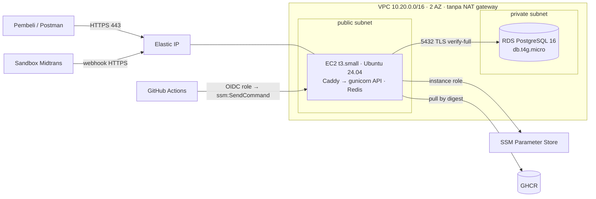

## 🎯 Target

RevoShop berjalan di AWS dengan URL HTTPS asli yang bisa dipanggil Midtrans, database PostgreSQL terkelola yang dibuat backup, **tanpa port SSH dan tanpa access key di mesin mana pun**, dan deploy langsung dari GitHub Actions — dengan biaya yang sudah kamu hitung sebelum klik apa pun.

Anggap materi ini seperti memindahkan toko dari ruang keluarga ke unit yang disewa: tokonya sama, tapi sekarang punya alamat asli, kunci yang benar, dan pemilik yang membuat backup.



## 🔤 Istilah penting

| Istilah | Artinya (sederhana) |
|---|---|
| **Elastic IP** | Alamat publik yang tetap, sehingga URL tetap bekerja saat server diganti |
| **Public / private subnet** | Bagian jaringan yang bisa jangkau internet / yang tidak bisa |
| **Instance role** | Role IAM yang terpasang di server, sehingga tidak perlu simpan AWS key di sana |
| **SSM Parameter Store** | Tempat AWS untuk simpan pengaturan dan rahasia, dibaca oleh role tersebut |
| **Session Manager** | Terminal di server lewat AWS, tanpa port SSH yang terbuka |
| **`ssm:SendCommand`** | Cara GitHub Actions menjalankan script deploy di server tanpa SSH |
| **Least-privilege DB user** | Login database untuk aplikasi yang bisa ubah data tapi tidak bisa ubah skema |
| **Teardown** | Hapus semua yang kamu buat, supaya biaya tidak terus jalan |

:::danger[Biaya itu nyata]
Buat budget dan alert **sebelum** apa pun (materi 01). Dengan harga contoh dari latihan 02 desain ini kira-kira **USD 35/bulan** (t3.small ≈ 15, RDS ≈ 14, public IPv4 ≈ 3,65, storage dan satu secret) di region US (lebih mahal di Singapore/Jakarta); di **plan Gratis** kamu pakai credit dan tidak bisa ditagih, tapi ingat plan itu berakhir setelah enam bulan atau saat credit habis lalu akun **ditutup**. Ikuti bagian teardown saat sudah selesai, atau simpan hanya yang dipakai Week 4 (VPC dan RDS).
:::

## 🧭 Checkpoint

### C0 · Baseline akun (1 h)

Ikuti checklist materi 01 secara berurutan, dan catat apa yang kamu lakukan di `docs/aws-runbook.md`:

1. Pilih **plan Gratis** atau **plan Berbayar** dengan sadar. Jangan gabung AWS Organizations di plan Gratis.
2. Root: MFA, tanpa access key, kontak alternatif.
3. User IAM `<kamu>-admin` dengan MFA, `AdministratorAccess`, **tanpa access key**.
4. Budget (misal USD 15) dengan alert di 50/80/100% aktual dan 100% forecast; alert free tier; Cost Anomaly Detection.
5. Pilih region: `ap-southeast-1` (Singapore, sudah aktif) atau `ap-southeast-3` (Jakarta, **aktifkan dulu** di Account → AWS Regions). Perintah di bawah pakai `REGION=ap-southeast-1`.
6. Di Mac-mu:

```bash
brew install awscli
brew install --cask session-manager-plugin
aws login --region ap-southeast-1
aws sts get-caller-identity
export REGION=ap-southeast-1 ACCOUNT_ID=$(aws sts get-caller-identity --query Account --output text)
```

### C1 · Jaringan tanpa tagihan NAT (45 min)

Rencananya: server duduk di pinggir jalan (public subnet) di belakang security group yang ketat, dan database duduk di ruang belakang tanpa pintu ke jalan (private subnet). Itu membuat database aman **dan** tidak perlu bayar NAT gateway.

Console → VPC → **Create VPC → VPC and more**:

| Pengaturan | Nilai |
|---|---|
| Name tag | `revoshop` |
| IPv4 CIDR | `10.20.0.0/16` (rencana dari RevoShop box materi 02) |
| AZ | 2 |
| Public subnet | 2 · Private subnet | 2 |
| **NAT gateway** | **Tidak ada** |
| VPC endpoint | **S3 Gateway** (gratis) |
| DNS hostname + resolusi | aktif |

Security group (VPC → Security group):

| Nama | Inbound | Catatan |
|---|---|---|
| `revoshop-web` | TCP 80 dan 443 dari `0.0.0.0/0` dan `::/0` | **tanpa port 22** |
| `revoshop-db` | TCP 5432 dari **`revoshop-web`** (referensi security group) | tidak ada lagi |

Cek rencanamu dengan `can_reach()` dari latihan 03 sebelum lanjut.

### C2 · RDS PostgreSQL (45 min, plus ~15 min pembuatan)

RDS → **Create database → Standard create**:

| Pengaturan | Nilai |
|---|---|
| Engine | PostgreSQL **16.x** |
| Template | Free tier / Dev-Test |
| Identifier | `revoshop-prod` |
| Credentials | master user `revoshop_admin`, **Kelola di AWS Secrets Manager** |
| Class | `db.t4g.micro` |
| Storage | gp3 20 GiB, autoscaling max 50 GiB |
| Availability | Single-AZ (belajar) |
| Connectivity | VPC `revoshop`, **Public access: Tidak**, DB subnet group baru dari dua private subnet, security group `revoshop-db` saja |
| Database authentication | password |
| Initial database name | `revoshop` |
| Backup | 7 hari · Encryption: aktif · **Deletion protection: aktif** |
| Performance Insight / Enhanced Monitoring | matikan untuk sekarang (biaya) |

**TLS di image.** Download RDS global CA bundle **sekali** di laptop dan commit, supaya build tetap bisa diulang:

```bash
mkdir -p certs
curl -fsSL -o certs/rds-global-bundle.pem https://truststore.pki.rds.amazonaws.com/global/global-bundle.pem
```

```dockerfile
# Dockerfile, prod stage (next to the other COPY lines)
COPY --chown=app:app certs/rds-global-bundle.pem /etc/ssl/certs/rds-global-bundle.pem
```

Tambah pengaturan pool ke `ProductionConfig` (RevoShop box materi 04): `pool_size=3`, `max_overflow=2`, `pool_pre_ping=True`, `pool_recycle=1800`. Gabung, dan biarkan CI terbitkan image baru.

### C3 · Rahasia di SSM Parameter Store (30 min)

Daripada salin rahasia ke server, kamu letakkan di laci terkunci (Parameter Store) dan beri server lencana yang buka hanya laci itu.

EC2 instance akan baca `/revoshop/production/*` dan tulis ke `/opt/revoshop/.env.production` (mode `600`) saat deploy.

```bash
# RDS endpoint and the managed master secret
DB_HOST=$(aws rds describe-db-instances --db-instance-identifier revoshop-prod --query 'DBInstances[0].Endpoint.Address' --output text --region $REGION)
SECRET_ARN=$(aws rds describe-db-instances --db-instance-identifier revoshop-prod --query 'DBInstances[0].MasterUserSecret.SecretArn' --output text --region $REGION)

# For the first deploy the app uses the master user; C7 switches to a least-privilege app user.
DB_PASSWORD=$(aws secretsmanager get-secret-value --secret-id "$SECRET_ARN" --query SecretString --output text --region $REGION | python3 -c 'import json,sys,urllib.parse; print(urllib.parse.quote(json.load(sys.stdin)["password"], safe=""))')

put() { aws ssm put-parameter --region $REGION --overwrite --type SecureString --name "/revoshop/production/$1" --value "$2" >/dev/null && echo "stored $1"; }
put DATABASE_URL "postgresql://revoshop_admin:${DB_PASSWORD}@${DB_HOST}:5432/revoshop?sslmode=verify-full&sslrootcert=/etc/ssl/certs/rds-global-bundle.pem"
put JWT_SECRET_KEY "$(openssl rand -hex 32)"
read -rs -p "Midtrans SANDBOX server key: " MIDTRANS_SERVER_KEY; echo
put MIDTRANS_SERVER_KEY "$MIDTRANS_SERVER_KEY"
put MIDTRANS_IS_PRODUCTION "false"
unset DB_PASSWORD MIDTRANS_SERVER_KEY
```

`read -s` simpan key keluar dari terminal dan shell history-mu. Parameter standar gratis; SecureString pakai AWS-managed KMS key.

### C4 · Instance role (20 min)

IAM → Roles → **Create role** → trusted entity **EC2** → nama `revoshop-ec2`:
- managed policy **`AmazonSSMManagedInstanceCore`**
- inline policy `read-revoshop-parameters`:

```json
{
  "Version": "2012-10-17",
  "Statement": [
    {
      "Effect": "Allow",
      "Action": ["ssm:GetParametersByPath", "ssm:GetParameter", "ssm:GetParameters"],
      "Resource": "arn:aws:ssm:ap-southeast-1:<ACCOUNT_ID>:parameter/revoshop/production/*"
    },
    {
      "Effect": "Allow",
      "Action": "ssm:GetParametersByPath",
      "Resource": "arn:aws:ssm:ap-southeast-1:<ACCOUNT_ID>:parameter/revoshop/production"
    },
    {
      "Effect": "Allow",
      "Action": "kms:Decrypt",
      "Resource": "*",
      "Condition": {"StringEquals": {"kms:ViaService": "ssm.ap-southeast-1.amazonaws.com"}}
    }
  ]
}
```

Jalankan lewat `review()` dari latihan 01 — `kms:Decrypt` di `*` bisa diterima hanya karena kondisi membatasinya ke SSM.

### C5 · Luncurkan EC2 instance (45 min)

Semua yang server butuhkan untuk setup diri sendiri masuk ke user data, jadi instance ini bisa diganti — mobil rental, bukan peliharaan.

Generate user data dengan latihan 04 dan tambah AWS CLI (dibutuhkan `fetch-env.sh`):

```bash
cd ~/Documents/LEARNING/Programming/Fullstack-Flask-React/fsse-handbook/exercises
uv run python -c 'import sys; sys.path.insert(0, "m5/w3/04-ec2-cloud-init"); from user_data import render_user_data; print(render_user_data(deploy_user="deploy", swap_gb=1))' > /tmp/revoshop-user-data.yaml
printf -- '- [snap, install, aws-cli, --classic]\n' >> /tmp/revoshop-user-data.yaml   # appended to runcmd (the last key, items at column 0)
python3 -c 'import yaml; print(yaml.safe_load(open("/tmp/revoshop-user-data.yaml"))["runcmd"][-1])'   # → ['snap', 'install', 'aws-cli', '--classic']
```

EC2 → **Launch instance**:

| Pengaturan | Nilai |
|---|---|
| Name | `revoshop-prod-1` (+ tag `Project=revoshop`, `Env=production`) |
| AMI | Ubuntu Server 24.04 LTS, **x86_64** (CI-mu build `linux/amd64`) |
| Type | `t3.small` |
| Key pair | **Proceed without a key pair** |
| Network | VPC `revoshop`, **public** subnet, auto-assign public IP **dimatikan** (nanti pasang Elastic IP), security group `revoshop-web` |
| Storage | 20 GiB gp3, encrypted |
| Advanced → IAM instance profile | `revoshop-ec2` |
| Advanced → Metadata version | **V2 only**, hop limit **2** |
| Advanced → Termination protection | aktif |
| Advanced → User data | isi `/tmp/revoshop-user-data.yaml` |

Lalu **Elastic IP → Allocate → Associate** dengan instance. Hubungkan:

```bash
aws ssm start-session --target <instance-id> --region $REGION
sudo cloud-init status --wait && docker --version && aws --version
```

### C6 · Deploy file dan deploy pertama (1 h)

Tambah tiga file ini ke repo RevoShop-mu (branch `deploy/aws-ec2`) — sudah diuji end-to-end dengan local registry dan database, termasuk deploy yang gagal lalu rollback.

**`compose.aws.yaml`**

```yaml
# RevoShop on a single EC2 instance: PostgreSQL lives in RDS.
#   /opt/revoshop/deploy/deploy.sh <image@digest>
name: revoshop

x-app: &app
  image: ${API_IMAGE:?set API_IMAGE}
  env_file: [.env.production]          # written from SSM Parameter Store by deploy/fetch-env.sh
  environment:
    APP_ENV: production
    REDIS_URL: redis://redis:6379/0
  networks: [backend]

services:
  proxy:
    image: caddy:2-alpine
    restart: unless-stopped
    ports: ["80:80", "443:443"]
    environment:
      SITE_ADDRESS: ${SITE_ADDRESS:?set SITE_ADDRESS}
    volumes:
      - ./Caddyfile:/etc/caddy/Caddyfile:ro
      - caddy_data:/data
      - caddy_config:/config
    depends_on:
      api:
        condition: service_healthy
    networks: [frontend]

  api:
    <<: *app
    restart: unless-stopped
    environment:
      APP_ENV: production
      REDIS_URL: redis://redis:6379/0
      WEB_CONCURRENCY: ${WEB_CONCURRENCY:-2}
      FORWARDED_ALLOW_IPS: "*"
    depends_on:
      redis:
        condition: service_healthy
    networks: [frontend, backend]
    read_only: true
    tmpfs: [/tmp]
    cap_drop: [ALL]
    security_opt: ["no-new-privileges:true"]
    deploy:
      resources:
        limits: { memory: 900M }

  migrate:
    <<: *app
    command: ["flask", "db", "upgrade"]
    restart: "no"
    profiles: [ops]                       # only runs when deploy.sh asks for it

  redis:
    image: redis:8-alpine
    restart: unless-stopped
    command: ["redis-server", "--maxmemory", "96mb", "--maxmemory-policy", "allkeys-lru"]
    healthcheck:
      test: ["CMD", "redis-cli", "ping"]
      interval: 5s
      timeout: 3s
      retries: 10
    networks: [backend]

networks:
  frontend:
  backend:

volumes:
  caddy_data:
  caddy_config:
```

**`deploy/fetch-env.sh`**

```bash
#!/usr/bin/env bash
# Write .env.production from SSM Parameter Store: /revoshop/<env>/NAME → NAME=value
# Uses the EC2 instance role — no keys on the server.
set -euo pipefail
ENVIRONMENT="${1:?usage: fetch-env.sh <environment> [output]}"
OUTPUT="${2:-/opt/revoshop/.env.production}"
PREFIX="/revoshop/${ENVIRONMENT}/"

tmp="$(mktemp)"
trap 'rm -f "$tmp"' EXIT
umask 077

aws ssm get-parameters-by-path --path "$PREFIX" --with-decryption --recursive \
  --query 'Parameters[].[Name,Value]' --output text |
while IFS=$'\t' read -r name value; do
  key="${name#"$PREFIX"}"
  [[ "$key" =~ ^[A-Z][A-Z0-9_]*$ ]] || { echo "skipping unexpected parameter name: $name" >&2; continue; }
  printf '%s=%s\n' "$key" "$value"
done > "$tmp"

for required in DATABASE_URL JWT_SECRET_KEY; do
  grep -q "^${required}=" "$tmp" || { echo "missing ${PREFIX}${required}" >&2; exit 1; }
done
mv "$tmp" "$OUTPUT"
chmod 600 "$OUTPUT"
echo "wrote $(wc -l < "$OUTPUT") variables to $OUTPUT"
```

**`deploy/deploy.sh`**

```bash
#!/usr/bin/env bash
# Deploy a RevoShop image by digest on this EC2 host, with automatic rollback.
#   deploy.sh ghcr.io/<you>/revoshop@sha256:…
set -euo pipefail
IMAGE="${1:?usage: deploy.sh <image@sha256:digest>}"
[[ "$IMAGE" == *@sha256:* ]] || { echo "deploy by digest, not by tag" >&2; exit 1; }

APP_DIR="${APP_DIR:-/opt/revoshop}"
ENVIRONMENT="${ENVIRONMENT:-production}"
HEALTH_URL="${HEALTH_URL:-https://${SITE_ADDRESS:?set SITE_ADDRESS}/api/v1/health}"
cd "$APP_DIR"

compose() { API_IMAGE="$1" docker compose -f compose.aws.yaml "${@:2}"; }
previous="$(cat .deployed-image 2>/dev/null || true)"

echo "→ refreshing configuration from SSM"
"$APP_DIR/deploy/fetch-env.sh" "$ENVIRONMENT" "$APP_DIR/.env.production"

if [[ "${SKIP_PULL:-0}" != "1" ]]; then
  echo "→ pulling $IMAGE"
  docker pull "$IMAGE"
fi

echo "→ running migrations"
compose "$IMAGE" --profile ops run --rm migrate

echo "→ starting new version"
healthy=0
if compose "$IMAGE" up -d --remove-orphans; then        # fails if the api container never becomes healthy
  for _ in $(seq 1 40); do
    if curl -fsS --max-time 5 "$HEALTH_URL" >/dev/null 2>&1; then healthy=1; break; fi
    sleep 3
  done
fi

if [[ "$healthy" == "1" ]]; then
  echo "$IMAGE" > .deployed-image
  echo "$(date -u +%FT%TZ) $IMAGE" >> .deploy-history
  docker image prune -f --filter "until=168h" >/dev/null
  echo "✓ deployed $IMAGE"
  exit 0
fi

echo "✗ health check failed" >&2
compose "$IMAGE" logs --tail 100 api >&2 || true
if [[ -n "$previous" ]]; then
  echo "↩ rolling back to $previous" >&2
  compose "$previous" up -d --remove-orphans
fi
exit 1
```

Tambah `.env.production`, `.deployed-image` dan `.deploy-history` ke `.gitignore`. Untuk HTTPS, perpanjang blok `header` Caddyfile dengan `Strict-Transport-Security "max-age=31536000"` (hanya saat domain sudah kerja).

**Akses registry.** Atau buat GHCR package **publik** (Package settings → Change visibility; image tidak punya secret secara rancangan), atau simpan privat: simpan token read-only di `/revoshop/registry/GHCR_TOKEN` (bukan di `/production/`, jadi tidak masuk environment aplikasi), izinkan instance role baca, dan tambah sebelum `docker pull` di `deploy.sh`:

```bash
aws ssm get-parameter --name /revoshop/registry/GHCR_TOKEN --with-decryption --query Parameter.Value --output text \
  | docker login ghcr.io -u <your-github-username> --password-stdin
```

**Di instance** (Session Manager):

```bash
sudo -iu deploy
cd /opt/revoshop
git clone --depth 1 https://github.com/<you>/revoshop.git src      # private repo: paste the 3 files + Caddyfile instead
cp -r src/deploy src/compose.aws.yaml src/Caddyfile .
echo 'SITE_ADDRESS=api.<your-domain>' > .site && set -a && . ./.site && set +a
./deploy/deploy.sh ghcr.io/<you>/revoshop@sha256:<digest-from-the-CI-build-job>
```

Belum punya domain? Pakai `SITE_ADDRESS=api-<elastic-ip-dengan-garis>>.sslip.io` (misal `api-203-0-113-10.sslip.io`) — Caddy dapat sertifikat asli. Dapat domain asli sebelum bagikan URL luas-luas (shared rate limit berlaku untuk hostname seperti ini).

### C7 · User database dengan least privilege (30 min)

Aplikasi harus jadi kasir, bukan pemilik toko: bisa tambah dan baca baris, tapi tidak bisa drop tabel. Migrasi pakai login owner, hanya saat deploy.

Buka tunnel dari laptop lewat instance:

```bash
aws ssm start-session --region $REGION --target <instance-id> \
  --document-name AWS-StartPortForwardingSessionToRemoteHost \
  --parameters "{\"host\":[\"$DB_HOST\"],\"portNumber\":[\"5432\"],\"localPortNumber\":[\"5494\"]}"
```

Di terminal lain, hubungkan dengan master password dari Secrets Manager (`psql "postgresql://revoshop_admin@localhost:5494/revoshop?sslmode=require"`) dan buat `revoshop_app`:

```sql
CREATE ROLE revoshop_app LOGIN PASSWORD '<generated with openssl rand -hex 24>';
GRANT CONNECT ON DATABASE revoshop TO revoshop_app;
GRANT USAGE ON SCHEMA public TO revoshop_app;
GRANT SELECT, INSERT, UPDATE, DELETE ON ALL TABLES IN SCHEMA public TO revoshop_app;
GRANT USAGE, SELECT ON ALL SEQUENCES IN SCHEMA public TO revoshop_app;
ALTER DEFAULT PRIVILEGES FOR ROLE revoshop_admin IN SCHEMA public GRANT SELECT, INSERT, UPDATE, DELETE ON TABLES TO revoshop_app;
ALTER DEFAULT PRIVILEGES FOR ROLE revoshop_admin IN SCHEMA public GRANT USAGE, SELECT ON SEQUENCES TO revoshop_app;
```

Migrasi tetap butuh owner. Simpan master URL terpisah dan beri `migrate` akses read:

1. `aws ssm put-parameter --type SecureString --name /revoshop/production-migrate/DATABASE_URL --value "<master URL dari C3>"` dan izinkan instance role `ssm:GetParameter` di `parameter/revoshop/production-migrate/*`.
2. Arahkan `/revoshop/production/DATABASE_URL` ke `revoshop_app`.
3. Di `deploy.sh`, ganti baris migrasi dengan:

```bash
MIGRATE_URL="$(aws ssm get-parameter --name "/revoshop/${ENVIRONMENT}-migrate/DATABASE_URL" --with-decryption --query Parameter.Value --output text)"
compose "$IMAGE" --profile ops run --rm -e DATABASE_URL="$MIGRATE_URL" migrate
```

Deploy ulang digest yang sama dan cek API kerja dengan hak yang lebih kecil (coba buat order). Seed data demo dengan `seeders/seeders.py` hanya jika environment ini untuk demo.

### C8 · DNS, HTTPS dan Midtrans (45 min)

1. DNS: record `A` `api.<domain>` → Elastic IP (Route 53 hosted zone atau DNS registrar-mu).
2. `curl -I https://api.<domain>/api/v1/health` → `200`, sertifikat asli; `curl -I http://api.<domain>/api/v1/health` → `308` redirect.
3. Dashboard Midtrans **sandbox** → Settings → Payment → **Notification URL**: `https://api.<domain>/api/v1/payments/webhook/midtrans`.
4. Buat order dan bayar dengan metode sandbox; lihat `docker compose -f compose.aws.yaml logs -f api` untuk webhook dan perubahan status pembayaran.
5. Dari laptop-mu:

```bash
REVOSHOP_URL=https://api.<domain> REVOSHOP_EXPECT_HTTPS=1 uv run pytest m5/w1/05-revoshop-smoke -v
```

### C9 · Deploy dari GitHub Actions lewat SSM (1 h)

Buat OIDC role `revoshop-gha-production` (materi Week 2 lesson 04) dengan trust `sub = repo:<kamu>/revoshop:environment:production` dan permission policy ini:

```json
{
  "Version": "2012-10-17",
  "Statement": [
    {
      "Effect": "Allow",
      "Action": "ssm:SendCommand",
      "Resource": [
        "arn:aws:ec2:ap-southeast-1:<ACCOUNT_ID>:instance/<instance-id>",
        "arn:aws:ssm:ap-southeast-1::document/AWS-RunShellScript"
      ]
    },
    { "Effect": "Allow", "Action": ["ssm:GetCommandInvocation", "ssm:ListCommandInvocations"], "Resource": "*" }
  ]
}
```

Ganti SSH step di `.github/workflows/deploy.yml` dengan:

```yaml
      - uses: aws-actions/configure-aws-credentials@cbe3b392738ccf3f987d68400dafcf4b0624a56c # v6.2.4
        with:
          role-to-assume: ${{ vars.AWS_ROLE_ARN }}
          aws-region: ${{ vars.AWS_REGION }}
      - name: Deploy through Session Manager
        env:
          IMAGE: ${{ inputs.image }}
          INSTANCE_ID: ${{ vars.INSTANCE_ID }}
          SITE: ${{ vars.SITE_ADDRESS }}
        run: |
          [[ "$IMAGE" =~ ^[a-z0-9./-]+@sha256:[a-f0-9]{64}$ ]] || { echo "unexpected image reference"; exit 1; }
          [[ "$SITE" =~ ^[a-z0-9.-]+$ ]] || { echo "unexpected site address"; exit 1; }
          COMMAND="sudo -iu deploy bash -c 'cd /opt/revoshop && SITE_ADDRESS=$SITE ./deploy/deploy.sh $IMAGE'"
          PARAMS=$(python3 -c 'import json,sys; print(json.dumps({"commands": [sys.argv[1]], "executionTimeout": ["900"]}))' "$COMMAND")
          COMMAND_ID=$(aws ssm send-command --instance-ids "$INSTANCE_ID" --document-name AWS-RunShellScript \
            --parameters "$PARAMS" --comment "revoshop deploy" --query Command.CommandId --output text)
          aws ssm wait command-executed --command-id "$COMMAND_ID" --instance-id "$INSTANCE_ID" || true
          aws ssm get-command-invocation --command-id "$COMMAND_ID" --instance-id "$INSTANCE_ID" \
            --query '{Status:Status,Output:StandardOutputContent,Errors:StandardErrorContent}' --output json
          STATUS=$(aws ssm get-command-invocation --command-id "$COMMAND_ID" --instance-id "$INSTANCE_ID" --query Status --output text)
          [[ "$STATUS" == "Success" ]]
```

Atur environment variable `AWS_ROLE_ARN`, `AWS_REGION`, `INSTANCE_ID`, `SITE_ADDRESS`, `APP_URL` di environment `production`, dan `PRODUCTION_ENABLED=true`. Tag `v0.1.0` → approve → lihat deploy dan smoke test.

Validasi image dan site dengan pola ketat sebelum sampai shell command adalah apa yang menjaga langkah ini dari injection.

### C10 · Alarm, backup, runbook (45 min)

- CloudWatch alarm di instance: `StatusCheckFailed_System` ≥ 1 selama 2 menit → aksi **EC2 recover** + email SNS.
- RDS alarm: `FreeStorageSpace` < 4 GiB, `DatabaseConnections` > 60, `CPUCreditBalance` < 20.
- **Drill restore** (RevoShop box materi 04) — catat waktunya.
- `docs/aws-runbook.md`: cara deploy, rollback (`./deploy/deploy.sh <digest sebelumnya dari .deploy-history>`), putar `JWT_SECRET_KEY`, buka tunnel DB, restore RDS, dan baca log.

### C11 · Cek biaya dan rencana teardown (30 min)

Sumber daya cloud yang lupa adalah keran yang tetap mengalir. Lakukan langkah ini walaupun rencana lanjut di Week 4 — kamu harus tahu persis apa yang tetap dan kenapa.

- Setelah 24 jam: Cost Explorer → group by **service** dan by **region**; bandingkan dengan estimate latihan 02. Cek biaya public IPv4 (VPC → Public IP insights).
- **Simpan untuk Week 4?** Simpan VPC, security group, RDS dan SSM parameter. EC2 instance dan Elastic IP akan diganti ECS + ALB.
- **Stop sebentar?** Stop EC2 (Elastic IP dan EBS tetap ditagih) — dan ingat RDS yang stopped **mulai lagi setelah 7 hari**.
- **Teardown** (berurutan): nonaktifkan CI deploy (`PRODUCTION_ENABLED=false`) → terminate EC2 (matikan termination protection) → lepas Elastic IP → RDS: matikan deletion protection, hapus dengan keputusan **final snapshot** → hapus managed secret (scheduled deletion) → SSM parameter → IAM role `revoshop-ec2`, `revoshop-gha-production` → VPC (hapus subnet, security group, S3 endpoint) → DNS record → cek Cost Explorer esok hari.

## ✅ Selesai saat

- [ ] Baseline akun selesai; alert budget tiba di inbox
- [ ] RDS privat dengan TLS `verify-full`; aplikasi pakai user dengan least privilege
- [ ] EC2 tanpa SSH inbound dan tanpa key pair; hanya dijangkau Session Manager
- [ ] `https://api.<domain>` lulus smoke test dengan `REVOSHOP_EXPECT_HTTPS=1`
- [ ] Pembayaran sandbox Midtrans ubah status order lewat webhook
- [ ] Tag deploy lewat GitHub Actions → OIDC → SSM → `deploy.sh`, image buruk rollback otomatis
- [ ] Alarm, drill restore dan runbook ada; biaya sesuai estimate

## 🧠 Kebijakan AI

🤖✅ AI boleh bantu navigasi console dan jelaskan error AWS. 🚫🤖 Jangan paste secret, account ID dengan ARN sumber daya asli yang belum diredaksi, atau isi `.env` ke tool AI mana pun. Tulis runbook sendiri — kamu pakai saat tekanan.

## ❓ Pertanyaan yang mungkin ditanya pewawancara

- Kenapa tidak NAT gateway, dan apa yang berubah untuk production launch?
- Bagaimana instance dapat secret tanpa access key, dan siapa lagi bisa bacanya?
- Cerita deploy dan rollback dari awal. Apa terjadi pada request saat deploy?
- Kenapa `sslmode=verify-full`, dan apa yang `pool_pre_ping` lindungi?
- Bagaimana deploy GitHub Actions dilindungi dari script injection dan repo tidak sah?

## 📣 Bagikan

:::linkedin{type="build"}
☁️ API RevoShop saya live di AWS — dibangun langkah demi langkah, bukan one-click.

- EC2 (tanpa port SSH, tanpa key pair — hanya Session Manager) jalankan Caddy + gunicorn + Redis
- RDS PostgreSQL di private subnet, TLS verify-full, user aplikasi dengan least privilege, dan drill restore berjadwal
- Rahasia di SSM Parameter Store dibaca lewat instance role — tanpa access key di mana pun
- GitHub Actions deploy via image digest lewat OIDC → SSM, dengan health check dan rollback otomatis
- Webhook sandbox Midtrans lewat HTTPS, budget alert, dan perkiraan biaya yang saya cek lawan Cost Explorer

Pelajaran terbesar: [contoh deploy script rollback saya tidak jalan sampai saya test deploy yang gagal sengaja].

Selanjutnya: container di ECS Fargate. 🚢

#AWS #Python #DevOps #CloudComputing #BuildInPublic
:::
