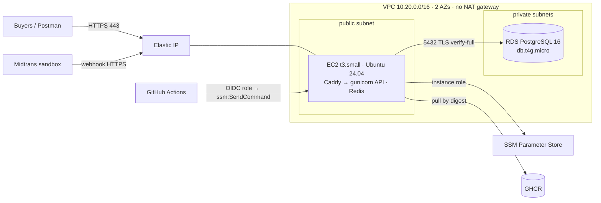

## 🎯 Goal

RevoShop runs on AWS with a real HTTPS URL that Midtrans can call, a managed PostgreSQL database with backups, **no SSH port and no access keys on any machine**, and deploys straight from GitHub Actions — at a cost you worked out before clicking anything.

Think of this lab as moving your shop from your living room into a rented unit: same shop, but now with a real address, a proper lock, and a landlord who keeps backups.



## 🔤 Key words

| Word | In simple words |
|---|---|
| **Elastic IP** | A fixed public address, so your URL keeps working when the server is replaced |
| **Public / private subnet** | A part of your network that can reach the internet / one that cannot |
| **Instance role** | An IAM role attached to the server, so it needs no stored AWS keys |
| **SSM Parameter Store** | AWS's place for settings and secrets, read by that role |
| **Session Manager** | A terminal on the server through AWS, with no SSH port open |
| **`ssm:SendCommand`** | How GitHub Actions runs the deploy script on the server without SSH |
| **Least-privilege DB user** | A database login for the app that can change data but not the schema |
| **Teardown** | Deleting everything you created, so it stops costing money |

:::danger[Costs are real]
Budgets and alerts **before** anything else (lesson 01). With the sample prices from exercise 02 this design is roughly **USD 35/month** (t3.small ≈ 15, RDS ≈ 14, public IPv4 ≈ 3.65, storage and a secret) in a US region (more in Singapore/Jakarta); on the **Free plan** that uses credits and can't bill you, but remember the plan ends after six months or when credits run out and the account then **closes**. Follow the teardown section when you're done, or keep only what Week 4 reuses (the VPC and RDS).
:::

## 🧭 Checkpoints

### C0 · Account baseline (1 h)

Do lesson 01's checklist in order, and write down what you did in `docs/aws-runbook.md`:

1. Choose **Free plan** or **Paid plan** knowingly. Don't join AWS Organizations on a Free plan.
2. Root: MFA, no access keys, alternate contacts.
3. IAM user `<you>-admin` with MFA, `AdministratorAccess`, **no access keys**.
4. Budget (e.g. USD 15) with alerts at 50/80/100% actual and 100% forecasted; free tier usage alerts; Cost Anomaly Detection.
5. Pick a region: `ap-southeast-1` (Singapore, default-enabled) or `ap-southeast-3` (Jakarta, **enable it first** in Account → AWS Regions). The commands below use `REGION=ap-southeast-1`.
6. On your Mac:

```bash
brew install awscli
brew install --cask session-manager-plugin
aws login --region ap-southeast-1
aws sts get-caller-identity
export REGION=ap-southeast-1 ACCOUNT_ID=$(aws sts get-caller-identity --query Account --output text)
```

### C1 · Network without a NAT bill (45 min)

The plan: the server sits on the street side (public subnet) behind a tight security group, and the database sits in a back room with no door to the street (private subnets). That keeps the database safe **and** avoids renting a NAT gateway.

Console → VPC → **Create VPC → VPC and more**:

| Setting | Value |
|---|---|
| Name tag | `revoshop` |
| IPv4 CIDR | `10.20.0.0/16` (the plan from lesson 02's RevoShop box) |
| AZs | 2 |
| Public subnets | 2 · Private subnets | 2 |
| **NAT gateways** | **None** |
| VPC endpoints | **S3 Gateway** (free) |
| DNS hostnames + resolution | enabled |

Security groups (VPC → Security groups):

| Name | Inbound | Notes |
|---|---|---|
| `revoshop-web` | TCP 80 and 443 from `0.0.0.0/0` and `::/0` | **no port 22** |
| `revoshop-db` | TCP 5432 from **`revoshop-web`** (security group reference) | nothing else |

Check your plan with `can_reach()` from exercise 03 before moving on.

### C2 · RDS PostgreSQL (45 min, plus ~15 min creation)

RDS → **Create database → Standard create**:

| Setting | Value |
|---|---|
| Engine | PostgreSQL **16.x** |
| Template | Free tier / Dev-Test |
| Identifier | `revoshop-prod` |
| Credentials | master user `revoshop_admin`, **Managed in AWS Secrets Manager** |
| Class | `db.t4g.micro` |
| Storage | gp3 20 GiB, autoscaling max 50 GiB |
| Availability | Single-AZ (learning) |
| Connectivity | VPC `revoshop`, **Public access: No**, new DB subnet group from the two private subnets, security group `revoshop-db` only |
| Database authentication | password |
| Initial database name | `revoshop` |
| Backups | 7 days · Encryption: on · **Deletion protection: on** |
| Performance Insights / Enhanced Monitoring | off for now (cost) |

**TLS in the image.** Download the RDS global CA bundle **once** on your laptop and commit it, so builds stay reproducible:

```bash
mkdir -p certs
curl -fsSL -o certs/rds-global-bundle.pem https://truststore.pki.rds.amazonaws.com/global/global-bundle.pem
```

```dockerfile
# Dockerfile, prod stage (next to the other COPY lines)
COPY --chown=app:app certs/rds-global-bundle.pem /etc/ssl/certs/rds-global-bundle.pem
```

Add pool settings to `ProductionConfig` (lesson 04's RevoShop box): `pool_size=3`, `max_overflow=2`, `pool_pre_ping=True`, `pool_recycle=1800`. Merge, and let CI publish a new image.

### C3 · Secrets in SSM Parameter Store (30 min)

Instead of copying secrets onto the server, you put them in a locked drawer (Parameter Store) and give the server a badge that opens only that drawer.

The EC2 instance will read `/revoshop/production/*` and write them into `/opt/revoshop/.env.production` (mode `600`) at deploy time.

```bash
# RDS endpoint and the managed master secret
DB_HOST=$(aws rds describe-db-instances --db-instance-identifier revoshop-prod --query 'DBInstances[0].Endpoint.Address' --output text --region $REGION)
SECRET_ARN=$(aws rds describe-db-instances --db-instance-identifier revoshop-prod --query 'DBInstances[0].MasterUserSecret.SecretArn' --output text --region $REGION)

# For the first deploy the app uses the master user; C7 switches to a least-privilege app user.
DB_PASSWORD=$(aws secretsmanager get-secret-value --secret-id "$SECRET_ARN" --query SecretString --output text --region $REGION | python3 -c 'import json,sys,urllib.parse; print(urllib.parse.quote(json.load(sys.stdin)["password"], safe=""))')

put() { aws ssm put-parameter --region $REGION --overwrite --type SecureString --name "/revoshop/production/$1" --value "$2" >/dev/null && echo "stored $1"; }
put DATABASE_URL "postgresql://revoshop_admin:${DB_PASSWORD}@${DB_HOST}:5432/revoshop?sslmode=verify-full&sslrootcert=/etc/ssl/certs/rds-global-bundle.pem"
put JWT_SECRET_KEY "$(openssl rand -hex 32)"
read -rs -p "Midtrans SANDBOX server key: " MIDTRANS_SERVER_KEY; echo
put MIDTRANS_SERVER_KEY "$MIDTRANS_SERVER_KEY"
put MIDTRANS_IS_PRODUCTION "false"
unset DB_PASSWORD MIDTRANS_SERVER_KEY
```

`read -s` keeps the key out of your terminal and shell history. Standard parameters are free; SecureString uses the AWS-managed KMS key.

### C4 · The instance role (20 min)

IAM → Roles → **Create role** → trusted entity **EC2** → name `revoshop-ec2`:
- managed policy **`AmazonSSMManagedInstanceCore`**
- inline policy `read-revoshop-parameters`:

```json
{
  "Version": "2012-10-17",
  "Statement": [
    {
      "Effect": "Allow",
      "Action": ["ssm:GetParametersByPath", "ssm:GetParameter", "ssm:GetParameters"],
      "Resource": "arn:aws:ssm:ap-southeast-1:<ACCOUNT_ID>:parameter/revoshop/production/*"
    },
    {
      "Effect": "Allow",
      "Action": "ssm:GetParametersByPath",
      "Resource": "arn:aws:ssm:ap-southeast-1:<ACCOUNT_ID>:parameter/revoshop/production"
    },
    {
      "Effect": "Allow",
      "Action": "kms:Decrypt",
      "Resource": "*",
      "Condition": {"StringEquals": {"kms:ViaService": "ssm.ap-southeast-1.amazonaws.com"}}
    }
  ]
}
```

Run it through `review()` from exercise 01 — the `kms:Decrypt` on `*` is acceptable only because the condition limits it to SSM.

### C5 · Launch the EC2 instance (45 min)

Everything the server needs to set itself up goes into user data, so this instance is replaceable — a rental car, not a pet.

Generate user data with exercise 04 and add the AWS CLI (needed by `fetch-env.sh`):

```bash
cd ~/Documents/LEARNING/Programming/Fullstack-Flask-React/fsse-handbook/exercises
uv run python -c 'import sys; sys.path.insert(0, "m5/w3/04-ec2-cloud-init"); from user_data import render_user_data; print(render_user_data(deploy_user="deploy", swap_gb=1))' > /tmp/revoshop-user-data.yaml
printf -- '- [snap, install, aws-cli, --classic]\n' >> /tmp/revoshop-user-data.yaml   # appended to runcmd (the last key, items at column 0)
python3 -c 'import yaml; print(yaml.safe_load(open("/tmp/revoshop-user-data.yaml"))["runcmd"][-1])'   # → ['snap', 'install', 'aws-cli', '--classic']
```

EC2 → **Launch instance**:

| Setting | Value |
|---|---|
| Name | `revoshop-prod-1` (+ tags `Project=revoshop`, `Env=production`) |
| AMI | Ubuntu Server 24.04 LTS, **x86_64** (your CI builds `linux/amd64`) |
| Type | `t3.small` |
| Key pair | **Proceed without a key pair** |
| Network | VPC `revoshop`, a **public** subnet, auto-assign public IP **disabled** (you'll attach an Elastic IP), security group `revoshop-web` |
| Storage | 20 GiB gp3, encrypted |
| Advanced → IAM instance profile | `revoshop-ec2` |
| Advanced → Metadata version | **V2 only**, hop limit **2** |
| Advanced → Termination protection | enabled |
| Advanced → User data | contents of `/tmp/revoshop-user-data.yaml` |

Then **Elastic IPs → Allocate → Associate** with the instance. Connect:

```bash
aws ssm start-session --target <instance-id> --region $REGION
sudo cloud-init status --wait && docker --version && aws --version
```

### C6 · Deploy files and the first deploy (1 h)

Add these three files to your RevoShop repo (branch `deploy/aws-ec2`) — they were tested end to end against a local registry and database, including a failed deploy that rolled back.

**`compose.aws.yaml`**

```yaml
# RevoShop on a single EC2 instance: PostgreSQL lives in RDS.
#   /opt/revoshop/deploy/deploy.sh <image@digest>
name: revoshop

x-app: &app
  image: ${API_IMAGE:?set API_IMAGE}
  env_file: [.env.production]          # written from SSM Parameter Store by deploy/fetch-env.sh
  environment:
    APP_ENV: production
    REDIS_URL: redis://redis:6379/0
  networks: [backend]

services:
  proxy:
    image: caddy:2-alpine
    restart: unless-stopped
    ports: ["80:80", "443:443"]
    environment:
      SITE_ADDRESS: ${SITE_ADDRESS:?set SITE_ADDRESS}
    volumes:
      - ./Caddyfile:/etc/caddy/Caddyfile:ro
      - caddy_data:/data
      - caddy_config:/config
    depends_on:
      api:
        condition: service_healthy
    networks: [frontend]

  api:
    <<: *app
    restart: unless-stopped
    environment:
      APP_ENV: production
      REDIS_URL: redis://redis:6379/0
      WEB_CONCURRENCY: ${WEB_CONCURRENCY:-2}
      FORWARDED_ALLOW_IPS: "*"
    depends_on:
      redis:
        condition: service_healthy
    networks: [frontend, backend]
    read_only: true
    tmpfs: [/tmp]
    cap_drop: [ALL]
    security_opt: ["no-new-privileges:true"]
    deploy:
      resources:
        limits: { memory: 900M }

  migrate:
    <<: *app
    command: ["flask", "db", "upgrade"]
    restart: "no"
    profiles: [ops]                       # only runs when deploy.sh asks for it

  redis:
    image: redis:8-alpine
    restart: unless-stopped
    command: ["redis-server", "--maxmemory", "96mb", "--maxmemory-policy", "allkeys-lru"]
    healthcheck:
      test: ["CMD", "redis-cli", "ping"]
      interval: 5s
      timeout: 3s
      retries: 10
    networks: [backend]

networks:
  frontend:
  backend:

volumes:
  caddy_data:
  caddy_config:
```

**`deploy/fetch-env.sh`**

```bash
#!/usr/bin/env bash
# Write .env.production from SSM Parameter Store: /revoshop/<env>/NAME → NAME=value
# Uses the EC2 instance role — no keys on the server.
set -euo pipefail
ENVIRONMENT="${1:?usage: fetch-env.sh <environment> [output]}"
OUTPUT="${2:-/opt/revoshop/.env.production}"
PREFIX="/revoshop/${ENVIRONMENT}/"

tmp="$(mktemp)"
trap 'rm -f "$tmp"' EXIT
umask 077

aws ssm get-parameters-by-path --path "$PREFIX" --with-decryption --recursive \
  --query 'Parameters[].[Name,Value]' --output text |
while IFS=$'\t' read -r name value; do
  key="${name#"$PREFIX"}"
  [[ "$key" =~ ^[A-Z][A-Z0-9_]*$ ]] || { echo "skipping unexpected parameter name: $name" >&2; continue; }
  printf '%s=%s\n' "$key" "$value"
done > "$tmp"

for required in DATABASE_URL JWT_SECRET_KEY; do
  grep -q "^${required}=" "$tmp" || { echo "missing ${PREFIX}${required}" >&2; exit 1; }
done
mv "$tmp" "$OUTPUT"
chmod 600 "$OUTPUT"
echo "wrote $(wc -l < "$OUTPUT") variables to $OUTPUT"
```

**`deploy/deploy.sh`**

```bash
#!/usr/bin/env bash
# Deploy a RevoShop image by digest on this EC2 host, with automatic rollback.
#   deploy.sh ghcr.io/<you>/revoshop@sha256:…
set -euo pipefail
IMAGE="${1:?usage: deploy.sh <image@sha256:digest>}"
[[ "$IMAGE" == *@sha256:* ]] || { echo "deploy by digest, not by tag" >&2; exit 1; }

APP_DIR="${APP_DIR:-/opt/revoshop}"
ENVIRONMENT="${ENVIRONMENT:-production}"
HEALTH_URL="${HEALTH_URL:-https://${SITE_ADDRESS:?set SITE_ADDRESS}/api/v1/health}"
cd "$APP_DIR"

compose() { API_IMAGE="$1" docker compose -f compose.aws.yaml "${@:2}"; }
previous="$(cat .deployed-image 2>/dev/null || true)"

echo "→ refreshing configuration from SSM"
"$APP_DIR/deploy/fetch-env.sh" "$ENVIRONMENT" "$APP_DIR/.env.production"

if [[ "${SKIP_PULL:-0}" != "1" ]]; then
  echo "→ pulling $IMAGE"
  docker pull "$IMAGE"
fi

echo "→ running migrations"
compose "$IMAGE" --profile ops run --rm migrate

echo "→ starting new version"
healthy=0
if compose "$IMAGE" up -d --remove-orphans; then        # fails if the api container never becomes healthy
  for _ in $(seq 1 40); do
    if curl -fsS --max-time 5 "$HEALTH_URL" >/dev/null 2>&1; then healthy=1; break; fi
    sleep 3
  done
fi

if [[ "$healthy" == "1" ]]; then
  echo "$IMAGE" > .deployed-image
  echo "$(date -u +%FT%TZ) $IMAGE" >> .deploy-history
  docker image prune -f --filter "until=168h" >/dev/null
  echo "✓ deployed $IMAGE"
  exit 0
fi

echo "✗ health check failed" >&2
compose "$IMAGE" logs --tail 100 api >&2 || true
if [[ -n "$previous" ]]; then
  echo "↩ rolling back to $previous" >&2
  compose "$previous" up -d --remove-orphans
fi
exit 1
```

Add `.env.production`, `.deployed-image` and `.deploy-history` to `.gitignore`. For HTTPS, extend the Caddyfile's `header` block with `Strict-Transport-Security "max-age=31536000"` (only once the domain works).

**Registry access.** Either make the GHCR package **public** (Package settings → Change visibility; the image contains no secrets by design), or keep it private: store a read-only token in `/revoshop/registry/GHCR_TOKEN` (not under `/production/`, so it never lands in the app's environment), allow the instance role to read it, and add before `docker pull` in `deploy.sh`:

```bash
aws ssm get-parameter --name /revoshop/registry/GHCR_TOKEN --with-decryption --query Parameter.Value --output text \
  | docker login ghcr.io -u <your-github-username> --password-stdin
```

**On the instance** (Session Manager):

```bash
sudo -iu deploy
cd /opt/revoshop
git clone --depth 1 https://github.com/<you>/revoshop.git src      # private repo: paste the 3 files + Caddyfile instead
cp -r src/deploy src/compose.aws.yaml src/Caddyfile .
echo 'SITE_ADDRESS=api.<your-domain>' > .site && set -a && . ./.site && set +a
./deploy/deploy.sh ghcr.io/<you>/revoshop@sha256:<digest-from-the-CI-build-job>
```

No domain yet? Use `SITE_ADDRESS=api-<elastic-ip-with-dashes>.sslip.io` (for example `api-203-0-113-10.sslip.io`) — Caddy obtains a real certificate for it. Get a real domain before sharing the URL widely (shared rate limits apply to such hostnames).

### C7 · Least-privilege database user (30 min)

The app should be a cashier, not the shop owner: it can add and read rows, but it cannot drop tables. Migrations use the owner login, and only during a deploy.

Open a tunnel from your laptop through the instance:

```bash
aws ssm start-session --region $REGION --target <instance-id> \
  --document-name AWS-StartPortForwardingSessionToRemoteHost \
  --parameters "{\"host\":[\"$DB_HOST\"],\"portNumber\":[\"5432\"],\"localPortNumber\":[\"5494\"]}"
```

In another terminal, connect with the master password from Secrets Manager (`psql "postgresql://revoshop_admin@localhost:5494/revoshop?sslmode=require"`) and create `revoshop_app`:

```sql
CREATE ROLE revoshop_app LOGIN PASSWORD '<generated with openssl rand -hex 24>';
GRANT CONNECT ON DATABASE revoshop TO revoshop_app;
GRANT USAGE ON SCHEMA public TO revoshop_app;
GRANT SELECT, INSERT, UPDATE, DELETE ON ALL TABLES IN SCHEMA public TO revoshop_app;
GRANT USAGE, SELECT ON ALL SEQUENCES IN SCHEMA public TO revoshop_app;
ALTER DEFAULT PRIVILEGES FOR ROLE revoshop_admin IN SCHEMA public GRANT SELECT, INSERT, UPDATE, DELETE ON TABLES TO revoshop_app;
ALTER DEFAULT PRIVILEGES FOR ROLE revoshop_admin IN SCHEMA public GRANT USAGE, SELECT ON SEQUENCES TO revoshop_app;
```

Migrations still need the owner. Store the master URL separately and give only the `migrate` run access to it:

1. `aws ssm put-parameter --type SecureString --name /revoshop/production-migrate/DATABASE_URL --value "<master URL from C3>"` and allow the instance role `ssm:GetParameter` on `parameter/revoshop/production-migrate/*`.
2. Point `/revoshop/production/DATABASE_URL` at `revoshop_app`.
3. In `deploy.sh`, replace the migration line with:

```bash
MIGRATE_URL="$(aws ssm get-parameter --name "/revoshop/${ENVIRONMENT}-migrate/DATABASE_URL" --with-decryption --query Parameter.Value --output text)"
compose "$IMAGE" --profile ops run --rm -e DATABASE_URL="$MIGRATE_URL" migrate
```

Redeploy the same digest and confirm the API works with the smaller privileges (try creating an order). Seed demo data with `seeders/seeders.py` only if this environment is for demos.

### C8 · DNS, HTTPS and Midtrans (45 min)

1. DNS: `A` record `api.<domain>` → Elastic IP (Route 53 hosted zone or your registrar's DNS).
2. `curl -I https://api.<domain>/api/v1/health` → `200`, valid certificate; `curl -I http://api.<domain>/api/v1/health` → `308` redirect.
3. Midtrans **sandbox** dashboard → Settings → Payment → **Notification URL**: `https://api.<domain>/api/v1/payments/webhook/midtrans`.
4. Create an order and pay with a sandbox method; watch `docker compose -f compose.aws.yaml logs -f api` for the webhook and the payment status change.
5. From your laptop:

```bash
REVOSHOP_URL=https://api.<domain> REVOSHOP_EXPECT_HTTPS=1 uv run pytest m5/w1/05-revoshop-smoke -v
```

### C9 · Deploy from GitHub Actions through SSM (1 h)

Create an OIDC role `revoshop-gha-production` (Week 2 lesson 04) with trust `sub = repo:<you>/revoshop:environment:production` and this permission policy:

```json
{
  "Version": "2012-10-17",
  "Statement": [
    {
      "Effect": "Allow",
      "Action": "ssm:SendCommand",
      "Resource": [
        "arn:aws:ec2:ap-southeast-1:<ACCOUNT_ID>:instance/<instance-id>",
        "arn:aws:ssm:ap-southeast-1::document/AWS-RunShellScript"
      ]
    },
    { "Effect": "Allow", "Action": ["ssm:GetCommandInvocation", "ssm:ListCommandInvocations"], "Resource": "*" }
  ]
}
```

Replace the SSH step in `.github/workflows/deploy.yml` with:

```yaml
      - uses: aws-actions/configure-aws-credentials@cbe3b392738ccf3f987d68400dafcf4b0624a56c # v6.2.4
        with:
          role-to-assume: ${{ vars.AWS_ROLE_ARN }}
          aws-region: ${{ vars.AWS_REGION }}
      - name: Deploy through Session Manager
        env:
          IMAGE: ${{ inputs.image }}
          INSTANCE_ID: ${{ vars.INSTANCE_ID }}
          SITE: ${{ vars.SITE_ADDRESS }}
        run: |
          [[ "$IMAGE" =~ ^[a-z0-9./-]+@sha256:[a-f0-9]{64}$ ]] || { echo "unexpected image reference"; exit 1; }
          [[ "$SITE" =~ ^[a-z0-9.-]+$ ]] || { echo "unexpected site address"; exit 1; }
          COMMAND="sudo -iu deploy bash -c 'cd /opt/revoshop && SITE_ADDRESS=$SITE ./deploy/deploy.sh $IMAGE'"
          PARAMS=$(python3 -c 'import json,sys; print(json.dumps({"commands": [sys.argv[1]], "executionTimeout": ["900"]}))' "$COMMAND")
          COMMAND_ID=$(aws ssm send-command --instance-ids "$INSTANCE_ID" --document-name AWS-RunShellScript \
            --parameters "$PARAMS" --comment "revoshop deploy" --query Command.CommandId --output text)
          aws ssm wait command-executed --command-id "$COMMAND_ID" --instance-id "$INSTANCE_ID" || true
          aws ssm get-command-invocation --command-id "$COMMAND_ID" --instance-id "$INSTANCE_ID" \
            --query '{Status:Status,Output:StandardOutputContent,Errors:StandardErrorContent}' --output json
          STATUS=$(aws ssm get-command-invocation --command-id "$COMMAND_ID" --instance-id "$INSTANCE_ID" --query Status --output text)
          [[ "$STATUS" == "Success" ]]
```

Set environment variables `AWS_ROLE_ARN`, `AWS_REGION`, `INSTANCE_ID`, `SITE_ADDRESS`, `APP_URL` on the `production` environment, and `PRODUCTION_ENABLED=true`. Tag `v0.1.0` → approve → watch the deploy and the smoke tests.

Validating the image and site with strict patterns before they reach a shell command is what keeps this step injection-safe.

### C10 · Alarms, backups, runbook (45 min)

- CloudWatch alarm on the instance: `StatusCheckFailed_System` ≥ 1 for 2 minutes → **EC2 recover** action + SNS email.
- RDS alarms: `FreeStorageSpace` < 4 GiB, `DatabaseConnections` > 60, `CPUCreditBalance` < 20.
- **Restore drill** (lesson 04 RevoShop box) — record the time.
- `docs/aws-runbook.md`: how to deploy, roll back (`./deploy/deploy.sh <previous digest from .deploy-history>`), rotate `JWT_SECRET_KEY`, open a DB tunnel, restore RDS, and read logs.

### C11 · Cost check and teardown plan (30 min)

A cloud resource you forget is a tap left running. Do this step even if you plan to continue in Week 4 — you should know exactly what stays and why.

- After 24 hours: Cost Explorer → group by **service** and by **region**; compare with your exercise 02 estimate. Check public IPv4 charges (VPC → Public IP insights).
- **Keeping it for Week 4?** Keep the VPC, security groups, RDS and SSM parameters. The EC2 instance and Elastic IP will be replaced by ECS + ALB.
- **Stopping for a while?** Stop EC2 (Elastic IP and EBS still bill) — and remember a stopped RDS instance **starts again after 7 days**.
- **Teardown** (in this order): disable CI deploys (`PRODUCTION_ENABLED=false`) → terminate EC2 (disable termination protection) → release Elastic IP → RDS: disable deletion protection, delete with a **final snapshot** decision → delete the managed secret (scheduled deletion) → SSM parameters → IAM roles `revoshop-ec2`, `revoshop-gha-production` → VPC (deletes subnets, SGs, S3 endpoint) → DNS record → check Cost Explorer the next day.

## ✅ Done when

- [ ] Account baseline complete; budget alerts arrive in your inbox
- [ ] RDS private with TLS `verify-full`; the app uses a least-privilege user
- [ ] EC2 has no inbound SSH and no key pair; you reach it only with Session Manager
- [ ] `https://api.<domain>` passes the smoke tests with `REVOSHOP_EXPECT_HTTPS=1`
- [ ] A sandbox Midtrans payment updates an order through the webhook
- [ ] A tag deploys through GitHub Actions → OIDC → SSM → `deploy.sh`, and a bad image rolls back
- [ ] Alarms, a restore drill and a runbook exist; costs match your estimate

## 🧠 AI policy

🤖✅ AI may help you navigate the console and explain AWS errors. 🚫🤖 Don't paste secrets, account IDs with ARNs of real resources you haven't redacted, or `.env` contents into any AI tool. Write the runbook yourself — you'll use it under pressure.

## ❓ Questions an interviewer might ask

- Why no NAT gateway, and what would change for a production launch?
- How does the instance get secrets without access keys, and who else can read them?
- Walk me through a deploy and a rollback. What happens to requests during the deploy?
- Why `sslmode=verify-full`, and what does `pool_pre_ping` protect you from?
- How is the GitHub Actions deploy protected against script injection and unauthorized repositories?

## 📣 Share it

:::linkedin{type="build"}
☁️ My RevoShop API is live on AWS — built step by step instead of one-click.

- EC2 (no SSH port, no key pair — Session Manager only) running Caddy + gunicorn + Redis
- RDS PostgreSQL in private subnets, TLS verify-full, a least-privilege app user, and a timed restore drill
- secrets in SSM Parameter Store read through an instance role — no access keys anywhere
- GitHub Actions deploys by image digest through OIDC → SSM, with health checks and automatic rollback
- Midtrans sandbox webhooks over HTTPS, budget alarms, and a cost estimate I checked against Cost Explorer

Biggest lesson: [e.g. my deploy script's rollback didn't work until I tested a broken deploy on purpose].

Next: containers on ECS Fargate. 🚢

#AWS #Python #DevOps #CloudComputing #BuildInPublic
:::
