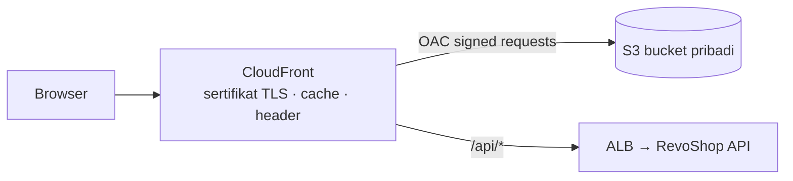

::part[Pelajari Konsepnya]{n="1"}

## 🎯 Yang akan kamu pelajari

- Jenis frontend apa yang kamu punya: **file statis**, **SPA**, atau **server-rendered** (Next.js SSR)
- Hosting build statis di **S3 pribadi + CloudFront (OAC)**: cache, tipe konten, routing SPA, domain kustom
- **Header keamanan** dengan policy header respons CloudFront
- **Next.js** di AWS: static export vs server Node vs **Amplify Hosting**
- Menempatkan **API di belakang distribusi CloudFront yang sama** (origin berbasis path) vs **CORS**
- Pipeline deploy: build → sync → invalidate → smoke test

## 🔤 Istilah penting

| Istilah | Artinya (sederhana) |
|---|---|
| **Static site** | File yang sudah selesai sebelum ada yang mengunjungi |
| **SPA** | Satu halaman HTML di mana JavaScript menukar isi saat kamu klik |
| **Server-rendered (SSR)** | Halaman dibangun segar di server untuk tiap pengunjung |
| **Static export** | `next build` menghasilkan file biasa, tanpa fitur server |
| **CDN edge** | Lokasi CloudFront dekat pengguna yang menyimpan salinan file-mu |
| **Cache-Control** | Header yang bilang berapa lama file boleh dipakai ulang |
| **Content type (MIME)** | Label yang bilang jenis file (`text/css`, `application/javascript`) |
| **Invalidation** | Memberitahu CloudFront untuk hapus file yang di-cache |
| **Routing fallback** | Mengirim path tidak dikenal ke `index.html` agar SPA menanganinya |
| **Amplify Hosting** | Layanan AWS yang membuat dan host frontend, termasuk server Next.js |

## 🧠 Ide besarnya

Dua hal yang sangat berbeda disebut "frontend":

- Frontend **statis** adalah **katalog tercetak**. Sekali dicetak, salinannya duduk di setiap toko (CDN edge) dan langsung diberikan.
- Frontend **server-rendered** adalah **personal shopper** yang menulis halaman segar untuk tiap pengunjung — jadi seseorang harus siap (server terus berjalan).

Putuskan mana yang kamu kirim *sebelum* memilih tempat host; banyak kebingungan AWS frontend datang dari mencampur keduanya.

## ❓ Kenapa ini penting

Bagi kebanyakan pengguna, frontend *adalah* kecepatan produkmu. Menyajikannya dari CDN membuatnya cepat di mana saja; menyajikannya salah membuatnya lambat, rusak tepat setelah deploy, atau tidak aman.

Kalau tidak hati-hati:

- `index.html` di-cache setahun → pengguna tetap dapat versi lama, yang meminta file yang sudah dihapus → halaman kosong.
- `.js` diunggah sebagai `binary/octet-stream` → browser menolak menjalankannya.
- Link mendalam seperti `/orders/42` kembalikan S3 `403 AccessDenied` di single-page app.
- API berada di domain lain dengan `Access-Control-Allow-Origin: *` plus cookie → error CORS, atau setup tidak aman.

## 📖 Langkah demi langkah

### 1. Frontend apa yang kamu punya?

| Tipe | Contoh | Butuh server? | AWS hosting |
|---|---|---|---|
| Static site | docs, landing page, `next build` dengan `output: "export"` | tidak | S3 + CloudFront |
| SPA | Vite + React Router | tidak (routing di client) | S3 + CloudFront dengan routing fallback |
| Server-rendered | Next.js App Router dengan Server Component, Server Action, cookie, `proxy.ts` | **ya** (Node.js) | Amplify Hosting, ECS/App Runner di belakang CloudFront, (atau Vercel) |

CareerPilot Phase 4 web app (session, Server Action) adalah **server-rendered**. Situs marketing atau docs adalah statis.

### 2. Static hosting: S3 + CloudFront

Aturan praktis cache: file yang namanya punya hash (`app-9f2c.js`) bisa disimpan setahun, karena perubahan memberinya nama baru. `index.html` **jangan** di-cache lama — itu halaman yang bilang ke browser file mana yang diminta.



| Pengaturan | Nilai |
|---|---|
| Bucket | pribadi, Blokir Akses Publik, versioning opsional |
| Origin | S3 REST endpoint + **Origin Access Control** |
| Default root object | `index.html` |
| Viewer protocol policy | Alihkan HTTP ke HTTPS |
| Certificate | Sertifikat ACM **di us-east-1** untuk `shop.example.com` |
| Cache policy | `CachingOptimized` untuk asset; object bawa `Cache-Control` sendiri |
| Response headers policy | HSTS, `X-Content-Type-Options`, `Referrer-Policy`, Content Security Policy |

**Header cache per file** (latihan 01):

| File | `Cache-Control` |
|---|---|
| asset di-hash (`_next/static/*`, `app.3f9a1c2b.js`) | `public, max-age=31536000, immutable` |
| `*.html`, `sw.js` | `public, max-age=0, must-revalidate` |
| file lain | singkat (`max-age=3600`) |

**Urutan deploy**: unggah asset di-hash baru → unggah HTML terakhir → invalidate path HTML → hapus asset lama nanti (pengguna dengan halaman HTML lama masih butuh asset lama sebentar).

### 3. SPA routing

S3 hanya tahu file. Saat pengunjung buka `/orders/42`, tidak ada file itu — jadi kamu bilang ke CloudFront "kalau hilang, sajikan `index.html`" dan biarkan router app putuskan, seperti resepsionis yang mengirim setiap permintaan tidak dikenal ke meja depan.

S3 tidak punya object `/orders/42`. Pilihan:
- **CloudFront Function** di viewer request yang menulis ulang path tanpa ekstensi file ke `/index.html`;
- atau **custom error response** CloudFront yang map 403/404 → `/index.html` dengan status 200 (lebih sederhana, tapi juga ubah file benar-benar hilang jadi 200).

```javascript
// CloudFront Function (viewer request)
function handler(event) {
  var request = event.request;
  if (!request.uri.includes('.') && !request.uri.startsWith('/api/')) {
    request.uri = '/index.html';
  }
  return request;
}
```

### 4. Next.js di AWS

| Pilihan | ✅ | ❌ |
|---|---|---|
| `output: "export"` → S3 + CloudFront | paling murah, paling sederhana | tidak ada Server Component saat request, tidak ada Server Action, tidak ada cookie/session, tidak ada `proxy.ts` |
| **Amplify Hosting** | build terhubung Git terkelola, dukungan SSR, preview per branch | pengaturan build spesifik platform; cek dukungan fitur untuk versi Next.js-mu |
| Node server di **ECS / App Runner** + CloudFront | kontrol penuh, pipeline sama dengan API-mu (`output: "standalone"` image dari M4 W6) | kamu operasikan |
| Vercel | dukungan Next.js kelas satu | di luar AWS; billing terpisah |

### 5. API origin: domain sama atau CORS?

Domain sama seperti toko dan gudang punya satu alamat: browser tidak butuh slip izin (CORS) dan cookie langsung jalan. Domain terpisah butuh allow-list eksplisit, dan jangan pernah `*` saat ada cookie.

| Pola | Cara | Catatan |
|---|---|---|
| **Domain sama via CloudFront path** | behavior `/api/*` → ALB origin, **caching dinonaktifkan**, teruskan semua header/cookie/query string (`AllViewer` origin request policy) | tidak ada CORS; cookie langsung jalan; satu domain |
| Domain terpisah | `shop.example.com` → CloudFront, `api.example.com` → ALB | atur CORS di API dengan allow-list origin eksplisit |

Kamu *bisa* cache respons API publik tertentu (mis. `GET /api/v1/products`) di CloudFront dengan TTL pendek — hanya saat respons tidak pernah tergantung pengguna.

### 6. Pipeline

```yaml
- run: npm ci && npm run build
- uses: aws-actions/configure-aws-credentials@cbe3b392738ccf3f987d68400dafcf4b0624a56c # v6.2.4
  with: { role-to-assume: "${{ vars.AWS_ROLE_ARN }}", aws-region: "${{ vars.AWS_REGION }}" }
- name: Upload hashed assets (long cache), then HTML (no cache)
  run: |
    aws s3 sync out/_next s3://"$BUCKET"/_next --cache-control "public,max-age=31536000,immutable"
    aws s3 sync out s3://"$BUCKET" --exclude "_next/*" --cache-control "public,max-age=0,must-revalidate"
  env: { BUCKET: "${{ vars.SITE_BUCKET }}" }
- name: Invalidate HTML
  run: aws cloudfront create-invalidation --distribution-id "$DIST" --paths "/" "/index.html"
  env: { DIST: "${{ vars.DISTRIBUTION_ID }}" }
```

Planner-mu dari latihan 01 umum-umum ini dengan tipe konten benar, urutan dan invalidation minimal.

### Memilih setup-mu

Setiap pilihan di sini adalah trade-off:

| Pilihan | ✅ | ❌ |
|---|---|---|
| S3 + CloudFront | biaya sedikit untuk situs kecil, kecepatan global | statis saja; disiplin cache/invalidation |
| Amplify Hosting | CI/CD berbasis Git, SSR, preview | kontrol lebih sedikit, batas platform |
| Container SSR di ECS | kontrol penuh, sama dengan backend | biaya dan operasi |
| API di belakang distribusi sama | tidak ada CORS, cookie-ramah | konfigurasi behavior CloudFront; hati-hati jangan cache data pengguna |

- ✅ S3 + CloudFront untuk situs statis, SPA, docs dan static export.
- ✅ Platform server untuk fitur Next.js yang butuh server saat request.
- 🚫 Jangan pakai **website endpoint** S3 dengan bucket publik untuk production.
- 🚫 Jangan cache HTML lama, dan jangan cache respons API personal di CDN.

## ⚠️ Kesalahan umum

- Unggah semuanya dengan `Cache-Control` sama.
- Buat sertifikat ACM di region aplikasi bukan us-east-1 untuk CloudFront.
- Invalidate `/*` setiap deploy (jalan, tapi sembunyikan masalah design cache dan bisa mahal skala besar).
- Lupa teruskan header `Authorization` atau cookie ke origin API.

:::revoshop
RevoShop adalah API, tapi akan punya frontend (storefront, seller dashboard, pekerjaan M4 Next.js-mu).

1. **CORS hari ini.** `app/__init__.py` tidak atur CORS (`flask-cors` hanya ada di `requirements-dev.txt` sebagai dependency Locust). Storefront di `https://shop.<domain>` panggil `https://api.<domain>` akan gagal di browser. Putuskan: tambah CORS ketat (izinkan hanya origin storefront-mu, header `Authorization`, tidak ada wildcard) **atau** rute `/api/*` lewat distribusi CloudFront storefront. Tulis pro dan kontra untuk auth JWT-in-header RevoShop.
2. **Swagger UI.** `config/base.py` muat asset Swagger UI dari `https://cdn.jsdelivr.net/npm/swagger-ui-dist/`. Haruskah production expose `/docs/swagger-ui` sama sekali? Kalau ya, tambah Content Security Policy yang izinkan persis CDN itu; kalau tidak, nonaktifkan dengan pengaturan production.
3. **Respons API yang bisa di-cache.** Endpoint RevoShop mana yang aman di-cache CloudFront selama 60 detik (`GET /api/v1/products/`, `GET /api/v1/categories/`)? Cache key harus include apa (query string!) dan endpoint mana yang tidak boleh pernah di-cache (`/users/me`, `/orders`, `/payments/webhook/midtrans`)?
4. **Gambar produk.** Sambungkan materi Week 3 lesson 05: storefront muat gambar dari `images.<domain>` (CloudFront + OAC) sedangkan HTML datang dari `shop.<domain>`. Sketsa kedua distribusi dan behavior cache-nya.
:::

## 🏆 Praktik terbaik

- [ ] Pilih hosting berdasarkan model rendering (statis vs SSR).
- [ ] Bucket pribadi + OAC; HTTPS saja; sertifikat ACM di us-east-1 untuk CloudFront.
- [ ] Cache panjang immutable untuk asset di-hash; tidak ada cache untuk HTML; tipe konten benar.
- [ ] Unggah asset sebelum HTML; hapus asset lama setelah grace period; invalidate hanya path yang dapat berubah.
- [ ] Header keamanan via response headers policy (HSTS, CSP, nosniff).
- [ ] SPA fallback dengan CloudFront Function (bukan dengan membuat bucket publik).
- [ ] Routing API domain sama atau allow-list CORS ketat.
- [ ] Deploy dengan OIDC role cakupan bucket dan distribusi.

::part[Jelaskan & Rancang]{n="2"}

## 🗣️ Jelaskan

Jelaskan analogi katalog tercetak vs personal shopper, dan kenapa CareerPilot Next.js app dengan Server Action tidak bisa begitu saja disalin ke S3.

## 📐 Rancang

Rancang hosting untuk **storefront RevoShop** dibuat dengan Next.js: model rendering mana yang kamu pakai untuk halaman produk, checkout dan seller dashboard; di mana setiap bagian jalan; behavior CloudFront (path, origin, cache policy); domain dan sertifikat; dan pipeline deploy.

:::quiz
Lihat contoh rancangan

- **Rendering:** halaman listing/detail produk dibuat statis dan divalidasi ulang (ISR/`use cache`) untuk SEO; cart, checkout dan seller dashboard sebagai halaman dinamis, terautentikasi → butuh **server** Next.js (bukan static export).
- **Runtime:** Next.js `output: "standalone"` image di **ECS Fargate** di belakang ALB sama dengan API (target group terpisah), atau Amplify Hosting kalau kamu lebih suka build terkelola.
- **CloudFront `shop.<domain>`** (sertifikat ACM di us-east-1):
  - `/_next/static/*` → S3 bucket dengan static asset build (OAC, `CachingOptimized`, immutable)
  - `/api/*` → ALB (RevoShop API), caching dinonaktifkan, teruskan `Authorization`, query string dan cookie
  - default `*` → ALB (Next.js server), `CachingDisabled` atau cache policy pendek hormati `Cache-Control` dari Next.js
  - response headers policy dengan HSTS dan CSP
- **Image:** distribusi `images.<domain>` dari Week 3 (bucket pribadi, OAC, key immutable).
- **Pipeline:** build image + unggah `_next/static` ke S3 (cache panjang) → jalankan migrasi (API) → update ECS service → smoke test → invalidate hanya kalau path tidak di-hash berubah.
:::

### 📝 Checklist review mandiri

- [ ] Model rendering memutuskan hosting
- [ ] Respons spesifik pengguna tidak pernah di-cache
- [ ] Asset immutable, HTML segar

::ai-review{task="design"}

::part[Latihan Kecil]{n="3"}

:::exercise{path="exercises/m5/w4/01-static-site-sync-plan" ai="no-ai" title="Rencana deploy frontend statis"}
Hitung header cache dan tipe konten per file, unggah untuk file berubah (asset duluan, HTML terakhir), hapus untuk file lama, dan set invalidation path CloudFront paling kecil — tolak path tidak aman.
:::

:::hints
- ETag S3 untuk unggah satu-bagian adalah MD5 hex dari konten, kadang dibungkus tanda kutip.
- File immutable tidak perlu invalidation — itu poin hash nama-nya.
- `docs/index.html` juga disajikan di `/docs/`.
:::

## ✅ Cek cepat

:::quiz
Setelah deploy beberapa pengguna lihat halaman kosong dengan 404 untuk `/_next/static/chunks/old-abc.js`. Apa yang terjadi?

Browser mereka (atau CloudFront) masih punya **HTML lama**, yang merujuk asset yang sudah dihapus. Simpan asset lama selama grace period, dan jangan cache HTML lama.
:::

:::quiz
Kenapa sertifikat ACM untuk custom domain CloudFront harus di us-east-1?

CloudFront adalah layanan global yang baca sertifikat dari region US East (N. Virginia), tidak peduli di mana origin-mu berada.
:::


## 📚 Lanjut belajar

- [Dokumentasi AWS: Batasi akses ke origin S3 (OAC)](https://docs.aws.amazon.com/AmazonCloudFront/latest/DeveloperGuide/private-content-restricting-access-to-s3.html) · [CloudFront Function](https://docs.aws.amazon.com/AmazonCloudFront/latest/DeveloperGuide/cloudfront-functions.html)
- [AWS Amplify Hosting](https://docs.aws.amazon.com/amplify/latest/userguide/welcome.html)
- Dokumentasi Next.js (bundled di `exercises/web/node_modules/next/dist/docs`): Deploying; Static Export; Self-Hosting
