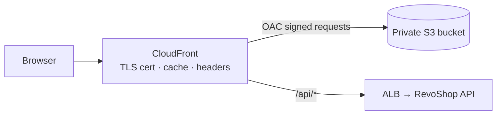

::part[Learn the Concept]{n="1"}

## 🎯 What you'll learn

- What kind of frontend you have: **static files**, **SPA**, or **server-rendered** (Next.js SSR)
- Hosting static builds on **private S3 + CloudFront (OAC)**: caching, content types, SPA routing, custom domains
- **Security headers** with CloudFront response headers policies
- **Next.js** on AWS: static export vs a Node server vs **Amplify Hosting**
- Putting the **API behind the same CloudFront distribution** (path-based origins) vs **CORS**
- A deploy pipeline: build → sync → invalidate → smoke test

## 🔤 Key words

| Word | In simple words | Bahasa Indonesia |
|---|---|---|
| **Static site** | Files that are already finished before anyone visits | Situs berupa file jadi |
| **SPA** | One HTML page where JavaScript swaps the content as you click | Aplikasi satu halaman |
| **Server-rendered (SSR)** | Pages built fresh on a server for each visitor | Halaman dibuat di server |
| **Static export** | `next build` producing plain files, with no server features | Ekspor jadi file biasa |
| **CDN edge** | A CloudFront location near the user that keeps copies of your files | Titik CDN dekat pengguna |
| **Cache-Control** | The header that says how long a file may be reused | Aturan lama penyimpanan |
| **Content type (MIME)** | The label saying what a file is (`text/css`, `application/javascript`) | Jenis file |
| **Invalidation** | Telling CloudFront to drop a cached file | Menghapus cache CDN |
| **Routing fallback** | Sending unknown paths to `index.html` so an SPA can handle them | Pengalihan ke index.html |
| **Amplify Hosting** | An AWS service that builds and hosts frontends, including Next.js servers | Layanan hosting frontend AWS |

## 🧠 The big idea

Two very different things get called "a frontend":

- A **static** frontend is a **printed catalogue**. Once printed, copies sit in every shop (CDN edges) and are handed out instantly.
- A **server-rendered** frontend is a **personal shopper** who writes a fresh page for each visitor — so somebody must be on duty (a running server).

Decide which one you are shipping *before* choosing where to host it; most AWS frontend confusion comes from mixing these two up.

## ❓ Why it matters

For most users, the frontend *is* the speed of your product. Serving it from a CDN makes it fast everywhere; serving it wrongly makes it slow, broken right after a deploy, or unsafe.

Done carelessly:

- `index.html` cached for a year → users keep the old version, which asks for files you already deleted → a blank page.
- `.js` uploaded as `binary/octet-stream` → browsers refuse to run it.
- Deep links like `/orders/42` return S3 `403 AccessDenied` in a single-page app.
- The API sits on another domain with `Access-Control-Allow-Origin: *` plus cookies → CORS errors, or an unsafe setup.

## 📖 Step by step

### 1. Which frontend do you have?

| Type | Examples | Needs a server? | AWS hosting |
|---|---|---|---|
| Static site | docs, landing page, `next build` with `output: "export"` | no | S3 + CloudFront |
| SPA | Vite + React Router | no (client-side routing) | S3 + CloudFront with a routing fallback |
| Server-rendered | Next.js App Router with Server Components, Server Actions, cookies, `proxy.ts` | **yes** (Node.js) | Amplify Hosting, ECS/App Runner behind CloudFront, (or Vercel) |

CareerPilot's Phase 4 web app (sessions, Server Actions) is **server-rendered**. A marketing site or docs are static.

### 2. Static hosting: S3 + CloudFront

The rule of thumb for caching: files whose names contain a hash (`app-9f2c.js`) can be kept for a year, because a change gives them a new name. `index.html` must **not** be cached for long — it's the page that tells the browser which file names to ask for.



| Setting | Value |
|---|---|
| Bucket | private, Block Public Access, versioning optional |
| Origin | S3 REST endpoint + **Origin Access Control** |
| Default root object | `index.html` |
| Viewer protocol policy | Redirect HTTP to HTTPS |
| Certificate | ACM certificate **in us-east-1** for `shop.example.com` |
| Cache policy | `CachingOptimized` for assets; objects carry their own `Cache-Control` |
| Response headers policy | HSTS, `X-Content-Type-Options`, `Referrer-Policy`, a Content Security Policy |

**Cache headers per file** (exercise 01):

| Files | `Cache-Control` |
|---|---|
| hashed assets (`_next/static/*`, `app.3f9a1c2b.js`) | `public, max-age=31536000, immutable` |
| `*.html`, `sw.js` | `public, max-age=0, must-revalidate` |
| other files | short (`max-age=3600`) |

**Deploy order**: upload new hashed assets → upload HTML last → invalidate HTML paths → delete old assets later (a user with an old HTML page still needs the old assets for a while).

### 3. SPA routing

S3 only knows files. When a visitor opens `/orders/42`, there is no such file — so you tell CloudFront "if it's missing, serve `index.html`" and let the app's router decide, like a receptionist who sends every unknown request to the front desk.

S3 has no `/orders/42` object. Options:
- a **CloudFront Function** on viewer requests that rewrites paths without a file extension to `/index.html`;
- or CloudFront **custom error responses** mapping 403/404 → `/index.html` with status 200 (simpler, but also turns real missing files into 200s).

```javascript
// CloudFront Function (viewer request)
function handler(event) {
  var request = event.request;
  if (!request.uri.includes('.') && !request.uri.startsWith('/api/')) {
    request.uri = '/index.html';
  }
  return request;
}
```

### 4. Next.js on AWS

| Option | ✅ | ❌ |
|---|---|---|
| `output: "export"` → S3 + CloudFront | cheapest, simplest | no Server Components on request, no Server Actions, no cookies/sessions, no `proxy.ts` |
| **Amplify Hosting** | managed Git-connected builds, SSR support, previews per branch | platform-specific build settings; check feature support for your Next.js version |
| Node server on **ECS / App Runner** + CloudFront | full control, same pipeline as your API (`output: "standalone"` image from M4 W6) | you operate it |
| Vercel | first-class Next.js support | outside AWS; separate billing |

### 5. API origin: same domain or CORS?

Same domain is like the shop and warehouse sharing one address: the browser doesn't need permission slips (CORS) and cookies just work. Separate domains need an explicit allow-list, and never `*` when cookies are involved.

| Pattern | How | Notes |
|---|---|---|
| **Same site via CloudFront path** | behavior `/api/*` → ALB origin, **caching disabled**, forward all headers/cookies/query strings (`AllViewer` origin request policy) | no CORS; cookies just work; one domain |
| Separate domains | `shop.example.com` → CloudFront, `api.example.com` → ALB | configure CORS on the API with an explicit origin allow-list |

You *can* cache selected public API responses (e.g. `GET /api/v1/products`) at CloudFront with short TTLs — only when the response never depends on the user.

### 6. Pipeline

```yaml
- run: npm ci && npm run build
- uses: aws-actions/configure-aws-credentials@cbe3b392738ccf3f987d68400dafcf4b0624a56c # v6.2.4
  with: { role-to-assume: "${{ vars.AWS_ROLE_ARN }}", aws-region: "${{ vars.AWS_REGION }}" }
- name: Upload hashed assets (long cache), then HTML (no cache)
  run: |
    aws s3 sync out/_next s3://"$BUCKET"/_next --cache-control "public,max-age=31536000,immutable"
    aws s3 sync out s3://"$BUCKET" --exclude "_next/*" --cache-control "public,max-age=0,must-revalidate"
  env: { BUCKET: "${{ vars.SITE_BUCKET }}" }
- name: Invalidate HTML
  run: aws cloudfront create-invalidation --distribution-id "$DIST" --paths "/" "/index.html"
  env: { DIST: "${{ vars.DISTRIBUTION_ID }}" }
```

Your planner from exercise 01 generalizes this with correct content types, ordering and minimal invalidations.

### Choosing your setup

Every option here is a trade-off:

| Choice | ✅ | ❌ |
|---|---|---|
| S3 + CloudFront | pennies for small sites, global speed | static only; cache/invalidation discipline |
| Amplify Hosting | Git-based CI/CD, SSR, previews | less control, platform limits |
| Container SSR on ECS | full control, same as backend | cost and operations |
| API behind the same distribution | no CORS, cookie-friendly | CloudFront behavior configuration; careful not to cache user data |

- ✅ S3 + CloudFront for static sites, SPAs, docs and static exports.
- ✅ A server platform for Next.js features that need a request-time server.
- 🚫 Don't use the S3 **website endpoint** with a public bucket for production.
- 🚫 Don't cache HTML for long, and don't cache personalized API responses at the CDN.

## ⚠️ Common mistakes

- Uploading everything with the same `Cache-Control`.
- Creating the ACM certificate in the application region instead of us-east-1 for CloudFront.
- Invalidating `/*` on every deploy (works, but hides cache design problems and can cost at scale).
- Forgetting to forward the `Authorization` header or cookies to the API origin.

:::revoshop
RevoShop is an API, but it will have frontends (a storefront, a seller dashboard, your M4 Next.js work).

1. **CORS today.** `app/__init__.py` doesn't configure CORS (`flask-cors` only appears in `requirements-dev.txt` as a Locust dependency). A storefront at `https://shop.<domain>` calling `https://api.<domain>` will fail in browsers. Decide: add strict CORS (allow only your storefront origins, `Authorization` header, no wildcard) **or** route `/api/*` through the storefront's CloudFront distribution. Write the pros and cons for RevoShop's JWT-in-header auth.
2. **Swagger UI.** `config/base.py` loads Swagger UI assets from `https://cdn.jsdelivr.net/npm/swagger-ui-dist/`. Should production expose `/docs/swagger-ui` at all? If yes, add a Content Security Policy that allows exactly that CDN; if not, disable it with a production setting.
3. **Cacheable API responses.** Which RevoShop endpoints could CloudFront cache safely for 60 seconds (`GET /api/v1/products/`, `GET /api/v1/categories/`)? What must the cache key include (query strings!) and which endpoints must never be cached (`/users/me`, `/orders`, `/payments/webhook/midtrans`)?
4. **Product images.** Connect Week 3 lesson 05: the storefront would load images from `images.<domain>` (CloudFront + OAC) while HTML comes from `shop.<domain>`. Sketch both distributions and their cache behaviors.
:::

## 🏆 Best practices

- [ ] Choose hosting by rendering model (static vs SSR).
- [ ] Private bucket + OAC; HTTPS only; ACM certificate in us-east-1 for CloudFront.
- [ ] Immutable long caching for hashed assets; no caching for HTML; correct content types.
- [ ] Upload assets before HTML; delete old assets after a grace period; invalidate only mutable paths.
- [ ] Security headers via a response headers policy (HSTS, CSP, nosniff).
- [ ] SPA fallback with a CloudFront Function (not by making the bucket public).
- [ ] Same-domain API routing or strict CORS allow-lists.
- [ ] Deploy with OIDC roles scoped to the bucket and distribution.

::part[Explain & Design]{n="2"}

## 🗣️ Explain it

Explain the printed catalog vs personal shopper analogy, and why a CareerPilot Next.js app with Server Actions can't simply be copied to S3.

## 📐 Design it

Design hosting for a **RevoShop storefront** built with Next.js: which rendering model you'd use for product pages, checkout and the seller dashboard; where each part runs; CloudFront behaviors (paths, origins, cache policies); domains and certificates; and the deploy pipeline.

:::quiz
Show a possible design

- **Rendering:** product listing/detail pages statically generated and revalidated (ISR/`use cache`) for SEO; cart, checkout and seller dashboard as dynamic, authenticated pages → needs a Next.js **server** (not a static export).
- **Runtime:** Next.js `output: "standalone"` image on **ECS Fargate** behind the same ALB as the API (separate target group), or Amplify Hosting if you prefer managed builds.
- **CloudFront `shop.<domain>`** (ACM cert in us-east-1):
  - `/_next/static/*` → S3 bucket with the build's static assets (OAC, `CachingOptimized`, immutable)
  - `/api/*` → ALB (RevoShop API), caching disabled, forward `Authorization`, query strings and cookies
  - default `*` → ALB (Next.js server), `CachingDisabled` or a short cache policy honoring `Cache-Control` from Next.js
  - response headers policy with HSTS and CSP
- **Images:** `images.<domain>` distribution from Week 3 (private bucket, OAC, immutable keys).
- **Pipeline:** build image + upload `_next/static` to S3 (long cache) → run migrations (API) → update ECS services → smoke tests → invalidate only if non-hashed paths changed.
:::

### 📝 Self-review checklist

- [ ] Rendering model decides hosting
- [ ] User-specific responses never cached
- [ ] Assets immutable, HTML fresh

::ai-review{task="design"}

::part[Toy Exercise]{n="3"}

:::exercise{path="exercises/m5/w4/01-static-site-sync-plan" ai="no-ai" title="Deploy plan for a static frontend"}
Compute cache headers and content types per file, uploads for changed files (assets first, HTML last), deletes for stale files, and the smallest set of CloudFront invalidation paths — rejecting unsafe paths.
:::

:::hints
- S3's ETag for a single-part upload is the MD5 hex of the content, sometimes wrapped in quotes.
- Immutable files never need invalidation — that's the point of hashing their names.
- `docs/index.html` is also served at `/docs/`.
:::

## ✅ Quick check

:::quiz
After a deploy some users see a blank page with 404s for `/_next/static/chunks/old-abc.js`. What happened?

Their browser (or CloudFront) still had the **old HTML**, which references assets you already deleted. Keep old assets for a grace period, and don't cache HTML long.
:::

:::quiz
Why must the ACM certificate for a CloudFront custom domain be in us-east-1?

CloudFront is a global service that reads certificates from the US East (N. Virginia) region, regardless of where your origins are.
:::


## 📚 Keep learning

- [AWS docs: Restrict access to an S3 origin (OAC)](https://docs.aws.amazon.com/AmazonCloudFront/latest/DeveloperGuide/private-content-restricting-access-to-s3.html) · [CloudFront Functions](https://docs.aws.amazon.com/AmazonCloudFront/latest/DeveloperGuide/cloudfront-functions.html)
- [AWS Amplify Hosting](https://docs.aws.amazon.com/amplify/latest/userguide/welcome.html)
- Next.js docs (bundled in `exercises/web/node_modules/next/dist/docs`): Deploying; Static Exports; Self-Hosting
