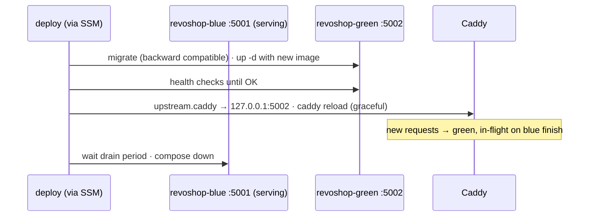
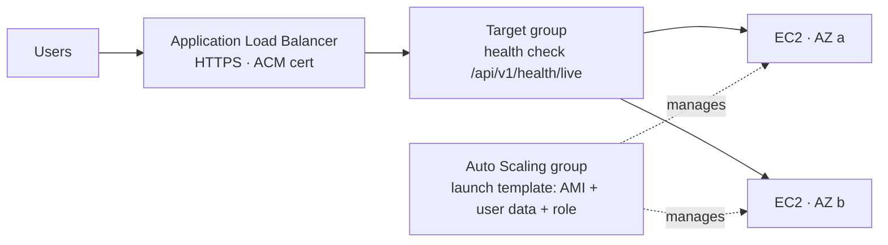

::part[Pelajari Konsepnya]{n="1"}

## 🎯 Yang akan kamu pelajari

- Strategi deployment di server: **recreate**, **rolling**, **blue/green**, **canary**
- **Blue/green di satu host** dengan Docker Compose project dan Caddy upstream switch
- **Graceful shutdown**: draining, gunicorn timeout, request yang masih berlangsung
- Deploy lewat **SSM Run Command** (tanpa SSH) dan catat setiap deployment
- **Log dan metrik** dengan CloudWatch agent dan retention
- **Auto Scaling group** + **Application Load Balancer**: launch template, health check, instance refresh
- Tanda-tanda waktu untuk pindah ke container di ECS

## 🔤 Istilah penting

| Istilah | Artinya (sederhana) |
|---|---|
| **Downtime** | Waktu aplikasi tidak bisa dipakai, user dapat error |
| **Recreate deploy** | Matikan versi lama, lalu nyalakan versi baru |
| **Rolling deploy** | Ganti server satu per satu sambil yang lain tetap layani traffic |
| **Blue/green** | Jalankan dua versi berdampingan, lalu pindahkan traffic |
| **Canary** | Kirim sedikit traffic ke versi baru dulu untuk tes |
| **Draining** | Tunggu request yang masih berlangsung selesai sebelum berhenti |
| **Graceful shutdown** | Berhenti dengan rapi setelah tanda "silahkan berhenti" |
| **SSM Run Command** | Jalankan perintah di server lewat AWS, tanpa SSH |
| **Auto Scaling group** | Kelompok server yang AWS jaga jumlahnya sesuai permintaan |
| **Load balancer (ALB)** | Pembagi traffic yang distribusikan request ke server yang sehat |

## 🧠 Ide besarnya

Recreate deploy itu seperti **renovasi restoran saat pelanggan sedang makan**: beberapa menit tidak ada yang bisa dilayani.

Blue/green itu seperti **membangun ruang makan baru di sebelahnya**:

1. selesaikan dan periksa (health check),
2. pindahkan papan masuk (switch proxy),
3. biarkan tamu terakhir di ruangan lama selesai dessert (draining),
4. lalu tutup ruangan lama.

Kalau ruangan baru bermasalah, kamu tinggal tidak pindahkan papan — itu rollback-mu.

## ❓ Kenapa ini penting

Deploy di Lab 3 menyebabkan beberapa detik error setiap kali, dan outage sungguhan kalau image buruk (sampai rollback selesai). Untuk toko yang terima pembayaran, bahkan celah singkat berarti transaksi gagal dan webhook Midtrans tidak terkirim — Midtrans coba ulang, tapi customer tetap lihat error.

Tanpa teknik ini:

- Deploy dijadwalkan "malam hari" karena merugikan — jadi jarang, besar, dan berisiko.
- Paksa kill saat request pembayaran: charge sukses di Midtrans, tapi order tidak terupdate.
- Log hanya ada di `docker logs` di instance; kalau instance diganti, bukti hilang.
- Traffic bertambah, satu instance kehabisan kapasitas, scaling jadi migrasi manual akhir pekan.

## 📖 Langkah demi langkah

### 1. Strategi

| Strategi | Cara kerja | Downtime | Rollback | Biaya |
|---|---|---|---|---|
| **Recreate** | matikan lama, nyalakan baru | beberapa detik+ | deploy lama | tidak ada |
| **Rolling** | ganti instance satu per satu di balik load balancer | tidak ada (kalau kapasitas cukup) | ganti lagi | kapasitas ekstra sementara |
| **Blue/green** | lingkungan baru penuh di sebelah lama, pindahkan traffic | tidak ada | pindahkan balik | kapasitas ganda saat deploy |
| **Canary** | sebagian kecil traffic ke versi baru, lalu tambah | tidak ada | pindahkan traffic balik | butuh weighted routing dan metrik |

### 2. Blue/green di satu host



```text
# Caddyfile
api.example.com {
	encode zstd gzip
	import /opt/revoshop/state/upstream.caddy     # "reverse_proxy 127.0.0.1:5001" or ":5002"
}
```

- Dua Compose **project name** (`-p revoshop-blue`, `-p revoshop-green`) dengan file yang sama dan `PORT` berbeda.
- `caddy reload` terapkan config baru tanpa putus koneksi.
- Butuh: cukup memory untuk dua API copy saat switch, dan **backward-compatible migration** (dua versi jalan di database yang sama sebentar).

### 3. Graceful shutdown

Stop yang sopan punya tiga bagian: jangan terima request baru, selesaikan yang sedang berjalan, lalu keluar. Tanpa ini, deploy itu seperti pelayan yang tumpah nampan di jalan ke meja.

| Layer | Pengaturan |
|---|---|
| Docker | `stop_grace_period: 30s` (Compose) — waktu antara SIGTERM dan SIGKILL |
| gunicorn | `graceful_timeout = 20` — worker selesaikan request setelah SIGTERM |
| Proxy | jangan kirim request baru *sebelum* matikan versi lama (blue/green switch atau load balancer deregistration delay) |
| App | request timeout pendek; pekerjaan latar belakang di queue, bukan thread request |

### 4. Deploy lewat SSM Run Command

```bash
aws ssm send-command \
  --instance-ids i-0123456789abcdef0 \
  --document-name AWS-RunShellScript \
  --parameters 'commands=["sudo -iu deploy /opt/revoshop/deploy/bluegreen.py ghcr.io/you/revoshop@sha256:…"]' \
  --comment "deploy v1.3.0"
```

- Tanpa SSH key, tanpa port 22; perintah dan output tercatat; IAM tentukan siapa bisa jalankan apa di instance mana (kondisi berbasis tag seperti `ssm:resourceTag/Env = production`).
- Untuk fleet: target instance **by tag** dan atur concurrency/error threshold.

### 5. Log dan metrik

Log di server yang bisa diganti itu catatan ditulis di jendela rental car. Kirim ke CloudWatch agar bukti bertahan lebih lama dari instance — dan atur retention agar tidak tagihan selamanya.

- Install **CloudWatch agent**; kirim `/var/lib/docker/containers/*/*.log` (atau pakai `awslogs` Docker log driver per container) ke log group seperti `/revoshop/production/api` dengan **retention period** (misal 30 hari).
- Kumpulkan memory dan disk metrik (tidak tersedia default di EC2).
- Metric filter/alarm di log pattern (`" 5[0-9][0-9] "`), plus EC2 status check dan RDS alarm dari Week 3.

### 6. Scale out: Auto Scaling group + ALB

Satu server dengan blue/green itu satu warung dengan dua kasir. Auto Scaling group di balik load balancer itu baris warung: pembagi traffic kirim customer hanya ke warung yang buka, dan group ganti warung mana pun yang tutup.



| Bagian | Peran |
|---|---|
| **Launch template** | AMI, instance type, security group, instance profile, user data |
| **Auto Scaling group** | desired/min/max instance di AZ, ganti yang tidak sehat, scaling policy (misal target 50% CPU) |
| **ALB + target group** | TLS termination (ACM), health check, connection draining (deregistration delay) |
| **Instance refresh** | rolling replacement dengan launch template versi baru — "deploy" mu untuk AMI immutable |

Redis di instance tidak lagi cocok dengan beberapa instance (rate limit harus dibagi) → pakai ElastiCache.

### 7. Kapan pindah ke ECS

Pindah kalau kamu rebuild container orchestration dengan tangan: banyak instance, rolling deploy, service discovery, per-service scaling, secret injection, replacement berbasis health. Itu pelajaran berikutnya.

### Pilih setup-mu

Setiap pilihan di sini ada trade-off:

| Pilihan | ✅ | ❌ |
|---|---|---|
| Single EC2 + blue/green | murah, deploy tanpa downtime, mudah dimengerti | satu titik kegagalan; scaling manual |
| ASG + ALB | self-healing, multi-AZ, scaling | biaya ALB; pipeline image/AMI; state bersama harus keluar instance |
| SSM Run Command deploy | auditable, tanpa SSH | setup IAM; batas ukuran perintah/output |
| CloudWatch agent | log terpusat dan metrik memory/disk | config agent dan biaya log |

- ✅ Single-host blue/green untuk aplikasi portfolio dan produk kecil.
- ✅ ASG + ALB untuk stateless service yang butuh ketersediaan tinggi tanpa orchestrator container.
- 🚫 Jangan scale out saat Redis/session state ada di satu instance.
- 🚫 Jangan jalankan migrasi irreversible di blue/green switch.

## ⚠️ Kesalahan umum

- Pindahkan traffic sebelum versi baru lulus health check.
- Grace period lebih pendek dari request terpanjang → SIGKILL saat pembayaran.
- Dua warna tulis ke direktori atau port sama.
- Tidak ada log retention → biaya CloudWatch Logs tumbuh diam-diam.

:::revoshop
1. **Ukur celahnya.** Saat Lab 3 deploy, jalankan `while true; do curl -s -o /dev/null -w "%{http_code} " https://api.<domain>/api/v1/health/live; sleep 0.2; done` dari laptopmu. Berapa banyak response non-200 yang kamu dapat?
2. **Blue/green untuk RevoShop.** Adaptasi `compose.aws.yaml` menjadi `compose.api.yaml` (api + migrate hanya, port dari `PORT`) dan `compose.edge.yaml` bersama (Caddy + Redis di network kedua warna). Wire orchestrator dari latihan 02 sebagai `deploy/bluegreen.py`. Berapa memory dua API copy butuh di `t3.small` mu (cek `docker stats`)?
3. **Graceful shutdown.** `gunicorn.conf.py` mu punya `graceful_timeout = 20` dan `timeout = 30`. Berapa `stop_grace_period` di Compose? Request RevoShop mana yang bisa ambil waktu paling lama (hint: buat transaction Midtrans panggil API eksternal)?
4. **Log keluar box.** Tambahkan `logging: driver: awslogs` dengan `awslogs-group: /revoshop/production/api` dan `awslogs-create-group: "false"` ke service API, buat log group dengan 30-day retention, dan tambahkan `logs:CreateLogStream`/`logs:PutLogEvents` untuk group itu ke instance role. Di mana kamu lihat webhook log sekarang?
5. **Penghalang scaling.** Daftar apa yang cegah jalankan dua instance RevoShop di balik ALB sekarang (Redis rate-limit state, `LOG_TO_FILE`, apa lagi?) dan bagaimana pelajaran 03 Week 4 hilangkan masing-masing.
:::

## 🏆 Praktik terbaik

- [ ] Deploy by digest; jaga versi sebelumnya tetap bisa jalan untuk instant rollback.
- [ ] Strategi tanpa downtime (blue/green atau rolling) dengan health check sebelum pindahkan traffic.
- [ ] Backward-compatible migration; jalankan sekali per deploy.
- [ ] Graceful shutdown: grace period lebih lama dari request timeout; draining sebelum stop.
- [ ] SSM Run Command (atau deploy cloud-native) bukan SSH; batasi by tag.
- [ ] Log terpusat dengan retention; metrik memory/disk; alarm di error dan health.
- [ ] Immutable instance (launch template, instance refresh) saat kamu scale out.

::part[Jelaskan & Rancang]{n="2"}

## 🗣️ Jelaskan

Jelaskan analogi "ruang makan baru di sebelahnya", dan kenapa backward-compatible migration prasyarat untuk blue/green.

## 📐 Rancang

Rancang perpindahan RevoShop dari single EC2 instance ke Auto Scaling group: isi launch template, bagaimana image ke instance (bake AMI vs pull saat boot), secret, state bersama, load balancer dan health check, deploy procedure (instance refresh atau rolling SSM command), log, alarm, dan perbedaan biaya.

:::quiz
Lihat contoh rancangan

- **Launch template:** Ubuntu 24.04 AMI, `t3.small`, `revoshop-app` SG (5000 dari ALB SG), instance profile (SSM core, baca `/revoshop/production/*`, CloudWatch agent), IMDSv2, user data yang install Docker, CloudWatch agent, ambil env dari SSM dan jalankan API container **dengan image digest dari SSM parameter** `/revoshop/production/API_IMAGE`.
- **Image:** tarik saat boot by digest (sederhana); bake AMI nanti kalau boot time penting.
- **State:** Redis → **ElastiCache** (rate limit dibagi); tidak ada file di instance (image di S3); log via `awslogs`.
- **ASG:** min 2, max 4, dua AZ, target tracking 60% CPU, health check type ELB dengan 120 s grace.
- **ALB:** listener HTTPS (ACM), HTTP→HTTPS redirect, target group health check `/api/v1/health/live`, deregistration delay 30 s; path webhook Midtrans diizinkan.
- **Deploy:** CI jalankan migration sebagai one-off (SSM command di satu instance atau separate task) → update `/revoshop/production/API_IMAGE` → **instance refresh** dengan min healthy 100% dan checkpoint → smoke test; rollback = digest sebelumnya + refresh.
- **Alarm:** target 5xx rate, unhealthy host count, p95 latency, ElastiCache memory.
- **Biaya:** ALB (~USD 16+/bulan di us-east-1 sebelum usage) + instance kedua + ElastiCache — kira-kira 2–3× single instance; ini titik ECS Fargate jadi kompetitif dalam kesederhanaan.
:::

### 📝 Checklist review mandiri

- [ ] Tidak ada state di instance
- [ ] Deploy tidak pernah kurangi kapasitas sehat di bawah demand
- [ ] Kenaikan biaya dipahami

::ai-review{task="design"}

::part[Latihan Kecil]{n="3"}

:::exercise{path="exercises/m5/w4/02-blue-green-on-ec2" ai="no-ai" title="Blue/green tanpa downtime di satu host"}
Tulis orchestrator: pilih warna yang idle, jalankan migrasi, nyalakan, polling health, pindahkan upstream Caddy dengan revert aman kalau reload gagal, catat history, lalu drain dan matikan warna lama — dengan injected command runner untuk tes.
:::

:::hints
- Simpan isi `upstream.caddy` sebelumnya sebelum tulis yang baru.
- `sleep(wait)` **antara** health check, bukan sebelum yang pertama.
- Hanya successful deploy yang boleh ubah `active` dan `history`.
:::

## ✅ Cek cepat

:::quiz
Blue/green sedang jalan dan warna baru sehat, tapi Caddy reload gagal. Apa yang perlu dilakukan deploy?

Restore config upstream sebelumnya, matikan warna baru, dan laporkan kegagalan — warna lama tidak pernah berhenti melayani traffic.
:::

:::quiz
Kenapa graceful shutdown timeout harus lebih lama dari request normal terpanjang?

Kalau tidak, proses di-kill (SIGKILL) saat masih handle request, menyebabkan operasi gagal atau setengah selesai seperti pembayaran.
:::


## 📚 Lanjut belajar

- [AWS docs: Run Command](https://docs.aws.amazon.com/systems-manager/latest/userguide/run-command.html) · [Instance refresh](https://docs.aws.amazon.com/autoscaling/ec2/userguide/asg-instance-refresh.html)
- [Caddy: reload without downtime](https://caddyserver.com/docs/command-line#caddy-reload)
- [gunicorn settings: graceful_timeout](https://docs.gunicorn.org/en/stable/settings.html#graceful-timeout)
