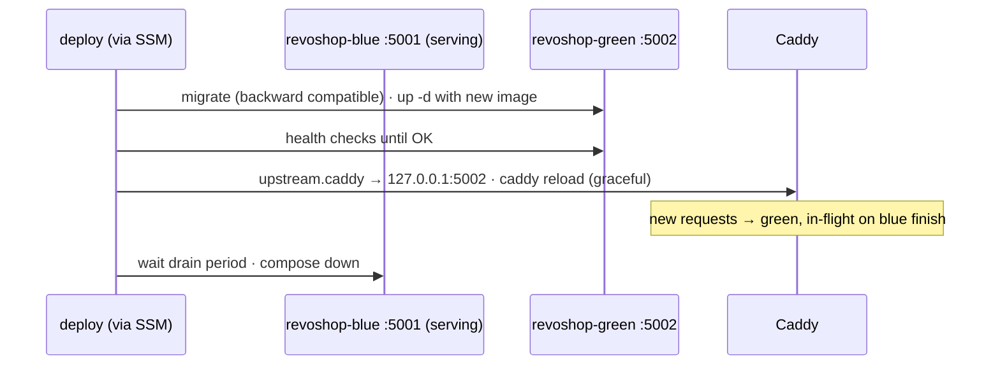
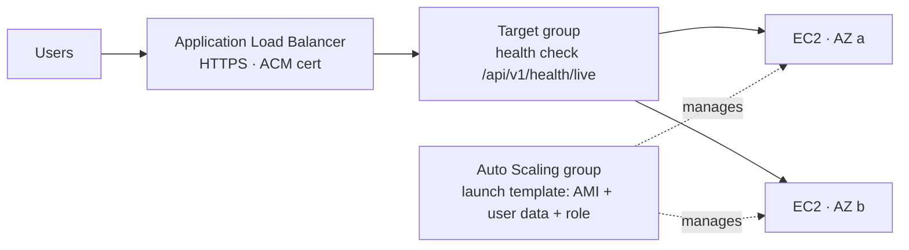

::part[Learn the Concept]{n="1"}

## 🎯 What you'll learn

- Deployment strategies on servers: **recreate**, **rolling**, **blue/green**, **canary**
- **Blue/green on a single host** with Docker Compose projects and a Caddy upstream switch
- **Graceful shutdown**: draining, gunicorn timeouts, in-flight requests
- Deploying through **SSM Run Command** (no SSH) and recording deployments
- **Logs and metrics** with the CloudWatch agent and log retention
- **Auto Scaling groups** + **Application Load Balancer**: launch templates, health checks, instance refresh
- Signals that it's time to move to containers on ECS

## 🧠 The big idea

Deploying by recreating the only container is like **renovating a restaurant while customers eat**. Blue/green is **building the new dining room next door**: finish it, inspect it, move the entrance sign, let the last guests in the old room finish dessert, then close the old room. If the new room has a problem, you never moved the sign.

## ❓ Why does this matter?

Lab 3's deploy has a few seconds of errors per deploy and a real outage when an image is bad (until rollback finishes). For a shop that takes payments, even short gaps mean failed checkouts and failed Midtrans webhook deliveries (which Midtrans retries, but your customers see errors).

## 💥 What happens if we DON'T?

- Deploys scheduled "at night" because they hurt — so they're rare, big and risky.
- SIGKILL during a payment request: the charge succeeded at Midtrans, the order never updated.
- Logs live only in `docker logs` on the instance; when it's replaced, the evidence is gone.
- Traffic grows, one instance saturates, and scaling means a manual weekend migration.

## 📖 How it works, step by step

### 1. Strategies

| Strategy | How | Downtime | Rollback | Cost |
|---|---|---|---|---|
| **Recreate** | stop old, start new | seconds+ | redeploy old | none |
| **Rolling** | replace instances one by one behind a load balancer | none (if capacity allows) | roll again | temporary extra capacity |
| **Blue/green** | full new environment beside the old, switch traffic | none | switch back | double capacity during deploy |
| **Canary** | small share of traffic to new version, then increase | none | shift traffic back | needs weighted routing and metrics |

### 2. Blue/green on one host



```text
# Caddyfile
api.example.com {
	encode zstd gzip
	import /opt/revoshop/state/upstream.caddy     # "reverse_proxy 127.0.0.1:5001" or ":5002"
}
```

- Two Compose **project names** (`-p revoshop-blue`, `-p revoshop-green`) with the same file and different `PORT`s.
- `caddy reload` applies a new config without dropping connections.
- Requirements: enough memory for two API copies during the switch, and **backward-compatible migrations** (both versions run against the same database for a moment).

### 3. Graceful shutdown

| Layer | Setting |
|---|---|
| Docker | `stop_grace_period: 30s` (Compose) — time between SIGTERM and SIGKILL |
| gunicorn | `graceful_timeout = 20` — workers finish requests after SIGTERM |
| Proxy | stop sending new requests *before* stopping the old version (blue/green switch or load balancer deregistration delay) |
| App | short request timeouts; background work in queues, not in request threads |

### 4. Deploys through SSM Run Command

```bash
aws ssm send-command \
  --instance-ids i-0123456789abcdef0 \
  --document-name AWS-RunShellScript \
  --parameters 'commands=["sudo -iu deploy /opt/revoshop/deploy/bluegreen.py ghcr.io/you/revoshop@sha256:…"]' \
  --comment "deploy v1.3.0"
```

- No SSH keys, no port 22; commands and output are recorded; IAM decides who can run what on which instance (tag-based conditions like `ssm:resourceTag/Env = production`).
- For fleets: target instances **by tag** and set concurrency/error thresholds.

### 5. Logs and metrics

- Install the **CloudWatch agent**; ship `/var/lib/docker/containers/*/*.log` (or use the `awslogs` Docker log driver per container) to a log group like `/revoshop/production/api` with a **retention period** (e.g. 30 days).
- Collect memory and disk metrics (not available by default on EC2).
- Metric filters/alarms on log patterns (`" 5[0-9][0-9] "`), plus EC2 status checks and RDS alarms from Week 3.

### 6. Scaling out: Auto Scaling group + ALB



| Piece | Role |
|---|---|
| **Launch template** | AMI, instance type, security groups, instance profile, user data |
| **Auto Scaling group** | desired/min/max instances across AZs, replaces unhealthy ones, scaling policies (e.g. target 50% CPU) |
| **ALB + target group** | TLS termination (ACM), health checks, connection draining (deregistration delay) |
| **Instance refresh** | rolling replacement with a new launch template version — your "deploy" for immutable AMIs |

Redis on the instance no longer works with several instances (rate limits must be shared) → use ElastiCache.

### 7. When to move to ECS

Move when you're rebuilding container orchestration by hand: multiple instances, rolling deploys, service discovery, per-service scaling, secrets injection, health-based replacement. That's next lesson.

## ⚖️ Trade-offs

| Choice | ✅ | ❌ |
|---|---|---|
| Single EC2 + blue/green | cheap, zero-downtime deploys, easy to understand | single point of failure; manual scaling |
| ASG + ALB | self-healing, multi-AZ, scaling | ALB cost; image/AMI pipeline; shared state must leave instances |
| SSM Run Command deploys | auditable, no SSH | IAM setup; command size/output limits |
| CloudWatch agent | central logs and memory/disk metrics | agent configuration and log costs |

## ✅ When to use it / 🚫 When NOT to use it

- ✅ Single-host blue/green for portfolio apps and small products.
- ✅ ASG + ALB for stateless services that need high availability without containers orchestration.
- 🚫 Don't scale out while Redis/session state lives on one instance.
- 🚫 Don't run irreversible migrations in a blue/green switch.

## 🏆 Best practices

- [ ] Deploy by digest; keep the previous version runnable for instant rollback.
- [ ] Zero-downtime strategy (blue/green or rolling) with health checks before switching traffic.
- [ ] Backward-compatible migrations; run them once per deploy.
- [ ] Graceful shutdown: grace periods longer than request timeouts; draining before stopping.
- [ ] SSM Run Command (or cloud-native deploys) instead of SSH; restrict by tags.
- [ ] Central logs with retention; memory/disk metrics; alarms on errors and health.
- [ ] Immutable instances (launch templates, instance refresh) when you scale out.

## 🏭 How it's used in industry

- Blue/green and canary releases are standard in larger companies, often implemented with load balancer weights (ALB weighted target groups) or service meshes.
- EC2 fleets managed by Auto Scaling groups with AMIs baked in CI remain common for workloads that predate containers.
- Many teams move from single VMs to ECS/Kubernetes once they have several services and frequent deploys.

## ⚠️ Common mistakes

- Switching traffic before the new version passes health checks.
- Grace period shorter than the longest request → SIGKILL mid-payment.
- Both colors writing to the same local directory or port.
- No log retention → CloudWatch Logs costs growing silently.

:::revoshop
1. **Measure the gap.** During a Lab 3 deploy, run `while true; do curl -s -o /dev/null -w "%{http_code} " https://api.<domain>/api/v1/health/live; sleep 0.2; done` from your laptop. How many non-200 responses did you get?
2. **Blue/green for RevoShop.** Adapt your `compose.aws.yaml` into `compose.api.yaml` (api + migrate only, port from `PORT`) and a shared `compose.edge.yaml` (Caddy + Redis on a network both colors join). Wire the orchestrator from exercise 02 as `deploy/bluegreen.py`. How much memory do two API copies need on your `t3.small` (check `docker stats`)?
3. **Graceful shutdown.** Your `gunicorn.conf.py` has `graceful_timeout = 20` and `timeout = 30`. What should `stop_grace_period` be in Compose? Which RevoShop request could take longest (hint: creating a Midtrans transaction calls an external API)?
4. **Logs off the box.** Add `logging: driver: awslogs` with `awslogs-group: /revoshop/production/api` and `awslogs-create-group: "false"` to the API service, create the log group with 30-day retention, and add `logs:CreateLogStream`/`logs:PutLogEvents` for that group to the instance role. Where do you look for the webhook logs now?
5. **Scaling blockers.** List what prevents running two RevoShop instances behind an ALB today (Redis rate-limit state, `LOG_TO_FILE`, anything else?) and how Week 4 lesson 03 removes each.
:::

::part[Explain & Design]{n="2"}

## 🗣️ Explain it

Explain the "new dining room next door" analogy, and why backward-compatible migrations are a prerequisite for blue/green.

## 📐 Design it

Design RevoShop's move from a single EC2 instance to an Auto Scaling group: launch template contents, how images get to instances (bake AMI vs pull at boot), secrets, shared state, load balancer and health checks, deploy procedure (instance refresh or rolling SSM command), logs, alarms, and the cost difference.

:::quiz
Show a possible design

- **Launch template:** Ubuntu 24.04 AMI, `t3.small`, `revoshop-app` SG (5000 from ALB SG), instance profile (SSM core, read `/revoshop/production/*`, CloudWatch agent), IMDSv2, user data that installs Docker, the CloudWatch agent, fetches env from SSM and runs the API container **with the image digest from an SSM parameter** `/revoshop/production/API_IMAGE`.
- **Images:** pull at boot by digest (simple); bake AMIs later if boot time matters.
- **State:** Redis → **ElastiCache** (rate limits shared); no files on instances (images on S3); logs via `awslogs`.
- **ASG:** min 2, max 4, two AZs, target tracking 60% CPU, health check type ELB with 120 s grace.
- **ALB:** HTTPS listener (ACM), HTTP→HTTPS redirect, target group health check `/api/v1/health/live`, deregistration delay 30 s; Midtrans webhook path allowed.
- **Deploy:** CI runs migrations as a one-off (SSM command on one instance or a separate task) → updates `/revoshop/production/API_IMAGE` → **instance refresh** with min healthy 100% and checkpoints → smoke tests; rollback = previous digest + refresh.
- **Alarms:** target 5xx rate, unhealthy host count, p95 latency, ElastiCache memory.
- **Cost:** ALB (~USD 16+/month in us-east-1 before usage) + a second instance + ElastiCache — roughly 2–3× the single instance; this is the point where ECS Fargate becomes competitive in simplicity.
:::

### 📝 Self-review checklist

- [ ] No state left on instances
- [ ] Deploy never reduces healthy capacity below demand
- [ ] Cost increase understood

::ai-review{task="design"}

::part[Toy Exercise]{n="3"}

:::exercise{path="exercises/m5/w4/02-blue-green-on-ec2" ai="no-ai" title="Zero-downtime blue/green on one host"}
Write the orchestrator: pick the idle color, run migrations, start it, poll health, switch Caddy's upstream with a safe revert on reload failure, record history, then drain and stop the old color — with an injected command runner for testing.
:::

:::hints
- Save the previous `upstream.caddy` content before writing the new one.
- `sleep(wait)` goes **between** health checks, not before the first.
- Only a successful deploy may change `active` and `history`.
:::

## ✅ Quick check

:::quiz
Blue/green is running and the new color is healthy, but Caddy's reload fails. What should the deploy do?

Restore the previous upstream configuration, stop the new color, and report failure — the old color never stopped serving traffic.
:::

:::quiz
Why must graceful shutdown timeouts be longer than your longest normal request?

Otherwise the process is killed (SIGKILL) while still handling requests, causing failed or half-completed operations such as payments.
:::

## 📖 Kamus (glossary)

| Term | Bahasa Indonesia |
|---|---|
| Blue/green deployment | Penerapan biru/hijau |
| Rolling deployment | Penerapan bergulir |
| Graceful shutdown | Penghentian yang anggun (menyelesaikan permintaan dulu) |
| Auto Scaling group | Grup penskalaan otomatis |
| Launch template | Templat peluncuran instans |
| Draining | Pengosongan koneksi sebelum dimatikan |

## 📚 Keep learning

- [AWS docs: Run Command](https://docs.aws.amazon.com/systems-manager/latest/userguide/run-command.html) · [Instance refresh](https://docs.aws.amazon.com/autoscaling/ec2/userguide/asg-instance-refresh.html)
- [Caddy: reload without downtime](https://caddyserver.com/docs/command-line#caddy-reload)
- [gunicorn settings: graceful_timeout](https://docs.gunicorn.org/en/stable/settings.html#graceful-timeout)
