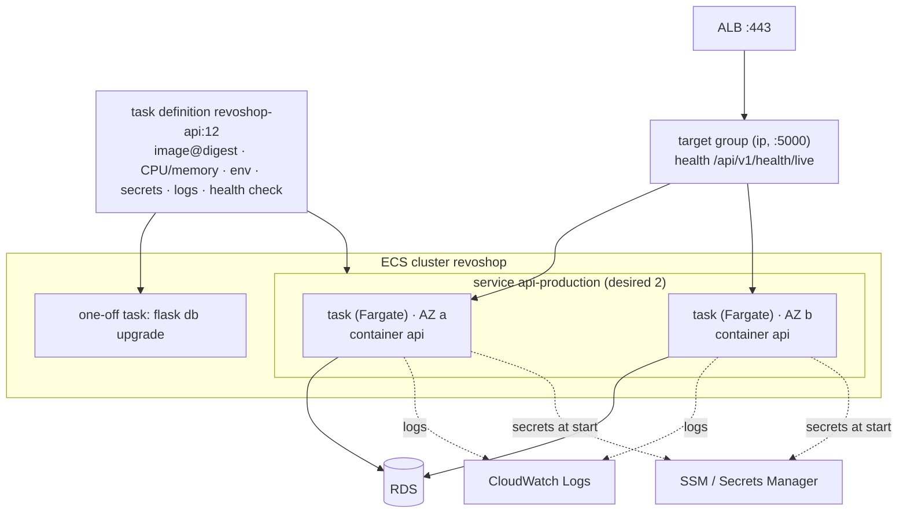

::part[Pelajari Konsepnya]{n="1"}

## 🎯 Yang akan kamu pelajari

- Bahan dasar ECS: **cluster**, **task definition**, **task**, **service**, **Fargate** vs EC2 capacity
- Repository **ECR**, image scanning dan lifecycle policy
- **Task execution role** vs **task role**
- **Injeksi secret** dari SSM Parameter Store dan Secrets Manager
- **ALB** listener, target group (`ip` target), health check dan deregistration delay
- **Rolling deployment**, **deployment circuit breaker** dan rollback
- **One-off task** untuk migrasi; **ECS Exec** untuk debugging
- **Service autoscaling**, **CloudWatch Logs**, pilihan networking (public IP vs NAT) dan **biaya**

## 🔤 Istilah penting

| Istilah | Artinya (sederhana) |
|---|---|
| **ECS** | Layanan AWS untuk menjalankan container untukmu |
| **Fargate** | Pilihan di mana AWS juga menyediakan server — kamu tidak pernah lihat mereka |
| **Cluster** | Tempat bernama di mana task-mu berjalan |
| **Task definition** | Resep: image, CPU, memory, environment, secret, log |
| **Task** | Satu salinan resep yang sedang berjalan |
| **Service** | Aturan "jalankan N task dan ganti yang tidak sehat" |
| **ECR** | Gudang image container AWS |
| **Execution role** | Badge yang dipakai ECS sendiri untuk menarik image, membaca secret, dan menulis log |
| **Task role** | Badge yang dipakai kode aplikasimu untuk memanggil AWS (S3, SQS) |
| **Target group** | Daftar alamat task yang load balancer kirimkan traffic ke sana |
| **Circuit breaker** | ECS melihat deploy terus gagal dan membatalkannya |

## 🧠 Ide besarnya

Compose di EC2 membuat kamu **manajer restoran dan penjaga gedung sekaligus**.

ECS di Fargate itu seperti **menyewa kios di food court**:

- kamu bawa resep (image) dan rencana staf — task definition dan service mengatakan "selalu dua koki, ganti yang pingsan, dan bawa koki baru sebelum yang lama pergi",
- mall menangani listrik, lantai, dan penjaga (server, patch, di mana semuanya berjalan).

Kamu masih punya resep dan menu; kamu tidak punya gedung lagi.

## ❓ Kenapa ini penting

Semua yang kamu bangun di tangan di materi 02 — beberapa salinan, ganti yang tidak sehat, rolling deploy dengan rollback, injeksi secret, log terpusat, scaling — adalah yang dilakukan service ECS dari konfigurasi. Itu salah satu cara paling umum perusahaan menjalankan container di AWS, dan langkah berikutnya yang alami setelah Compose.

Saat bagian-bagiannya tidak jelas, ini adalah error yang kamu temui:

- Task tidak mau jalan: `ResourceInitializationError: unable to pull secrets` — **execution** role tidak punya `ssm:GetParameters`.
- App dapat `AccessDenied` dari S3, karena izin ditambahkan ke execution role bukan **task** role.
- Task terus berganti: health check path load balancer mengembalikan 404, jadi ECS terus ganti container yang sehat.
- Migrasi berjalan di setiap task saat startup, dan dua task balapan di `ALTER TABLE` yang sama.
- Task di subnet private tanpa NAT tidak bisa menarik image dari ECR atau jangkau Midtrans.

## 📖 Langkah demi langkah

### 1. Bahan dasarnya



| Konsep | Seperti di Compose |
|---|---|
| Task definition (revisi immutable, tersedia di versi) | blok service di `compose.yaml` |
| Task | satu kelompok container berjalan (satu instance dari definisi) |
| Service | "jalankan N task dan daftarkan ke load balancer" |
| Cluster | namespace untuk service dan task |
| Fargate | kapasitas serverless: tidak perlu urus EC2 instance |

### 2. ECR

```bash
aws ecr create-repository --repository-name revoshop-api --image-scanning-configuration scanOnPush=true --image-tag-mutability IMMUTABLE
aws ecr put-lifecycle-policy --repository-name revoshop-api --lifecycle-policy-text file://keep-last-30.json
```

Fargate menarik dari ECR lewat execution role. Kamu juga bisa menarik dari GHCR (private registry butuh `repositoryCredentials` dengan secret Secrets Manager) — ECR simpan semuanya di dalam AWS IAM.

### 3. Dua peran

Cara paling mudah mengingat: **execution role** milik delivery crew yang menyiapkan kios (image, secret, log); **task role** adalah badge yang dipakai staf yang bekerja di sana (kode-mu memanggil S3 atau SQS).

| Peran | Dipakai oleh | Izin umum |
|---|---|---|
| **Task execution role** | ECS agent, *sebelum dan saat* container berjalan | `AmazonECSTaskExecutionRolePolicy` (ECR pull, CloudWatch Logs) + `ssm:GetParameters` / `secretsmanager:GetSecretValue` untuk secret yang diinjeksi (+ `kms:Decrypt`) |
| **Task role** | kode aplikasimu (boto3 di dalam container) | S3 `products/*`, SQS `SendMessage`, … — hanya yang dipanggil app |

### 4. Task definition

```json
{
  "family": "revoshop-api-production",
  "requiresCompatibilities": ["FARGATE"],
  "networkMode": "awsvpc",
  "cpu": "512",
  "memory": "1024",
  "runtimePlatform": { "operatingSystemFamily": "LINUX", "cpuArchitecture": "X86_64" },
  "executionRoleArn": "arn:aws:iam::123456789012:role/revoshop-task-execution",
  "taskRoleArn": "arn:aws:iam::123456789012:role/revoshop-task",
  "containerDefinitions": [{
    "name": "api",
    "image": "123456789012.dkr.ecr.ap-southeast-1.amazonaws.com/revoshop-api@sha256:…",
    "portMappings": [{ "name": "http", "containerPort": 5000, "protocol": "tcp" }],
    "environment": [{ "name": "APP_ENV", "value": "production" }],
    "secrets": [{ "name": "JWT_SECRET_KEY", "valueFrom": "arn:aws:ssm:ap-southeast-1:123456789012:parameter/revoshop/production/JWT_SECRET_KEY" }],
    "readonlyRootFilesystem": true,
    "logConfiguration": { "logDriver": "awslogs", "options": { "awslogs-group": "/ecs/revoshop-api-production", "awslogs-region": "ap-southeast-1", "awslogs-stream-prefix": "api" } },
    "healthCheck": { "command": ["CMD", "python", "-c", "…/api/v1/health/live…"], "interval": 15, "timeout": 5, "retries": 3, "startPeriod": 30 }
  }]
}
```

- `awsvpc` networking: setiap task dapat ENI sendiri, IP dan **security group**.
- Fargate CPU/memory datang dalam kombinasi tetap (latihan 03).
- Secret diselesaikan **saat task dimulai** — ubah parameter, lalu mulai task baru (paksa deploy baru) untuk ambil yang baru.

### 5. Load balancer

Health check itu seperti penjaga mall mengetuk pintu kios sebelum mengirim pelanggan. Arahkan ke endpoint murah yang tidak sentuh database, atau satu query lambat akan kosongkan seluruh food court-mu.

| Pengaturan | Nilai |
|---|---|
| ALB | internet-facing, public subnet, `sg-alb` (80/443 dari dunia) |
| Listener 443 | Sertifikat ACM untuk `api.<domain>`; listener 80 arahkan ke 443 |
| Target group | tipe **`ip`** (wajib untuk Fargate `awsvpc`), port 5000, health check `/api/v1/health/live`, healthy threshold 2, interval 15 s |
| Deregistration delay | 30 s (≥ request normal terpanjang-mu, ≤ `stopTimeout`) |
| Service | config load balancer → container `api` port 5000; **health check grace period** 60 s |

### 6. Deploy

```json
"deploymentConfiguration": {
  "deploymentCircuitBreaker": { "enable": true, "rollback": true },
  "maximumPercent": 200,
  "minimumHealthyPercent": 100
}
```

- **Rolling**: task baru mulai (sampai 200%), jadi sehat di target group, task lama keringkan dan berhenti — tidak ada downtime untuk service tanpa state.
- **Circuit breaker**: kalau task baru terus gagal jadi sehat, deploy berhenti dan **batal** ke task definition yang terakhir kerja.
- Deploy = daftarkan revisi task definition baru (digest baru) → `update-service` → tunggu `services-stable`. Di GitHub Actions: `aws-actions/amazon-ecs-render-task-definition` + `amazon-ecs-deploy-task-definition` (SHA-pinned), atau CLI.
- ECS juga mendukung blue/green deploy native (dengan ALB listener rule) untuk shift traffic instan dan bake time.

### 7. Migrasi sebagai one-off task

Migrasi itu atur ulang dapur: lakukan sekali, sebelum staf baru mulai layani — bukan setiap koki di waktu yang sama.

```bash
TASK_ARN=$(aws ecs run-task --cluster revoshop --launch-type FARGATE --task-definition revoshop-api-production:12 \
  --network-configuration "awsvpcConfiguration={subnets=[subnet-a,subnet-b],securityGroups=[sg-api],assignPublicIp=ENABLED}" \
  --overrides '{"containerOverrides":[{"name":"api","command":["flask","db","upgrade"]}]}' \
  --query 'tasks[0].taskArn' --output text)
aws ecs wait tasks-stopped --cluster revoshop --tasks "$TASK_ARN"
aws ecs describe-tasks --cluster revoshop --tasks "$TASK_ARN" --query 'tasks[0].containers[0].exitCode'   # must be 0
```

### 8. Debugging dan scaling

- **ECS Exec** (`aws ecs execute-command --interactive --command /bin/sh`) — butuh `enableExecuteCommand`, izin SSM di task role, dan shell di image.
- Event: `aws ecs describe-services` → `events` jelaskan gagal placement dan health check.
- **Service Auto Scaling**: target tracking di `ECSServiceAverageCPUUtilization` atau ALB `RequestCountPerTarget`; min 2 task untuk availability.

### 9. Networking dan biaya

| Penempatan | Internet outbound | Catatan biaya |
|---|---|---|
| Public subnet, `assignPublicIp: ENABLED` | lewat IGW | public IPv4 per task; SG izinkan inbound **hanya dari ALB** |
| Private subnet + NAT gateway | NAT | NAT per jam + per GB (sering lebih dari task) |
| Private subnet + VPC endpoint (ECR API/DKR, S3, Logs, SSM) | tidak ada (Midtrans masih butuh NAT/egress) | endpoint interface per AZ per jam |

Fargate ditagih per vCPU-detik dan GB-detik saat task berjalan; ALB ada minimum per jam; log per GB masuk dan simpan. **Fargate Spot** bisa potong biaya untuk pekerjaan yang bisa diinterupsi (bukan satu-satunya production API task-mu).

### Pilih setupmu

Setiap pilihan di sini ada trade-off:

| Pilihan | ✅ | ❌ |
|---|---|---|
| ECS Fargate | tidak urus server, isolasi per-task, integrasi AWS native | biaya per-unit lebih tinggi dari EC2 packed; beberapa batasan (tidak boleh privileged container) |
| ECS di EC2 capacity | lebih murah di skala tetap, GPU, daemon | urus instance/AMI/capacity provider |
| App Runner | paling sederhana "container → HTTPS URL" | lebih sedikit tombol; cek networking dan cocok fitur |
| EKS (Kubernetes) | ekosistem portable, tooling besar | biaya control plane dan jauh lebih rumit (Minggu 6) |

- ✅ Stateless HTTP API, worker dan scheduled container job di AWS.
- ✅ Tim tanpa dedicated platform engineer yang masih mau rolling deploy dan autoscaling.
- 🚫 Jangan jalankan PostgreSQL di Fargate task — pakai RDS.
- 🚫 Jangan panggang secret di `environment` task definition.

## ⚠️ Kesalahan umum

- Target group tipe `instance` dengan Fargate (harus `ip`).
- Grace period health check terlalu singkat untuk startup app → loop penggantian tanpa henti.
- Task di subnet private tanpa NAT atau endpoint → `CannotPullContainerError`.
- Ubah SSM parameter dan harap running task lihat itu.

:::revoshop
1. **Compose → task definition.** Petakan setiap pengaturan service `api` di `compose.aws.yaml` (image, env, `env_file`, `read_only`, `tmpfs`, `cap_drop`, memory limit, healthcheck, restart) ke ECS equivalent-nya. Yang tidak punya direct equivalent, dan kenapa tidak masalah di Fargate?
2. **Generate itu.** Pakai `task_definition()` dari latihan 03 dengan nama sungguhan: family `revoshop-api-production`, 512 CPU / 1024 MiB, secret `DATABASE_URL`, `JWT_SECRET_KEY`, `MIDTRANS_SERVER_KEY` dari `/revoshop/production/*`. Kenapa `REDIS_URL` tinggal di `environment` — dan di mana Redis akan tinggal di ECS (sidecar container, ElastiCache, atau tidak ada Redis dengan fail-open rate limiting)?
3. **Dua peran untuk RevoShop.** Tulis policy execution role (ECR pull, logs, `ssm:GetParameters` pada tiga ARN parameter-mu, `kms:Decrypt` via SSM) dan task role policy (hari ini: tidak ada, atau S3 `products/*` begitu image upload tiba).
4. **Health check.** ALB harus pakai `/api/v1/health/live` (tidak ada database) — tapi kamu juga mau tahu saat DB down. Di mana `/api/v1/health` (dengan DB check) sebaiknya tinggal? (Petunjuk: alarm atau synthetic check, bukan load balancer.)
5. **Midtrans di ECS.** Task di public subnet dengan public IP jangkau `app.sandbox.midtrans.com` lewat internet gateway. Security group rule mana yang pastikan tidak ada yang di internet bisa kena port 5000 di public IP itu?
:::

## 🏆 Praktik terbaik

- [ ] ECR repo immutable dengan scanning dan lifecycle policy; deploy dengan digest.
- [ ] Execution dan task role terpisah, keduanya least privilege.
- [ ] Secret via `secrets` (SSM/Secrets Manager ARN), jangan pernah plain `environment`.
- [ ] Read-only root filesystem, `/tmp` volume, init process, non-root image.
- [ ] Container health check + ALB health check di endpoint liveness murah; grace period yang masuk akal.
- [ ] Circuit breaker dengan rollback; `minimumHealthyPercent: 100` untuk service menghadap user.
- [ ] Migrasi sebagai one-off task sebelum `update-service`.
- [ ] Minimal 2 task di 2 AZ; target tracking autoscaling.
- [ ] Log group dengan retention; alarm di 5xx, unhealthy target dan task restart.
- [ ] Pahami pilihan biaya networking (public IP vs NAT vs endpoint).

::part[Jelaskan & Rancang]{n="2"}

## 🗣️ Jelaskan

Jelaskan analogi kios food court, lalu jelaskan ke rekan kerja kenapa izin S3 harus di task role bukan execution role.

## 📐 Rancang

Rancang setup production ECS RevoShop: cluster, ECR repo, role, task definition sizing, service setting (desired count, deployment config, grace period), ALB dan target group, subnet dan security group, secret, log, prosedur migrasi, autoscaling dan alarm — plus langkah deploy tepat yang workflow GitHub Actions-mu jalankan.

:::quiz
Lihat contoh rancangan

- **ECR:** `revoshop-api`, tag immutable, scan on push, simpan image terakhir 30.
- **Role:** `revoshop-task-execution` (managed execution policy + `ssm:GetParameters` di `/revoshop/production/*` + `kms:Decrypt` via SSM) · `revoshop-task` (kosong untuk sekarang) · `revoshop-gha-production` (OIDC; `ecr:*` push action di repo, `ecs:RegisterTaskDefinition`, `ecs:UpdateService`/`DescribeServices` di service, `ecs:RunTask`/`DescribeTasks`, `iam:PassRole` di dua task role saja).
- **Task definition:** 512 CPU / 1024 MiB, X86_64, image digest, `WEB_CONCURRENCY=2`, secret dari SSM, read-only root + `/tmp`, init process, awslogs `/ecs/revoshop-api-production` (retention 30 hari), container health check di `/api/v1/health/live`.
- **Service `api-production`:** Fargate, desired 2, public subnet a/b dengan public IP, `sg-api` (5000 dari `sg-alb`), circuit breaker + rollback, max 200% / min 100%, grace period 60 s, target group `revoshop-api` (ip, 5000, `/api/v1/health/live`, deregistration delay 30 s), `enableExecuteCommand` untuk debugging.
- **ALB:** HTTPS 443 dengan sertifikat ACM `api.<domain>`, 80 → 443 redirect, idle timeout 60 s.
- **Autoscaling:** 2–4 task, target tracking 60% CPU.
- **Alarm:** ALB `HTTPCode_Target_5XX_Count`, `UnHealthyHostCount > 0` selama 5 min, `TargetResponseTime` p95, service running task count < desired.
- **Langkah deploy:** build/push ke ECR dengan digest → render task definition dengan digest → `run-task` migration override → tunggu `tasks-stopped` dan cek exit code 0 → `update-service` dengan revisi baru → `aws ecs wait services-stable` → smoke test → kalau gagal circuit breaker (atau job) batal ke revisi sebelumnya.
:::

### 📝 Checklist review mandiri

- [ ] Role terpilah dengan benar
- [ ] Migrasi sebelum service update
- [ ] Health check tidak bisa sebabkan replacement loop

::ai-review{task="design"}

::part[Latihan Kecil]{n="3"}

:::exercise{path="exercises/m5/w4/03-ecs-task-definition" ai="no-ai" title="ECS Fargate task definition untuk RevoShop"}
Generate task definition production-grade (image digest, ukuran Fargate valid, awsvpc, runtime platform, secret dari SSM/Secrets Manager di region sama, read-only root dengan volume /tmp, init process, log, health check), migration override dan deployment config — dan daftarkan ke moto.
:::

:::hints
- Bangun set memory valid per CPU sekali, sebagai dict of set.
- Nama terlihat-secret di `environment` adalah error walaupun nilainya terlihat harmless.
- moto naikkan revisi setiap kali kamu daftarkan family yang sama.
:::

## ✅ Cek cepat

:::quiz
Task baru berhenti dengan `ResourceInitializationError: unable to pull secrets or registry auth`. Role mana yang kamu perbaiki?

**Task execution role** — ia butuh izin baca SSM parameter atau secret yang dirujuk (dan decrypt dengan KMS), dan tarik image.
:::

:::quiz
`minimumHealthyPercent: 100` dengan `maximumPercent: 200` berarti apa saat deploy 2 task?

ECS boleh mulai sampai 2 task baru (4 total) dan jaga minimal 2 task sehat setiap saat, hanya berhenti task lama setelah task baru sehat — tidak ada drop kapasitas.
:::


## 📚 Lanjut belajar

- [AWS docs: Amazon ECS task definitions](https://docs.aws.amazon.com/AmazonECS/latest/developerguide/task_definitions.html) · [Passing sensitive data to a container](https://docs.aws.amazon.com/AmazonECS/latest/developerguide/specifying-sensitive-data.html)
- [AWS docs: Deployment circuit breaker](https://docs.aws.amazon.com/AmazonECS/latest/developerguide/deployment-circuit-breaker.html) · [ECS Exec](https://docs.aws.amazon.com/AmazonECS/latest/developerguide/ecs-exec.html)
- [AWS docs: Fargate task size](https://docs.aws.amazon.com/AmazonECS/latest/developerguide/fargate-tasks-services.html)
