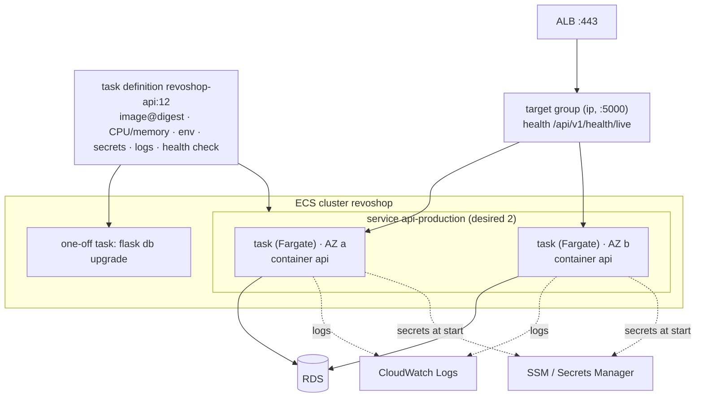

::part[Learn the Concept]{n="1"}

## 🎯 What you'll learn

- ECS building blocks: **cluster**, **task definition**, **task**, **service**, **Fargate** vs EC2 capacity
- **ECR** repositories, image scanning and lifecycle policies
- The **task execution role** vs the **task role**
- **Secrets injection** from SSM Parameter Store and Secrets Manager
- **ALB** listeners, target groups (`ip` targets), health checks and deregistration delay
- **Rolling deployments**, the **deployment circuit breaker** and rollbacks
- **One-off tasks** for migrations; **ECS Exec** for debugging
- **Service autoscaling**, **CloudWatch Logs**, networking choices (public IP vs NAT) and **cost**

## 🔤 Key words

| Word | In simple words | Bahasa Indonesia |
|---|---|---|
| **ECS** | AWS's service for running containers for you | Pengelola container AWS |
| **Fargate** | The option where AWS provides the servers too — you never see them | Tanpa mengurus server |
| **Cluster** | The named place your tasks run in | Wadah tempat task berjalan |
| **Task definition** | The recipe: image, CPU, memory, environment, secrets, logs | Resep menjalankan container |
| **Task** | One running copy of that recipe | Satu container berjalan |
| **Service** | The rule "keep N tasks running and replace unhealthy ones" | Penjaga jumlah task |
| **ECR** | AWS's registry for your container images | Gudang image AWS |
| **Execution role** | The badge ECS itself uses to pull the image, read secrets and write logs | Peran untuk menyiapkan task |
| **Task role** | The badge your application code uses to call AWS (S3, SQS) | Peran untuk kode aplikasi |
| **Target group** | The list of task addresses the load balancer sends traffic to | Daftar tujuan load balancer |
| **Circuit breaker** | ECS noticing a deploy keeps failing and rolling it back | Pembatal deploy gagal |

## 🧠 The big idea

Compose on EC2 makes you **both the restaurant manager and the building caretaker**.

ECS on Fargate is **renting a stall in a food court**:

- you bring the recipe (the image) and the staffing plan — the task definition and service say "always two cooks, replace anyone who faints, and bring new cooks in before the old ones leave",
- the mall handles electricity, floors and security guards (servers, patching, where things run).

You still own the recipe and the menu; you stop owning the building.

## ❓ Why it matters

Everything you built by hand in lesson 02 — several copies, replacing unhealthy ones, rolling deploys with rollback, secrets injection, central logs, scaling — is what an ECS service does from configuration. It's one of the most common ways companies run containers on AWS, and the natural next step after Compose.

When the pieces aren't clear, these are the errors you meet:

- The task won't start: `ResourceInitializationError: unable to pull secrets` — the **execution** role lacks `ssm:GetParameters`.
- The app gets `AccessDenied` from S3, because the permission was added to the execution role instead of the **task** role.
- Tasks cycle forever: the load balancer health check path returns 404, so ECS keeps replacing perfectly healthy containers.
- Migrations run inside every task at startup, and two tasks race on the same `ALTER TABLE`.
- Tasks in private subnets without NAT can't pull images from ECR or reach Midtrans.

## 📖 Step by step

### 1. The building blocks



| Concept | Like in Compose |
|---|---|
| Task definition (versioned, immutable revisions) | a service block in `compose.yaml` |
| Task | a running container group (one `docker compose up` instance of the definition) |
| Service | "keep N tasks running and register them with a load balancer" |
| Cluster | a namespace for services and tasks |
| Fargate | serverless capacity: no EC2 instances to manage |

### 2. ECR

```bash
aws ecr create-repository --repository-name revoshop-api --image-scanning-configuration scanOnPush=true --image-tag-mutability IMMUTABLE
aws ecr put-lifecycle-policy --repository-name revoshop-api --lifecycle-policy-text file://keep-last-30.json
```

Fargate pulls from ECR through the execution role. You can also pull from GHCR (private registries need `repositoryCredentials` with a Secrets Manager secret) — ECR keeps everything inside AWS IAM.

### 3. Two roles

The simplest way to remember them: the **execution role** belongs to the delivery crew that sets the stall up (image, secrets, logs); the **task role** is the badge worn by the staff actually working there (your code calling S3 or SQS).

| Role | Used by | Typical permissions |
|---|---|---|
| **Task execution role** | the ECS agent, *before and around* your container | `AmazonECSTaskExecutionRolePolicy` (ECR pull, CloudWatch Logs) + `ssm:GetParameters` / `secretsmanager:GetSecretValue` for injected secrets (+ `kms:Decrypt`) |
| **Task role** | your application code (boto3 inside the container) | S3 `products/*`, SQS `SendMessage`, … — only what the app calls |

### 4. The task definition

```json
{
  "family": "revoshop-api-production",
  "requiresCompatibilities": ["FARGATE"],
  "networkMode": "awsvpc",
  "cpu": "512",
  "memory": "1024",
  "runtimePlatform": { "operatingSystemFamily": "LINUX", "cpuArchitecture": "X86_64" },
  "executionRoleArn": "arn:aws:iam::123456789012:role/revoshop-task-execution",
  "taskRoleArn": "arn:aws:iam::123456789012:role/revoshop-task",
  "containerDefinitions": [{
    "name": "api",
    "image": "123456789012.dkr.ecr.ap-southeast-1.amazonaws.com/revoshop-api@sha256:…",
    "portMappings": [{ "name": "http", "containerPort": 5000, "protocol": "tcp" }],
    "environment": [{ "name": "APP_ENV", "value": "production" }],
    "secrets": [{ "name": "JWT_SECRET_KEY", "valueFrom": "arn:aws:ssm:ap-southeast-1:123456789012:parameter/revoshop/production/JWT_SECRET_KEY" }],
    "readonlyRootFilesystem": true,
    "logConfiguration": { "logDriver": "awslogs", "options": { "awslogs-group": "/ecs/revoshop-api-production", "awslogs-region": "ap-southeast-1", "awslogs-stream-prefix": "api" } },
    "healthCheck": { "command": ["CMD", "python", "-c", "…/api/v1/health/live…"], "interval": 15, "timeout": 5, "retries": 3, "startPeriod": 30 }
  }]
}
```

- `awsvpc` networking: every task gets its own ENI, IP and **security group**.
- Fargate CPU/memory come in fixed combinations (exercise 03).
- Secrets are resolved **when the task starts** — change a parameter, then start new tasks (force a new deployment) to pick it up.

### 5. Load balancer

A health check is the mall guard knocking on the stall door before sending customers in. Point it at a cheap endpoint that doesn't touch the database, or one slow query will empty your whole food court.

| Setting | Value |
|---|---|
| ALB | internet-facing, public subnets, `sg-alb` (80/443 from world) |
| Listener 443 | ACM certificate for `api.<domain>`; listener 80 redirects to 443 |
| Target group | type **`ip`** (required for Fargate `awsvpc`), port 5000, health check `/api/v1/health/live`, healthy threshold 2, interval 15 s |
| Deregistration delay | 30 s (≥ your longest normal request, ≤ `stopTimeout`) |
| Service | load balancer config → container `api` port 5000; **health check grace period** 60 s |

### 6. Deployments

```json
"deploymentConfiguration": {
  "deploymentCircuitBreaker": { "enable": true, "rollback": true },
  "maximumPercent": 200,
  "minimumHealthyPercent": 100
}
```

- **Rolling**: new tasks start (up to 200%), become healthy in the target group, old tasks drain and stop — zero downtime for stateless services.
- **Circuit breaker**: if new tasks keep failing to become healthy, the deployment stops and **rolls back** to the last working task definition.
- Deploy = register a new task definition revision (new digest) → `update-service` → wait `services-stable`. In GitHub Actions: `aws-actions/amazon-ecs-render-task-definition` + `amazon-ecs-deploy-task-definition` (SHA-pinned), or the CLI.
- ECS also supports blue/green deployments natively (with ALB listener rules) for instant traffic shifts and bake time.

### 7. Migrations as one-off tasks

A migration is rearranging the kitchen: do it once, before the new staff start serving — not by every cook at the same time.

```bash
TASK_ARN=$(aws ecs run-task --cluster revoshop --launch-type FARGATE --task-definition revoshop-api-production:12 \
  --network-configuration "awsvpcConfiguration={subnets=[subnet-a,subnet-b],securityGroups=[sg-api],assignPublicIp=ENABLED}" \
  --overrides '{"containerOverrides":[{"name":"api","command":["flask","db","upgrade"]}]}' \
  --query 'tasks[0].taskArn' --output text)
aws ecs wait tasks-stopped --cluster revoshop --tasks "$TASK_ARN"
aws ecs describe-tasks --cluster revoshop --tasks "$TASK_ARN" --query 'tasks[0].containers[0].exitCode'   # must be 0
```

### 8. Debugging and scaling

- **ECS Exec** (`aws ecs execute-command --interactive --command /bin/sh`) — needs `enableExecuteCommand`, SSM permissions on the task role, and a shell in the image.
- Events: `aws ecs describe-services` → `events` explain failed placements and health check failures.
- **Service Auto Scaling**: target tracking on `ECSServiceAverageCPUUtilization` or ALB `RequestCountPerTarget`; min 2 tasks for availability.

### 9. Networking and cost

| Placement | Outbound internet | Cost notes |
|---|---|---|
| Public subnets, `assignPublicIp: ENABLED` | through the IGW | public IPv4 per task; SG allows inbound **only from the ALB** |
| Private subnets + NAT gateway | NAT | NAT hourly + per GB (often more than the tasks) |
| Private subnets + VPC endpoints (ECR API/DKR, S3, Logs, SSM) | none (Midtrans still needs NAT/egress) | interface endpoints per AZ per hour |

Fargate is billed per vCPU-second and GB-second while tasks run; the ALB has an hourly minimum; logs per GB ingested and stored. **Fargate Spot** can cut costs for interruptible work (not your only production API task).

### Choosing your setup

Every option here is a trade-off:

| Choice | ✅ | ❌ |
|---|---|---|
| ECS Fargate | no servers, per-task isolation, native AWS integration | per-unit cost higher than packed EC2; some limits (no privileged containers) |
| ECS on EC2 capacity | cheaper at steady scale, GPUs, daemons | manage instances/AMIs/capacity providers |
| App Runner | simplest "container → HTTPS URL" | fewer knobs; check networking and feature fit |
| EKS (Kubernetes) | portable ecosystem, huge tooling | control plane cost and much more complexity (Week 6) |

- ✅ Stateless HTTP APIs, workers and scheduled container jobs on AWS.
- ✅ Teams without dedicated platform engineers who still want rolling deploys and autoscaling.
- 🚫 Don't run PostgreSQL in Fargate tasks — use RDS.
- 🚫 Don't bake secrets into task definition `environment`.

## ⚠️ Common mistakes

- Target group type `instance` with Fargate (must be `ip`).
- Health check grace period too short for app startup → endless replacement loop.
- Task in private subnets without NAT or endpoints → `CannotPullContainerError`.
- Changing an SSM parameter and expecting running tasks to see it.

:::revoshop
1. **Compose → task definition.** Map every setting of your `api` service in `compose.aws.yaml` (image, env, `env_file`, `read_only`, `tmpfs`, `cap_drop`, memory limit, healthcheck, restart) to its ECS equivalent. Which ones have no direct equivalent, and why doesn't it matter on Fargate?
2. **Generate it.** Use `task_definition()` from exercise 03 with your real names: family `revoshop-api-production`, 512 CPU / 1024 MiB, secrets `DATABASE_URL`, `JWT_SECRET_KEY`, `MIDTRANS_SERVER_KEY` from `/revoshop/production/*`. Why does `REDIS_URL` stay in `environment` — and where will Redis live on ECS (a sidecar container, ElastiCache, or no Redis with fail-open rate limiting)?
3. **Two roles for RevoShop.** Write the execution role policy (ECR pull, logs, `ssm:GetParameters` on your three parameter ARNs, `kms:Decrypt` via SSM) and the task role policy (today: nothing, or S3 `products/*` once image uploads land).
4. **Health checks.** The ALB should use `/api/v1/health/live` (no database) — but you also want to know when the DB is down. Where does `/api/v1/health` (with the DB check) belong instead? (Hint: an alarm or synthetic check, not the load balancer.)
5. **Midtrans on ECS.** Tasks in public subnets with public IPs reach `app.sandbox.midtrans.com` through the internet gateway. Which security group rule makes sure nobody on the internet can hit port 5000 on those public IPs directly?
:::

## 🏆 Best practices

- [ ] Immutable ECR repos with scanning and lifecycle policies; deploy by digest.
- [ ] Separate execution and task roles, both least privilege.
- [ ] Secrets via `secrets` (SSM/Secrets Manager ARNs), never plain `environment`.
- [ ] Read-only root filesystem, `/tmp` volume, init process, non-root image.
- [ ] Container health check + ALB health check on a cheap liveness endpoint; sensible grace periods.
- [ ] Circuit breaker with rollback; `minimumHealthyPercent: 100` for user-facing services.
- [ ] Migrations as one-off tasks before `update-service`.
- [ ] At least 2 tasks in 2 AZs; target tracking autoscaling.
- [ ] Log groups with retention; alarms on 5xx, unhealthy targets and task restarts.
- [ ] Understand the networking cost choice (public IP vs NAT vs endpoints).

::part[Explain & Design]{n="2"}

## 🗣️ Explain it

Explain the food-court stall analogy, then explain to a teammate why permissions for S3 belong on the task role and not the execution role.

## 📐 Design it

Design RevoShop's ECS production setup: cluster, ECR repo, roles, task definition sizing, service settings (desired count, deployment configuration, grace period), ALB and target group, subnets and security groups, secrets, logs, migration procedure, autoscaling and alarms — plus the exact deploy steps your GitHub Actions workflow runs.

:::quiz
Show a possible design

- **ECR:** `revoshop-api`, immutable tags, scan on push, keep last 30 images.
- **Roles:** `revoshop-task-execution` (managed execution policy + `ssm:GetParameters` on `/revoshop/production/*` + `kms:Decrypt` via SSM) · `revoshop-task` (empty for now) · `revoshop-gha-production` (OIDC; `ecr:*` push actions on the repo, `ecs:RegisterTaskDefinition`, `ecs:UpdateService`/`DescribeServices` on the service, `ecs:RunTask`/`DescribeTasks`, `iam:PassRole` on the two task roles only).
- **Task definition:** 512 CPU / 1024 MiB, X86_64, digest image, `WEB_CONCURRENCY=2`, secrets from SSM, read-only root + `/tmp`, init process, awslogs `/ecs/revoshop-api-production` (30-day retention), container health check on `/api/v1/health/live`.
- **Service `api-production`:** Fargate, desired 2, public subnets a/b with public IPs, `sg-api` (5000 from `sg-alb`), circuit breaker + rollback, max 200% / min 100%, grace period 60 s, target group `revoshop-api` (ip, 5000, `/api/v1/health/live`, deregistration delay 30 s), `enableExecuteCommand` for debugging.
- **ALB:** HTTPS 443 with ACM cert `api.<domain>`, 80 → 443 redirect, idle timeout 60 s.
- **Autoscaling:** 2–4 tasks, target tracking 60% CPU.
- **Alarms:** ALB `HTTPCode_Target_5XX_Count`, `UnHealthyHostCount > 0` for 5 min, `TargetResponseTime` p95, service running task count < desired.
- **Deploy steps:** build/push to ECR by digest → render task definition with the digest → `run-task` migration override → wait `tasks-stopped` and check exit code 0 → `update-service` with the new revision → `aws ecs wait services-stable` → smoke tests → on failure the circuit breaker (or the job) rolls back to the previous revision.
:::

### 📝 Self-review checklist

- [ ] Roles split correctly
- [ ] Migrations before the service update
- [ ] Health checks can't cause replacement loops

::ai-review{task="design"}

::part[Toy Exercise]{n="3"}

:::exercise{path="exercises/m5/w4/03-ecs-task-definition" ai="no-ai" title="ECS Fargate task definition for RevoShop"}
Generate a production-grade task definition (digest image, valid Fargate size, awsvpc, runtime platform, secrets from SSM/Secrets Manager in the same region, read-only root with a /tmp volume, init process, logs, health check), migration overrides and a deployment configuration — and register it against moto.
:::

:::hints
- Build the valid memory sets per CPU once, as a dict of sets.
- Secret-looking names in `environment` are an error even if the value looks harmless.
- moto increments the revision each time you register the same family.
:::

## ✅ Quick check

:::quiz
New tasks stop with `ResourceInitializationError: unable to pull secrets or registry auth`. Which role do you fix?

The **task execution role** — it needs permission to read the referenced SSM parameters or secrets (and decrypt with KMS), and to pull the image.
:::

:::quiz
What does `minimumHealthyPercent: 100` with `maximumPercent: 200` mean during a deployment of 2 tasks?

ECS may start up to 2 new tasks (4 total) and keeps at least 2 healthy tasks at all times, stopping old tasks only after new ones are healthy — no capacity drop.
:::


## 📚 Keep learning

- [AWS docs: Amazon ECS task definitions](https://docs.aws.amazon.com/AmazonECS/latest/developerguide/task_definitions.html) · [Passing sensitive data to a container](https://docs.aws.amazon.com/AmazonECS/latest/developerguide/specifying-sensitive-data.html)
- [AWS docs: Deployment circuit breaker](https://docs.aws.amazon.com/AmazonECS/latest/developerguide/deployment-circuit-breaker.html) · [ECS Exec](https://docs.aws.amazon.com/AmazonECS/latest/developerguide/ecs-exec.html)
- [AWS docs: Fargate task size](https://docs.aws.amazon.com/AmazonECS/latest/developerguide/fargate-tasks-services.html)
