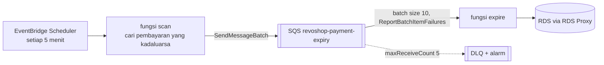

::part[Pelajari Konsepnya]{n="1"}

## 🎯 Yang akan kamu pelajari

- Apa itu **Lambda**: fungsi, handler, siklus hidup runtime, batas (timeout, memori, payload)
- Trigger: **EventBridge Scheduler** (cron), **SQS**, **event S3**, panggilan API
- **Cold start** dan apa sebenarnya yang membantu
- Pengiriman **at-least-once**, **idempotency**, **partial batch response**, dan **dead-letter queue**
- Pola **scan → queue → worker**
- Koneksi ke **RDS dari Lambda**: penempatan VPC, batas koneksi, **RDS Proxy**
- Packaging (zip vs container image, layer), konfigurasi, **Powertools**, log, metrik dan biaya

## 🔤 Istilah penting

| Istilah | Artinya (sederhana) |
|---|---|
| **Lambda function** | Kode yang dijalankan AWS saat dipanggil; kamu tidak perlu mengelola server |
| **Handler** | Fungsi yang dipanggil AWS, dengan event sebagai argumennya |
| **Trigger / event** | Apa yang memicu fungsi: jadwal, pesan antrean, upload file |
| **Cold start** | Jeda ekstra saat salinan baru harus dinyalakan pertama kali |
| **SQS queue** | Antrean pesan yang aman untuk menampung pekerjaan |
| **At-least-once** | Pesan mungkin terkirim dua kali, tidak pernah nol kali |
| **Idempotent** | Menjalankannya dua kali punya efek yang sama dengan menjalankan sekali |
| **Partial batch response** | Laporan ke SQS pesan mana saja di batch yang gagal, hanya itu yang diulang |
| **Dead-letter queue (DLQ)** | Tempat pesan pergi setelah gagal berkali-kali |
| **RDS Proxy** | Kolam koneksi di depan database, untuk banyak fungsi kecil |

## 🧠 Ide besarnya

Lambda adalah **spesialis yang siap sedia**. Tidak ada yang duduk menunggu (tidak ada server idle): saat tiket pekerjaan tiba, seorang spesialis muncul, mengerjakan satu tugas fokus dalam batas waktu, lalu pergi.

Antrean (SQS) adalah **rak tiket** di sebelah pintu:

- tiket menunggu dengan aman saat para spesialis sibuk,
- setiap tiket diserahkan ke tepat satu spesialis sekaligus,
- dan tiket yang terus gagal masuk ke **nampan "butuh manusia"** — dead-letter queue.

## ❓ Kenapa ini penting

RevoShop punya pekerjaan yang seharusnya tidak terjadi di dalam request HTTP, dan tidak boleh bergantung pada webhook yang tiba: pembayaran kadaluarsa, mengirim email, memproses gambar yang di-upload, laporan malam hari. Membiarkan worker server berjalan 24/7 untuk pekerjaan yang hanya butuh beberapa detik setiap lima menit adalah pemborosan uang — Lambda hanya berjalan saat ada sesuatu untuk dikerjakan.

Kalau dilakukan sembarangan:

- Cron job di instance API berjalan dua kali saat kamu scaling ke dua instance → email duplikat.
- Pembayaran yang transaksi Midtrans-nya kadaluarsa tetap punya stok reserved selamanya, karena webhook tidak pernah tiba.
- Lambda menangani 10 pesan SQS, gagal di nomor 7 dan raise → semua 10 diulang → pelanggan dapat email duplikat.
- 500 fungsi berjalan sekaligus, setiap satu membuka koneksi PostgreSQL → `too many connections`.

## 📖 Langkah demi langkah

### 1. Handler dan siklus hidup

```python
import json
import logging

logger = logging.getLogger()
logger.setLevel("INFO")

CLIENT = make_database_pool()        # runs once per execution environment (reused across invocations)

def handler(event, context):
    logger.info("request %s, %d ms left", context.aws_request_id, context.get_remaining_time_in_millis())
    return {"ok": True}
```

| Batas / pengaturan | Catatan |
|---|---|
| Timeout | Hingga 15 menit; atur sedikit di atas durasi yang diharapkan |
| Memory | 128 MB–10 GB; CPU bertambah seiring memori (lebih banyak memori bisa lebih murah saat finish lebih cepat) |
| Concurrency | Batas akun per region; **reserved concurrency** batasi fungsi (proteksi database-mu) |
| Payload | Sinkron 6 MB; untuk data lebih besar lewatkan kunci S3 |
| Ephemeral storage | `/tmp` default 512 MB, dapat diatur hingga 10 GB |

Kode inisialisasi di luar handler berjalan di **cold start** dan dipakai ulang di pemanggilan warm.

### 2. Trigger

| Trigger | Pemanggilan | Perilaku ulang |
|---|---|---|
| **EventBridge Scheduler** (`rate(5 minutes)`, `cron(0 2 * * ? *)`, zona waktu) | asinkron | ulang dengan retry policy; DLQ dapat diatur |
| **SQS** (event source mapping) | Lambda polling dalam batch | pesan yang gagal jadi terlihat lagi; `maxReceiveCount` → DLQ |
| **S3 event** / EventBridge rule | asinkron | 2 ulang secara default; on-failure destination |
| API Gateway / Function URL | sinkron | pemanggil tangani error |

### 3. Pola scan → queue → worker

Satu fungsi mencari pekerjaan dan menulis tiket; salinan lain mengerjakan tiketnya. Seperti supervisor yang berjalan di toko, menulis apa yang perlu dikerjakan, dan memberikan slip ke siapa saja yang sedang bebas — jauh lebih aman daripada satu pekerjaan panjang yang harus selesai sebelum batas waktu.



- **Scan** kecil dan cepat; antrean menyerap lonjakan; worker scale dengan backlog; reserved concurrency batasi tekanan database.
- Duplikat terjadi (scan berjalan lagi sebelum worker selesai; ulang) → worker harus **idempotent**: pembaruan kondisional `UPDATE payments SET status='expired' WHERE id=:id AND status='pending'` berhasil sekali, percobaan nanti tidak apa-apa.

### 4. Partial batch response

Tanpa pengaturan ini, satu tiket buruk mengirim seluruh batch kembali ke rak. Dengan ini, kamu hanya mengembalikan tiket yang gagal.

```python
def handler(event, context):
    failures = []
    for record in event["Records"]:
        try:
            process(json.loads(record["body"]))
        except TransientError:
            failures.append({"itemIdentifier": record["messageId"]})
    return {"batchItemFailures": failures}
```

Aktifkan **ReportBatchItemFailures** di event source mapping. Pesan beracun (JSON tidak valid) harus di-log dan di-skip — kalau tidak, akan berputar sampai DLQ.

Atur **visibility timeout** antrean ke minimal **6×** timeout fungsi (panduan AWS untuk SQS event source), dan berhenti memulai record baru saat `get_remaining_time_in_millis()` rendah.

### 5. Koneksi ke RDS

Setiap salinan fungsi membuka koneksi database sendiri seperti setiap kurir meminta tempat parkir sendiri. Proxy (RDS Proxy) menyimpan kolam parkir kecil bersama sebagai gantinya.

| Pilihan | Catatan |
|---|---|
| Lambda **di VPC** (private subnet + SG diizinkan oleh `sg-db`) | butuh untuk RDS privat; outbound internet lalu butuh NAT (atau VPC endpoint untuk AWS API seperti SQS) |
| **RDS Proxy** | pool dan bagikan koneksi di pemanggilan; auth IAM; direkomendasikan untuk Lambda → RDS |
| Reserved concurrency | batasi pemanggilan paralel (mis. 5) jadi database tidak kewalahan |
| RDS Data API | tersedia untuk Aurora (berbasis HTTP, tanpa koneksi) — bukan RDS PostgreSQL standar |

Untuk setup pembelajaran kecil: jalankan logika scan/expire sebagai **scheduled ECS task** (image sama, akses VPC sama) — atau terima biaya Lambda-in-VPC dengan SQS **interface endpoint**. Pilih dengan sadar.

### 6. Packaging dan konfigurasi

- **Zip** untuk fungsi Python murni kecil; **container image** (hingga 10 GB) saat dependensi berat atau native (psycopg, Pillow).
- Konfigurasi via environment variable; secret via **Parameters and Secrets Lambda Extension** atau SDK call dengan caching (latihan 05 minggu ini).
- **Powertools for AWS Lambda (Python)**: structured logging, metrik, tracing, idempotency utility, batch processing utility.

### 7. Observasi dan biaya

- Log di CloudWatch Logs (`/aws/lambda/<name>`, atur retention); metrik: `Errors`, `Throttles`, `Duration`, `IteratorAge`/`ApproximateAgeOfOldestMessage` untuk antrean.
- Alarm: DLQ `ApproximateNumberOfMessagesVisible > 0`, `Errors > 0`, usia pesan tertua.
- Biaya: request + GB-second (Lambda punya allowance gratis bulanan — cek syarat terkini) + SQS request + log; pola akses in-VPC mungkin menambah biaya NAT/endpoint/RDS Proxy yang jauh melebihi Lambda itu sendiri.

### Memilih setup-mu

Setiap pilihan di sini adalah trade-off:

| Pilihan | ✅ | ❌ |
|---|---|---|
| Lambda + SQS | scaling ke nol, managed retry, fine-grained scaling | batas 15 menit, cold start, kompleksitas VPC/RDS |
| Scheduled ECS task | image dan VPC sama dengan API, tidak ada connection storm | start lebih lambat, bayar per menit run, integrasi event lebih sedikit |
| Worker process di host API (RQ/Celery) | sederhana lokal | berjalan 24/7, duplikat saat scale-out, mati dengan host |
| Step Functions | workflow panjang, retry, history visual | satu service lagi untuk belajar |

- ✅ Pekerjaan singkat, terpicu event atau terjadwal: webhook fan-out, pemrosesan gambar, notifikasi, cleanup job.
- ✅ Beban spiky yang idle kebanyakan waktu.
- 🚫 Pekerjaan running lama lebih dari 15 menit, atau pemrosesan throughput tinggi steady (container bisa lebih murah).
- 🚫 Jangan buka koneksi database tak terbatas dari fungsi concurrency tinggi.

## ⚠️ Kesalahan umum

- Throw pada satu pesan buruk dan ulang seluruh batch.
- Visibility timeout lebih pendek dari timeout fungsi → pesan diproses dua kali bersamaan.
- Menempatkan Lambda di VPC lalu bertanya-tanya kenapa tidak bisa jangkau internet.
- Jadwal cron di UTC saat aturan bisnis di zona Jakarta (EventBridge Scheduler mendukung zona waktu).

:::revoshop
1. **Masalah dalam kode-mu.** `PaymentService` di `app/services/payment_service.py` mengatur `expires_at = utcnow() + timedelta(minutes=MIDTRANS_EXPIRY_MINUTES)` (1440 default), tapi tidak ada yang bertindak kecuali Midtrans mengirim notifikasi `expire`. Tulis SQL untuk "pembayaran pending yang kadaluarsa" dan pembaruan **kondisional** yang membuat expiry idempotent. Apa lagi yang harus terjadi dalam transaksi yang sama (order status `cancelled`? stok dipulihkan?) — baca `OrderService` untuk memutuskan.
2. **Di mana itu berjalan.** Bandingkan untuk RevoShop: (a) Lambda di VPC + RDS Proxy + SQS interface endpoint, (b) **scheduled ECS task** memakai image-mu dengan perintah seperti `flask payments expire` (EventBridge Scheduler → `ecs:RunTask`), (c) thread di gunicorn. Mana yang kamu pilih untuk setup pembelajaran Lab 4 dan kenapa?
3. **Perintah Flask CLI.** Apapun yang menjalankannya, logika harus ada di app: tambahkan `@app.cli.command("expire-payments")` yang memanggil service method dengan batch limit. Bagaimana itu membuat handler Lambda dari latihan 04 menjadi wrapper tipis?
4. **Adu webhook vs job.** Midtrans mengirim `settlement` saat moment yang sama job-mu expire pembayaran. Memakai cek `payment.status` yang sudah ada di `handle_notification`, apa yang dilakukan setiap sisi, dan pembaruan kondisional mana yang jamin order bayar tidak pernah dibatalkan?
5. **Alarm.** Alarm CloudWatch mana yang memberitahu job diam-diam berhenti berjalan (hint: metrik custom seperti `ExpiredPaymentsScanned` dengan "missing data = breaching")?
:::

## 🏆 Praktik terbaik

- [ ] Satu tanggung jawab fokus per fungsi; timeout dan memori diatur dengan pengukuran.
- [ ] Handler idempotent; pembaruan database kondisional; idempotency key untuk side effect.
- [ ] SQS dengan DLQ, visibility timeout ≥ 6× timeout fungsi, partial batch response.
- [ ] Reserved concurrency untuk proteksi sistem downstream; RDS Proxy untuk Lambda → RDS.
- [ ] Inisialisasi client di luar handler; cache konfigurasi.
- [ ] Least-privilege execution role per fungsi.
- [ ] Structured log dengan request ID, log retention, alarm pada error, throttle dan DLQ depth.
- [ ] Infrastructure as code untuk fungsi, jadwal, antrean dan permission (Week 7).

::part[Jelaskan & Rancang]{n="2"}

## 🗣️ Jelaskan

Jelaskan analogi spesialis siap sedia dan rak tiket, dan kenapa pekerjaan yang "berjalan sekali" mungkin tetap berjalan dua kali.

## 📐 Rancang

Rancang pipeline email konfirmasi pesanan RevoShop di AWS: trigger (saat pembayaran menjadi `paid`), antrean, worker (Lambda atau ECS), idempotency, email provider (Amazon SES), ulang dan DLQ, template, apa yang dibaca worker dari database, alarm, dan cara menguji lokal.

:::quiz
Lihat contoh rancangan

- **Trigger:** dalam transaksi yang menandai pembayaran `paid`, masukkan baris **outbox** `outbox(id, type='order_paid', order_id, created_at, sent_at NULL)`. **relay** kecil (terjadwal setiap menit, atau berjalan setelah commit) kirim baris outbox yang belum dikirim ke SQS dan tandai terkirim → tidak ada event yang hilang jika SQS singkat tidak tersedia.
- **Antrean:** `revoshop-emails` (visibility timeout 6× worker timeout), DLQ setelah 5 penerimaan, DLQ alarm.
- **Worker:** Lambda (zip, tidak ada VPC) memanggil **internal API** RevoShop atau membaca snapshot order yang disertakan dalam pesan — hindari menempatkan Lambda di VPC; batch size 10, partial batch response, reserved concurrency 5.
- **Idempotency:** constraint unique `emails_sent(order_id, type)`, atau Powertools idempotency dengan tabel DynamoDB dengan kunci `order_id:type`; SES `SendEmail` hanya setelah kunci diklaim.
- **SES:** domain terverifikasi dengan DKIM/SPF, akses production diminta (akun baru mulai di sandbox SES), template disimpan di kode.
- **Alarm:** DLQ pesan visible > 0, error worker, bounce/complaint rate SES.
- **Tes lokal:** unit test dengan fake SES/SQS (moto), handler test dengan sample event SQS, Mailpit untuk preview template.
:::

### 📝 Checklist review mandiri

- [ ] Tidak ada event hilang antara database commit dan antrean
- [ ] Duplikat tidak bisa kirim dua email
- [ ] Kegagalan jadi terlihat (DLQ + alarm)

::ai-review{task="design"}

::part[Latihan Kecil]{n="3"}

:::exercise{path="exercises/m5/w4/04-lambda-payment-expiry" ai="no-ai" title="Lambda job: expire pembayaran yang belum dibayar"}
Tulis handler scan yang terjadwal yang antri payment ID yang kadaluarsa ke SQS dalam batch (moto) dan gagal keras pada partial send failure, dan handler worker yang expire pembayaran secara idempotent dengan partial batch response, poison-message skipping dan safety margin waktu tersisa.
:::

:::hints
- `send_message_batch` terima paling banyak 10 entry; `Id` hanya perlu unik dalam satu batch.
- Pesan beracun di-skip, bukan gagal — kalau tidak, looping sampai DLQ.
- Cek waktu tersisa **sebelum** setiap record dan gagalkan record itu plus semua sisanya.
:::

## ✅ Cek cepat

:::quiz
Kenapa atur reserved concurrency pada Lambda yang menulis ke RDS?

Untuk batasi berapa banyak pemanggilan berjalan paralel, jadi backlog antrean besar tidak bisa buka lebih banyak koneksi database dari PostgreSQL (atau RDS Proxy) yang bisa tangani.
:::

:::quiz
Worker-mu butuh hingga 50 detik. Visibility timeout SQS apa yang antrean harus punya?

Minimal 6× timeout fungsi (mis. timeout fungsi 60 detik → visibility timeout 360 detik), jadi pesan tidak dikirim ulang saat masih diproses, termasuk ulang dari batch.
:::


## 📚 Lanjut belajar

- [AWS docs: Using Lambda with Amazon SQS](https://docs.aws.amazon.com/lambda/latest/dg/with-sqs.html) · [Reporting batch item failures](https://docs.aws.amazon.com/lambda/latest/dg/services-sqs-errorhandling.html)
- [Amazon EventBridge Scheduler](https://docs.aws.amazon.com/scheduler/latest/UserGuide/what-is-scheduler.html)
- [Powertools for AWS Lambda (Python)](https://docs.powertools.aws.dev/lambda/python/latest/)
- [AWS docs: Using RDS Proxy with Lambda](https://docs.aws.amazon.com/lambda/latest/dg/services-rds.html)
