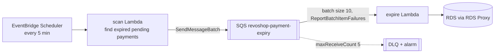

::part[Learn the Concept]{n="1"}

## 🎯 What you'll learn

- What **Lambda** is: functions, handlers, runtime lifecycle, limits (timeout, memory, payload)
- Triggers: **EventBridge Scheduler** (cron), **SQS**, **S3 events**, API calls
- **Cold starts** and what actually helps
- **At-least-once** delivery, **idempotency**, **partial batch responses** and **dead-letter queues**
- The **scan → queue → worker** pattern
- Reaching **RDS from Lambda**: VPC placement, connection limits, **RDS Proxy**
- Packaging (zip vs container image, layers), configuration, **Powertools**, logs, metrics and cost

## 🧠 The big idea

A Lambda function is an **on-call specialist**: nobody sits at a desk waiting (no idle servers); when a job ticket arrives (event), a specialist shows up, does one focused task within a time limit, and leaves. A queue (SQS) is the **ticket rack**: tickets wait safely if specialists are busy, and a ticket that fails too many times goes to the **"needs a human" tray** (dead-letter queue).

## ❓ Why does this matter?

RevoShop has work that shouldn't happen inside HTTP requests or depend on a webhook arriving: expiring unpaid payments, sending emails, processing uploaded images, nightly reports. Running a worker server 24/7 for a job that takes seconds every five minutes wastes money; Lambda runs only when needed.

## 💥 What happens if we DON'T (or do it naively)?

- A cron job on the API instance runs twice when you scale to two instances — double emails.
- Payments with expired Midtrans transactions keep stock reserved forever because the webhook never came.
- A Lambda processes 10 SQS messages, fails on message 7 and throws → all 10 retry → customers get duplicate emails.
- 500 concurrent Lambda invocations each open a PostgreSQL connection → `too many connections`.

## 📖 How it works, step by step

### 1. Handler and lifecycle

```python
import json
import logging

logger = logging.getLogger()
logger.setLevel("INFO")

CLIENT = make_database_pool()        # runs once per execution environment (reused across invocations)

def handler(event, context):
    logger.info("request %s, %d ms left", context.aws_request_id, context.get_remaining_time_in_millis())
    return {"ok": True}
```

| Limit / setting | Notes |
|---|---|
| Timeout | up to 15 minutes; set just above the expected duration |
| Memory | 128 MB–10 GB; CPU scales with memory (more memory can be cheaper when it finishes faster) |
| Concurrency | account limit per region; **reserved concurrency** caps a function (protects your database) |
| Payload | synchronous invocations 6 MB; for bigger data pass S3 keys |
| Ephemeral storage | `/tmp` 512 MB by default, configurable up to 10 GB |

Initialization code outside the handler runs on a **cold start** and is reused on warm invocations.

### 2. Triggers

| Trigger | Invocation | Retry behavior |
|---|---|---|
| **EventBridge Scheduler** (`rate(5 minutes)`, `cron(0 2 * * ? *)`, time zones) | asynchronous | retries with a retry policy; DLQ configurable |
| **SQS** (event source mapping) | Lambda polls in batches | failed messages become visible again; `maxReceiveCount` → DLQ |
| **S3 event** / EventBridge rules | asynchronous | 2 retries by default; on-failure destination |
| API Gateway / Function URL | synchronous | caller handles errors |

### 3. The scan → queue → worker pattern



- The **scan** is small and fast; the queue absorbs spikes; workers scale with the backlog; reserved concurrency limits database pressure.
- Duplicates happen (scan runs again before workers finish; retries) → the worker must be **idempotent**: a conditional update `UPDATE payments SET status='expired' WHERE id=:id AND status='pending'` succeeds once, later attempts do nothing.

### 4. Partial batch responses

```python
def handler(event, context):
    failures = []
    for record in event["Records"]:
        try:
            process(json.loads(record["body"]))
        except TransientError:
            failures.append({"itemIdentifier": record["messageId"]})
    return {"batchItemFailures": failures}
```

Enable **ReportBatchItemFailures** on the event source mapping. Poison messages (invalid JSON) should be logged and skipped — or they'll cycle until the DLQ.

Set the queue's **visibility timeout** to at least **6×** the function timeout (AWS guidance for SQS event sources), and stop starting new records when `get_remaining_time_in_millis()` is low.

### 5. Reaching RDS

| Choice | Notes |
|---|---|
| Lambda **in the VPC** (private subnets + SG allowed by `sg-db`) | needed for private RDS; outbound internet then needs NAT (or VPC endpoints for AWS APIs like SQS) |
| **RDS Proxy** | pools and shares connections across invocations; IAM auth; recommended for Lambda → RDS |
| Reserved concurrency | caps parallel invocations (e.g. 5) so the database isn't overwhelmed |
| RDS Data API | available for Aurora (HTTP-based, no connections) — not standard RDS PostgreSQL |

For a small learning setup: run the scan/expire logic as a **scheduled ECS task** (same image, same VPC access) — or accept Lambda-in-VPC with SQS **interface endpoint** costs. Choose consciously.

### 6. Packaging and configuration

- **Zip** for small pure-Python functions; **container images** (up to 10 GB) when dependencies are heavy or native (psycopg, Pillow).
- Configuration via environment variables; secrets via **Parameters and Secrets Lambda Extension** or SDK calls with caching (exercise 05 of this week).
- **Powertools for AWS Lambda (Python)**: structured logging, metrics, tracing, idempotency utility, batch processing utility.

### 7. Observability and cost

- Logs in CloudWatch Logs (`/aws/lambda/<name>`, set retention); metrics: `Errors`, `Throttles`, `Duration`, `IteratorAge`/`ApproximateAgeOfOldestMessage` for queues.
- Alarms: DLQ `ApproximateNumberOfMessagesVisible > 0`, `Errors > 0`, oldest message age.
- Cost: requests + GB-seconds (Lambda has an always-free monthly allowance — check current terms) + SQS requests + logs; in-VPC access patterns may add NAT/endpoint/RDS Proxy costs that dwarf Lambda itself.

## ⚖️ Trade-offs

| Choice | ✅ | ❌ |
|---|---|---|
| Lambda + SQS | scales to zero, managed retries, fine-grained scaling | 15-min limit, cold starts, VPC/RDS complexity |
| Scheduled ECS task | same image and VPC as the API, no connection storms | slower start, pay per run minute, less event integration |
| Worker process on the API host (RQ/Celery) | simple locally | runs 24/7, duplicates on scale-out, dies with the host |
| Step Functions | long workflows, retries, visual history | extra service to learn |

## ✅ When to use it / 🚫 When NOT to use it

- ✅ Short, event-driven or scheduled work: webhooks fan-out, image processing, notifications, cleanup jobs.
- ✅ Spiky workloads that sit idle most of the time.
- 🚫 Long-running jobs over 15 minutes, or steady high-throughput processing (containers can be cheaper).
- 🚫 Don't open unbounded database connections from high-concurrency functions.

## 🏆 Best practices

- [ ] One focused responsibility per function; timeouts and memory tuned with measurements.
- [ ] Idempotent handlers; conditional database updates; idempotency keys for side effects.
- [ ] SQS with DLQ, visibility timeout ≥ 6× function timeout, partial batch responses.
- [ ] Reserved concurrency to protect downstream systems; RDS Proxy for Lambda → RDS.
- [ ] Initialize clients outside the handler; cache configuration.
- [ ] Least-privilege execution role per function.
- [ ] Structured logs with request IDs, log retention, alarms on errors, throttles and DLQ depth.
- [ ] Infrastructure as code for functions, schedules, queues and permissions (Week 7).

## 🏭 How it's used in industry

- Event-driven architectures commonly use SQS/SNS/EventBridge with Lambda for fan-out and asynchronous processing.
- Media platforms process uploads with S3-triggered functions; payment and e-commerce systems use scheduled reconciliation jobs.
- Powertools for AWS Lambda is widely adopted to standardize logging, tracing and idempotency.

## ⚠️ Common mistakes

- Throwing on one bad message and retrying the whole batch.
- Visibility timeout shorter than the function timeout → messages processed twice concurrently.
- Putting Lambda in a VPC and then wondering why it can't reach the internet.
- Cron schedules in UTC when the business rule is in Jakarta time (EventBridge Scheduler supports time zones).

:::revoshop
1. **The problem in your code.** `PaymentService` in `app/services/payment_service.py` sets `expires_at = utcnow() + timedelta(minutes=MIDTRANS_EXPIRY_MINUTES)` (1440 by default), but nothing acts on it unless Midtrans sends an `expire` notification. Write the SQL for "expired pending payments" and the **conditional** update that makes expiry idempotent. What else must happen in the same transaction (order status `cancelled`? stock restored?) — read `OrderService` to decide.
2. **Where it runs.** Compare for RevoShop: (a) Lambda in the VPC + RDS Proxy + SQS interface endpoint, (b) a **scheduled ECS task** using your existing image with a command like `flask payments expire` (EventBridge Scheduler → `ecs:RunTask`), (c) a thread in gunicorn. Which do you choose for the Lab 4 learning setup and why?
3. **A Flask CLI command.** Whatever runs it, the logic belongs in the app: add `@app.cli.command("expire-payments")` that calls a service method with a batch limit. How does that make the Lambda handlers from exercise 04 thin wrappers?
4. **Webhook vs job race.** Midtrans sends `settlement` at the same moment your job expires the payment. Using the `payment.status` checks you already have in `handle_notification`, what does each side do, and which conditional updates guarantee a paid order is never cancelled?
5. **Alarms.** Which CloudWatch alarm tells you the job silently stopped running (hint: a custom metric like `ExpiredPaymentsScanned` with "missing data = breaching")?
:::

::part[Explain & Design]{n="2"}

## 🗣️ Explain it

Explain the on-call specialist and ticket rack analogy, and why a job that "runs once" may still run twice.

## 📐 Design it

Design RevoShop's order confirmation email pipeline on AWS: trigger (when a payment becomes `paid`), queue, worker (Lambda or ECS), idempotency, email provider (Amazon SES), retries and DLQ, templates, what the worker reads from the database, alarms, and how you test it locally.

:::quiz
Show a possible design

- **Trigger:** inside the transaction that marks the payment `paid`, insert an **outbox** row `outbox(id, type='order_paid', order_id, created_at, sent_at NULL)`. A small **relay** (scheduled every minute, or run right after commit) sends unsent outbox rows to SQS and marks them sent → no lost events if SQS is briefly unavailable.
- **Queue:** `revoshop-emails` (visibility timeout 6× worker timeout), DLQ after 5 receives, DLQ alarm.
- **Worker:** Lambda (zip, no VPC) calling the RevoShop **internal API** or reading an order snapshot included in the message — avoids putting Lambda in the VPC; batch size 10, partial batch responses, reserved concurrency 5.
- **Idempotency:** `emails_sent(order_id, type)` unique constraint, or Powertools idempotency with a DynamoDB table keyed by `order_id:type`; SES `SendEmail` only after the key is claimed.
- **SES:** verified domain with DKIM/SPF, production access requested (new accounts start in the SES sandbox), templates stored in code.
- **Alarms:** DLQ visible messages > 0, worker errors, SES bounce/complaint rates.
- **Local testing:** unit tests with fake SES/SQS (moto), handler tests with sample SQS events, Mailpit for template previews.
:::

### 📝 Self-review checklist

- [ ] No lost events between database commit and queue
- [ ] Duplicates can't send two emails
- [ ] Failures end up visible (DLQ + alarm)

::ai-review{task="design"}

::part[Toy Exercise]{n="3"}

:::exercise{path="exercises/m5/w4/04-lambda-payment-expiry" ai="no-ai" title="Lambda jobs: expire unpaid payments"}
Write a scheduled scan handler that enqueues expired payment IDs to SQS in batches (moto) and fails loudly on partial send failures, and a worker handler that expires payments idempotently with partial batch responses, poison-message skipping and a remaining-time safety margin.
:::

:::hints
- `send_message_batch` accepts at most 10 entries; `Id`s only need to be unique within a batch.
- Poison messages are skipped, not failed — otherwise they loop until the DLQ.
- Check the remaining time **before** each record and fail that record plus all remaining ones.
:::

## ✅ Quick check

:::quiz
Why set reserved concurrency on a Lambda that writes to RDS?

To cap how many invocations run in parallel, so a large queue backlog can't open more database connections than PostgreSQL (or RDS Proxy) can handle.
:::

:::quiz
Your worker takes up to 50 seconds. What SQS visibility timeout should the queue have?

At least 6× the function timeout (e.g. function timeout 60 s → visibility timeout 360 s), so messages aren't redelivered while still being processed, including retries of the batch.
:::

## 📖 Kamus (glossary)

| Term | Bahasa Indonesia |
|---|---|
| Serverless | Tanpa server (dikelola penyedia) |
| Cold start | Mulai dingin (inisialisasi pertama) |
| Event source mapping | Pemetaan sumber peristiwa |
| Dead-letter queue | Antrean surat mati (pesan gagal) |
| Idempotent | Aman diulang tanpa efek ganda |
| Reserved concurrency | Konkurensi yang dicadangkan/dibatasi |

## 📚 Keep learning

- [AWS docs: Using Lambda with Amazon SQS](https://docs.aws.amazon.com/lambda/latest/dg/with-sqs.html) · [Reporting batch item failures](https://docs.aws.amazon.com/lambda/latest/dg/services-sqs-errorhandling.html)
- [Amazon EventBridge Scheduler](https://docs.aws.amazon.com/scheduler/latest/UserGuide/what-is-scheduler.html)
- [Powertools for AWS Lambda (Python)](https://docs.powertools.aws.dev/lambda/python/latest/)
- [AWS docs: Using RDS Proxy with Lambda](https://docs.aws.amazon.com/lambda/latest/dg/services-rds.html)
