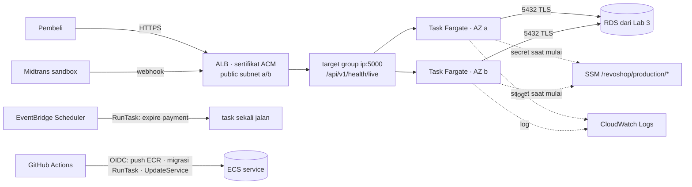

## 🎯 Tujuan

RevoShop berjalan sebagai **dua task Fargate di dua Availability Zone** di belakang **load balancer HTTPS**. Deploy tidak ada downtime dan roll back dengan sendirinya, migrasi dan tugas terjadwal berjalan sebagai **task sekali jalan**, dan secret disuntikkan dari SSM — tanpa server untuk kamu patch. Di akhir kamu **breakdown semuanya** (atau simpan sengaja) menggunakan checklist.

Lab 3 menyewakan kamu unit toko dan kamu merawatnya. Lab ini memindahkan toko yang sama ke food court: dua kios di dua gedung, satpam mengecek mereka buka, dan mall mengelola lantainya.



## 🔤 Istilah penting

| Istilah | Artinya (sederhana) |
|---|---|
| **ECR** | Toko AWS tempat image container disimpan |
| **Immutable tag** | Tag yang tidak pernah bisa menunjuk ke image berbeda nanti |
| **Task definition** | Resep yang dipakai ECS: image, CPU, memori, environment, secret, log |
| **Service** | Aturan yang menjaga N task tetap berjalan dan mengganti yang tidak sehat |
| **Target group** | Daftar alamat task yang load balancer kirim traffic ke sana |
| **Sertifikat ACM** | Sertifikat gratis AWS yang memberi load balancer HTTPS |
| **Rolling deploy** | Mengganti task sedikit demi sedikit, dengan rollback kalau yang baru gagal |
| **Task sekali jalan** | Task yang dijalankan sekali untuk satu pekerjaan (migrasi, expire payment) |
| **EventBridge Scheduler** | Cron AWS: ia menyalakan task sesuai jadwal |
| **Breakdown** | Menghapus semua yang kamu buat agar tidak terus keluarkan biaya |

:::danger[Biaya]
ALB memiliki minimum per jam walaupun tanpa traffic, dan setiap task Fargate ditagih per vCPU dan GB per jam; task di public subnet juga bayar alamat IPv4 publik. Dengan harga sampel exercise 02: 2 × (0.5 vCPU, 1 GB) task ≈ USD 36 + ALB ≈ 16 + RDS ≈ 14 + sekitar 4 alamat IPv4 publik (task dan ALB) ≈ 15 + log ≈ **USD 80/bulan** sebelum transfer data — lebih dari dua kali Lab 3. Rencanakan selesai lab ini dalam beberapa hari, lalu breakdown atau scale ke setup lebih murah. Perbarui budget alert kamu **sebelum** mulai.
:::

:::note[Syarat awal]
Lab 3 berjalan: VPC `revoshop` (public + private subnet, tanpa NAT), RDS `revoshop-prod`, parameter di `/revoshop/production/`, user `revoshop_app`, domain menunjuk ke Elastic IP EC2. Kamu akan simpan RDS dan SSM dan ganti EC2.
:::

## 🧭 Checkpoint

### C1 · ECR dan pipeline (1 jam)

```bash
aws ecr create-repository --region $REGION --repository-name revoshop-api \
  --image-tag-mutability IMMUTABLE --image-scanning-configuration scanOnPush=true
aws ecr put-lifecycle-policy --region $REGION --repository-name revoshop-api --lifecycle-policy-text '{
  "rules": [{"rulePriority": 1, "description": "keep last 30 images",
             "selection": {"tagStatus": "any", "countType": "imageCountMoreThan", "countNumber": 30},
             "action": {"type": "expire"}}]}'
```

Di `.github/workflows/ci-cd.yml`, job `build` push ke **ECR** bukan (atau tambahan) GHCR: tambahkan `aws-actions/configure-aws-credentials` (OIDC, role di bawah) dan `aws ecr get-login-password | docker login` sebelum `docker/build-push-action`, atur `images: <ACCOUNT_ID>.dkr.ecr.<region>.amazonaws.com/revoshop-api`, dan beri job `id-token: write`. Output job tetap referensi image **digest**. Karena tag immutable, simpan tag `type=sha` dan lepas tag mutable seperti `main` untuk ECR (atau pakai repository mutable terpisah).

### C2 · Role (1 jam)

Dua badge, dua pekerjaan: role **execution** untuk crew delivery yang siapkan kios (pull image, baca secret, tulis log); role **task** dipakain kode kamu saat panggil AWS.

**`revoshop-task-execution`** — dipercaya oleh `ecs-tasks.amazonaws.com`; managed policy **`AmazonECSTaskExecutionRolePolicy`** plus:

```json
{
  "Version": "2012-10-17",
  "Statement": [
    {
      "Sid": "ReadProductionParameters",
      "Effect": "Allow",
      "Action": "ssm:GetParameters",
      "Resource": "arn:aws:ssm:ap-southeast-1:<ACCOUNT_ID>:parameter/revoshop/production/*"
    },
    {
      "Sid": "DecryptViaSsm",
      "Effect": "Allow",
      "Action": "kms:Decrypt",
      "Resource": "*",
      "Condition": {
        "StringEquals": {
          "kms:ViaService": "ssm.ap-southeast-1.amazonaws.com"
        }
      }
    }
  ]
}
```

**`revoshop-task`** — dipercaya oleh `ecs-tasks.amazonaws.com`; belum ada policy (tambah S3/SQS permission saat app butuh). Tambah permission `ssmmessages:*Channel` hanya kalau aktifkan ECS Exec.

**`revoshop-gha-production`** (dari Lab 3, trust `repo:<kamu>/revoshop:environment:production`) — ganti SSM permission-nya dengan:

```json
{
  "Version": "2012-10-17",
  "Statement": [
    {
      "Sid": "EcrLogin",
      "Effect": "Allow",
      "Action": "ecr:GetAuthorizationToken",
      "Resource": "*"
    },
    {
      "Sid": "PushImages",
      "Effect": "Allow",
      "Action": [
        "ecr:BatchCheckLayerAvailability",
        "ecr:InitiateLayerUpload",
        "ecr:UploadLayerPart",
        "ecr:CompleteLayerUpload",
        "ecr:PutImage",
        "ecr:BatchGetImage"
      ],
      "Resource": "arn:aws:ecr:ap-southeast-1:<ACCOUNT_ID>:repository/revoshop-api"
    },
    {
      "Sid": "TaskDefinitions",
      "Effect": "Allow",
      "Action": [
        "ecs:RegisterTaskDefinition",
        "ecs:DescribeTaskDefinition"
      ],
      "Resource": "*"
    },
    {
      "Sid": "RunMigrations",
      "Effect": "Allow",
      "Action": [
        "ecs:RunTask"
      ],
      "Resource": "arn:aws:ecs:ap-southeast-1:<ACCOUNT_ID>:task-definition/revoshop-api-production:*"
    },
    {
      "Sid": "WatchTasks",
      "Effect": "Allow",
      "Action": [
        "ecs:DescribeTasks"
      ],
      "Resource": "arn:aws:ecs:ap-southeast-1:<ACCOUNT_ID>:task/revoshop/*"
    },
    {
      "Sid": "UpdateService",
      "Effect": "Allow",
      "Action": [
        "ecs:UpdateService",
        "ecs:DescribeServices"
      ],
      "Resource": "arn:aws:ecs:ap-southeast-1:<ACCOUNT_ID>:service/revoshop/api-production"
    },
    {
      "Sid": "PassTaskRoles",
      "Effect": "Allow",
      "Action": "iam:PassRole",
      "Resource": [
        "arn:aws:iam::<ACCOUNT_ID>:role/revoshop-task-execution",
        "arn:aws:iam::<ACCOUNT_ID>:role/revoshop-task"
      ],
      "Condition": {
        "StringEquals": {
          "iam:PassedToService": "ecs-tasks.amazonaws.com"
        }
      }
    }
  ]
}
```

Jalankan keduanya melalui `review()` dari latihan Week 3 01. Kamu akan dapat dua temuan **medium** — keduanya bisa diterima, dan kamu harus bisa jelasin kenapa di interview:
- `kms:Decrypt` di `*` dibatasi oleh kondisi `kms:ViaService` hanya untuk dekripsi yang diminta SSM.
- `ecs:RegisterTaskDefinition` tidak dukung permission tingkat resource, jadi `Resource: "*"` wajib; bagian berbahaya (`iam:PassRole`) hanya dibatasi ke dua task role dan `ecs-tasks.amazonaws.com`.

Buktikan dengan `evaluate()`: pass `AdminRole` → `ImplicitDeny`; update `api-staging` → `ImplicitDeny`.

### C3 · Jaringan dan load balancer (1.5 jam)

Load balancer adalah traffic director mall: ia pegang sertifikat HTTPS, ketuk pintu setiap kios (health check) dan hanya kirim pembeli ke kios yang jawab.

**Security group**

| Nama | Inbound |
|---|---|
| `revoshop-alb` | 80, 443 dari `0.0.0.0/0` dan `::/0` |
| `revoshop-api` | 5000 **hanya dari `revoshop-alb`** |
| `revoshop-db` (ada) | tambah 5432 dari `revoshop-api` (simpan `revoshop-web` hingga EC2 pensiun) |

**Sertifikat:** ACM (di **region aplikasimu** — untuk ALB, bukan us-east-1) → request `api.<domain>` → validasi DNS → tunggu *Issued*.

**Target group:** tipe **IP address**, protocol HTTP, port 5000, VPC `revoshop`, path health check `/api/v1/health/live`, threshold sehat 2, interval 15 s, kode sukses 200. Atribut: deregistration delay **30 s**.

**ALB:** internet-facing, IPv4 (atau dual-stack), kedua public subnet, security group `revoshop-alb`, listener:
- HTTPS 443 → forward ke target group, sertifikat `api.<domain>`, policy keamanan TLS terkini
- HTTP 80 → redirect ke HTTPS 443

**Log:** CloudWatch → buat log group `/ecs/revoshop-api-production` dengan **retention 30 hari**.

### C4 · Task definition (45 menit)

Commit `deploy/ecs/task-definition.json`. Ia dibuat dengan fungsi `task_definition()` dari exercise 03 (jadi ukuran Fargate, secret, filesystem root read-only, health check dan logging tervalidasi) dan memakai placeholder yang script deploy isi:

```json
{
  "family": "revoshop-api-production",
  "requiresCompatibilities": [
    "FARGATE"
  ],
  "networkMode": "awsvpc",
  "cpu": "512",
  "memory": "1024",
  "executionRoleArn": "arn:aws:iam::<ACCOUNT_ID>:role/revoshop-task-execution",
  "taskRoleArn": "arn:aws:iam::<ACCOUNT_ID>:role/revoshop-task",
  "runtimePlatform": {
    "operatingSystemFamily": "LINUX",
    "cpuArchitecture": "X86_64"
  },
  "volumes": [
    {
      "name": "tmp"
    }
  ],
  "containerDefinitions": [
    {
      "name": "api",
      "image": "__IMAGE__",
      "essential": true,
      "portMappings": [
        {
          "name": "http",
          "containerPort": 5000,
          "protocol": "tcp"
        }
      ],
      "environment": [
        {
          "name": "APP_ENV",
          "value": "production"
        },
        {
          "name": "LOG_TO_FILE",
          "value": "false"
        },
        {
          "name": "WEB_CONCURRENCY",
          "value": "2"
        }
      ],
      "secrets": [
        {
          "name": "DATABASE_URL",
          "valueFrom": "arn:aws:ssm:ap-southeast-1:<ACCOUNT_ID>:parameter/revoshop/production/DATABASE_URL"
        },
        {
          "name": "JWT_SECRET_KEY",
          "valueFrom": "arn:aws:ssm:ap-southeast-1:<ACCOUNT_ID>:parameter/revoshop/production/JWT_SECRET_KEY"
        },
        {
          "name": "MIDTRANS_IS_PRODUCTION",
          "valueFrom": "arn:aws:ssm:ap-southeast-1:<ACCOUNT_ID>:parameter/revoshop/production/MIDTRANS_IS_PRODUCTION"
        },
        {
          "name": "MIDTRANS_SERVER_KEY",
          "valueFrom": "arn:aws:ssm:ap-southeast-1:<ACCOUNT_ID>:parameter/revoshop/production/MIDTRANS_SERVER_KEY"
        }
      ],
      "readonlyRootFilesystem": true,
      "mountPoints": [
        {
          "sourceVolume": "tmp",
          "containerPath": "/tmp",
          "readOnly": false
        }
      ],
      "linuxParameters": {
        "initProcessEnabled": true
      },
      "stopTimeout": 30,
      "logConfiguration": {
        "logDriver": "awslogs",
        "options": {
          "awslogs-group": "/ecs/revoshop-api-production",
          "awslogs-region": "ap-southeast-1",
          "awslogs-stream-prefix": "api"
        }
      },
      "healthCheck": {
        "command": [
          "CMD",
          "python",
          "-c",
          "import urllib.request; urllib.request.urlopen('http://127.0.0.1:5000/api/v1/health/live', timeout=3)"
        ],
        "interval": 15,
        "timeout": 5,
        "retries": 3,
        "startPeriod": 30
      }
    }
  ]
}
```

Ganti region di ARN parameter kalau kamu tidak pakai `ap-southeast-1`. `LOG_TO_FILE=false` penting karena filesystem root read-only.

**Redis di ECS?** Dua task yang masing-masing jalankan Redis sendiri berarti rate limit login per task (5 percobaan per task, bukan per email). Untuk lab ini, **biarkan `REDIS_URL` tidak diset** — limiter-mu gagal terbuka by design (Lab 1). Kalau mau batas bersama, tambah ElastiCache (Valkey/Redis) di private subnet dan atur `REDIS_URL` — dan tambah ke estimasi biaya dulu.

### C5 · Cluster, migrasi pertama, service (1.5 jam)

Urutan penting: atur dapur dulu (task migrasi), baru biarkan staff baru melayani (service). Jangan keduanya bersamaan.

```bash
aws ecs create-cluster --region $REGION --cluster-name revoshop --settings name=containerInsights,value=disabled
```

Copy `deploy/ecs-deploy.sh` ke repo kamu:

```bash
#!/usr/bin/env bash
# Deploy a RevoShop image to ECS: register task definition → run migrations → update service → verify.
#   ACCOUNT_ID=… CLUSTER=revoshop SERVICE=api-production SUBNETS=subnet-a,subnet-b SECURITY_GROUP=sg-… \
#   deploy/ecs-deploy.sh 123456789012.dkr.ecr.ap-southeast-1.amazonaws.com/revoshop-api@sha256:…
set -euo pipefail
IMAGE="${1:?usage: ecs-deploy.sh <image@sha256:digest>}"
[[ "$IMAGE" =~ ^[a-z0-9./-]+@sha256:[a-f0-9]{64}$ ]] || { echo "deploy by digest" >&2; exit 1; }
: "${ACCOUNT_ID:?}" "${CLUSTER:?}" "${SERVICE:?}" "${SUBNETS:?}" "${SECURITY_GROUP:?}"
TEMPLATE="${TEMPLATE:-deploy/ecs/task-definition.json}"

task_definition=$(python3 - "$TEMPLATE" "$IMAGE" "$ACCOUNT_ID" <<'PY'
import json, sys
template, image, account = sys.argv[1:4]
text = open(template).read().replace("__IMAGE__", image).replace("<ACCOUNT_ID>", account)
json.loads(text)  # fail early on a broken template
print(text)
PY
)

echo "→ registering task definition"
TD_ARN=$(aws ecs register-task-definition --cli-input-json "$task_definition" --query 'taskDefinition.taskDefinitionArn' --output text)
echo "  $TD_ARN"

echo "→ running migrations"
NETWORK="awsvpcConfiguration={subnets=[${SUBNETS}],securityGroups=[${SECURITY_GROUP}],assignPublicIp=ENABLED}"
TASK_ARN=$(aws ecs run-task --cluster "$CLUSTER" --launch-type FARGATE --task-definition "$TD_ARN" \
  --network-configuration "$NETWORK" --started-by deploy-migrate \
  --overrides '{"containerOverrides":[{"name":"api","command":["flask","db","upgrade"]}]}' \
  --query 'tasks[0].taskArn' --output text)
aws ecs wait tasks-stopped --cluster "$CLUSTER" --tasks "$TASK_ARN"
EXIT_CODE=$(aws ecs describe-tasks --cluster "$CLUSTER" --tasks "$TASK_ARN" --query 'tasks[0].containers[0].exitCode' --output text)
if [[ "$EXIT_CODE" != "0" ]]; then
  echo "✗ migration task exited with $EXIT_CODE — service not updated (see CloudWatch Logs)" >&2
  exit 1
fi

echo "→ updating service"
aws ecs update-service --cluster "$CLUSTER" --service "$SERVICE" --task-definition "$TD_ARN" >/dev/null
aws ecs wait services-stable --cluster "$CLUSTER" --services "$SERVICE"

PRIMARY_TD=$(aws ecs describe-services --cluster "$CLUSTER" --services "$SERVICE" \
  --query 'services[0].deployments[?status==`PRIMARY`] | [0].taskDefinition' --output text)
if [[ "$PRIMARY_TD" != "$TD_ARN" ]]; then
  echo "✗ deployment rolled back by the circuit breaker (primary is $PRIMARY_TD)" >&2
  exit 1
fi
echo "✓ $SERVICE runs $TD_ARN"
```

Script ini diuji terhadap CLI AWS palsu untuk tiga jalur: sukses, migrasi gagal (service tidak diperbarui) dan circuit-breaker rollback (pekerjaan gagal keras).

Pertama kali, daftarkan task definition dan jalankan migrasi manual dengan perintah yang sama, lalu buat service di konsol (**ECS → revoshop → Buat service**):

| Pengaturan | Nilai |
|---|---|
| Compute | **Fargate**, platform version LATEST |
| Task definition | `revoshop-api-production` (revision terbaru) |
| Nama service | `api-production` |
| Task yang diinginkan | **2** |
| Deployment | rolling update, sehat minimum **100%**, maksimal **200%**, **circuit breaker deployment dengan rollback** |
| Jaringan | VPC `revoshop`, public subnet a/b, security group `revoshop-api`, **public IP: on** (outbound ke Midtrans/ECR/SSM tanpa NAT) |
| Load balancing | ALB ada → listener 443 → target group ada → container `api:5000` |
| Health check grace period | 60 detik |
| Service auto scaling | minimal 2, maksimal 3, target tracking CPU 60% (opsional) |

Tunggu hingga kedua target **sehat** di target group. Tes melalui DNS ALB: `curl -H "Host: api.<domain>" https://<alb-dns-name>/api/v1/health -k`.

### C6 · Alihkan traffic (30 menit)

Ini saat kamu pindah papan nama pintu dari toko EC2 lama ke kios food court baru. Simpan yang lama berjalan hingga yakin — memindah papan mudah, rebuild toko tidak.

1. DNS: ubah `api.<domain>` dari Elastic IP `A` record ke ALB — alias `A` record (Route 53) atau **CNAME** (provider DNS lain).
2. URL notifikasi Midtrans tetap sama (`https://api.<domain>/api/v1/payments/webhook/midtrans`).
3. Smoke test: `REVOSHOP_URL=https://api.<domain> REVOSHOP_EXPECT_HTTPS=1 uv run pytest m5/w1/05-revoshop-smoke -v`. Test HSTS gagal hingga kamu tambah header — tambah di app (hook `after_request` kecil) atau response header ALB/CloudFront; test HTTP→HTTPS redirect lewat karena rule listener.
4. Buat sandbox payment dan konfirmasi webhook muncul di **CloudWatch Logs** `/ecs/revoshop-api-production`.

### C7 · Deploy dari GitHub Actions (1 jam)

Ganti langkah SSM di `.github/workflows/deploy.yml` dengan:

```yaml
      - uses: aws-actions/configure-aws-credentials@cbe3b392738ccf3f987d68400dafcf4b0624a56c # v6.2.4
        with:
          role-to-assume: ${{ vars.AWS_ROLE_ARN }}
          aws-region: ${{ vars.AWS_REGION }}
      - name: Deploy to ECS
        env:
          IMAGE: ${{ inputs.image }}
          ACCOUNT_ID: ${{ vars.AWS_ACCOUNT_ID }}
          CLUSTER: ${{ vars.ECS_CLUSTER }}
          SERVICE: ${{ vars.ECS_SERVICE }}
          SUBNETS: ${{ vars.ECS_SUBNETS }}
          SECURITY_GROUP: ${{ vars.ECS_SECURITY_GROUP }}
        run: ./deploy/ecs-deploy.sh "$IMAGE"
```

Environment variable di `production`: `AWS_ROLE_ARN`, `AWS_REGION`, `AWS_ACCOUNT_ID`, `ECS_CLUSTER=revoshop`, `ECS_SERVICE=api-production`, `ECS_SUBNETS=subnet-…,subnet-…`, `ECS_SECURITY_GROUP=sg-…`, `APP_URL=https://api.<domain>`.

**Buktikan tanpa downtime:** jalankan curl loop dari materi Week 4 02 saat tag di-deploy — harapkan hanya `200`.

**Buktikan rollback:** deploy image sengaja rusak (mis. commit yang `/api/v1/health/live` return `500`) ke staging atau production saat sepi. Pantau ECS event: task baru gagal health check, circuit breaker trigger, service balik ke revision sebelum, dan pekerjaan gagal dengan "rolled back by the circuit breaker".

### C8 · Payment expiry terjadwal (1.5 jam)

1. Di RevoShop, tambah perintah Flask CLI `flask expire-payments` yang expire payment `pending` dengan `expires_at <= now` dalam batch menggunakan conditional update (materi Week 4 04 RevoShop box). Tes lokal terhadap Compose.
2. EventBridge **Scheduler** → *Create schedule* `revoshop-expire-payments`: rate **5 menit**, time zone `Asia/Jakarta`, target **ECS RunTask**: cluster `revoshop`, task definition `revoshop-api-production` (terbaru), launch type Fargate, public subnet, security group `revoshop-api`, public IP on, **container override** perintah `["flask", "expire-payments"]`, retry policy 2 percobaan. Biarkan Scheduler buat role execution-nya (ia butuh `ecs:RunTask` dan `iam:PassRole` untuk dua task role).
3. Cek log task sekali jalan. Kenapa scheduled ECS task adalah alternatif yang wajar untuk Lambda di sini (image sama, akses VPC ke RDS, tidak connection storm)?

### C9 · Alarm dan pensiun EC2 (45 menit)

- CloudWatch alarm → SNS email: ALB `HTTPCode_Target_5XX_Count` > 5 dalam 5 menit; target group `UnHealthyHostCount` ≥ 1 selama 5 menit; ECS service `RunningTaskCount` < 2 (Container Insights atau metric math alarm); simpan alarm RDS.
- Pensiun EC2: matikan protection terminasi instance lama → **terminate** → **release Elastic IP** → hapus `revoshop-web` dari inbound `revoshop-db` → hapus role `revoshop-ec2` → hapus permission `send-command` SSM dari role GitHub.

### C10 · Review biaya dan breakdown (1 jam)

Lab ini paling mahal di module, jadi treat breakdown sebagai bagian dari pekerjaan, bukan sekadar diakhir. Jalan checklist dan konfirmasi di Cost Explorer sehari nanti bahwa pengeluaran benar-benar berhenti.

Setelah 24–48 jam, Cost Explorer → grup by service: bandingkan ALB, Fargate, RDS, IPv4 publik, CloudWatch dengan estimasi kamu. Putuskan:

| Keputusan | Lakukan |
|---|---|
| **Simpan untuk portofolio** (paket bayar, kamu terima biaya bulanan) | desired count 1 di luar demo, alarm pada budget forecast, drill restore periodik |
| **Pause** | ECS service desired count **0** (ALB masih tagih per jam — hapus juga untuk hemat sungguhan), stop RDS (**auto-start setelah 7 hari**) |
| **Breakdown** | ikuti checklist di bawah; simpan video demo dan dokumen kamu |

**Checklist breakdown (urutan)**
1. GitHub: atur `PRODUCTION_ENABLED=false`; hapus schedule EventBridge.
2. ECS: perbarui service desired count 0 → hapus service → deregister task definition (opsional) → hapus cluster.
3. ALB → hapus listener dan load balancer → hapus target group.
4. Sertifikat ACM (kalau tidak dipakai) · record DNS.
5. ECR: hapus image / repository.
6. CloudWatch: log group `/ecs/revoshop-api-production`, alarm, topik SNS.
7. RDS: matikan deletion protection → hapus (final snapshot: ya kalau mungkin restore) → hapus secret terkelola.
8. Parameter SSM `/revoshop/*`.
9. Role IAM: `revoshop-task-execution`, `revoshop-task`, `revoshop-gha-production`, role scheduler, OIDC provider (kalau tidak lagi dipakai).
10. VPC `revoshop` (menghapus subnet, route table, security group, S3 endpoint).
11. Sehari nanti: Cost Explorer by service **dan region** hanya menunjuk residue yang diharap (mis. snapshot storage).

## ✅ Selesai saat

- [ ] Dua task Fargate sehat di dua AZ di belakang ALB HTTPS; EC2 pensiun
- [ ] Secret disuntik dari SSM; filesystem root read-only; log di CloudWatch dengan retention
- [ ] Tag deploy melalui OIDC: push ECR → task migrasi → rolling update, dengan deploy tanpa downtime terverifikasi dan circuit-breaker rollback terverifikasi
- [ ] Payment expiry berjalan setiap 5 menit sebagai task ECS terjadwal
- [ ] Alarm kirim email; biaya di-review terhadap estimasi
- [ ] Checklist breakdown dijalankan **atau** keputusan tertulis untuk simpan dengan budget bulanan

## 🧠 Kebijakan AI

🤖✅ AI boleh bantu decode ECS service event dan pesan IAM `AccessDenied` (rahasiakan account ID). 🚫🤖 Tulis keputusan migrasi/deploy dan checklist breakdown sendiri.

## ❓ Pertanyaan yang mungkin ditanya interviewer

- Execution role vs task role — apa isi masing-masing untuk RevoShop?
- Ceritakan saya satu deploy. Apa yang hentikan image rusak dari ambil alih site?
- Kenapa task berjalan di public subnet, dan port 5000 masih terlindungi bagaimana?
- Bagaimana migrasi berjalan, dan apa kalau satu gagal?
- Ini berapa biayanya, apa yang dorong biaya, dan bagaimana kamu kurangi?

## 📣 Bagikan

:::linkedin{type="build"}
🚢 RevoShop pindah dari satu server EC2 ke ECS Fargate.

- 2 task di 2 Availability Zone di belakang load balancer HTTPS
- deploy dari tag GitHub Actions (OIDC, tanpa AWS key): task migrasi → rolling update → automatic rollback saat health check gagal (saya sengaja rusak untuk lihat ia roll back)
- secret disuntik dari SSM Parameter Store, container read-only, log di CloudWatch
- payment yang sudah expired dibersihkan oleh scheduled ECS task setiap 5 menit
- dan checklist breakdown — skill cloud termasuk matiin sesuatu 💸

Yang mengejutkan saya: [mis. load balancer lebih mahal dari container].

#AWS #ECS #Docker #DevOps #BuildInPublic
:::
