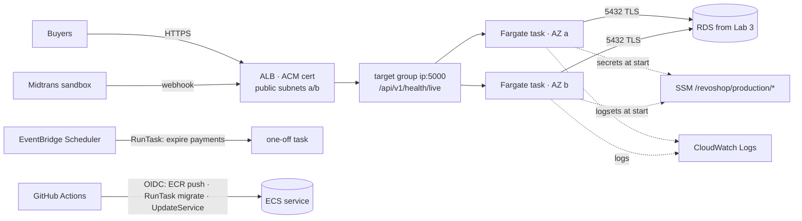

## 🎯 Goal

RevoShop runs as **two Fargate tasks in two Availability Zones** behind an **HTTPS Application Load Balancer**, deploys with **zero downtime** and automatic rollback, runs migrations and scheduled jobs as **one-off tasks**, and gets secrets injected from SSM — no servers to patch. Then you **tear everything down** (or keep it deliberately) with a checklist.



:::danger[Costs]
An ALB has an hourly minimum even with no traffic, and each Fargate task bills per vCPU and GB per hour; tasks in public subnets also pay for public IPv4 addresses. With exercise 02's sample prices: 2 × (0.5 vCPU, 1 GB) tasks ≈ USD 36 + ALB ≈ 16 + RDS ≈ 14 + about 4 public IPv4 addresses (tasks and ALB) ≈ 15 + logs ≈ **USD 80/month** before data transfer — more than double Lab 3. Plan to finish this lab in a few days, then tear down or scale to a cheaper setup. Update your budget alert **before** starting.
:::

:::note[Prerequisites]
Lab 3 working: VPC `revoshop` (public + private subnets, no NAT), RDS `revoshop-prod`, parameters under `/revoshop/production/`, the `revoshop_app` user, a domain pointing at the EC2 Elastic IP. You'll keep RDS and SSM and replace EC2.
:::

## 🧭 Checkpoints

### C1 · ECR and the pipeline (1 h)

```bash
aws ecr create-repository --region $REGION --repository-name revoshop-api \
  --image-tag-mutability IMMUTABLE --image-scanning-configuration scanOnPush=true
aws ecr put-lifecycle-policy --region $REGION --repository-name revoshop-api --lifecycle-policy-text '{
  "rules": [{"rulePriority": 1, "description": "keep last 30 images",
             "selection": {"tagStatus": "any", "countType": "imageCountMoreThan", "countNumber": 30},
             "action": {"type": "expire"}}]}'
```

In `.github/workflows/ci-cd.yml`, the `build` job pushes to **ECR** instead of (or in addition to) GHCR: add `aws-actions/configure-aws-credentials` (OIDC, role below) and `aws ecr get-login-password | docker login` before `docker/build-push-action`, set `images: <ACCOUNT_ID>.dkr.ecr.<region>.amazonaws.com/revoshop-api`, and give the job `id-token: write`. The job output stays the image **digest** reference. Because tags are immutable, keep `type=sha` tags and drop mutable tags like `main` for ECR (or use a separate mutable repository).

### C2 · Roles (1 h)

**`revoshop-task-execution`** — trusted by `ecs-tasks.amazonaws.com`; managed policy **`AmazonECSTaskExecutionRolePolicy`** plus:

```json
{
  "Version": "2012-10-17",
  "Statement": [
    {
      "Sid": "ReadProductionParameters",
      "Effect": "Allow",
      "Action": "ssm:GetParameters",
      "Resource": "arn:aws:ssm:ap-southeast-1:<ACCOUNT_ID>:parameter/revoshop/production/*"
    },
    {
      "Sid": "DecryptViaSsm",
      "Effect": "Allow",
      "Action": "kms:Decrypt",
      "Resource": "*",
      "Condition": {
        "StringEquals": {
          "kms:ViaService": "ssm.ap-southeast-1.amazonaws.com"
        }
      }
    }
  ]
}
```

**`revoshop-task`** — trusted by `ecs-tasks.amazonaws.com`; no policies yet (add S3/SQS permissions when the app needs them). Add `ssmmessages:*Channel` permissions only if you enable ECS Exec.

**`revoshop-gha-production`** (from Lab 3, trust `repo:<you>/revoshop:environment:production`) — replace its SSM permissions with:

```json
{
  "Version": "2012-10-17",
  "Statement": [
    {
      "Sid": "EcrLogin",
      "Effect": "Allow",
      "Action": "ecr:GetAuthorizationToken",
      "Resource": "*"
    },
    {
      "Sid": "PushImages",
      "Effect": "Allow",
      "Action": [
        "ecr:BatchCheckLayerAvailability",
        "ecr:InitiateLayerUpload",
        "ecr:UploadLayerPart",
        "ecr:CompleteLayerUpload",
        "ecr:PutImage",
        "ecr:BatchGetImage"
      ],
      "Resource": "arn:aws:ecr:ap-southeast-1:<ACCOUNT_ID>:repository/revoshop-api"
    },
    {
      "Sid": "TaskDefinitions",
      "Effect": "Allow",
      "Action": [
        "ecs:RegisterTaskDefinition",
        "ecs:DescribeTaskDefinition"
      ],
      "Resource": "*"
    },
    {
      "Sid": "RunMigrations",
      "Effect": "Allow",
      "Action": [
        "ecs:RunTask"
      ],
      "Resource": "arn:aws:ecs:ap-southeast-1:<ACCOUNT_ID>:task-definition/revoshop-api-production:*"
    },
    {
      "Sid": "WatchTasks",
      "Effect": "Allow",
      "Action": [
        "ecs:DescribeTasks"
      ],
      "Resource": "arn:aws:ecs:ap-southeast-1:<ACCOUNT_ID>:task/revoshop/*"
    },
    {
      "Sid": "UpdateService",
      "Effect": "Allow",
      "Action": [
        "ecs:UpdateService",
        "ecs:DescribeServices"
      ],
      "Resource": "arn:aws:ecs:ap-southeast-1:<ACCOUNT_ID>:service/revoshop/api-production"
    },
    {
      "Sid": "PassTaskRoles",
      "Effect": "Allow",
      "Action": "iam:PassRole",
      "Resource": [
        "arn:aws:iam::<ACCOUNT_ID>:role/revoshop-task-execution",
        "arn:aws:iam::<ACCOUNT_ID>:role/revoshop-task"
      ],
      "Condition": {
        "StringEquals": {
          "iam:PassedToService": "ecs-tasks.amazonaws.com"
        }
      }
    }
  ]
}
```

Run both through `review()` from Week 3 exercise 01. You'll get two **medium** findings — both acceptable, and you should be able to say why in an interview:
- `kms:Decrypt` on `*` is limited by the `kms:ViaService` condition to decryption requested by SSM.
- `ecs:RegisterTaskDefinition` doesn't support resource-level permissions, so `Resource: "*"` is required; the dangerous part (`iam:PassRole`) is scoped to the two task roles and to `ecs-tasks.amazonaws.com`.

Prove it with `evaluate()`: passing an `AdminRole` → `ImplicitDeny`; updating `api-staging` → `ImplicitDeny`.

### C3 · Networking and the load balancer (1.5 h)

**Security groups**

| Name | Inbound |
|---|---|
| `revoshop-alb` | 80, 443 from `0.0.0.0/0` and `::/0` |
| `revoshop-api` | 5000 **from `revoshop-alb` only** |
| `revoshop-db` (existing) | add 5432 from `revoshop-api` (keep `revoshop-web` until EC2 is retired) |

**Certificate:** ACM (in **your application region** — for an ALB, not us-east-1) → request `api.<domain>` → DNS validation → wait for *Issued*.

**Target group:** type **IP addresses**, protocol HTTP, port 5000, VPC `revoshop`, health check path `/api/v1/health/live`, healthy threshold 2, interval 15 s, success codes 200. Attributes: deregistration delay **30 s**.

**ALB:** internet-facing, IPv4 (or dual-stack), both **public** subnets, security group `revoshop-alb`, listeners:
- HTTPS 443 → forward to the target group, certificate `api.<domain>`, a current TLS security policy
- HTTP 80 → redirect to HTTPS 443

**Logs:** CloudWatch → create log group `/ecs/revoshop-api-production` with **30-day retention**.

### C4 · Task definition (45 min)

Commit `deploy/ecs/task-definition.json`. It was generated with the `task_definition()` function from exercise 03 (so the Fargate size, secrets, read-only root filesystem, health check and logging are validated) and uses placeholders the deploy script fills in:

```json
{
  "family": "revoshop-api-production",
  "requiresCompatibilities": [
    "FARGATE"
  ],
  "networkMode": "awsvpc",
  "cpu": "512",
  "memory": "1024",
  "executionRoleArn": "arn:aws:iam::<ACCOUNT_ID>:role/revoshop-task-execution",
  "taskRoleArn": "arn:aws:iam::<ACCOUNT_ID>:role/revoshop-task",
  "runtimePlatform": {
    "operatingSystemFamily": "LINUX",
    "cpuArchitecture": "X86_64"
  },
  "volumes": [
    {
      "name": "tmp"
    }
  ],
  "containerDefinitions": [
    {
      "name": "api",
      "image": "__IMAGE__",
      "essential": true,
      "portMappings": [
        {
          "name": "http",
          "containerPort": 5000,
          "protocol": "tcp"
        }
      ],
      "environment": [
        {
          "name": "APP_ENV",
          "value": "production"
        },
        {
          "name": "LOG_TO_FILE",
          "value": "false"
        },
        {
          "name": "WEB_CONCURRENCY",
          "value": "2"
        }
      ],
      "secrets": [
        {
          "name": "DATABASE_URL",
          "valueFrom": "arn:aws:ssm:ap-southeast-1:<ACCOUNT_ID>:parameter/revoshop/production/DATABASE_URL"
        },
        {
          "name": "JWT_SECRET_KEY",
          "valueFrom": "arn:aws:ssm:ap-southeast-1:<ACCOUNT_ID>:parameter/revoshop/production/JWT_SECRET_KEY"
        },
        {
          "name": "MIDTRANS_IS_PRODUCTION",
          "valueFrom": "arn:aws:ssm:ap-southeast-1:<ACCOUNT_ID>:parameter/revoshop/production/MIDTRANS_IS_PRODUCTION"
        },
        {
          "name": "MIDTRANS_SERVER_KEY",
          "valueFrom": "arn:aws:ssm:ap-southeast-1:<ACCOUNT_ID>:parameter/revoshop/production/MIDTRANS_SERVER_KEY"
        }
      ],
      "readonlyRootFilesystem": true,
      "mountPoints": [
        {
          "sourceVolume": "tmp",
          "containerPath": "/tmp",
          "readOnly": false
        }
      ],
      "linuxParameters": {
        "initProcessEnabled": true
      },
      "stopTimeout": 30,
      "logConfiguration": {
        "logDriver": "awslogs",
        "options": {
          "awslogs-group": "/ecs/revoshop-api-production",
          "awslogs-region": "ap-southeast-1",
          "awslogs-stream-prefix": "api"
        }
      },
      "healthCheck": {
        "command": [
          "CMD",
          "python",
          "-c",
          "import urllib.request; urllib.request.urlopen('http://127.0.0.1:5000/api/v1/health/live', timeout=3)"
        ],
        "interval": 15,
        "timeout": 5,
        "retries": 3,
        "startPeriod": 30
      }
    }
  ]
}
```

Replace the region in the parameter ARNs if you don't use `ap-southeast-1`. `LOG_TO_FILE=false` matters because the root filesystem is read-only.

**Redis on ECS?** Two tasks each running their own Redis would make the login rate limit per task (5 attempts per task, not per email). For this lab, **leave `REDIS_URL` unset** — your limiter fails open by design (Lab 1). If you want shared limits, add an ElastiCache (Valkey/Redis) cache in the private subnets and set `REDIS_URL` — and add it to your cost estimate first.

### C5 · Cluster, first migration, service (1.5 h)

```bash
aws ecs create-cluster --region $REGION --cluster-name revoshop --settings name=containerInsights,value=disabled
```

Copy `deploy/ecs-deploy.sh` into your repo:

```bash
#!/usr/bin/env bash
# Deploy a RevoShop image to ECS: register task definition → run migrations → update service → verify.
#   ACCOUNT_ID=… CLUSTER=revoshop SERVICE=api-production SUBNETS=subnet-a,subnet-b SECURITY_GROUP=sg-… \
#   deploy/ecs-deploy.sh 123456789012.dkr.ecr.ap-southeast-1.amazonaws.com/revoshop-api@sha256:…
set -euo pipefail
IMAGE="${1:?usage: ecs-deploy.sh <image@sha256:digest>}"
[[ "$IMAGE" =~ ^[a-z0-9./-]+@sha256:[a-f0-9]{64}$ ]] || { echo "deploy by digest" >&2; exit 1; }
: "${ACCOUNT_ID:?}" "${CLUSTER:?}" "${SERVICE:?}" "${SUBNETS:?}" "${SECURITY_GROUP:?}"
TEMPLATE="${TEMPLATE:-deploy/ecs/task-definition.json}"

task_definition=$(python3 - "$TEMPLATE" "$IMAGE" "$ACCOUNT_ID" <<'PY'
import json, sys
template, image, account = sys.argv[1:4]
text = open(template).read().replace("__IMAGE__", image).replace("<ACCOUNT_ID>", account)
json.loads(text)  # fail early on a broken template
print(text)
PY
)

echo "→ registering task definition"
TD_ARN=$(aws ecs register-task-definition --cli-input-json "$task_definition" --query 'taskDefinition.taskDefinitionArn' --output text)
echo "  $TD_ARN"

echo "→ running migrations"
NETWORK="awsvpcConfiguration={subnets=[${SUBNETS}],securityGroups=[${SECURITY_GROUP}],assignPublicIp=ENABLED}"
TASK_ARN=$(aws ecs run-task --cluster "$CLUSTER" --launch-type FARGATE --task-definition "$TD_ARN" \
  --network-configuration "$NETWORK" --started-by deploy-migrate \
  --overrides '{"containerOverrides":[{"name":"api","command":["flask","db","upgrade"]}]}' \
  --query 'tasks[0].taskArn' --output text)
aws ecs wait tasks-stopped --cluster "$CLUSTER" --tasks "$TASK_ARN"
EXIT_CODE=$(aws ecs describe-tasks --cluster "$CLUSTER" --tasks "$TASK_ARN" --query 'tasks[0].containers[0].exitCode' --output text)
if [[ "$EXIT_CODE" != "0" ]]; then
  echo "✗ migration task exited with $EXIT_CODE — service not updated (see CloudWatch Logs)" >&2
  exit 1
fi

echo "→ updating service"
aws ecs update-service --cluster "$CLUSTER" --service "$SERVICE" --task-definition "$TD_ARN" >/dev/null
aws ecs wait services-stable --cluster "$CLUSTER" --services "$SERVICE"

PRIMARY_TD=$(aws ecs describe-services --cluster "$CLUSTER" --services "$SERVICE" \
  --query 'services[0].deployments[?status==`PRIMARY`] | [0].taskDefinition' --output text)
if [[ "$PRIMARY_TD" != "$TD_ARN" ]]; then
  echo "✗ deployment rolled back by the circuit breaker (primary is $PRIMARY_TD)" >&2
  exit 1
fi
echo "✓ $SERVICE runs $TD_ARN"
```

This script was exercised against a fake AWS CLI for three paths: success, failed migration (the service is never updated) and a circuit-breaker rollback (the job fails loudly).

The first time, register the task definition and run migrations manually with the same commands, then create the service in the console (**ECS → revoshop → Create service**):

| Setting | Value |
|---|---|
| Compute | **Fargate**, platform version LATEST |
| Task definition | `revoshop-api-production` (latest revision) |
| Service name | `api-production` |
| Desired tasks | **2** |
| Deployment | rolling update, min healthy **100%**, max **200%**, **deployment circuit breaker with rollback** |
| Networking | VPC `revoshop`, **public** subnets a/b, security group `revoshop-api`, **public IP: on** (outbound to Midtrans/ECR/SSM without NAT) |
| Load balancing | existing ALB → listener 443 → existing target group → container `api:5000` |
| Health check grace period | 60 seconds |
| Service auto scaling | min 2, max 3, target tracking CPU 60% (optional) |

Wait until both targets are **healthy** in the target group. Test through the ALB's DNS name: `curl -H "Host: api.<domain>" https://<alb-dns-name>/api/v1/health -k`.

### C6 · Switch traffic (30 min)

1. DNS: change `api.<domain>` from the Elastic IP `A` record to the ALB — an **alias `A`** record (Route 53) or a **CNAME** (other DNS providers).
2. The Midtrans notification URL stays the same (`https://api.<domain>/api/v1/payments/webhook/midtrans`).
3. Smoke tests: `REVOSHOP_URL=https://api.<domain> REVOSHOP_EXPECT_HTTPS=1 uv run pytest m5/w1/05-revoshop-smoke -v`. The HSTS test fails until you add the header — add it in the app (a small `after_request` hook) or with ALB/CloudFront response headers; the HTTP→HTTPS redirect test passes because of the listener rule.
4. Make a sandbox payment and confirm the webhook appears in **CloudWatch Logs** `/ecs/revoshop-api-production`.

### C7 · Deploys from GitHub Actions (1 h)

Replace the SSM step in `.github/workflows/deploy.yml` with:

```yaml
      - uses: aws-actions/configure-aws-credentials@cbe3b392738ccf3f987d68400dafcf4b0624a56c # v6.2.4
        with:
          role-to-assume: ${{ vars.AWS_ROLE_ARN }}
          aws-region: ${{ vars.AWS_REGION }}
      - name: Deploy to ECS
        env:
          IMAGE: ${{ inputs.image }}
          ACCOUNT_ID: ${{ vars.AWS_ACCOUNT_ID }}
          CLUSTER: ${{ vars.ECS_CLUSTER }}
          SERVICE: ${{ vars.ECS_SERVICE }}
          SUBNETS: ${{ vars.ECS_SUBNETS }}
          SECURITY_GROUP: ${{ vars.ECS_SECURITY_GROUP }}
        run: ./deploy/ecs-deploy.sh "$IMAGE"
```

Environment variables on `production`: `AWS_ROLE_ARN`, `AWS_REGION`, `AWS_ACCOUNT_ID`, `ECS_CLUSTER=revoshop`, `ECS_SERVICE=api-production`, `ECS_SUBNETS=subnet-…,subnet-…`, `ECS_SECURITY_GROUP=sg-…`, `APP_URL=https://api.<domain>`.

**Prove zero downtime:** run the curl loop from Week 4 lesson 02 while a tag deploys — expect only `200`s.

**Prove rollback:** deploy a deliberately broken image (e.g. a commit whose `/api/v1/health/live` returns `500`) to staging or production during a quiet moment. Watch ECS events: new tasks fail health checks, the circuit breaker triggers, the service returns to the previous revision, and the job fails with "rolled back by the circuit breaker".

### C8 · Scheduled payment expiry (1.5 h)

1. In RevoShop, add a Flask CLI command `flask expire-payments` that expires `pending` payments with `expires_at <= now` in batches using conditional updates (Week 4 lesson 04's RevoShop box). Test it locally against Compose.
2. EventBridge **Scheduler** → *Create schedule* `revoshop-expire-payments`: rate **5 minutes**, time zone `Asia/Jakarta`, target **ECS RunTask**: cluster `revoshop`, task definition `revoshop-api-production` (latest), launch type Fargate, public subnets, `revoshop-api` security group, public IP on, **container override** command `["flask", "expire-payments"]`, retry policy 2 attempts. Let Scheduler create its execution role (it needs `ecs:RunTask` and `iam:PassRole` for the two task roles).
3. Check the logs of the one-off tasks. Why is a scheduled ECS task a reasonable alternative to Lambda here (same image, same VPC access to RDS, no connection storms)?

### C9 · Alarms and retiring EC2 (45 min)

- CloudWatch alarms → SNS email: ALB `HTTPCode_Target_5XX_Count` > 5 in 5 min; target group `UnHealthyHostCount` ≥ 1 for 5 min; ECS service `RunningTaskCount` < 2 (Container Insights or a metric math alarm); keep the RDS alarms.
- Retire EC2: set the old instance's termination protection off → **terminate** → **release the Elastic IP** → remove `revoshop-web` from `revoshop-db` inbound → delete `revoshop-ec2` role → remove the SSM `send-command` permission from the GitHub role.

### C10 · Cost review and teardown (1 h)

After 24–48 hours, Cost Explorer → group by service: compare ALB, Fargate, RDS, public IPv4, CloudWatch with your estimate. Decide:

| Decision | Do |
|---|---|
| **Keep for portfolio** (paid plan, you accept the monthly cost) | desired count 1 outside demos, alarms on budget forecast, periodic restore drills |
| **Pause** | ECS service desired count **0** (ALB still bills hourly — delete it too for real savings), stop RDS (**auto-starts after 7 days**) |
| **Tear down** | follow the checklist below; keep a demo video and your docs |

**Teardown checklist (in order)**
1. GitHub: set `PRODUCTION_ENABLED=false`; delete the EventBridge schedule.
2. ECS: update service desired count 0 → delete service → deregister task definitions (optional) → delete cluster.
3. ALB → delete listeners and load balancer → delete target group.
4. ACM certificate (if unused) · DNS records.
5. ECR: delete images / repository.
6. CloudWatch: log groups `/ecs/revoshop-api-production`, alarms, SNS topic.
7. RDS: disable deletion protection → delete (final snapshot: yes if you might restore) → delete the managed secret.
8. SSM parameters `/revoshop/*`.
9. IAM roles: `revoshop-task-execution`, `revoshop-task`, `revoshop-gha-production`, scheduler role, OIDC provider (if no longer used).
10. VPC `revoshop` (removes subnets, route tables, security groups, S3 endpoint).
11. Next day: Cost Explorer by service **and region** shows only expected residue (e.g. snapshot storage).

## ✅ Done when

- [ ] Two healthy Fargate tasks in two AZs behind HTTPS ALB; EC2 retired
- [ ] Secrets injected from SSM; read-only root filesystem; logs in CloudWatch with retention
- [ ] Tag deploys through OIDC: ECR push → migration task → rolling update, with a verified zero-downtime deploy and a verified circuit-breaker rollback
- [ ] Payment expiry runs every 5 minutes as a scheduled ECS task
- [ ] Alarms deliver email; costs reviewed against the estimate
- [ ] Teardown checklist executed **or** a written decision to keep it with a monthly budget

## 🧠 AI policy

🤖✅ AI may help decode ECS service events and IAM `AccessDenied` messages (redact account IDs). 🚫🤖 Write the migration/deploy decisions and the teardown checklist yourself.

## ❓ Questions an interviewer might ask

- Execution role vs task role — what's in each for RevoShop?
- Walk me through a deploy. What stops a broken image from taking the site down?
- Why do tasks run in public subnets, and how is port 5000 still protected?
- How do migrations run, and what happens if one fails?
- What did this cost, what drove the cost, and how would you reduce it?

## 📣 Share it

:::linkedin{type="build"}
🚢 RevoShop moved from one EC2 server to ECS Fargate.

- 2 tasks in 2 Availability Zones behind an HTTPS load balancer
- deploys by image digest from GitHub Actions (OIDC, no AWS keys): migration task → rolling update → automatic rollback when health checks fail (I broke it on purpose to watch it roll back)
- secrets injected from SSM Parameter Store, read-only containers, logs in CloudWatch
- expired payments cleaned up by a scheduled ECS task every 5 minutes
- and a teardown checklist — cloud skills include turning things off 💸

What surprised me: [e.g. the load balancer cost more than the containers].

#AWS #ECS #Docker #DevOps #BuildInPublic
:::
