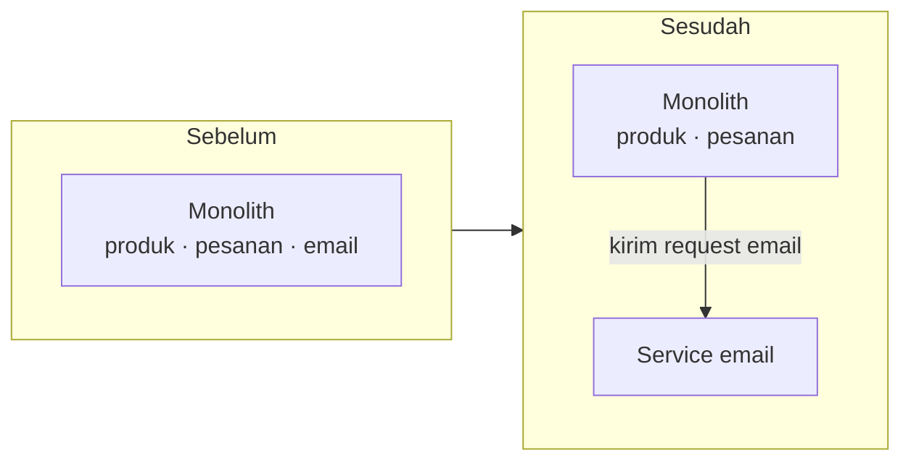

::part[Pelajari Konsepnya]{n="1"}

## 🎯 Yang akan kamu pelajari

- Apa itu **monolith** dan **microservice** sebenarnya, dalam kata-kata mudah
- Kenapa "**monolith dulu**" adalah pilihan aman untuk hampir setiap aplikasi baru
- Sinyal nyata yang menunjukkan sebuah bagian **siap dipisah** jadi service tersendiri
- Biaya tersembunyi dari sebuah split, supaya kamu tidak membayarnya terlalu cepat
- Cara memisah **satu garis seam sekali** bukan semuanya sekaligus

## 🔤 Istilah penting

| Istilah | Artinya (sederhana) |
|---|---|
| **Monolith** | Satu aplikasi utuh, satu kode sumber, di-deploy sebagai satu unit |
| **Microservice** | Aplikasi kecil yang mandiri, punya satu pekerjaan dan datanya sendiri |
| **Deploy** | Menaikkan versi baru aplikasi ke internet |
| **Scale** | Menambah salinan untuk menangani lebih banyak traffic |
| **Coupling** | Seberapa saling bergantung dua bagian satu sama lain |
| **Seam** | Garis potong yang rapi di mana kamu bisa memisah aplikasi jadi dua |
| **Boundary** | Batas kepemilikan sebuah service (datanya dan aturannya) |

## 🧠 Ide besarnya

**Monolith** itu seperti warung satu tempat di mana satu tukang masak membuat semuanya — nasi goreng, es teh, sate — semua dari dapur yang sama. Simpel: satu tempat untuk ubah menu, satu tempat untuk bersih-bersih.

**Microservice** seperti memisah warung jadi beberapa kios spesialis: kios sate, kios minum, kios nasi. Masing-masing punya tukang masak sendiri, stok sendiri, antrean pelanggan sendiri.

Kios spesialis bisa bagus kalau food court sedang ramai dan sibuk. Tapi di hari pertama, dengan sepuluh pelanggan, menjalankan lima kios terpisah malah berarti lima kali setup, lima orang yang harus dibayar, dan makanan yang harus dipindah-pindah antar kios. **Mulai dengan satu warung. Pisah hanya kalau satu dapur sungguh-sungguh tidak cukup.**

## ❓ Kenapa ini penting

Engineer baru sering ingin pakai microservice karena terdengar modern dan "scalable". Tapi microservice bukan folder — itu adalah **aplikasi terpisah** punya deploy sendiri, database sendiri, network call sendiri, cara gagal sendiri. Setiap kali kamu pisah, function call yang sederhana berubah jadi pesan dikirimi lewat jaringan, yang bisa lambat, bisa hilang, atau datang dua kali.

Kalau kamu pisah terlalu cepat:

- Satu fitur sekarang menyentuh **tiga service**, jadi satu perubahan berarti tiga deploy yang harus sejalan.
- Function call yang dulunya perlu mikrodetik jadi **network request** yang bisa timeout.
- Satu database jadi banyak, jadi "join dua tabel" berubah jadi "panggil service lain dan berharap dia jawab".
- Kamu habiskan waktu di plumbing (jaringan, retry, tracing) bukan di produk.

Kalau kamu tahan monolith terlalu lama, sakitnya berbeda dan jauh lebih lembut: kode jadi besar, dan deploy menyentuh semuanya. Itu sakit yang nyata, tapi **mudah dilihat dan mudah diperbaiki nanti**. Pisah terlalu cepat adalah kesalahan yang lebih mahal, karena membatalkannya sulit. Jadi urutan yang aman: **monolith dulu, pisah dengan bukti.**

## 📖 Langkah demi langkah

### 1. Apa arti "satu aplikasi" sebenarnya

Monolith itu satu unit yang bisa di-deploy. Di dalamnya, boleh tetap rapi: folder atau modul terpisah untuk produk, pesanan, pembayaran. Struktur internal yang bagus (layered architecture yang sudah kamu pelajari) memberimu sebagian besar manfaat "terorganisir" dari microservice **tanpa** jaringan di antaranya.

> Monolith yang terorganisir dengan baik mengalahkan tumpukan microservice yang berantakan hampir setiap kali. Modul bersih dulu; aplikasi terpisah nanti, hanya kalau perlu.

### 2. Biaya yang dibawa sebuah split

Sebelum kamu pisah apa pun, jujur tentang apa yang diminta service kedua:

| Dulu (monolith) | Sekarang (dua service) |
|---|---|
| Function call | Network request yang bisa gagal, timeout, atau terulang |
| Satu database, join nyata | Dua database; data disalin atau diambil lewat jaringan |
| Satu deploy | Dua deploy yang harus tetap cocok |
| Satu log untuk dibaca | Dua log; kamu butuh tracing untuk ikuti satu request |
| Satu hal untuk jalan di lokal | Dua (atau lebih) aplikasi untuk dijalankan sebelum bisa tes |

Tidak ada yang mustahil — perusahaan besar melakukannya setiap hari. Tapi itu adalah **kerja yang tidak kamu dapat gratis**, jadi harus membeli sesuatu yang nyata.

### 3. Sinyal nyata untuk pisah

Pisah satu bagian hanya kalau setidak-tidaknya beberapa ini jelas benar:

- **Kebutuhan scaling berbeda.** Satu bagian dipukul jauh lebih keras dari sisanya. Contoh: proses gambar yang makan CPU sementara rest aplikasi idle. Memisah membiarkan kamu tambah salinan *hanya* bagian itu.
- **Tim terpisah memilikinya.** Tim lain ingin deploy sesuai jadwal mereka tanpa tunggu jadwalmu. Batas software sering mengikuti batas tim.
- **Kecepatan rilis berbeda.** Satu bagian berubah tiap hari; bagian lain stabil berbulan-bulan. Memisah membiarkan bagian cepat rilis tanpa re-deploy bagian lambat.
- **Garis data jelas.** Bagian itu punya datanya sendiri dan hampir tidak menyentuh sisanya. Kalau dua bagian terus-terusan perlu tabel satu sama lain, mereka tidak benar-benar terpisah — tahan bersama.

Perhatikan apa yang **bukan** di daftar: "terasa lebih bersih", "microservice adalah best practice", "mungkin kita perlu scale nanti". Itu tebakan, bukan bukti.

### 4. Pisah satu seam sekali jalan

Kalau kamu memang pisah, jangan ledakkan monolith jadi sepuluh service dalam seminggu. Cari **satu seam yang bersih** — biasanya bagian dengan batas jelas, seperti kirim email, proses gambar, atau buat laporan — dan angkat itu saja. Ini pendekatan *strangler*: tumbuhkan service baru di sekeliling satu tepi aplikasi lama sementara semuanya tetap bekerja, seperti jalan baru dibangun di sebelah jalan lama sebelum ada lane yang ditutup.

Deploy satu split, hidup dengannya sebentar, pelajari apa yang dia bayarkan — *lalu* putuskan apakah seam berikutnya layak.

### Memilih setup-mu

- ✅ Aplikasi baru, tim kecil, masih pelajari domain → **satu monolith**, modul bersih di dalamnya.
- ✅ Sudut yang sarat CPU atau jarang berubah punya datanya sendiri → calon untuk dipisah nanti.
- 🚫 "Mungkin kita scale nanti" tanpa angka → belum.
- 🚫 Dua bagian yang terus-terusan baca data satu sama lain → tahan bersama.

## ⚠️ Kesalahan umum

- Mulai proyek brand-new sebagai lima microservice "untuk bisa scale" — sebelum tahu produknya.
- Pisah per lapis teknis (service "database", service "logic") bukan per kemampuan bisnis (pesanan, pembayaran) — ini kaitkan setiap fitur di semua service.
- Beri dua service **database yang sama**. Kalau mereka bagikan tabel, mereka satu service dengan dua jas; ubah ke tabel rusak keduanya.
- Pisah bagian yang terus-terusan butuh sisa data aplikasi, ubah join murah jadi network call lambat.

## 🏆 Praktik terbaik

- [ ] Default **satu monolith** dengan modul internal yang bersih; buat mudah untuk ubah dulu.
- [ ] Pisah hanya kalau kamu bisa sebutkan **sinyal nyata** (scaling, tim, kecepatan rilis, batas data).
- [ ] Pisah **satu seam sekali jalan**, dimulai dengan bagian yang punya datanya sendiri.
- [ ] Beri setiap service **database-nya sendiri**; jangan pernah bagikan tabel antar service.
- [ ] Gambar batas di sekeliling **kemampuan bisnis**, bukan lapis teknis.
- [ ] Tulis apa yang diminta split sebelum pisah hal berikutnya.

:::revoshop
1. **Sebutkan seam-seam-nya.** RevoShop adalah monolith hari ini. Daftar bagian-bagiannya (produk, keranjang, pesanan, auth, pembayaran/webhook Midtrans). Untuk setiap, tanya: apakah punya datanya sendiri, atau terus-terusan baca tabel bagian lain?
2. **Cari calon terbaik.** Bagian mana punya batas paling bersih dan bisa jalan sendiri — misalnya, tangani webhook Midtrans, atau kirim email pesanan? Tulis satu kalimat kenapa itu seam paling bersih.
3. **Sebutkan biayanya.** Kalau kamu pisah bagian itu, daftar dua masalah baru yang harus kamu selesaikan (mis. "service webhook harus panggil balik pesanan lewat jaringan — gimana kalau dia down?").
4. **Putuskan jujur.** Sesuai ukuran RevoShop dan satu orang yang urus, apakah split layak sekarang? "Tidak, tahan monolith" adalah jawaban yang kuat dan benar — sebutkan kenapa.
:::

::part[Jelaskan & Rancang]{n="2"}

## 🗣️ Jelaskan

Rekan kerja bilang: "Mari buat fitur baru sebagai tiga microservice jadi scalable sejak hari satu." Jelaskan, pakai analogi warung, kenapa kamu mulai dengan satu aplikasi — dan bukti apa yang akan ubah pikiran kamu.

## 📐 Rancang

Pilih satu bagian RevoShop yang mungkin suatu hari kamu pisah (contoh, service gambar/thumbnail). Jelaskan: data apa yang punya, apa yang butuh minta ke monolith, monolith panggil dia gimana, dan satu hal yang **jadi lebih sulit** setelah split. Lalu putuskan: pisah sekarang, atau nanti?

:::quiz
Lihat contoh jawaban

Service thumbnail bisa punya gambar yang di-upload dan ukuran yang di-generate. Dia hampir tidak butuh apa pun dari monolith — cuma gambar dan product id — jadi batas data bersih, dan resize gambar itu CPU-heavy, jadi scaling terpisah membantu. Monolith kirimkan permintaan "buat thumbnail gambar ini" ke dia (async bagus — produk bisa tampilkan placeholder sampai siap).

Apa yang jadi lebih sulit: kalau service thumbnail down, upload tetap harus sukses dan retry nanti; dan sekarang kamu punya dua aplikasi untuk jalankan di lokal. Sesuai RevoShop kecil dan beban gambar ringan, panggilan jujur **nanti** — catat sebagai seam masa depan, bukan kerja hari ini.
:::

### 📝 Checklist review mandiri

- [ ] Service calon punya datanya sendiri
- [ ] Saya sebutkan sinyal nyata (scaling, tim, kecepatan rilis, atau batas data)
- [ ] Saya sebutkan setidak-tidaknya satu biaya baru yang dibawa split

::ai-review{task="design"}

::part[Latihan Kecil]{n="3"}

:::exercise{path="exercises/m5/w5/01-should-split" ai="no-ai" title="Putuskan apakah harus pisah service"}
Tulis `should_extract_service(signals)` yang merekomendasikan split **hanya** kalau ada bukti nyata — setidak-tidaknya dua sinyal independen — dan jangan pernah sementara tim masih cari batas (monolith dulu). Kembalikan keputusan dan alasan di baliknya.
:::

:::hints
- Mulai dengan periksa pengaman: kalau `still_finding_boundaries` benar, kembalikan `False` cepat dengan alasan jelas — tidak peduli apakah yang lain set.
- Kumpulkan alasan untuk sinyal yang *benar* jadi satu daftar dulu, lalu putuskan berdasarkan berapa banyak ada.
- "Setidak-tidaknya dua" berarti `len(reasons) >= 2`.
:::

## ✅ Cek cepat

:::quiz
Kenapa pisah terlalu cepat lebih berbahaya daripada pisah terlalu lama?

Pisah terlalu lama beri kamu monolith besar-tapi-teratur — mengesalkan, tapi mudah dilihat dan mudah diperbaiki dengan ekstrak service nanti. Pisah terlalu cepat sebar satu fitur di banyak aplikasi dengan network call, database terpisah dan deploy yang harus sejalan, dan gabung balik mereka sulit. Kesalahan murah adalah yang bisa kamu batalkan.
:::

:::quiz
Dua bagian aplikasi kamu terus-terusan baca dan tulis tabel satu sama lain. Apakah mereka pasangan bagus untuk dipisah jadi dua service?

Tidak. Akses data bersama yang terus-terusan berarti mereka saling kait erat — sungguh-sungguh satu hal. Memisah mereka ubah join database murah jadi network call lambat yang bisa gagal. Tahan bersama sampai garis datanya benar-benar bersih.
:::

## 📚 Lanjut belajar

- [Martin Fowler: Monolith First](https://martinfowler.com/bliki/MonolithFirst.html)
- [Martin Fowler: Microservice Trade-Offs](https://martinfowler.com/articles/microservice-trade-offs.html)
- [Sam Newman: Strangler Fig application](https://martinfowler.com/bliki/StranglerFigApplication.html)
