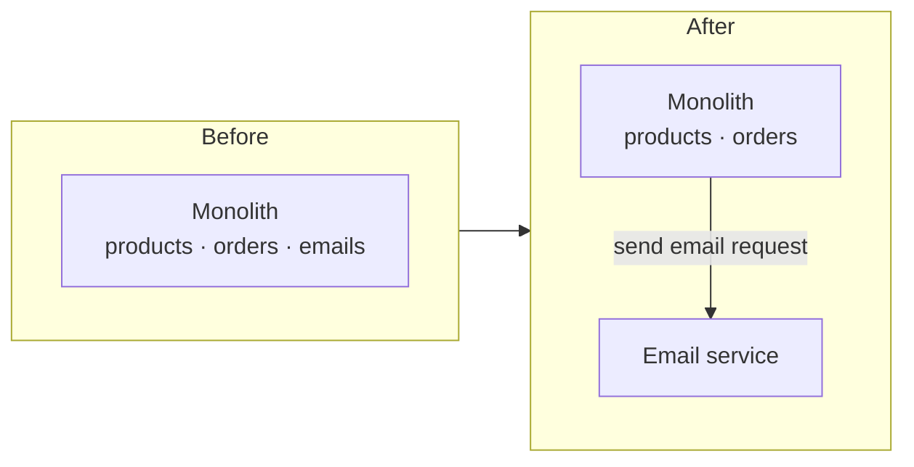

::part[Learn the Concept]{n="1"}

## 🎯 What you'll learn

- What a **monolith** and a **microservice** really are, in plain words
- Why "**monolith first**" is the safe default for almost every new app
- The real signals that a piece is **ready to split** into its own service
- The hidden costs a split adds, so you don't pay them too early
- How to split **one seam at a time** instead of all at once

## 🔤 Key words

| Word | In simple words | Bahasa Indonesia |
|---|---|---|
| **Monolith** | One app, one codebase, deployed as one unit | Satu aplikasi utuh |
| **Microservice** | A small separate app that owns one job and its own data | Layanan kecil mandiri |
| **Deploy** | Put a new version of the app online | Menaikkan versi baru |
| **Scale** | Add more copies to handle more traffic | Menambah kapasitas |
| **Coupling** | How tightly two parts depend on each other | Seberapa saling bergantung |
| **Seam** | A clean line where you could cut the app in two | Garis potong yang rapi |
| **Boundary** | The edge of what a service owns (its data and rules) | Batas milik sebuah layanan |

## 🧠 The big idea

A **monolith** is one warung where one cook makes everything — nasi goreng, es teh, sate — all from a single kitchen. It is simple: one place to change the menu, one place to clean up.

**Microservices** are like splitting that warung into separate specialist stalls: a sate stall, a drinks stall, a rice stall. Each has its own cook, its own supplies, its own line of customers.

Specialist stalls can be great when the food court is huge and busy. But on your first day, with ten customers, running five separate stalls just means five times the setup, five people to pay, and food that has to be carried between stalls. **Start with one warung. Split only when one kitchen truly can't keep up.**

## ❓ Why it matters

New engineers often reach for microservices because they sound modern and "scalable". But a microservice is not a folder — it is a **separate app** with its own deploy, its own database, its own network calls, its own way to fail. Every split you make turns a simple function call into a message sent across the network, which can be slow, or lost, or arrive twice.

If you split too early:

- A single feature now touches **three services**, so one change means three deploys that must line up.
- A function call that used to take a microsecond becomes a **network request** that can time out.
- One database becomes many, so a simple "join two tables" turns into "call another service and hope it answers".
- You spend your time on plumbing (networking, retries, tracing) instead of on the product.

If you keep one monolith too long, the pain is different and much gentler: the codebase gets big, and deploys touch everything. That pain is real, but it is **easy to see and easy to fix later**. Splitting too early is the more expensive mistake, because undoing it is hard. So the safe order is: **monolith first, split on evidence.**

## 📖 Step by step

### 1. What "one app" actually means

A monolith is one deployable unit. Inside, it can still be tidy: separate folders or modules for products, orders, payments. Good internal structure (the layered architecture you already learned) gives you most of the "organized" benefit of microservices **without** the network in between.

> A well-organized monolith beats a messy pile of microservices almost every time. Clean modules first; separate apps later, only if needed.

### 2. The costs a split adds

Before you split anything, be honest about what a second service costs you:

| You had (monolith) | You now have (two services) |
|---|---|
| A function call | A network request that can fail, time out, or repeat |
| One database, real joins | Two databases; data copied or fetched across the wire |
| One deploy | Two deploys that must stay compatible |
| One log to read | Two logs; you need tracing to follow one request |
| One thing to run locally | Two (or more) apps to start before you can test |

None of this is impossible — big companies do it every day. But it is **work you don't get for free**, so it needs to buy you something real.

### 3. The real signals to split

Split a piece off only when at least a couple of these are clearly true:

- **Different scaling needs.** One part is hammered far harder than the rest. Example: image processing that eats CPU while the rest of the app is idle. Splitting lets you add copies of *just* that part.
- **A separate team owns it.** A different team wants to deploy on their own schedule without waiting for yours. Software boundaries often follow team boundaries.
- **Different release speed.** One part changes daily; another is stable for months. Splitting lets the fast part ship without redeploying the slow part.
- **A clear data boundary.** The piece owns its own data and barely touches the rest. If two parts constantly need each other's tables, they are not really separate — keep them together.

Notice what is **not** on the list: "it feels cleaner", "microservices are best practice", "we might need to scale one day". Those are guesses, not evidence.

### 4. Split one seam at a time

When you do split, don't explode the monolith into ten services over a weekend. Find **one clean seam** — usually a part with a clear boundary, like sending emails, processing images, or generating reports — and lift out just that. This is the *strangler* approach: grow the new service around one edge of the old app while everything else keeps working, like a new road built beside the old one before any lane is closed.

Ship one split, live with it for a while, learn what it cost you — *then* decide if the next seam is worth it.

### Choosing your setup

- ✅ New app, small team, still learning the domain → **one monolith**, clean modules inside.
- ✅ A CPU-heavy or rarely-changing corner with its own data → a candidate to split later.
- 🚫 "We might scale someday" with no numbers → not yet.
- 🚫 Two parts that constantly read each other's data → keep them together.

## ⚠️ Common mistakes

- Starting a brand-new project as five microservices "to be scalable" — before you even know the product.
- Splitting by technical layer (a "database service", a "logic service") instead of by business capability (orders, payments) — this couples every feature across all services.
- Giving two services the **same** database. If they share tables, they are one service wearing two coats; a change to the table breaks both.
- Splitting a part that constantly needs the rest of the app's data, turning cheap joins into slow network calls.

## 🏆 Best practices

- [ ] Default to **one monolith** with clean internal modules; make it easy to change first.
- [ ] Split only when you can name a **real signal** (scaling, team, release speed, data boundary).
- [ ] Split **one seam at a time**, starting with a part that owns its own data.
- [ ] Give each service its **own database**; never share tables between services.
- [ ] Draw the boundary around a **business capability**, not a technical layer.
- [ ] Write down what the split cost you before splitting the next thing.

:::revoshop
1. **Name the seams.** RevoShop is a monolith today. List its parts (products, cart, orders, auth, payments/Midtrans webhooks). For each, ask: does it own its own data, or does it constantly read other parts' tables?
2. **Find the best candidate.** Which single part has the cleanest boundary and could run on its own — for example, handling Midtrans webhooks, or sending order emails? Write one sentence on *why* it's the cleanest seam.
3. **Name the cost.** If you split that part out, list two new problems you'd have to solve (e.g. "the webhook service must call back into orders over the network — what if it's down?").
4. **Decide honestly.** Given RevoShop's size and that one person maintains it, is splitting worth it right now? "No, keep the monolith" is a strong, correct answer here — say why.
:::

::part[Explain & Design]{n="2"}

## 🗣️ Explain it

A teammate says: "Let's build the new feature as three microservices so it's scalable from day one." Explain, using the warung analogy, why you'd start with one app instead — and what evidence would change your mind.

## 📐 Design it

Pick one part of RevoShop you might one day split (for example, an image/thumbnail service). Describe: what data it would own, what it would need to ask the monolith for, how the monolith would call it, and one thing that gets *harder* after the split. Then decide: split now, or later?

:::quiz
Show a possible answer

A thumbnail service could own uploaded images and their generated sizes. It needs almost nothing from the monolith — just an image and a product id — so the data boundary is clean, and image resizing is CPU-heavy, so separate scaling helps. The monolith would send it a "make thumbnails for this image" request (async is fine — the product can show a placeholder until they're ready).

What gets harder: if the thumbnail service is down, uploads must still succeed and retry later; and you now have two apps to run locally. Given RevoShop is small and image load is light, the honest call is **later** — note it as a future seam, not today's work.
:::

### 📝 Self-review checklist

- [ ] The candidate service owns its own data
- [ ] I named a real signal (scaling, team, release speed, or data boundary)
- [ ] I named at least one new cost the split adds

::ai-review{task="design"}

::part[Toy Exercise]{n="3"}

:::exercise{path="exercises/m5/w5/01-should-split" ai="no-ai" title="Decide whether to split a service"}
Write `should_extract_service(signals)` that recommends a split **only** when there is real evidence — at least two independent signals — and never while the team is still finding the boundaries (monolith first). Return the decision and the reasons behind it.
:::

:::hints
- Start by handling the guard: if `still_finding_boundaries` is true, return `False` early with a clear reason — no matter what else is set.
- Collect the reasons for the *true* signals into a list first, then decide based on how many there are.
- "At least two" means `len(reasons) >= 2`.
:::

## ✅ Quick check

:::quiz
Why is splitting too early more dangerous than splitting too late?

Splitting too late gives you a big-but-organized monolith — annoying, but easy to see and easy to fix by extracting a service later. Splitting too early scatters one feature across many apps with network calls, separate databases and lined-up deploys, and merging them back together is hard. The cheap mistake is the one you can undo.
:::

:::quiz
Two parts of your app constantly read and write each other's tables. Are they a good pair to split into two services?

No. Constant shared-data access means they are tightly coupled — really one thing. Splitting them turns cheap database joins into slow, failure-prone network calls. Keep them together until the data boundary is genuinely clean.
:::

## 📚 Keep learning

- [Martin Fowler: Monolith First](https://martinfowler.com/bliki/MonolithFirst.html)
- [Martin Fowler: Microservice Trade-Offs](https://martinfowler.com/articles/microservice-trade-offs.html)
- [Sam Newman: Strangler Fig application](https://martinfowler.com/bliki/StranglerFigApplication.html)
