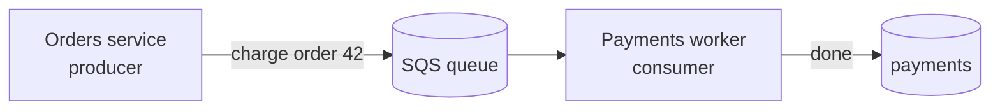

::part[Pelajari Konsepnya]{n="1"}

## 🎯 Yang akan kamu pelajari

- Dua cara service berkomunikasi: **synchronous** (panggil dan tunggu) vs **asynchronous** (kirim dan lanjut)
- Kenapa **queue** seperti shock absorber untuk traffic spike dan gangguan
- Harga dari async: pesan bisa datang **terlambat, tidak urut, atau lebih dari satu kali**
- Apa itu **at-least-once delivery** dan kenapa ia memaksa kamu membuat handler **idempotent**
- Cara memilih sync atau async untuk pekerjaan tertentu

## 🔤 Istilah penting

| Istilah | Artinya (sederhana) |
|---|---|
| **Synchronous** | Kamu panggil dan tunggu jawaban sebelum melakukan hal lain |
| **Asynchronous** | Kamu kirim pesan dan lanjut; pekerjaan terjadi nanti |
| **Queue** | Antrean yang menyimpan pesan sampai worker siap |
| **Producer / Consumer** | Pihak yang mengirim pesan / yang memprosesnya |
| **At-least-once** | Setiap pesan tiba, tapi kadang lebih dari satu kali |
| **Idempotent** | Mengerjakannya dua kali punya hasil sama seperti sekali |
| **SQS** | Layanan antrean terkelola milik Amazon |

## 🧠 Ide besarnya

**Synchronous** seperti memesan di kasir dan berdiri di sana sampai koki menyerahkan piringmu. Sederhana — kamu dapat makanan dan jawaban langsung. Tapi kamu tidak bisa apa-apa saat menunggu, dan kalau koki lambat, semua orang di belakangmu terjebak.

**Asynchronous** seperti mengambil buzzer dan duduk santai. Kamu drop pesananmu di antrean lalu pergi bebas. Dapur bekerja melalui pesanan dengan kecepatan sendiri dan buzz kamu saat saatnya. Kalau rush datang, pesanan numpuk di antrean daripada membuat semua orang di kasir terpaksa menunggu.

Sebuah **queue** (seperti Amazon **SQS**) adalah sistem tiket antara service: pengirim drop pesan dan lanjut; worker mengambilnya saat bisa.

## ❓ Kenapa ini penting

Saat satu service memanggil yang lain dan *menunggu* (synchronous), nasib mereka terikat. Kalau Payments service lambat, Orders service — menunggu di barisan — jadi lambat juga. Kalau Payments *down*, Orders tidak bisa selesai sama sekali. Dan kalau 1.000 pesanan datang sekaligus, semua 1.000 itu pukul Payments sekaligus dan mungkin jatuhkan dia.

Sebuah queue memutus rantai itu:

- **Ia menyerap spike.** 1.000 pesanan masuk antrean dalam satu detik; worker mengerjakannya steady di 50 per detik. Tidak ada yang ditolak — mereka hanya tunggu sebentar.
- **Ia bertahan saat gangguan.** Kalau Payments down dua menit, pesan duduk aman di antrean dan diproses saat dia kembali. Tidak ada yang hilang.
- **Ia pisahkan kecepatan.** Pengirim tidak tunggu pekerjaan yang lambat; ia kembali ke pengguna langsung ("Pesanan diterima!") sementara pekerjaan berat terjadi di background.

Tapi kebebasan ini punya harga, dan pura-pura tidak punya adalah tempat pemula terjepit. Dengan queue kamu serahkan jawaban instant dan order sederhana. Pesan bisa tiba **beberapa detik terlambat**, **tidak urut**, dan — yang paling penting — **lebih dari satu kali**. Kalau worker-mu charge kartu kredit setiap kali lihat pesan "charge pesanan ini", duplikasi delivery berarti **double charge**. Jadi async bukan "scalability gratis"; ia trade: kamu dapat ketangguhan (resilience), dan sebagai gantinya kamu harus rancang untuk delay dan duplikasi.

## 📖 Langkah demi langkah

### 1. Kedua bentuk, berdampingan

| | Synchronous (REST call) | Asynchronous (queue / SQS) |
|---|---|---|
| Pengirim melakukan | panggil, lalu **tunggu** jawaban | drop pesan, **lanjut** |
| Cocok untuk | "aku butuh jawaban sekarang" (ambil harga, login) | "lakukan pekerjaan ini, aku tidak perlu tunggu" (kirim email, ubah ukuran gambar) |
| Kalau receiver lambat | pengirim lambat juga | pesan cuma tunggu di antrean |
| Kalau receiver down | panggilan gagal sekarang | pesan tunggu, diproses nanti |
| Traffic spike | pukul receiver sekaligus | buffer, drain steady |
| Jawaban | langsung | nanti (atau lewat pesan/event lain) |
| Kompleksitas | rendah | lebih tinggi — delay, retry, duplikasi |

### 2. Apa yang queue terlihat dalam praktik



Orders service kembali ke customer langsung setelah drop pesan. Payments worker baca dari queue dengan kecepatan sendiri. Rush pesanan cuma bikin antrean lebih panjang sebentar.

### 3. At-least-once delivery (gotcha besar)

Sebagian besar queue asli, termasuk SQS, janjikan **at-least-once** delivery: setiap pesan *pasti* diproses, tapi kadang pesan yang sama dikirim **dua kali** (misalnya, worker proses tapi crash sebelum bilang ke queue "selesai", jadi queue keluarkan lagi).

Ini berarti worker-mu *pasti* kadang lihat pesan yang sama dua kali. Kalau proses tidak aman diulang, kamu dapat double charge, double email, double kurang stok.

### 4. Solusinya: handler idempotent

**Idempotent** artinya "aman diulang" — jalankan dua kali punya hasil sama seperti satu kali. Matikan lampu dengan switch itu idempotent (flip ke off dua kali, masih off). Tambah uang ke saldo *bukan* (lakukan dua kali, kamu tambah dua kali).

Trik biasanya: kasih setiap pesan unique **id**, ingat id yang sudah kamu handle, dan **skip duplikasi**:

```python
def handle(message):
    if already_processed(message.id):   # seen this exact message before?
        return                          # skip — do nothing, safely
    charge_card(message.order_id, message.amount)
    mark_processed(message.id)          # remember it
```

Sekarang delivery kedua dari pesan yang sama tidak apa-apa — kartu di-charge tepat satu kali, walaupun pesan tiba dua kali.

### 5. Dapatkan jawaban kembali

Dengan sync, jawaban balik langsung. Dengan async, pengirim sudah lanjut — jadi bagaimana orang belajar hasilnya? Biasanya lewat pesan lain: Payments worker, saat selesai, publish event "pembayaran sukses untuk pesanan 42", dan Orders update status pesanan saat terima. Halaman pengguna tampilkan "Processing…" dan berubah ke "Paid" sebentar kemudian.

### Pilih setup-mu

- ✅ **Synchronous** saat caller benar-benar butuh jawaban untuk lanjut: login, baca harga, validasi form.
- ✅ **Asynchronous** untuk pekerjaan lambat atau spike di background yang pengguna tidak perlu tunggu: kirim email, buat invoice, ubah ukuran gambar, panggil pihak ketiga yang tidak stabil.
- 🚫 Jangan buat pengguna tunggu di kasir untuk pekerjaan yang tidak perlu mereka selesai sekarang.
- 🚫 Jangan ambil queue kalau function call sederhana dan cepat cukup — ini tambah kompleksitas nyata.

## ⚠️ Kesalahan umum

- Perlakukan queue sebagai "free scaling" dan lupa pesan bisa tiba **dua kali** → double charge.
- Tulis worker yang bukan **idempotent**, lalu kaget duplikasi side effect.
- Anggap pesan tiba **berurutan** — biasanya tidak; jangan bergantung.
- Pakai async untuk sesuatu yang pengguna lihat dan butuh *sekarang*, jadi mereka lihat layar basi.
- Hilangkan kegagalan senyap: pesan yang terus gagal harus pergi ke **dead-letter queue** untuk manusia periksa, bukan hilang.

## 🏆 Praktik terbaik

- [ ] Pakai **sync** untuk "aku butuh jawaban sekarang", **async** untuk pekerjaan lambat atau spike di background.
- [ ] Anggap **at-least-once**: kasih setiap pesan id dan buat handler **idempotent**.
- [ ] Jangan bergantung pada pesan **urutan**; rancang agar urutan tidak penting.
- [ ] Kembali ke pengguna cepat ("diterima!"), lalu laporkan hasil lewat event atau update status.
- [ ] Kirim pesan yang terus gagal ke **dead-letter queue**; alert manusia.

:::revoshop
1. **Spot the sync pain.** Di RevoShop, pasang pesanan dan ambil pembayaran terjadi di request yang pengguna tunggu. Apa yang pengguna alami kalau provider pembayaran lambat 20 detik? Kalau down?
2. **Pick an async job.** Nama satu bagian RevoShop yang lebih baik sebagai pekerjaan background di balik queue (email konfirmasi pesanan? Proses webhook Midtrans? laporan penjualan?). Kenapa itu?
3. **Design the idempotency.** Midtrans bisa kirim **webhook yang sama lebih dari sekali**. Kalau handler-mu tandai pesanan bayar dan email customer setiap kali api jalan, apa yang salah? Id apa yang kamu dedupe untuk jalankan tepat sekali?
4. **Draw it.** Sketsa alur async: producer → queue → worker → event hasil. Tandai di mana duplikasi bisa masuk dan di mana kamu stop.
:::

::part[Jelaskan & Rancang]{n="2"}

## 🗣️ Jelaskan

Satu rekan kerja bilang "ayo taruh semuanya di queue, queue bikin skalabel". Jelaskan apa yang kamu dapat (spike, gangguan, decouple) dan apa yang sekarang harus kamu handle (delay, tanpa urutan, duplikasi), pakai analogi buzzer.

## 📐 Rancang

Rancang email konfirmasi pesanan RevoShop sebagai pekerjaan async. Sebutkan pesan apa yang order flow kirim, apa yang worker lakukan, apa yang kamu buat idempotent jadi duplikasi delivery tidak email customer dua kali, dan apa yang dilakukan kalau email terus gagal.

:::quiz
Lihat contoh jawaban

Saat pesanan dipasang, order flow drop pesan `{message_id, order_id}` ke antrean dan kembali ke pengguna langsung. Email worker baca, dan **pertama cek apakah sudah kirim email untuk `message_id` ini** (atau untuk `order_id` ini) — kalau ya, stop. Kalau tidak, kirim email dan catat. Jadi duplikasi delivery temukan catatan dan tidak kirim apa-apa. Kalau provider email terus gagal setelah beberapa retry, pesan pergi ke **dead-letter queue** di mana manusia bisa lihat, daripada retry selamanya atau hilang senyap.
:::

### 📝 Checklist review mandiri

- [ ] Pengguna tidak perlu tunggu pekerjaan di background
- [ ] Worker idempotent (duplikasi tidak apa-apa)
- [ ] Kegagalan berulang pergi ke tempat manusia bisa lihat

::ai-review{task="design"}

::part[Latihan Kecil]{n="3"}

:::exercise{path="exercises/m5/w5/03-idempotent-consumer" ai="no-ai" title="Proses setiap pesan tepat sekali"}
Queue kirim pesan pembayaran **minimal satu kali**, jadi duplikasi terjadi. Tulis `apply_once(events)` yang charge setiap unique message id sekali saja — walaupun tiba berkali-kali — dan laporkan id mana yang benar-benar diaplikasi.
:::

:::hints
- Simpan `set` dari message id yang sudah kamu aplikasi.
- Jalan pesan berurutan; skip id yang sudah di set, kalau tidak tambah jumlah-nya dan catat id-nya.
- Kembalikan total jalannya dan daftar id yang diaplikasi **dalam urutan pertama kali dilihat**.
:::

## ✅ Cek cepat

:::quiz
SQS kasih "at-least-once" delivery. Kenapa kata "least" itu memaksa kamu tulis handler idempotent?

"At least once" artinya setiap pesan tiba, tapi kadang **lebih dari satu kali**. Jadi worker-mu bakal kadang lihat pesan yang sama dua kali. Kalau handler tidak idempotent (aman diulang), duplikasi itu sebabkan efek duplikasi nyata — charge kedua, email kedua. Buat idempotent (dedupe by message id) berarti ulang tidak apa-apa.
:::

:::quiz
Kasih satu hal yang kamu dapat dan satu hal yang kamu serahkan dengan pindahkan email pesanan ke queue.

Dapat: pengguna tidak perlu tunggu email kirim lagi, dan kalau provider email down sebentar pesan tunggu aman dan kirim nanti (ketangguhan terhadap spike dan gangguan). Serahkan: email bukan lagi instant, dan kamu harus handle duplikasi delivery jadi customer tidak email dua kali.
:::

## 📚 Lanjut belajar

- [Amazon SQS: How it works](https://docs.aws.amazon.com/AWSSimpleQueueService/latest/SQSDeveloperGuide/sqs-basic-architecture.html)
- [Amazon SQS: At-least-once delivery](https://docs.aws.amazon.com/AWSSimpleQueueService/latest/SQSDeveloperGuide/standard-queues.html)
- [microservices.io: Messaging](https://microservices.io/patterns/communication-style/messaging.html)
