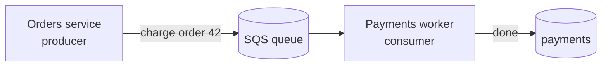

::part[Learn the Concept]{n="1"}

## 🎯 What you'll learn

- The two ways services talk: **synchronous** (call and wait) vs **asynchronous** (send and move on)
- Why a **queue** acts like a shock absorber for traffic spikes and outages
- The price of async: messages can **arrive late, out of order, or more than once**
- What **at-least-once delivery** means and why it forces you to write **idempotent** handlers
- How to choose sync or async for a given job

## 🔤 Key words

| Word | In simple words | Bahasa Indonesia |
|---|---|---|
| **Synchronous** | You call and wait for the answer before doing anything else | Menunggu jawaban |
| **Asynchronous** | You send a message and carry on; the work happens later | Tidak menunggu |
| **Queue** | A line that holds messages until a worker is ready | Antrean pesan |
| **Producer / Consumer** | The one who sends messages / the one who processes them | Pengirim / pemroses |
| **At-least-once** | Every message arrives, but sometimes more than once | Minimal satu kali |
| **Idempotent** | Doing it twice has the same result as doing it once | Aman diulang |
| **SQS** | Amazon's managed queue service | Layanan antrean AWS |

## 🧠 The big idea

**Synchronous** is ordering at the counter and standing there until the cook hands you your plate. Simple — you get the food and an answer right away. But you can't do anything else while you wait, and if the cook is slow, the whole line behind you is stuck.

**Asynchronous** is taking a buzzer and sitting down. You drop your order in the queue and walk away free. The kitchen works through orders at its own pace and buzzes you when yours is ready. If a rush hits, orders pile up in the queue instead of freezing everyone at the counter.

A **queue** (like Amazon **SQS**) is that ticket system between services: the sender drops a message and moves on; a worker picks it up when it can.

## ❓ Why it matters

When one service calls another and *waits* (synchronous), it ties their fates together. If the Payments service is slow, the Orders service — waiting on the line — is slow too. If Payments is *down*, Orders can't finish at all. And if a sudden rush of 1,000 orders arrives, all 1,000 hit Payments at once and may knock it over.

A queue breaks that chain:

- **It absorbs spikes.** 1,000 orders land in the queue in a second; the worker drains them steadily at 50 per second. Nobody is turned away — they just wait a little.
- **It survives outages.** If Payments is down for two minutes, the messages sit safely in the queue and get processed when it comes back. Nothing is lost.
- **It decouples speed.** The sender doesn't wait for the slow work; it returns to the user immediately ("Order received!") while the heavy work happens in the background.

But this freedom has a price, and pretending it doesn't is where beginners get burned. With a queue you give up instant answers and simple ordering. Messages can arrive **seconds late**, **out of order**, and — most importantly — **more than once**. If your worker charges a credit card every time it sees a "charge this order" message, a duplicate delivery means a **double charge**. So async isn't "free scalability"; it's a trade: you gain resilience, and in return you must design for delay and duplicates.

## 📖 Step by step

### 1. The two shapes, side by side

| | Synchronous (REST call) | Asynchronous (queue / SQS) |
|---|---|---|
| Sender does | calls, then **waits** for the reply | drops a message, **moves on** |
| Good for | "I need the answer now" (get a price, log in) | "do this work, I don't need to wait" (send email, resize image) |
| If receiver is slow | sender is slow too | messages just wait in the queue |
| If receiver is down | the call fails now | messages wait, processed later |
| Traffic spike | hits the receiver all at once | buffered, drained steadily |
| Answer | immediate | later (or via another message/event) |
| Complexity | low | higher — delays, retries, duplicates |

### 2. What a queue looks like in practice



The Orders service returns to the customer immediately after dropping the message. The Payments worker reads from the queue at its own pace. A rush of orders just makes the queue longer for a moment.

### 3. At-least-once delivery (the big gotcha)

Most real queues, including SQS, promise **at-least-once** delivery: every message *will* be processed, but occasionally the same message is delivered **twice** (for example, the worker processed it but crashed before telling the queue "done", so the queue hands it out again).

This means your worker **will** sometimes see the same message twice. If processing isn't safe to repeat, you get double charges, double emails, double stock decrements.

### 4. The fix: idempotent handlers

**Idempotent** means "safe to do again" — running it twice gives the same result as running it once. Turning a light switch to *off* is idempotent (flip it to off twice, it's still off). Adding money to a balance is *not* (do it twice, you added twice).

The usual trick: give each message a unique **id**, remember the ids you've already handled, and **skip duplicates**:

```python
def handle(message):
    if already_processed(message.id):   # seen this exact message before?
        return                          # skip — do nothing, safely
    charge_card(message.order_id, message.amount)
    mark_processed(message.id)          # remember it
```

Now a second delivery of the same message does nothing — the card is charged exactly once, even though the message arrived twice.

### 5. Getting the answer back

With sync, the answer comes right back. With async, the sender moved on — so how does anyone learn the result? Usually by another message: the Payments worker, when done, publishes a "payment succeeded for order 42" event, and Orders updates the order's status when it receives it. The user's page shows "Processing…" and flips to "Paid" a moment later.

### Choosing your setup

- ✅ **Synchronous** when the caller genuinely needs the answer to continue: logging in, reading a price, validating a form.
- ✅ **Asynchronous** for slow or spiky background work the user shouldn't wait on: sending emails, generating invoices, resizing images, calling a flaky third party.
- 🚫 Don't make the user wait on the counter for work they don't need finished yet.
- 🚫 Don't reach for a queue when a simple, fast function call would do — it adds real complexity.

## ⚠️ Common mistakes

- Treating a queue as "free scaling" and forgetting messages can arrive **twice** → double charges.
- Writing a worker that isn't **idempotent**, then being surprised by duplicate side effects.
- Assuming messages arrive **in order** — usually they don't; don't depend on it.
- Using async for something the user is staring at and needs *now*, so they see a stale screen.
- Losing failures silently: a message that keeps failing should go to a **dead-letter queue** for a human to inspect, not vanish.

## 🏆 Best practices

- [ ] Use **sync** for "I need the answer now", **async** for slow or spiky background work.
- [ ] Assume **at-least-once**: give every message an id and make handlers **idempotent**.
- [ ] Don't rely on message **order**; design so order doesn't matter.
- [ ] Return to the user fast ("received!"), then report the result via an event or status update.
- [ ] Send messages that keep failing to a **dead-letter queue**; alert a human.

:::revoshop
1. **Spot the sync pain.** In RevoShop, placing an order and taking payment happens in the request the user waits on. What does the user experience if the payment provider is slow for 20 seconds? What if it's down?
2. **Pick an async job.** Name one piece of RevoShop that would be better as a background job behind a queue (order confirmation emails? Midtrans webhook processing? a sales report?). Why that one?
3. **Design the idempotency.** Midtrans can send the **same webhook more than once**. If your handler marks an order paid and emails the customer every time it fires, what goes wrong? What id would you dedupe on so it runs exactly once?
4. **Draw it.** Sketch the async flow: producer → queue → worker → result event. Mark where a duplicate could sneak in and where you stop it.
:::

::part[Explain & Design]{n="2"}

## 🗣️ Explain it

A teammate says "let's put everything on a queue, queues make things scalable". Explain what you actually gain (spikes, outages, decoupling) and what you now have to handle (delays, no ordering, duplicates), using the buzzer analogy.

## 📐 Design it

Design RevoShop's order-confirmation email as an async job. Say what message the order flow sends, what the worker does, how you make it idempotent so a duplicate delivery doesn't email the customer twice, and how a permanently failing email is handled.

:::quiz
Show a possible answer

When an order is placed, the order flow drops a message `{message_id, order_id}` on a queue and returns to the user immediately. An email worker reads it, and **first checks whether it already sent an email for this `message_id`** (or for this `order_id`) — if so, it stops. Otherwise it sends the email and records that it did. So a duplicate delivery finds the record and sends nothing. If the email provider keeps failing after a few retries, the message goes to a **dead-letter queue** where a human can look, instead of retrying forever or silently vanishing.
:::

### 📝 Self-review checklist

- [ ] The user isn't made to wait on the background work
- [ ] The worker is idempotent (a duplicate does nothing)
- [ ] Repeated failures go somewhere a human can see them

::ai-review{task="design"}

::part[Toy Exercise]{n="3"}

:::exercise{path="exercises/m5/w5/03-idempotent-consumer" ai="no-ai" title="Process each message exactly once"}
A queue delivers payment messages **at least once**, so duplicates happen. Write `apply_once(events)` that charges each unique message id only once — even if it arrives several times — and reports which ids were actually applied.
:::

:::hints
- Keep a `set` of message ids you've already applied.
- Walk the events in order; skip any id already in the set, otherwise add its amount and record the id.
- Return the running total and the list of applied ids **in the order they were first seen**.
:::

## ✅ Quick check

:::quiz
SQS gives "at-least-once" delivery. Why does that word "least" force you to write idempotent handlers?

"At least once" means every message arrives, but sometimes **more than once**. So your worker will occasionally see the same message twice. If the handler isn't idempotent (safe to repeat), that duplicate causes a real duplicate effect — a second charge, a second email. Making it idempotent (dedupe by message id) means the repeat does nothing.
:::

:::quiz
Give one thing you gain and one thing you give up by moving order emails onto a queue.

Gain: the user no longer waits for the email to send, and if the email provider is briefly down the messages wait safely and get sent later (resilience to spikes and outages). Give up: the email is no longer instant, and you must handle duplicate deliveries so the customer isn't emailed twice.
:::

## 📚 Keep learning

- [Amazon SQS: How it works](https://docs.aws.amazon.com/AWSSimpleQueueService/latest/SQSDeveloperGuide/sqs-basic-architecture.html)
- [Amazon SQS: At-least-once delivery](https://docs.aws.amazon.com/AWSSimpleQueueService/latest/SQSDeveloperGuide/standard-queues.html)
- [microservices.io: Messaging](https://microservices.io/patterns/communication-style/messaging.html)
