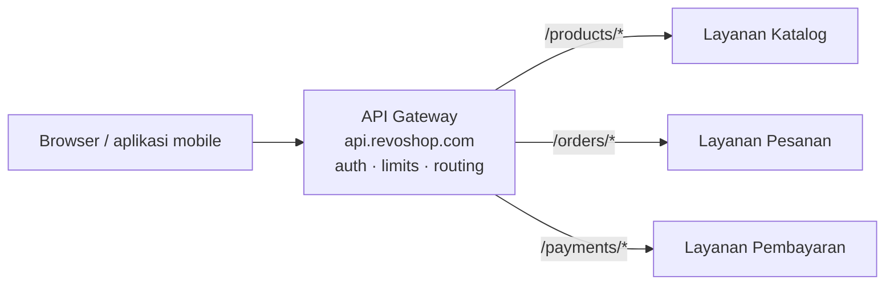

::part[Pelajari Konsepnya]{n="1"}

## 🎯 Yang akan kamu pelajari

- Apa itu **API gateway**: pintu masuk tunggal di depan layananmu
- Kenapa klien harus bicara ke **satu** alamat, bukan langsung ke setiap layanan
- Tugas bersama yang dilakukan gateway: **routing**, **auth**, **rate limiting**, TLS
- Bagaimana **routing** bekerja (mencocokkan path request ke layanan yang tepat)
- Kapan gateway membantu dan kapan terlalu berlebihan

## 🔤 Istilah penting

| Istilah | Artinya (sederhana) |
|---|---|
| **API gateway** | Satu pintu masuk yang meneruskan request ke layanan yang tepat |
| **Route** | Aturan yang mengatakan layanan mana yang menangani path mana |
| **Reverse proxy** | Server yang menerima request dan meneruskannya ke yang lain |
| **Rate limiting** | Membatasi berapa banyak request yang bisa dibuat satu pemanggil |
| **Cross-cutting concern** | Pekerjaan yang banyak layanan bagikan (auth, logging, limit) |
| **Backend** | Layanan internal yang benar-benar mengerjakan pekerjaan |

## 🧠 Ide besarnya

API gateway itu seperti **meja depan di gedung perkantoran besar**. Pengunjung tidak berkeliling cari pintu sampai ketemu departemen yang tepat. Mereka datang ke **satu** meja depan, tunjukkan ID mereka (auth), dan resepsionis menunjuk mereka ke ruangan yang benar. Resepsionis juga menghentikan orang yang datang 500 kali setiap jam (rate limiting) dan membuat buku catatan pengunjung.

Tanpa meja depan, setiap departemen harus punya penjaganya sendiri, cek ID sendiri, buku catatan sendiri — dan setiap pengunjung butuh peta seluruh gedung. Gateway mengerjakan pekerjaan bersama itu **sekali**, di pintu masuk, sehingga ruangan di belakangnya bisa fokus pada pekerjaan mereka.

## ❓ Kenapa ini penting

Begitu kamu punya beberapa layanan, pertanyaan muncul: **klien bicara ke siapa?** Kalau browser atau aplikasi mobile memanggil setiap layanan langsung, kamu dapat kekacauan:

- Klien harus tahu **alamat setiap layanan** — dan alamat itu berubah saat kamu memindahkan sesuatu. Ubah peta internal dan setiap aplikasi rusak.
- **Setiap layanan** harus ulang pekerjaan yang sama: cek token login, terapkan rate limit, hentikan HTTPS, tambah header CORS, tulis access log. Lima layanan berarti lima salinan kode keamanan yang sama — dan kalau satu salah, itu lubangnya.
- Tidak ada **satu tempat** untuk menambah aturan perusahaan ("blokir IP yang jahat ini", "wajib auth di semuanya").

Gateway mengatasi semua itu dengan menjadi satu alamat publik. Klien memanggil `api.revoshop.com` dan tidak pernah tahu tata letak internal. Gateway mengecek auth dan limit **sekali**, lalu meneruskan request ke layanan yang mengatasinya. Layananmu tetap kecil dan pribadi, bebas bergerak dan berubah di balik pintu depan. Trade-off-nya: satu hal lagi yang harus dijalankan, dan kalau gateway mati, semuanya tidak bisa dijangkau — jadi harus sederhana, cepat dan tersedia tinggi.

## 📖 Langkah demi langkah

### 1. Satu pintu publik, banyak ruangan pribadi

Klien hanya melihat gateway. Layanannya tidak punya alamat publik sama sekali — mereka hidup di jaringan pribadi dan hanya gateway yang bisa menjangkaunya.

### 2. Routing: mengirim setiap request ke layanan yang tepat

Gateway memegang **tabel routing**: daftar pola path dan ke layanan mana masing-masing pergi.

| Path dimulai dengan | Pergi ke |
|---|---|
| `/products` | Layanan Katalog |
| `/orders` | Layanan Pesanan |
| `/payments` | Layanan Pembayaran |

Request ke `/orders/42` cocok dengan aturan `/orders` dan diteruskan ke Layanan Pesanan. Saat dua aturan bisa cocok, **yang lebih spesifik (lebih panjang) menang** — `/orders/history` harus mengalahkan `/orders` umum kalau kamu punya keduanya, sama seperti alamat jalan yang lebih tepat mengalahkan "di suatu tempat di jalan itu".

### 3. Tugas bersama yang ditanganinya

Mengerjakan ini **sekali** di gateway membuat layanan bebas darinya:

- **TLS termination** — HTTPS berakhir di gateway; panggilan internal bisa HTTP biasa di jaringan pribadi.
- **Authentication** — cek token login sekali; teruskan id pengguna ke layanan sehingga ia tidak perlu ulang parsing token.
- **Rate limiting** — batas request per klien (kamu sudah membuat sliding-window limiter di Minggu 1 — ini tempat yang natural untuk hidupnya).
- **Logging & tracing** — lampirkan request id di pintu sehingga satu request bisa diikuti di seluruh layanan (materi berikutnya).
- **CORS, batasan ukuran request, cek input dasar** — satu kebijakan konsisten untuk semua.

### 4. Apa yang SEHARUSNYA tidak dilakukannya

Gateway mengarahkan dan menjaga; ia SEHARUSNYA **tidak** pegang logika bisnis. Kalau mulai menentukan harga, validasi pesanan atau jahit data dari tiga layanan bersama, ia jadi monolith kedua — bottleneck yang setiap tim harus edit dan redeploy. Tetap tipis: cocokkan, cek, teruskan.

### 5. Di mana kamu sudah menemui satu

Caddy, yang kamu letakkan di depan RevoShop di Minggu 1, adalah reverse proxy kecil yang mengerjakan bagian dari pekerjaan ini (HTTPS + forwarding). Gateway API penuh menambah routing di banyak layanan, auth dan rate limiting. Di AWS kamu pakai **Amazon API Gateway** atau **Application Load Balancer** dengan aturan routing; idenya identik dengan meja depan.

### Memilih setup-mu

- ✅ Beberapa layanan dan satu atau lebih aplikasi klien → gateway beri satu alamat dan satu tempat untuk aturan bersama.
- ✅ Satu layanan (monolith) → reverse proxy tipis (seperti Caddy) untuk HTTPS cukup; belum butuh gateway penuh.
- 🚫 Jangan letakkan logika bisnis di gateway — tetap tipis.
- 🚫 Jangan biarkan klien memanggil layanan internal langsung dan skip gateway; itu buka kembali setiap masalah yang dipecahkannya.

## ⚠️ Kesalahan umum

- Biarkan klien tahu alamat sungguhan layanan, jadi peta internal bocor dan tidak bisa berubah.
- Ulang **di setiap layanan** implementasi auth dan rate limiting, bukan sekali di gateway.
- Tumbuhkan **gateway gemuk** penuh logika bisnis — monolith baru dan bottleneck tunggal.
- Lupa gateway sekarang adalah titik kegagalan tunggal: harus sederhana dan tersedia tinggi.
- Percaya request **dalam** jaringan membabi buta — gateway jaga pintu, tapi layanan sensitif tetap harus cek siapa yang memanggil.

## 🏆 Praktik terbaik

- [ ] Berikan klien **satu** alamat publik; tetap privat layanan di balik gateway.
- [ ] Kerja bersama sekali di gateway: TLS, auth, rate limiting, logging.
- [ ] Jaga **tabel routing** jelas; biarkan rute paling spesifik menang.
- [ ] Tetap gateway **tipis** — hanya routing dan menjaga, tidak logika bisnis.
- [ ] Buat tersedia tinggi; itu pintu depan ke semuanya.

:::revoshop
1. **Gambar pintu hari ini.** RevoShop jalan di balik Caddy. Apa yang Caddy lakukan untuk kamu sekarang (HTTPS? forward ke satu aplikasi?) dan apa yang gateway penuh tambahkan kalau kamu pisah jadi layanan?
2. **Tulis tabel routing.** Bayangkan RevoShop pisah jadi Katalog, Pesanan dan Pembayaran. Tulis tabel path → layanan yang gateway pakai. Path mana yang publik (`/products`) dan mana yang butuh auth (`/orders`)?
3. **Pindahkan limiter.** Login rate limiter kamu hidup dalam aplikasi sekarang. Kalau punya gateway, kenapa itu rumah yang lebih baik untuknya? Apa yang setiap layanan tidak perlu lagi lakukan?
4. **Tetap tipis.** Nama satu hal yang akan menggoda untuk tambahkan ke gateway tapi sungguhnya milik layanan, dan jelaskan kenapa.
:::

::part[Jelaskan & Rancang]{n="2"}

## 🗣️ Jelaskan

Jelaskan ke rekan kerja kenapa aplikasi mobile harus memanggil **satu** alamat gateway, bukan Katalog, Pesanan dan Pembayaran langsung. Pakai analogi meja depan perkantoran, dan sebut dua tugas bersama yang gateway hemat setiap layanan.

## 📐 Rancang

Rancang tabel routing gateway RevoShop dan kebijakan bersama-nya. Catat rute (path → layanan), tandai mana yang butuh auth, katakan di mana rate limiting dan HTTPS terjadi, dan nama satu hal yang sengaja kamu tetap **keluar** dari gateway.

:::quiz
Lihat contoh jawaban

Rute: `/products/*` → Katalog (publik, read-only), `/orders/*` → Pesanan (auth wajib), `/payments/*` → Pembayaran (auth wajib), `/auth/*` → Auth (publik, rate-limited ketat). HTTPS berakhir di gateway; panggilan internal adalah HTTP biasa di jaringan pribadi. Gateway cek token login sekali dan teruskan id pengguna; ia rate-limit `/auth/login` (5 per 15 menit) dan terapkan batas per-IP umum. Tetap **keluar**: perhitungan total pesanan dan cek stok — itu logika bisnis Pesanan/Katalog; menaruhnya di gateway jadi monolith dan bottleneck.
:::

### 📝 Checklist review mandiri

- [ ] Klien pakai satu alamat; layanan tetap privat
- [ ] Tugas bersama (auth, limit, TLS) terjadi sekali di gateway
- [ ] Gateway tidak pegang logika bisnis

::ai-review{task="design"}

::part[Latihan Kecil]{n="3"}

:::exercise{path="exercises/m5/w5/04-gateway-routing" ai="no-ai" title="Arahkan request ke backend yang tepat"}
Tulis `pick_backend(path, routes)`, jantung tabel routing gateway: diberi path request dan daftar aturan `(prefix, backend)`, teruskan request ke backend dengan **prefix cocok terpanjang** — atau kembalikan `None` (404) saat tidak ada yang cocok.
:::

:::hints
- Aturan cocok saat `path.startswith(prefix)`.
- Di antara semua aturan yang cocok, pilih yang punya **prefix terpanjang** (paling spesifik).
- Kalau tidak ada yang cocok, kembalikan `None`.
:::

## ✅ Cek cepat

:::quiz
Kenapa klien harus memanggil satu alamat gateway, bukan setiap layanan langsung?

Sehingga klien tidak pernah tahu (atau bergantung pada) peta layanan internal, yang bebas berubah; dan sehingga tugas bersama seperti auth, rate limiting dan HTTPS dikerjakan sekali di pintu, bukan disalin — dan mungkin dikerjakan salah — di setiap layanan. Satu alamat, satu tempat untuk aturan bersama.
:::

:::quiz
Dua rute bisa cocok `/orders/history`: aturan untuk `/orders` dan aturan untuk `/orders/history`. Mana yang menang, dan kenapa?

Aturan `/orders/history` menang — prefix terpanjang (paling spesifik). Aturan umum tidak boleh menelan request yang aturan lebih tepat ditulis untuk ditangani, sama seperti alamat jalan yang tepat mengalahkan "suatu tempat di jalan itu".
:::

## 📚 Lanjut belajar

- [microservices.io: API Gateway pattern](https://microservices.io/patterns/apigateway.html)
- [Amazon API Gateway](https://docs.aws.amazon.com/apigateway/latest/developerguide/welcome.html)
- [Caddy: reverse proxy](https://caddyserver.com/docs/caddyfile/directives/reverse_proxy)
